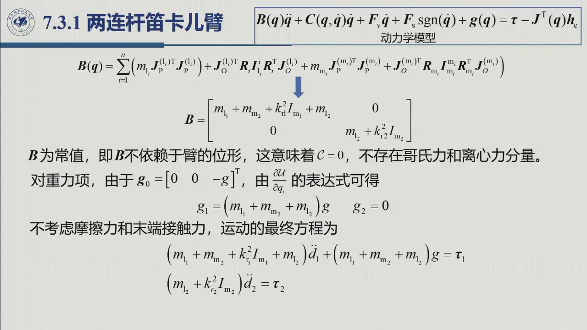

# 6.3.1 两连杆笛卡儿臂

惯性矩阵不一定随构形变化。两个移动关节若沿固定正交方向运动，各质心速度的方向就不随关节位置转动，动能系数可以保持常数。本例先求这组系数，再改变两轴夹角，区分位形依赖与关节耦合。课堂回看：01:23:20–01:23:45，并参照教材§7.3.1。

## 6.3.1.1 结构与广义坐标

关节1沿基系竖直 $z$ 方向移动，位移为 $d_1$；关节2沿水平 $x$ 方向移动，位移为 $d_2$。取 $q=(d_1,d_2)^{\mathrm T}$，单位均为m。连杆1跟随 $d_1$，连杆2同时跟随 $d_1,d_2$。关节2的电机质量 $m_{m_2}$ 由连杆1携带，电机1固定在基座。

这里由旋转电机驱动直线运动，应把 $k_{r_i}=\partial\theta_{m_i}/\partial d_i$ 理解为转角／位移转换系数，单位rad/m，不能当成两转轴之间的无量纲减速比。假设它恒定，则 $\dot\theta_{m_i}=k_{r_i}\dot d_i$。

## 6.3.1.2 雅可比与惯性矩阵

质心位置中的固定偏置求导为零，所以两杆的速度为

$$v_1=\begin{bmatrix}0\\0\\\dot d_1\end{bmatrix},\qquad
v_2=\begin{bmatrix}\dot d_2\\0\\\dot d_1\end{bmatrix}.$$

由[位置雅可比](../recall.md#jacobian-column)也得到

$$J_P^{(1)}=\begin{bmatrix}0&0\\0&0\\1&0\end{bmatrix},\qquad
J_P^{(2)}=\begin{bmatrix}0&1\\0&0\\1&0\end{bmatrix}.$$

两杆不转动，转动动能为零。加上电机2随第一轴平移的动能与两个转子的自转动能：

$$T=\tfrac12(m_1+m_2+m_{m_2})\dot d_1^2+\tfrac12m_2\dot d_2^2
+\tfrac12I_{m_1}k_{r_1}^2\dot d_1^2+\tfrac12I_{m_2}k_{r_2}^2\dot d_2^2.$$

按两种速度的系数收集，得

$$B=\begin{bmatrix}
m_1+m_{m_2}+m_2+k_{r_1}^2I_{m_1}&0\\
0&m_2+k_{r_2}^2I_{m_2}
\end{bmatrix}.$$

这次 $B$ 的单位是等效质量kg，因为输入是直线加速度、输出是力。$k_r^2I_m$ 的单位也确为kg。所有系数与 $d_1,d_2$ 无关，因此 Christoffel系数为零，可取 $C=0$。

## 6.3.1.3 重力项

以 $z$ 朝上，重力向量为 $(0,0,-g)^{\mathrm T}$。只有第一轴改变各移动质量的高度，故

$$U=(m_1+m_2+m_{m_2})gd_1+\text{常数},$$

$$g_1=\frac{\partial U}{\partial d_1}=(m_1+m_2+m_{m_2})g,
\qquad g_2=0.$$

转子自转惯量会增加加速所需的力，但重力仍由需要托举的实际质量决定。$k_r^2I_m$ 是动能中的等效系数，不能作为新增质量计入重量。

## 6.3.1.4 运动方程

忽略摩擦、传动损失与末端接触，有

$$\bigl(m_1+m_{m_2}+m_2+k_{r_1}^2I_{m_1}\bigr)\ddot d_1
+(m_1+m_{m_2}+m_2)g=\tau_1,$$

$$\bigl(m_2+k_{r_2}^2I_{m_2}\bigr)\ddot d_2=\tau_2.$$

这里 $\tau_1,\tau_2$ 是关节广义力，单位N。无耦合项是本例理想几何和模型的结果，实际结构的柔性、摩擦、负载变化仍要另查。

::: note 轴不正交时会发生什么
若两固定单位方向为 $u_1,u_2$，连杆2的速度变成 $u_1\dot d_1+u_2\dot d_2$。其动能展开为

$$T_2=\tfrac12m_2\bigl(\dot d_1^2+2(u_1^{\mathrm T}u_2)\dot d_1\dot d_2+\dot d_2^2\bigr).$$

于是 $b_{12}=m_2u_1^{\mathrm T}u_2$。正交时该项为零，夹角45°时为 $m_2/\sqrt2$。矩阵仍可保持常数，却不再对角，因此“没有速度二次项”不等于“关节完全解耦”。
:::

::: intuition 动手实验 · 位置改变时惯性矩阵是否改变（3D）
改变 $d_1,d_2$，检查矩阵读数是否固定。再不用界面，按上面两根不正交方向的动能式说明：即使读数不随位置变化，第二轴加速仍可能要求第一轴出力。

:::

## 6.3.1.5 小结与常见错误

本例需分别判断动能系数是否随构形改变、交叉速度系数是否为零，以及哪一方向改变重力势能。它们依次决定速度二次项、惯性耦合与重力项；只认出“笛卡儿结构”，还不能省去这些检查。