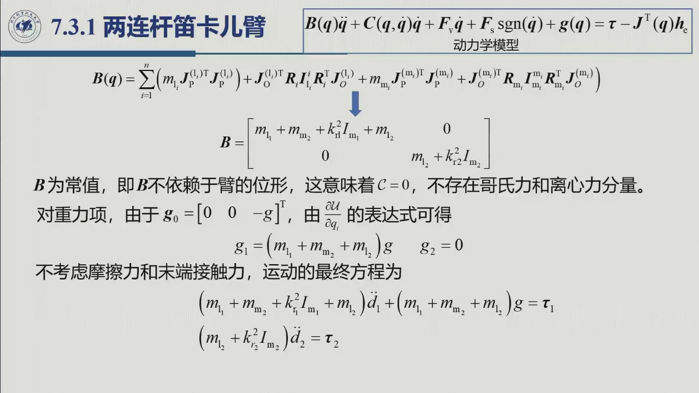

# 6.3.1 两连杆笛卡儿臂

在一般多关节机械臂里，惯性矩阵随位形变，速度耦合项与非对角惯量耦合交织在一起。什么样的机械手能把这几项同时拆干净？下面先算全章最简单的两连杆正交笛卡儿臂，看惯性矩阵何时退化成常数对角阵、$C$ 何时为零，再把第二轴转成斜角，把“没有速度二次项”与“两轴完全解耦”两个条件区分开。课堂回看：01:23:20–01:23:45，并参照教材 §7.3.1。

## 6.3.1.1 结构与广义坐标

两连杆笛卡儿臂（教材图 7.3）由两个移动关节组成：关节 1 沿基系竖直 $z_0$ 方向移动 $d_1$，关节 2 沿水平 $x_0$ 方向移动 $d_2$。取广义坐标 $\boldsymbol q=[d_1,\ d_2]^{\mathrm T}$，单位均为 m。设两连杆质量为 $m_1,m_2$，两转子质量为 $m_{m_1},m_{m_2}$，绕各自轴的转动惯量为 $I_{m_1},I_{m_2}$，并采用标准简化：转子质心在各自关节轴上（电机 1 固定在基座，电机 2 质量 $m_{m_2}$ 随连杆 1 沿 $d_1$ 移动）。

因为两轴用旋转电机驱动直线进给（如丝杠或齿轮齿条），$k_{r_i}=\partial\vartheta_{m_i}/\partial d_i$ 是转角对位移的转换系数，单位 rad/m（不同于两转动轴之间的无量纲减速比）。在恒定传动比下，$\dot\vartheta_{m_i}=k_{r_i}\dot d_i$；乘以惯量 $I_{m_i}\ (\mathrm{kg\cdot m^2})$ 后，$k_{r_i}^2I_{m_i}$ 的单位恰好是 $\mathrm{kg}$（即等效平移质量）。

## 6.3.1.2 雅可比与惯性矩阵

质心位置中的固定偏置求导为零，所以两杆的速度为

$$v_1=\begin{bmatrix}0\\0\\\dot d_1\end{bmatrix},\qquad
v_2=\begin{bmatrix}\dot d_2\\0\\\dot d_1\end{bmatrix}.$$

由第三章[位置雅可比](../recall.md#jacobian-column)（移动关节第 $j$ 列为 $\boldsymbol z_{j-1}$）同样写出：

$$J_P^{(1)}=\begin{bmatrix}0&0\\0&0\\1&0\end{bmatrix},\qquad
J_P^{(2)}=\begin{bmatrix}0&1\\0&0\\1&0\end{bmatrix}.$$

两个连杆只平动不转动（$\boldsymbol\omega_1=\boldsymbol\omega_2=\boldsymbol 0$），故 $J_O^{(1)}=J_O^{(2)}=O$，连杆转动动能为零。转子质心不随连杆 2 以外的轴偏移，这里 $J_P^{(m_1)}=O$、$J_P^{(m_2)}=J_P^{(1)}$（电机 2 随第一轴竖直平移），转子只绕各自驱动轴自转：

$$J_O^{(m_1)}=\begin{bmatrix}0&0\\0&0\\k_{r_1}&0\end{bmatrix},\qquad
J_O^{(m_2)}=\begin{bmatrix}0&0\\0&0\\0&k_{r_2}\end{bmatrix}\ \text{（若按各自的转子轴，第二列取 }k_{r_2}\boldsymbol z_{m_2}\text{，如沿 }x_0\text{ 轴为 }[k_{r_2},0,0]^{\mathrm T}\text{）}.$$

在标量自转动能 $\frac12I_{m_i}\dot\vartheta_{m_i}^2$ 下，转子绕自身轴的单位向量长度为 $1$，两种写法给出同一项 $\frac12I_{m_2}k_{r_2}^2\dot d_2^2$。直接展开总动能 $T=T_1+T_2+T_{m_1}+T_{m_2}$：

$$T=\frac12 m_1\dot d_1^2+\frac12 m_2(\dot d_1^2+\dot d_2^2)
+\frac12 m_{m_2}\dot d_1^2
+\frac12 I_{m_1}k_{r_1}^2\dot d_1^2+\frac12 I_{m_2}k_{r_2}^2\dot d_2^2.$$

按两种速度的系数收集，得

$$B=\begin{bmatrix}
m_1+m_{m_2}+m_2+k_{r_1}^2I_{m_1}&0\\
0&m_2+k_{r_2}^2I_{m_2}
\end{bmatrix}.$$

这里 $B$ 的元素单位是等效质量 kg（输入广义加速度是直线加速度 $\mathrm{m/s^2}$，输出广义力是力 N）。更重要的是，$B$ 中完全不含 $d_1,d_2$，所有偏导 $\partial b_{ij}/\partial q_k\equiv0$，因此 Christoffel 系数 $c_{ijk}\equiv0$、$C=O$——**既没有离心项，也没有科氏项**。

## 6.3.1.3 重力项

以 $z_0$ 竖直向上，重力向量 $\boldsymbol g_0=[0,0,-g]^{\mathrm T}$。关节 2 沿水平 $x_0$ 运动，不改变任何质量的竖直高度；只有第一轴带动连杆 1、转子 2 和连杆 2 一起上升 $d_1$，所以

$$U=(m_1+m_{m_2}+m_2)g\,d_1+\text{常数},$$

$$g_1=\frac{\partial U}{\partial d_1}=(m_1+m_{m_2}+m_2)g,
\qquad g_2=\frac{\partial U}{\partial d_2}=0.$$

注意转子自转的等效质量 $k_{r_1}^2I_{m_1}$ 只进入惯性项，不进入重力项：加速时电机要多输出转动角加速度的能量，静止托举时重力只作用在实际质量 $m_1+m_{m_2}+m_2$ 上。

## 6.3.1.4 运动方程

忽略摩擦、传动损失与末端接触，有

$$\bigl(m_1+m_{m_2}+m_2+k_{r_1}^2I_{m_1}\bigr)\ddot d_1
+(m_1+m_{m_2}+m_2)g=\tau_1,$$

$$\bigl(m_2+k_{r_2}^2I_{m_2}\bigr)\ddot d_2=\tau_2.$$

这里 $\tau_1,\tau_2$ 是关节广义力，单位为 N。两根关节的运动方程各自只出现自己的加速度与力，没有任何耦合项：调节 $\tau_1$ 只改变 $d_1$，调节 $\tau_2$ 只改变 $d_2$，因此每个关节可以分别按单轴系统设计控制器。这一结论依赖两个条件：理想刚性无摩擦假设，以及两移动轴正交。

::: note 解耦的两个条件（缺一不可）
如果两移动轴不再正交，而是分别沿固定单位方向 $\boldsymbol u_1,\boldsymbol u_2$（夹角为 $\alpha$），连杆 2 的线速度变成 $\boldsymbol v_2=\boldsymbol u_1\dot d_1+\boldsymbol u_2\dot d_2$。展开平动动能：

$$T_2=\frac12 m_2\boldsymbol v_2^{\mathrm T}\boldsymbol v_2=\frac12 m_2\bigl(\dot d_1^2+2(\boldsymbol u_1^{\mathrm T}\boldsymbol u_2)\dot d_1\dot d_2+\dot d_2^2\bigr).$$

由此在惯性矩阵中出现非对角项 $b_{12}=m_2\boldsymbol u_1^{\mathrm T}\boldsymbol u_2=m_2\cos\alpha$。正交（$\alpha=90^\circ$）时 $b_{12}=0$；夹角 $\alpha=45^\circ$ 时 $b_{12}=m_2/\sqrt2$（习题 7.1）。此时 $B$ 依然是常数矩阵（$C=O$），但不再对角，关节 2 加速会立刻在关节 1 上产生耦合力 $b_{12}\ddot d_2$。可见**机构类型决定 $B$ 是否随位形变，轴线正交决定 $B$ 是否对角**，“没有速度二次项”不等于“两轴完全解耦”。
:::

::: intuition 动手实验 · 位置改变时惯性矩阵是否改变（3D）
改变 $d_1,d_2$，检查矩阵读数是否固定。再不用界面，按上面两根不正交方向的动能式说明：即使读数不随位置变化，第二轴加速仍可能要求第一轴出力。

:::

## 6.3.1.5 小结与常见错误

两连杆正交笛卡儿臂的两个关节只做平动，故 $B$ 为常数对角阵、$C=O$、$g_1=(m_1+m_{m_2}+m_2)g$、$g_2=0$，两轴完全解耦；下一节的两连杆平面臂加入了转动关节，位形相关惯量、离心/科氏项与重力耦合会一起出现。

::: think 常见错误清单
1. **忘记转子的 $k_r^2I_m$**：它进的是 $B$ 的对角元，漏掉会让加速所需广义力偏小（且直线进给下 $k_r$ 单位为 rad/m）。
2. **把 $g_1$ 写成 $m_1g$ 或混入 $k_r^2I_m$**：关节 1 托起的是它上方全部实际质量 $m_1+m_{m_2}+m_2$，不包括转子转动等效惯量。
3. **以为“笛卡儿移动结构”就一定解耦**：轴不正交时 $B$ 仍为常数，但 $b_{12}=m_2\cos\alpha\neq0$（习题 7.1）。
4. **在 $C$ 上硬算 Christoffel 公式**：$B$ 为常数时所有偏导为零，直接得 $C=O$。
:::