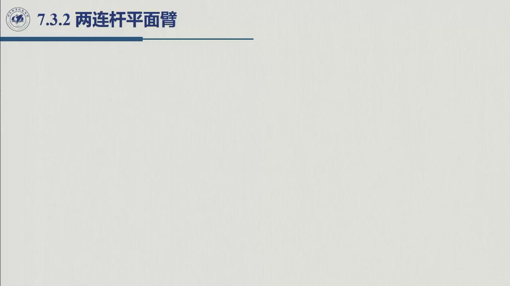
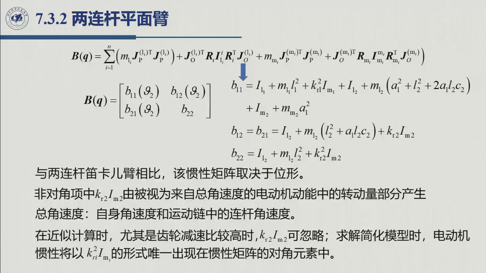
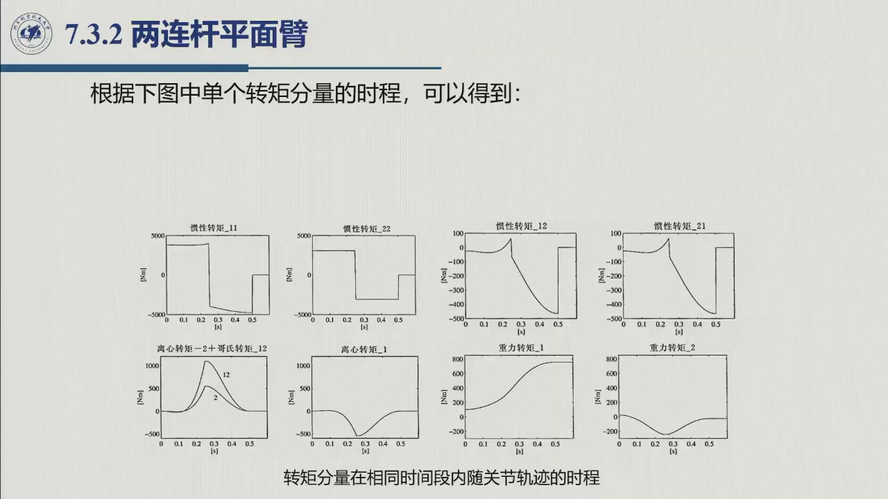

# 6.3.2 两连杆平面臂

> 录播 01:23:45–02:17:20。这是全章**唯一一个手算完整 $B,C,g$ 的例子**，也是考试与作业的主战场：
> 位形相关的惯性矩阵、离心项、科氏项、重力项、Christoffel 符号、回归矩阵，全部在这里第一次落地。
> 教材 §7.3.2 + 例 7.2。

## 6.3.2.1 结构与参数

两连杆平面臂（教材图 7.4）：两个转动关节都在垂直平面内，关节 1 固定在基座，关节 2 装在连杆 1 末端。
取

$$\boldsymbol q=[\vartheta_1,\ \vartheta_2]^{\mathrm T}.$$

| 符号 | 含义 |
|:--|:--|
| $a_1,a_2$ | 两连杆长度 |
| $\ell_1,\ell_2$ | 两连杆质心到各自关节轴的距离 |
| $m_1,m_2$ | 两连杆质量 |
| $m_{m_1},m_{m_2}$ | 两转子质量 |
| $I_1,I_2$ | 两连杆相对各自质心的转动惯量 |
| $I_{m_1},I_{m_2}$ | 两转子绕自身轴的转动惯量 |
| $k_{r_1},k_{r_2}$ | 两关节减速比 |

假设转子质心在关节轴上（$\boldsymbol p_{m_i}=\boldsymbol p_{i-1}$，$\boldsymbol z_{m_i}=\boldsymbol z_{i-1}$）。

## 6.3.2.2 雅可比

平面臂的角速度都沿 $z_0$ 轴，故 $R_i$ 对惯性张量无影响，可用标量惯量 $I_i$。平动雅可比：

$$J_P^{(1)}=\begin{bmatrix}-\ell_1s_1&0\\ \ell_1c_1&0\\0&0\end{bmatrix},\qquad
J_P^{(2)}=\begin{bmatrix}-a_1s_1-\ell_2s_{12}&-\ell_2s_{12}\\
a_1c_1+\ell_2c_{12}&\ell_2c_{12}\\0&0\end{bmatrix},$$

转动雅可比：

$$J_O^{(1)}=\begin{bmatrix}0&0\\0&0\\1&0\end{bmatrix},\qquad
J_O^{(2)}=\begin{bmatrix}0&0\\0&0\\1&1\end{bmatrix}.$$

转子的平动雅可比与角速度雅可比：

$$J_P^{(m_1)}=0,\qquad J_P^{(m_2)}=\begin{bmatrix}-a_1s_1&0\\ a_1c_1&0\\0&0\end{bmatrix},$$

$$J_O^{(m_1)}=\begin{bmatrix}0&0\\0&0\\k_{r_1}&0\end{bmatrix},\qquad
J_O^{(m_2)}=\begin{bmatrix}0&0\\0&0\\1&k_{r_2}\end{bmatrix}.$$

注意 $J_O^{(m_2)}$ 的 $(3,1)$ 元是 $1$ 而不是 $0$：转子 2 的绝对角速度是「连杆 1 的角速度 + 自身相对角速度」，
即 $\omega_{m_2}=\dot\vartheta_1+k_{r_2}\dot\vartheta_2$。**这一项会在 $B$ 的非对角元里留下 $k_{r_2}I_{m_2}$。**

（记号 $s_1=\sin\vartheta_1$，$c_1=\cos\vartheta_1$，$s_{12}=\sin(\vartheta_1+\vartheta_2)$，$c_{12}=\cos(\vartheta_1+\vartheta_2)$。）

## 6.3.2.3 惯性矩阵 $B(\boldsymbol q)$

代入 $B=\sum_i\bigl(m_iJ_P^{(i)\mathrm T}J_P^{(i)}+J_O^{(i)\mathrm T}I_iJ_O^{(i)}
+m_{m_i}J_P^{(m_i)\mathrm T}J_P^{(m_i)}+J_O^{(m_i)\mathrm T}I_{m_i}J_O^{(m_i)}\bigr)$，得

$$B(\boldsymbol q)=\begin{bmatrix}b_{11}(\vartheta_2)&b_{12}(\vartheta_2)\\b_{21}(\vartheta_2)&b_{22}\end{bmatrix},$$

$$b_{11}=I_1+m_1\ell_1^2+k_{r_1}^2I_{m_1}+I_2+m_2\bigl(a_1^2+\ell_2^2+2a_1\ell_2c_2\bigr)+I_{m_2}+m_{m_2}a_1^2,$$

$$b_{12}=b_{21}=I_2+m_2\bigl(\ell_2^2+a_1\ell_2c_2\bigr)+k_{r_2}I_{m_2},$$

$$b_{22}=I_2+m_2\ell_2^2+k_{r_2}^2I_{m_2}.$$

**与笛卡儿臂的三个差别**：

1. $b_{11},b_{12}$ 依赖 $\vartheta_2$（通过 $c_2$）——惯性矩阵**随位形变**；
2. $b_{12}\neq0$——两轴**耦合**；
3. $b_{22}$ 是常数——关节 2 的惯量不随位形变（因为它只受连杆 2 影响），这也解释了例 7.2 中
   「关节 2 的惯性力矩分段恒定」。

::: note $k_{r_2}I_{m_2}$ 这一项的来源（老师专门解释）
它来自转子 2 的**总角速度** $\omega_{m_2}=\dot\vartheta_1+k_{r_2}\dot\vartheta_2$，而不是仅仅 $k_{r_2}\dot\vartheta_2$。
展开 $\frac12I_{m_2}\omega_{m_2}^2$ 会出现交叉项 $I_{m_2}\dot\vartheta_1(k_{r_2}\dot\vartheta_2)$，这就是 $b_{12}$ 里的
$k_{r_2}I_{m_2}$。**高减速比时**这一项相对 $k_{r_2}^2I_{m_2}$ 可以忽略（$1/k_{r_2}$ 量级），
简化模型里转子惯量只留在对角元上——这是第 5 章「减速比把负载折算到关节侧」的同一逻辑。
:::

## 6.3.2.4 Christoffel 符号与 $C$

由 $B$ 的表达式，记

$$h=-m_2a_1\ell_2s_2,$$

则非零的 Christoffel 符号为

$$c_{112}=c_{121}=\frac12\frac{\partial b_{11}}{\partial\vartheta_2}=-m_2a_1\ell_2s_2=h,$$

$$c_{122}=\frac{\partial b_{12}}{\partial\vartheta_2}-\frac12\frac{\partial b_{22}}{\partial\vartheta_1}=h,$$

$$c_{211}=\frac{\partial b_{21}}{\partial\vartheta_1}-\frac12\frac{\partial b_{11}}{\partial\vartheta_2}=-h,$$

其余 $c_{111}=c_{212}=c_{221}=c_{222}=0$。于是

$$C(\boldsymbol q,\dot{\boldsymbol q})=\begin{bmatrix}
h\dot\vartheta_2&h(\dot\vartheta_1+\dot\vartheta_2)\\
-h\dot\vartheta_1&0
\end{bmatrix}.$$

$C\dot{\boldsymbol q}$ 的分量：

$$\bigl(C\dot{\boldsymbol q}\bigr)_1=h\dot\vartheta_2\dot\vartheta_1+h(\dot\vartheta_1+\dot\vartheta_2)\dot\vartheta_2
=h\bigl(2\dot\vartheta_1\dot\vartheta_2+\dot\vartheta_2^2\bigr),$$

$$\bigl(C\dot{\boldsymbol q}\bigr)_2=-h\dot\vartheta_1^2.$$

对照式 (7.82)：关节 1 的速度项是 $-2m_2a_1\ell_2s_2\dot\vartheta_1\dot\vartheta_2-m_2a_1\ell_2s_2\dot\vartheta_2^2$，
关节 2 是 $+m_2a_1\ell_2s_2\dot\vartheta_1^2$，与 $h=-m_2a_1\ell_2s_2$ 的代入一致。

**反对称性验证**：

$$\dot B=\begin{bmatrix}2h\dot\vartheta_2&h\dot\vartheta_2\\h\dot\vartheta_2&0\end{bmatrix},\qquad
N=\dot B-2C=\begin{bmatrix}0&-2h\dot\vartheta_1-h\dot\vartheta_2\\2h\dot\vartheta_1+h\dot\vartheta_2&0\end{bmatrix},$$

确实反对称——这是 [6.2.1](sec6-2-1.md) 的具体例证。

## 6.3.2.5 重力项与完整方程

平面臂取 $y$ 轴竖直向上，$\boldsymbol g_0=[0,-g,0]^{\mathrm T}$。由 $g_i=\partial U/\partial q_i$：

$$g_1=\bigl(m_1\ell_1+m_{m_2}a_1+m_2a_1\bigr)g\cos\vartheta_1+m_2\ell_2g\cos(\vartheta_1+\vartheta_2),$$

$$g_2=m_2\ell_2g\cos(\vartheta_1+\vartheta_2).$$

无摩擦、无末端接触力时，完整方程（教材式 (7.82)）：

$$\begin{aligned}
&\bigl[I_1+m_1\ell_1^2+k_{r_1}^2I_{m_1}+I_2+m_2(a_1^2+\ell_2^2+2a_1\ell_2c_2)+I_{m_2}+m_{m_2}a_1^2\bigr]\ddot\vartheta_1\\
&\quad+\bigl[I_2+m_2(\ell_2^2+a_1\ell_2c_2)+k_{r_2}I_{m_2}\bigr]\ddot\vartheta_2
-2m_2a_1\ell_2s_2\dot\vartheta_1\dot\vartheta_2-m_2a_1\ell_2s_2\dot\vartheta_2^2\\
&\quad+\bigl(m_1\ell_1+m_{m_2}a_1+m_2a_1\bigr)gc_1+m_2\ell_2gc_{12}=\tau_1,
\end{aligned}$$

$$\begin{aligned}
&\bigl[I_2+m_2(\ell_2^2+a_1\ell_2c_2)+k_{r_2}I_{m_2}\bigr]\ddot\vartheta_1
+\bigl[I_2+m_2\ell_2^2+k_{r_2}^2I_{m_2}\bigr]\ddot\vartheta_2\\
&\quad+m_2a_1\ell_2s_2\dot\vartheta_1^2+m_2\ell_2gc_{12}=\tau_2.
\end{aligned}$$

## 6.3.2.6 例 7.2：各项力矩的相对大小

教材例 7.2 给出一组「两连杆完全相同」的数据：

$$a_1=a_2=1\ \mathrm m,\quad \ell_1=\ell_2=0.5\ \mathrm m,\quad m_1=m_2=50\ \mathrm{kg},\quad I_1=I_2=10\ \mathrm{kg\cdot m^2},$$

$$k_{r_1}=k_{r_2}=100,\quad m_{m_1}=m_{m_2}=5\ \mathrm{kg},\quad I_{m_1}=I_{m_2}=0.01\ \mathrm{kg\cdot m^2}.$$

初始位形使末端在 $(0.2,0)$ m（肘下垂），两关节各转 $\pi/2$，用时 $0.5$ s，速度梯形曲线。
仿真结果（教材图 7.5–7.7）给出四条可读的结论：

1. **关节 1 的惯性力矩**随加速度变化（因为 $b_{11}$ 随 $\vartheta_2$ 变，且 $\ddot\vartheta_1$ 本身在变）；
2. **关节 2 的惯性力矩分段恒定**，因为 $b_{22}$ 是常数，只随 $\ddot\vartheta_2$ 的符号跳变；
3. **离心/科氏项**在高速段明显，方向与符号由 $h=-m_2a_1\ell_2s_2$ 决定；
4. **重力项**量级最小但不可忽略，尤其在低速保持阶段。

## 6.3.2.7 参数向量与回归矩阵（8 个参数）

对平面臂，按 [6.2.2](sec6-2-2.md) 的扩展连杆法，可取 8 个参数：

$$\boldsymbol\pi=[\pi_1,\dots,\pi_8]^{\mathrm T},\qquad
\begin{aligned}
\pi_1&=m_1+m_{m_2},&
\pi_2&=m_1(\ell_1-a_1),&
\pi_3&=\bar I_1,&
\pi_4&=I_{m_1},\\
\pi_5&=m_2,&
\pi_6&=m_2(\ell_2-a_2),&
\pi_7&=\bar I_2,&
\pi_8&=I_{m_2},
\end{aligned}$$

回归矩阵 $Y$ 为 $2\times8$，其元素只含 $\vartheta,\dot\vartheta,\ddot\vartheta$（教材式 (7.84)）。
25 个名义参数被压到 8 个，再进一步可压到 5 个（习题 7.4 的最小参数化）。

## 6.3.2.8 小结与常见错误

- **一句话**：平面臂的 $B(q)$ 随 $\vartheta_2$ 变、非对角、$b_{22}$ 常数；$C$ 由 $h=-m_2a_1\ell_2s_2$ 生成；
  $g$ 有两项，第二项只含 $\cos(\vartheta_1+\vartheta_2)$。
- **三个「第一次」**：第一次出现位形相关惯量、第一次出现离心/科氏项、第一次出现重力耦合。
- **一个对照**：与笛卡儿臂比，全部复杂性都来自「转动关节 + 位形变化」。

::: think 常见错误清单
1. **$b_{12}$ 漏掉 $k_{r_2}I_{m_2}$**：它来自转子 2 的总角速度，不是笔误。
2. **$c_{122}$ 写成 $\partial b_{12}/\partial\vartheta_2$ 就完事**：还要减 $\frac12\partial b_{22}/\partial\vartheta_1$，
   虽然本例中后者为零，但公式不能省。
3. **$C\dot q$ 的符号**：$h=-m_2a_1\ell_2s_2$ 带负号；先定 $h$，再代 $C$，最后与式 (7.82) 逐项对。
4. **重力方向**：平面臂取 $y$ 竖直，$\boldsymbol g_0=[0,-g,0]^{\mathrm T}$；若取 $z$ 竖直，$g$ 的表达式整体换轴。
5. **以为 $b_{22}$ 也随位形变**：$b_{22}=I_2+m_2\ell_2^2+k_{r_2}^2I_{m_2}$ 是常数，这正是例 7.2 中
   「关节 2 惯性力矩分段恒定」的原因。
:::

::: think 默写点 · 合上书再写
1. 写出两连杆平面臂的 $J_P^{(1)},J_P^{(2)},J_O^{(1)},J_O^{(2)}$。
2. 写出 $b_{11},b_{12},b_{22}$，并说明每一项的来源。
3. 写出 $h$、非零 Christoffel 符号与 $C$。
4. 写出 $g_1,g_2$ 与完整运动方程。
5. 验证 $N=\dot B-2C$ 反对称。
:::
