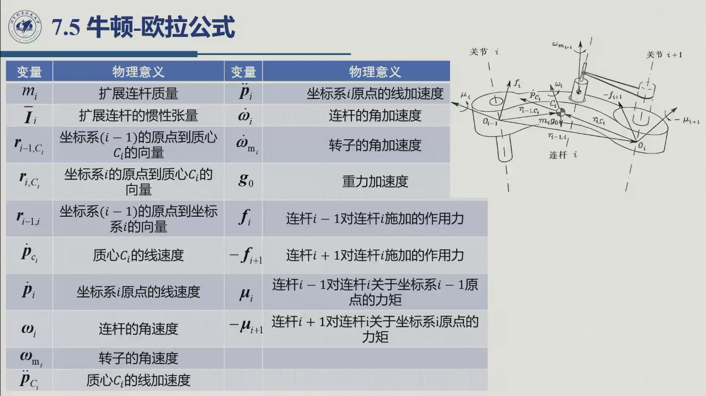
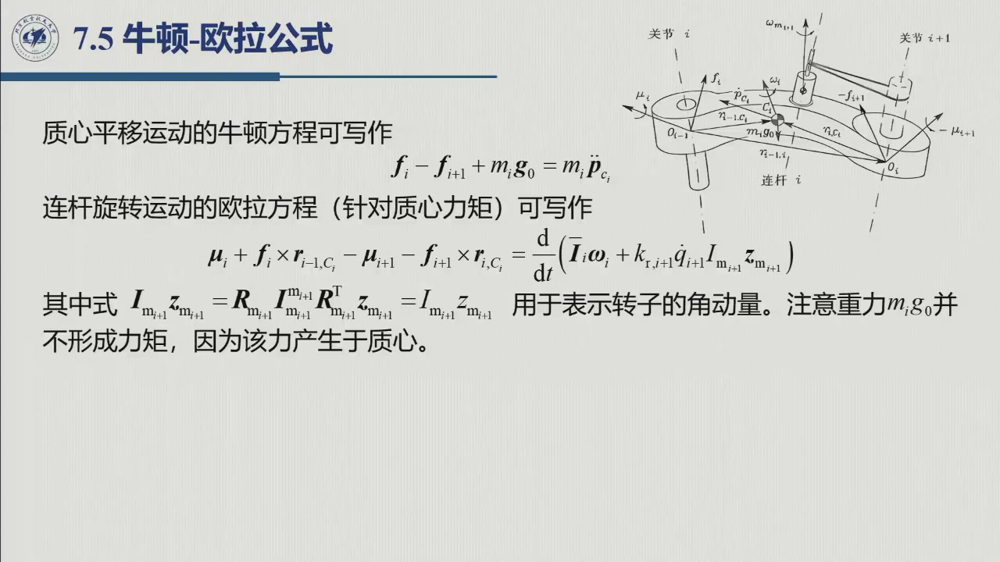
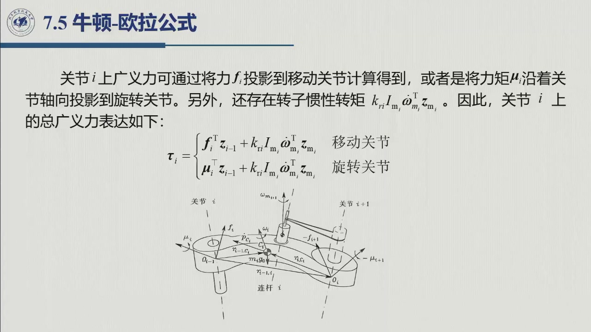
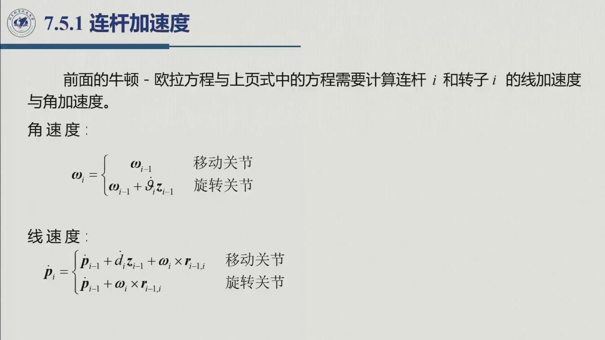
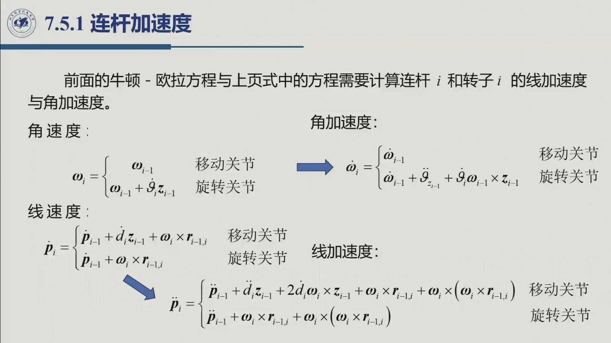
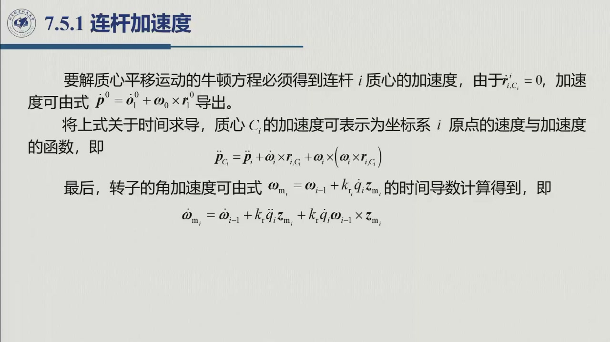
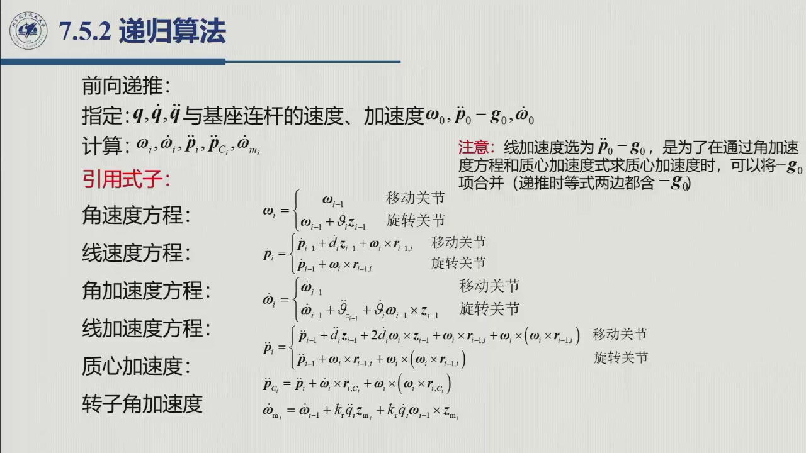
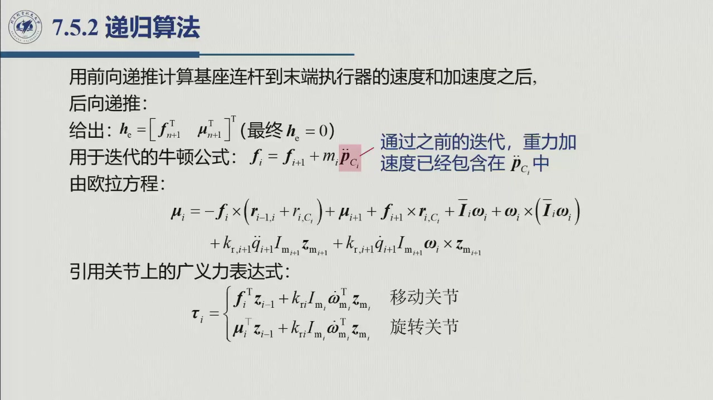
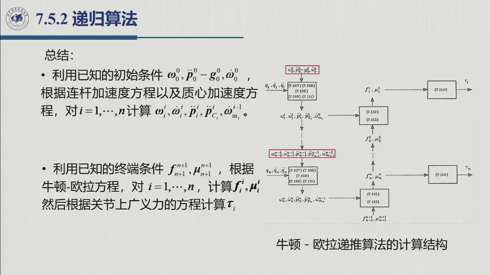
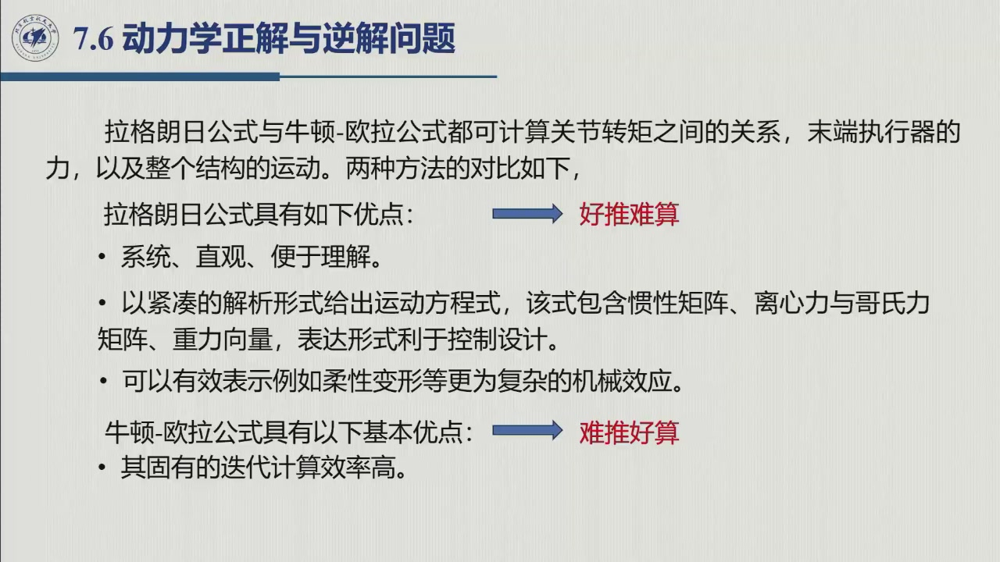

# 6.4 牛顿–欧拉递推

拉格朗日法从能量推出封闭方程 $B(\boldsymbol q)\ddot{\boldsymbol q}+C(\boldsymbol q,\dot{\boldsymbol q})\dot{\boldsymbol q}+\boldsymbol g(\boldsymbol q)=\boldsymbol\tau-J^{\mathrm T}\boldsymbol h_e$，适合看清惯性、速度耦合和重力的结构。但在实时控制或仿真内环里，往往只关心一个具体数值问题：已知这一瞬间的 $\boldsymbol q,\dot{\boldsymbol q},\ddot{\boldsymbol q}$，需要输出多大的关节驱动力 $\boldsymbol\tau$？按封闭公式先把 $n\times n$ 的 $B$、$C$ 算出来，随着关节数 $n$ 增大，表达式会迅速膨胀。牛顿–欧拉法换一条路：对每根杆直接列牛顿和欧拉方程，让相邻连杆的约束反力和反力矩沿运动链传递，不构造整张 $B$ 矩阵，用两遍循环以 $O(n)$ 运算算出同一组 $\boldsymbol\tau$。课堂回看：00:04:30–01:30:00；教材 §7.4，课堂课件编号为 §7.5（本讲课件把参数辨识编为 §7.4，读课件时不要按节号对教材）。

## 6.4.1 为什么还要第二种方法

逆动力学在已知当前位置 $\boldsymbol q$、速度 $\dot{\boldsymbol q}$ 和期望加速度 $\ddot{\boldsymbol q}$ 时，求关节驱动力 $\boldsymbol\tau$（以及已知末端向环境施加的力系 $\boldsymbol h_e$ 时的额外补偿 $J^{\mathrm T}\boldsymbol h_e$）。拉格朗日法消掉了关节之间的约束反力，最后给出封闭解析式；牛顿–欧拉法把相邻两杆之间的作用力 $\boldsymbol f_i$ 和力矩 $\boldsymbol\mu_i$ 显式保留下来。

单个刚体（车、无人机、卫星，00:16:26–00:17:06）可以直接列牛顿–欧拉方程；一串机械臂的每根杆既被上一杆带动运动，又要托住下一杆的重量和惯性。运动由基座传向末端，负载从末端传回基座，于是算式自然拆成**向外（前向）递推运动量、向内（后向）递推力和力矩**的两遍循环。课上这样概括分工（00:04:30–00:05:52）：牛顿–欧拉法公式多、正反两遍传递不如拉格朗日直观，但每一步只做 $3\times3$ 向量运算，计算效率高得多。下面先用固定基座、刚性连杆、无摩擦的统一记号把基本两遍递推推完整，所有向量先在同一基坐标系中表达，角度用 rad、长度用 m。

## 6.4.2 预备知识：动量、角动量与力系简化

整个牛顿–欧拉递推只用到刚体力学的两条定理（课上 00:16–00:37 专门复习）：动量定理与动量矩定理。

对质量为 $m$、密度 $\rho$ 的刚体，质心速度为 $\dot{\boldsymbol p}_C$，所有微元动量对体积的积分只剩总质量乘质心速度，即线动量 $\boldsymbol l=\int_{V_B}\dot{\boldsymbol p}\rho\,\mathrm dV=m\dot{\boldsymbol p}_C$。关于空间参考点 $\Omega$ 的角动量为 $\boldsymbol k_\Omega=\int_{V_B}\dot{\boldsymbol p}\times(\boldsymbol p_\Omega-\boldsymbol p)\rho\,\mathrm dV=\boldsymbol I_C\boldsymbol\omega+m\dot{\boldsymbol p}_C\times(\boldsymbol p_\Omega-\boldsymbol p_C)$，包含绕质心的自转动量和把总动量集中到质心的轨道角动量；$\boldsymbol I_C$ 与 $\boldsymbol\omega$ 必须在同一表达系下。当质量恒定且取矩点固定或就是质心 $C$ 时，动量定理和动量矩定理给出牛顿方程与欧拉方程：

$$\boldsymbol f_{\mathrm{ext}}=m\boldsymbol a_C,\qquad
\boldsymbol\mu_{\mathrm{ext},C}=\boldsymbol I_C\dot{\boldsymbol\omega}+\boldsymbol\omega\times(\boldsymbol I_C\boldsymbol\omega),$$

其中 $\boldsymbol a_C=\ddot{\boldsymbol p}_C$、$\dot{\boldsymbol\omega}$ 是惯性系下的质心线加速度和角加速度。如果改取另一个随杆运动的非质心点 $O$ 直接对 $\boldsymbol k_O$ 求导，会多出 $\dot{\boldsymbol p}_O\times\boldsymbol l$ 之类的动点修正项（00:33:52–00:35:50）；为避免出错，下文欧拉方程统一对**质心**写动力学平衡，再靠力臂叉乘把其他点上的作用力迁移到质心。

迁移时要注意力系简化规则：作用在点 $P$ 的力 $\boldsymbol f$ 关于参考点 $O$ 产生的力矩为 $(\boldsymbol p_P-\boldsymbol p_O)\times\boldsymbol f$。只有纯力偶矩可以自由平移；如果用主矢和主矩代表整个力系，把参考点从 $P$ 换到 $O$，主矩必须同时加上主矢在新参考点产生的力臂矩。

## 6.4.3 单连杆的牛顿–欧拉方程

沿用标准 DH 编号：关节 $i$ 绕或沿 $\boldsymbol z_{i-1}$ 运动，轴线过原点 $O_{i-1}$；连杆 $i$ 的远端关节 $i+1$ 轴线过原点 $O_i$，质心为 $C_i$。为了和 [6.2.2](sec6-2-2.md) 一致，把装在连杆 $i$ 上的第 $i+1$ 号电机定子/转子质量一并计入连杆 $i$，称为扩展连杆 $i$（质量 $m_i$、相对质心 $C_i$ 的惯性张量 $\bar{\boldsymbol I}_i$）；转子相对连杆 $i$ 自转的转动惯量 $I_{m_{i+1}}$ 与减速比 $k_{r,i+1}$ 单独计入角动量（电机也可归入下一杆，整本书统一采用归前一杆的约定，00:39:19–00:39:45）。定义两段相对位置向量：

$$\boldsymbol r_{i-1,i}=\boldsymbol p_{O_i}-\boldsymbol p_{O_{i-1}},\qquad
\boldsymbol r_{i,C_i}=\boldsymbol p_{C_i}-\boldsymbol p_{O_i},\qquad
\boldsymbol r_{i-1,C_i}=\boldsymbol r_{i-1,i}+\boldsymbol r_{i,C_i}=\boldsymbol p_{C_i}-\boldsymbol p_{O_{i-1}}.$$

（下面手算跟算例中若不计连杆自身偏移，简记作 $\boldsymbol r_i=\boldsymbol r_{i-1,i}$、$\boldsymbol c_i=\boldsymbol r_{i,C_i}$。）

上游连杆 $i-1$ 对连杆 $i$ 施加的约束力系记为 $\boldsymbol f_i$ 和力矩 $\boldsymbol\mu_i$（$\boldsymbol\mu_i$ 关于近端原点 $O_{i-1}$）；按牛顿第三定律，连杆 $i$ 对下游连杆 $i+1$ 施加 $(\boldsymbol f_{i+1},\boldsymbol\mu_{i+1})$，因此下游对连杆 $i$ 的反作用力系为 $-\boldsymbol f_{i+1}$ 和 $-\boldsymbol\mu_{i+1}$（$-\boldsymbol\mu_{i+1}$ 关于远端原点 $O_i$）。两个力矩参考点不同，不能直接相加减。



对连杆 $i$ 列质心平动的牛顿方程（先保留物理质心加速度 $\ddot{\boldsymbol p}_{C_i}^{\mathrm{phys}}$ 和显式重力 $m_i\boldsymbol g_0$）：

$$\boldsymbol f_i-\boldsymbol f_{i+1}+m_i\boldsymbol g_0=m_i\ddot{\boldsymbol p}_{C_i}^{\mathrm{phys}}.$$

再对质心 $C_i$ 列欧拉方程。把作用在 $O_{i-1}$ 的力 $\boldsymbol f_i$ 迁移到 $C_i$ 产生力矩 $(\boldsymbol p_{O_{i-1}}-\boldsymbol p_{C_i})\times\boldsymbol f_i=-\boldsymbol r_{i-1,C_i}\times\boldsymbol f_i=\boldsymbol f_i\times\boldsymbol r_{i-1,C_i}$；把作用在 $O_i$ 的反作用力 $-\boldsymbol f_{i+1}$ 迁移到 $C_i$ 产生力矩 $(\boldsymbol p_{O_i}-\boldsymbol p_{C_i})\times(-\boldsymbol f_{i+1})=-\boldsymbol r_{i,C_i}\times(-\boldsymbol f_{i+1})=\boldsymbol r_{i,C_i}\times\boldsymbol f_{i+1}=-\boldsymbol f_{i+1}\times\boldsymbol r_{i,C_i}$。注意重力作用在质心 $C_i$ 上，对质心的力臂为零，因此不直接出现在质心欧拉方程中（之后把力矩迁回关节原点 $O_{i-1}$ 时，重力会通过 $\boldsymbol f_i$ 的支撑力分量进入所需关节力矩）：

$$\boldsymbol\mu_i+\boldsymbol f_i\times\boldsymbol r_{i-1,C_i}
-\boldsymbol\mu_{i+1}-\boldsymbol f_{i+1}\times\boldsymbol r_{i,C_i}
=\frac{\mathrm d}{\mathrm dt}\Bigl(\bar{\boldsymbol I}_i\boldsymbol\omega_i+k_{r,i+1}\dot q_{i+1}I_{m_{i+1}}\boldsymbol z_{m_{i+1}}\Bigr).$$



## 6.4.4 欧拉方程的展开：惯性张量、陀螺项与转子项

上面欧拉方程右端还在对时间求导，其中基坐标系中的 $\bar{\boldsymbol I}_i=\boldsymbol R_i\bar{\boldsymbol I}_i^i\boldsymbol R_i^{\mathrm T}$ 随姿态 $\boldsymbol R_i$ 变化。用第三章[旋转矩阵求导](../recall.md#angular)公式 $\dot{\boldsymbol R}_i=S(\boldsymbol\omega_i)\boldsymbol R_i$ 和 $\dot{\boldsymbol R}_i^{\mathrm T}=-\boldsymbol R_i^{\mathrm T}S(\boldsymbol\omega_i)$，先展开 $\dot{\bar{\boldsymbol I}}_i$：

$$\dot{\bar{\boldsymbol I}}_i
=\dot{\boldsymbol R}_i\bar{\boldsymbol I}_i^i\boldsymbol R_i^{\mathrm T}+\boldsymbol R_i\bar{\boldsymbol I}_i^i\dot{\boldsymbol R}_i^{\mathrm T}
=S(\boldsymbol\omega_i)\bar{\boldsymbol I}_i-\bar{\boldsymbol I}_i S(\boldsymbol\omega_i).$$

用它对连杆角动量 $\bar{\boldsymbol I}_i\boldsymbol\omega_i$ 求导，因为 $S(\boldsymbol\omega_i)\boldsymbol\omega_i=\boldsymbol\omega_i\times\boldsymbol\omega_i=\boldsymbol 0$，第二项自动消失：

$$\frac{\mathrm d}{\mathrm dt}\bigl(\bar{\boldsymbol I}_i\boldsymbol\omega_i\bigr)
=\dot{\bar{\boldsymbol I}}_i\boldsymbol\omega_i+\bar{\boldsymbol I}_i\dot{\boldsymbol\omega}_i
=S(\boldsymbol\omega_i)\bar{\boldsymbol I}_i\boldsymbol\omega_i-\bar{\boldsymbol I}_i\underbrace{S(\boldsymbol\omega_i)\boldsymbol\omega_i}_{=\,\boldsymbol 0}+\bar{\boldsymbol I}_i\dot{\boldsymbol\omega}_i
=\bar{\boldsymbol I}_i\dot{\boldsymbol\omega}_i+\boldsymbol\omega_i\times(\bar{\boldsymbol I}_i\boldsymbol\omega_i).$$

第二项 $\boldsymbol\omega_i\times(\bar{\boldsymbol I}_i\boldsymbol\omega_i)$ 叫**陀螺项**：角动量矢量本身在连杆转动时改变了空间方向，因此即使角加速度 $\dot{\boldsymbol\omega}_i=\boldsymbol 0$（定常三维转动），只要 $\boldsymbol\omega_i$ 不沿惯量主轴，维持转动仍需要力矩。平面运动时 $\boldsymbol\omega_i$ 始终平行 $z_0$ 主轴，陀螺项为零，三维机械臂里却不能省略。

接着展开转子自转角动量项。由于第 $i+1$ 个电机固定在连杆 $i$ 上，它的转轴方向 $\boldsymbol z_{m_{i+1}}$ 随连杆 $i$ 以角速度 $\boldsymbol\omega_i$ 转动，因此 $\dot{\boldsymbol z}_{m_{i+1}}=\boldsymbol\omega_i\times\boldsymbol z_{m_{i+1}}$，求导得

$$\frac{\mathrm d}{\mathrm dt}\bigl(k_{r,i+1}\dot q_{i+1}I_{m_{i+1}}\boldsymbol z_{m_{i+1}}\bigr)
=k_{r,i+1}\ddot q_{i+1}I_{m_{i+1}}\boldsymbol z_{m_{i+1}}
+k_{r,i+1}\dot q_{i+1}I_{m_{i+1}}\bigl(\boldsymbol\omega_i\times\boldsymbol z_{m_{i+1}}\bigr).$$

合并两块，得到展开后的单杆欧拉方程：

$$\boxed{\ \begin{aligned}
\boldsymbol\mu_i+\boldsymbol f_i\times\boldsymbol r_{i-1,C_i}
-\boldsymbol\mu_{i+1}-\boldsymbol f_{i+1}\times\boldsymbol r_{i,C_i}
={}&\bar{\boldsymbol I}_i\dot{\boldsymbol\omega}_i+\boldsymbol\omega_i\times(\bar{\boldsymbol I}_i\boldsymbol\omega_i)\\
&+k_{r,i+1}\ddot q_{i+1}I_{m_{i+1}}\boldsymbol z_{m_{i+1}}+k_{r,i+1}\dot q_{i+1}I_{m_{i+1}}\bigl(\boldsymbol\omega_i\times\boldsymbol z_{m_{i+1}}\bigr)
\end{aligned}\ }$$

这里转子角动量里只出现一次 $k_{r,i+1}$，与 [6.1.1](sec6-1-1.md) 动能中 $k_{r_i}^2I_{m_i}$ 并不矛盾：驱动第 $i$ 关节的转子角加速度自身已经含一次 $k_{r_i}$，下面把转子反作用力矩折算到关节坐标时，虚功还会再乘一次 $k_{r_i}$，最终与动能给出的 $k_{r_i}^2I_{m_i}$ 完全一致。

（为看清两遍递推的骨架，下文先按不含转子自转、刚性连杆的纯连杆公式写出核心递推，并在关节力矩和伪代码处注明转子项如何并入；手算或编程含转子时，可直接按上式和下面的转子角加速度式补回这几项，或按[§6.1.1](sec6-1-1.md)的能量公式交叉核对。）

## 6.4.5 关节广义力：把力/力矩投影到关节轴

单杆平衡方程给出了整个关节约束力系 $(\boldsymbol f_i,\boldsymbol\mu_i)$，其中包括被导轨或轴承挡住的法向约束反力。电机真正需要克服的只是沿允许运动方向的分量。给定关节 $i$ 一个虚位移 $\delta q_i$：如果是移动关节，连杆只沿 $\boldsymbol z_{i-1}$ 平移 $\delta d_i\boldsymbol z_{i-1}$，虚功为 $\boldsymbol f_i^{\mathrm T}\boldsymbol z_{i-1}\delta d_i$；如果是转动关节，连杆绕过 $O_{i-1}$ 的 $\boldsymbol z_{i-1}$ 轴转动 $\delta\vartheta_i\boldsymbol z_{i-1}$，因为 $\boldsymbol\mu_i$ 恰好就是关于 $O_{i-1}$ 的力矩，虚功为 $\boldsymbol\mu_i^{\mathrm T}\boldsymbol z_{i-1}\delta\vartheta_i$。纯刚性连杆模型（无转子自转与摩擦）下：

$$\tau_i=\begin{cases}
\boldsymbol z_{i-1}^{\mathrm T}\boldsymbol f_i,&\text{移动关节},\\
\boldsymbol z_{i-1}^{\mathrm T}\boldsymbol\mu_i,&\text{转动关节}.
\end{cases}$$

若计入绕轴 $\boldsymbol z_{m_i}$ 转动的电机转子惯量 $I_{m_i}$，由转子虚位移 $k_{r_i}\delta q_i$，投影式还要补上转子自转惯性反力矩 $+k_{r_i}I_{m_i}\dot{\boldsymbol\omega}_{m_i}^{\mathrm T}\boldsymbol z_{m_i}$（教材式 (7.114)）。



## 6.4.6 向外（前向）递推：连杆运动量

第一遍循环从基座 $i=1$ 推到末端 $i=n$，由已知的 $\boldsymbol q,\dot{\boldsymbol q},\ddot{\boldsymbol q}$ 算出每根连杆和质心的加速度。基座固定不动，角速度和角加速度初值为 $\boldsymbol\omega_0=\boldsymbol 0$、$\dot{\boldsymbol\omega}_0=\boldsymbol 0$。为了不在每杆的牛顿方程里单独加一次 $m_i\boldsymbol g_0$，这里存一个减去重力加速度后的等效加速度 $a_i=\ddot{\boldsymbol p}_i^{\mathrm{phys}}-\boldsymbol g_0$，于是把基座初值设成

$$a_0=-\boldsymbol g_0.$$

这一步的等价物理解释（01:07:46–01:08:22）是让整机处在一个向上以 $-\boldsymbol g_0$ 加速的参考系里，重力自动转化为每一杆惯性需求 $m_i a_{C_i}$ 中的一部分；注意它是个计算技巧，不是说固定基座真的在向下落。如果改用物理初值 $a_0^{\mathrm{phys}}=\boldsymbol 0$，则后面牛顿方程必须显式写回 $+m_i\boldsymbol g_0$，两种做法只能选一种，混用会把重力算两遍或漏掉。

**转动关节**：关节 $i$ 绕 $\boldsymbol z_{i-1}$ 以 $\dot q_i$ 相对连杆 $i-1$ 转动，而 $\boldsymbol z_{i-1}$ 本身随连杆 $i-1$ 以 $\boldsymbol\omega_{i-1}$ 旋转，因此 $\dot{\boldsymbol z}_{i-1}=\boldsymbol\omega_{i-1}\times\boldsymbol z_{i-1}$。对速度递推 $\boldsymbol\omega_i=\boldsymbol\omega_{i-1}+\dot q_i\boldsymbol z_{i-1}$ 求时间导数，并由两点加速度公式把原点线加速度从 $O_{i-1}$ 传到 $O_i$（$\boldsymbol r_i=\boldsymbol r_{i-1,i}$）：

$$\boldsymbol\omega_i=\boldsymbol\omega_{i-1}+\dot q_i\boldsymbol z_{i-1},\qquad
\dot{\boldsymbol\omega}_i=\dot{\boldsymbol\omega}_{i-1}+\ddot q_i\boldsymbol z_{i-1}+\dot q_i(\boldsymbol\omega_{i-1}\times\boldsymbol z_{i-1}),$$

$$a_i=a_{i-1}+\dot{\boldsymbol\omega}_i\times\boldsymbol r_i+\boldsymbol\omega_i\times(\boldsymbol\omega_i\times\boldsymbol r_i).$$

**移动关节**：连杆 $i$ 与连杆 $i-1$ 之间没有相对转动，故角速度与角加速度直接继承；但原点 $O_i$ 沿随连杆 $i-1$ 一起转动的 $\boldsymbol z_{i-1}$ 轴伸缩 $d_i$。在转动坐标系里对相对位置 $d_i\boldsymbol z_{i-1}$ 求两次导数，速度和牵连转动在导数中各贡献一次，合并出著名的**科氏加速度项** $2\dot d_i(\boldsymbol\omega_i\times\boldsymbol z_{i-1})$（漏掉系数 $2$ 就会丢掉一半）：

$$\boldsymbol\omega_i=\boldsymbol\omega_{i-1},\qquad\dot{\boldsymbol\omega}_i=\dot{\boldsymbol\omega}_{i-1},$$

$$a_i=a_{i-1}+\ddot d_i\boldsymbol z_{i-1}+2\dot d_i(\boldsymbol\omega_i\times\boldsymbol z_{i-1})+\dot{\boldsymbol\omega}_i\times\boldsymbol r_i+\boldsymbol\omega_i\times(\boldsymbol\omega_i\times\boldsymbol r_i).$$





算出每根连杆的原点加速度 $a_i$ 后，再把它从远端原点 $O_i$ 移到固连在杆 $i$ 上的质心 $C_i$（$\boldsymbol c_i=\boldsymbol r_{i,C_i}$）：

$$a_{C_i}=a_i+\dot{\boldsymbol\omega}_i\times\boldsymbol c_i+\boldsymbol\omega_i\times(\boldsymbol\omega_i\times\boldsymbol c_i).$$

若模型包含转子惯量，还需在同一步里递推第 $i$ 关节转子的角加速度：$\dot{\boldsymbol\omega}_{m_i}=\dot{\boldsymbol\omega}_{i-1}+k_{r_i}\ddot q_i\boldsymbol z_{m_i}+k_{r_i}\dot q_i(\boldsymbol\omega_{i-1}\times\boldsymbol z_{m_i})$。





## 6.4.7 向内（后向）递推：力、力矩与关节力矩

第一遍递推结束后，每根杆的惯性力需求 $\boldsymbol F_i=m_i a_{C_i}$（已通过 $a_0=-\boldsymbol g_0$ 吸收了重力）和绕质心的惯性力矩需求 $\boldsymbol N_i=\bar{\boldsymbol I}_i\dot{\boldsymbol\omega}_i+\boldsymbol\omega_i\times(\bar{\boldsymbol I}_i\boldsymbol\omega_i)$ 都已确定。

第二遍从末端 $i=n$ 向基座 $i=1$ 倒推。终端条件来自机器人施加给环境的末端广义力 $\boldsymbol h_e=[\boldsymbol f_{n+1};\boldsymbol\mu_{n+1}]$（已预先平移到末端原点 $O_n$ 并换到当前统一表达系；自由运动时 $\boldsymbol f_{n+1}=\boldsymbol\mu_{n+1}=\boldsymbol 0$）。把单杆牛顿方程中的重力合并进 $\boldsymbol F_i=m_i a_{C_i}$ 后移项，直接得到力的递推：

$$\boldsymbol f_i=\boldsymbol F_i+\boldsymbol f_{i+1}.$$

接着把单杆欧拉方程解出 $\boldsymbol\mu_i$，并将上式的 $\boldsymbol f_i=\boldsymbol F_i+\boldsymbol f_{i+1}$ 代入力矩臂整理：

$$\begin{aligned}
\boldsymbol\mu_i
&=\boldsymbol N_i+\boldsymbol\mu_{i+1}-\boldsymbol f_i\times\boldsymbol r_{i-1,C_i}+\boldsymbol f_{i+1}\times\boldsymbol r_{i,C_i}\\
&=\boldsymbol N_i+\boldsymbol\mu_{i+1}+(\boldsymbol r_i+\boldsymbol c_i)\times\boldsymbol F_i+\boldsymbol r_i\times\boldsymbol f_{i+1},
\end{aligned}$$

其中用到 $\boldsymbol r_{i-1,C_i}=\boldsymbol r_i+\boldsymbol c_i$ 以及 $-(\boldsymbol F_i+\boldsymbol f_{i+1})\times(\boldsymbol r_i+\boldsymbol c_i)+\boldsymbol f_{i+1}\times\boldsymbol c_i=-(\boldsymbol F_i\times(\boldsymbol r_i+\boldsymbol c_i)+\boldsymbol f_{i+1}\times\boldsymbol r_i)=(\boldsymbol r_i+\boldsymbol c_i)\times\boldsymbol F_i+\boldsymbol r_i\times\boldsymbol f_{i+1}$。最后一行四项的物理账目非常清楚：本杆绕质心转动所需力矩 $\boldsymbol N_i$、下游传回的力偶 $\boldsymbol\mu_{i+1}$、本杆惯性及重力合力 $\boldsymbol F_i$ 对近端关节 $O_{i-1}$ 的力臂矩，以及下游合力 $\boldsymbol f_{i+1}$ 跨过整杆 $\boldsymbol r_i$ 对 $O_{i-1}$ 的力臂矩（若计入装在杆 $i$ 上的转子 $i+1$ 自转项，再补上 $k_{r,i+1}\ddot q_{i+1}I_{m_{i+1}}\boldsymbol z_{m_{i+1}}+k_{r,i+1}\dot q_{i+1}I_{m_{i+1}}(\boldsymbol\omega_i\times\boldsymbol z_{m_{i+1}})$）。算出 $\boldsymbol f_i,\boldsymbol\mu_i$ 后，按 6.4.5 投影到 $\boldsymbol z_{i-1}$ 即得 $\tau_i$。



### 完整跟算：一个加速关节为什么会使另一关节出力

拿第三章起一直沿用的两杆质点臂检验两遍递推：两杆长各 $1\ \mathrm m$，当前构形 $q=(0,\pi/2)$、速度 $\dot{\boldsymbol q}=\boldsymbol 0$，仅在末端放一个 $m_2=2\ \mathrm{kg}$ 的质点（杆本体质量与转子、摩擦均略去），取基系 $y$ 竖直向上、$\boldsymbol g_0=(0,-9.81,0)^{\mathrm T}$，要求加速度 $\ddot{\boldsymbol q}=(2,0)^{\mathrm T}\ \mathrm{rad/s^2}$。

杆 1 水平向右 $\boldsymbol r_1=(1,0,0)^{\mathrm T}$，杆 2 竖直向上 $\boldsymbol r_2=(0,1,0)^{\mathrm T}$，质点在末端故 $\boldsymbol c_2=\boldsymbol 0$。前向递推先设 $a_0=-\boldsymbol g_0=(0,9.81,0)^{\mathrm T}$、$\boldsymbol\omega_1=\boldsymbol\omega_2=\boldsymbol 0$，角加速度为 $\dot{\boldsymbol\omega}_1=\dot{\boldsymbol\omega}_2=(0,0,2)^{\mathrm T}$。因为速度为零，向心项全零，依次算出原点等效加速度：

$$a_1=a_0+\dot{\boldsymbol\omega}_1\times\boldsymbol r_1=(0,9.81,0)^{\mathrm T}+(0,2,0)^{\mathrm T}=(0,11.81,0)^{\mathrm T},$$

$$a_{C_2}=a_2=a_1+\dot{\boldsymbol\omega}_2\times\boldsymbol r_2=(0,11.81,0)^{\mathrm T}+(-2,0,0)^{\mathrm T}=(-2,11.81,0)^{\mathrm T},$$

减去 $-g_0$ 前的物理质心加速度是 $\ddot{\boldsymbol p}_{C_2}^{\mathrm{phys}}=(-2,2,0)^{\mathrm T}\ \mathrm{m/s^2}$。后向递推中质点绕自身质心无转动需求（$\boldsymbol N_2=\boldsymbol 0$），终端力系 $\boldsymbol h_e=\boldsymbol 0$，于是 $\boldsymbol f_2=\boldsymbol F_2=m_2 a_{C_2}=(-4,23.62,0)^{\mathrm T}\ \mathrm N$。沿运动链向内迁回关节 2 和关节 1：

$$\boldsymbol\mu_2=\boldsymbol r_2\times\boldsymbol F_2=(0,1,0)^{\mathrm T}\times(-4,23.62,0)^{\mathrm T}=(0,0,4)^{\mathrm T}\ \mathrm{N\cdot m},$$

$$\boldsymbol\mu_1=\boldsymbol\mu_2+\boldsymbol r_1\times\boldsymbol F_2=(0,0,4)^{\mathrm T}+(1,0,0)^{\mathrm T}\times(-4,23.62,0)^{\mathrm T}=(0,0,4+23.62)^{\mathrm T}=(0,0,27.62)^{\mathrm T}\ \mathrm{N\cdot m}.$$

投影到两根正向 $\boldsymbol z_0=(0,0,1)^{\mathrm T}$ 轴，得 $\boldsymbol\tau=(27.62,\ 4)^{\mathrm T}\ \mathrm{N\cdot m}$。虽然第二关节此刻相对加速度 $\ddot q_2=0$，但末端质点正随杆 1 向左加速 $-2\ \mathrm{m/s^2}$，对关节 2 有 $1\ \mathrm m$ 力臂，关节 2 必须输出 $4\ \mathrm{N\cdot m}$ 的约束力矩才能保持直角不折弯。

用 [6.1.1](sec6-1-1.md) 的拉格朗日法独立核对：这一构形下质点臂的 $B=\begin{bmatrix}4&2\\2&2\end{bmatrix}$、$\boldsymbol g=(19.62,0)^{\mathrm T}$，零速时 $C\dot{\boldsymbol q}=\boldsymbol 0$，故 $B(2,0)^{\mathrm T}+\boldsymbol g=(8,4)^{\mathrm T}+(19.62,0)^{\mathrm T}=(27.62,4)^{\mathrm T}\ \mathrm{N\cdot m}$，两者完全一致。若把要求加速度改为 $\ddot{\boldsymbol q}=\boldsymbol 0$，递推立刻退化为静止保持力矩 $(19.62,0)^{\mathrm T}\ \mathrm{N\cdot m}$。

## 6.4.8 两遍循环：算法、计算结构与复杂度

```text
输入：q, qdot, qddot，连杆质量与质心惯量，终端力系 h_e = [f[n+1]; mu[n+1]]
初值：omega[0] = alpha[0] = 0，a[0] = -g0

# 第 1 遍：向外（前向），i = 1 → n
对 i = 1 到 n：
    由正运动学取得 r[i]、c[i]、z[i-1] 和惯量表达
    按关节类型计算 omega[i]、alpha[i]（即 omegadot[i]）、a[i]
    移到质心，计算 aC[i] = a[i] + alpha[i] × c[i] + omega[i] × (omega[i] × c[i])
    F[i] = m[i] * aC[i]
    N[i] = I[i] * alpha[i] + omega[i] × (I[i] * omega[i])

# 第 2 遍：向内（后向），i = n → 1
设置已统一到末端原点 O[n] 与统一表达系的 f[n+1]、mu[n+1]
对 i = n 到 1：
    f[i] = F[i] + f[i+1]
    mu[i] = N[i] + mu[i+1] + (r[i]+c[i]) × F[i] + r[i] × f[i+1]
    转动关节取 tau[i] = z[i-1] · mu[i]
    移动关节取 tau[i] = z[i-1] · f[i]
    （含电机转子时，于欧拉递推与投影式按 6.4.4–6.4.5 补入转子惯性及陀螺项）
```

两遍循环中每根杆只做固定规模的 $3\times3$ 矩阵与 $3\times1$ 向量运算，既没有 $n\times n$ 求逆也没有跨杆求和，因此给定一组 $(\boldsymbol q,\dot{\boldsymbol q},\ddot{\boldsymbol q})$ 求逆动力学 $\boldsymbol\tau$ 的计算量随连杆数线性增长，即 $O(n)$（与课上 01:15:10–01:15:26“每个方程并不长，矩阵运算少一些，计算速度会快一些”对应；结构框图见教材式 (7.107)–(7.114)）。上面为方便核对把所有向量留在基坐标系；实际工程程序会把向量逐杆乘 $\boldsymbol R_i^{i-1\mathrm T}$ 换到**当前连杆系**，这样 $\bar{\boldsymbol I}_i^i$ 和 $\boldsymbol c_i^i$ 变成常数、不必每步算 $\boldsymbol R_i\bar{\boldsymbol I}_i^i\boldsymbol R_i^{\mathrm T}$，代价只是每次传递向量多一次 $3\times3$ 旋转。



## 6.4.9 与拉格朗日法的关系：好推难算 vs 难推好算

两种方法从同一组牛顿力学定律出发，只要建模假设（是否含转子、摩擦、重力约定）一致，给出的关节驱动力 $\boldsymbol\tau$ 完全相同（01:22:36–01:22:59）。课上把两法分工概括成八个字（01:23:20–01:25:45）：**拉格朗日好推难算，牛顿–欧拉难推好算**。

具体来说，拉格朗日法只写标量能量再求导，把所有连杆写成一个封闭解析式 $B\ddot{\boldsymbol q}+C\dot{\boldsymbol q}+\boldsymbol g=\boldsymbol\tau$，便于观察对称性、反对称性、参数线性性，以及做控制器和 Lyapunov 稳定性证明（01:24:28–01:24:35）；但要算出整张稠密 $B$ 和 $C$（$n^2$ 个元素）并求值至少需要 $O(n^2)$ 甚至更多计算。牛顿–欧拉法把约束反力传出来又消去，手推公式琐碎，也不显式暴露 $B,C,\boldsymbol g$，但给定瞬时运动直接算 $\boldsymbol\tau$ 只需 $O(n)$。注意比较复杂度前要先声明任务和口径：课件在“计算复杂度”一页上对封闭形式正、逆解记作 $O(n^2)$，那是针对已展开或构造整套 $n\times n$ 矩阵而言，与递推算法的 $O(n)$ 并不矛盾。



## 6.4.10 小结与常见错误

牛顿–欧拉递推先从基座向外算出各杆质心的等效加速度 $a_{C_i}$（以 $a_0=-\boldsymbol g_0$ 自动吸收重力）与角加速度，再从末端向内把本杆需求 $\boldsymbol F_i,\boldsymbol N_i$ 与下游力系 $\boldsymbol f_{i+1},\boldsymbol\mu_{i+1}$ 迁回近端原点累加 $\boldsymbol f_i,\boldsymbol\mu_i$，最后沿关节轴 $\boldsymbol z_{i-1}$ 投影得到 $\tau_i$。递推逆动力学与拉格朗日法算出的数值完全一致，一个适合运行时高速求解，一个适合分析结构与设计控制律。

::: think 常见错误清单
1. **力臂用错参考点**：$\boldsymbol\mu_i$ 关于近端原点 $O_{i-1}$，$\boldsymbol\mu_{i+1}$ 关于远端原点 $O_i$；欧拉方程必须补齐合力对各自参考点的力臂叉乘，不能把 $\boldsymbol\mu_{i+1}$ 直接当成关于 $O_{i-1}$ 的力矩。
2. **重力算两遍或放进欧拉方程**：用 $a_0=-\boldsymbol g_0$ 初始化后，牛顿方程直接写 $\boldsymbol f_i=\boldsymbol f_{i+1}+m_i a_{C_i}$，不再另加 $m_i\boldsymbol g_0$；质心欧拉方程中重力对质心力臂为零，也不加重力矩。
3. **移动关节漏掉科氏加速度项的系数 2**：$\boldsymbol\omega_i=\boldsymbol\omega_{i-1}$ 没错，但线加速度中 $2\dot d_i(\boldsymbol\omega_i\times\boldsymbol z_{i-1})$ 的因子 $2$ 来自相对平动与牵连转动的两次求导贡献。
4. **递推方向搞反**：运动量从基座向末端（$i=1\to n$），力与力矩从末端向基座（$i=n\to1$）。
5. **漏转子项或下标错位**：按“扩展连杆 $i$ 含第 $i+1$ 个电机”的约定，杆 $i$ 欧拉方程里出现的是第 $i+1$ 个电机（$k_{r,i+1},I_{m_{i+1}}$），而第 $i$ 关节投影式 $\tau_i$ 里加的是第 $i$ 个电机（$k_{r_i},I_{m_i}$）。
6. **把 $O(n)$ 与 $O(n^2)$ 混比**：递推求一次 $\boldsymbol\tau$ 是 $O(n)$；构造或乘以完整 $n\times n$ 矩阵 $B$ 才是 $O(n^2)$。
:::

::: think 检查理解
1. 为什么固定基座仍可用 $a_0=-\boldsymbol g_0$ 初始化？它代表什么计算量？
2. $\boldsymbol\mu_i$ 与 $\boldsymbol\mu_{i+1}$ 为什么不能不迁移参考点就直接相减？
3. 在两杆质点跟算例里，关节 2 相对加速度 $\ddot q_2=0$，为什么算出的 $\tau_2=4\ \mathrm{N\cdot m}$ 仍然非零？
4. 转子角动量含一次 $k_r$，为什么折算到关节的惯量贡献却含 $k_r^2$？

::: sol 核对
1. 递推变量存的是实际线加速度减去重力加速度 $a_i=\ddot{\boldsymbol p}_i^{\mathrm{phys}}-\boldsymbol g_0$，固定基座实际加速度仍为零。
2. $\boldsymbol\mu_i$ 关于 $O_{i-1}$ 而 $\boldsymbol\mu_{i+1}$ 关于 $O_i$，力系迁移参考点时必须补上合力跨过力臂的矩。
3. 第一关节加速带着末端质点产生横向加速度 $-2\ \mathrm{m/s^2}$，对关节 2 轴有 $1\ \mathrm m$ 力臂，关节 2 必须施加 $4\ \mathrm{N\cdot m}$ 约束力矩维持两杆直角不变。
4. 转子自身角加速度放大了 $k_r$ 倍，投影回关节坐标时虚位移也放大 $k_r$ 倍，两次乘在一起得到 $k_r^2$。
:::
:::

::: think 默写点 · 合上书再写
1. 写出单连杆牛顿方程与质心欧拉方程，并解释为什么重力不出现在质心欧拉方程中。
2. 写出前向递推六式（角速度、线速度、角加速度、线加速度、质心加速度、转子角加速度），区分转动关节与移动关节。
3. 写出后向递推的 $\boldsymbol f_i$、$\boldsymbol\mu_i$ 与关节轴投影 $\tau_i$ 三式。
4. 说明 $a_0=-\boldsymbol g_0$ 与物理初值 $a_0^{\mathrm{phys}}=\boldsymbol 0$ 两种重力处理法的区别。
5. 说明牛顿–欧拉递推为什么是 $O(n)$，并与拉格朗日法对比各自的适用场合。
:::
