# 6.4 牛顿–欧拉递推

> 录播 00:04:30–01:30:00。课件 **§7.5「牛顿–欧拉公式」**，对应教材 **§7.4**，本书编为 6.4；
> 主体 6.4.1–6.4.8 对应 00:16–01:15，与拉格朗日法的对比补引 01:23–01:30。
> 本节回答：只对每根杆列牛顿方程与欧拉方程，怎样用两遍递推算出 $\boldsymbol\tau$；它为什么更快、又为什么更难推。

::: note 来源与边界（本节）
- **编号错位**：本讲课件把「动力学参数辨识」编为 §7.4、「牛顿–欧拉公式」编为 §7.5，与教材顺序相反；教材 §7.4 才是牛顿–欧拉方法。本书按教材对应关系编为 **6.4**，正文引用教材式号 (7.107)–(7.114)，与课件结构图一致。读课件时不要按编号对章节。
- **课堂 vs 教材**：单杆方程、两遍递推、关节轴投影按课堂推导整理；「换到当前连杆系」（课件 §7.5.2 末）只在 6.4.8 交代做法。文中「课件」指幻灯片、「老师」指口述。
:::

## 6.4.1 为什么还要第二种方法

上一讲用拉格朗日方程得到了**封闭形式**的关节空间模型

$$B(\boldsymbol q)\ddot{\boldsymbol q}+C(\boldsymbol q,\dot{\boldsymbol q})\dot{\boldsymbol q}
+\boldsymbol g(\boldsymbol q)=\boldsymbol\tau,$$

它系统、紧凑，是控制设计与论文里最常用的形式。两条路线的分工开场就讲清了（00:04:30–00:05:52）：拉格朗日路线写能量、代公式，得到 $B,C,\boldsymbol g$ 的解析式；牛顿–欧拉路线对每根杆列方程、让相邻连杆的**约束力**一进一出地传递，得到的是**递推式**而非封闭式。

老师的原话是「它是基于递推的形式，计算效率会更高一些；但是因为公式特别多，反而不一定、不是特别直观」。**用直观性换计算效率**，这就是本节要付的代价。

为什么多体系统要用递推？老师的对照是（00:16:26–00:17:06）：单个刚体（车、飞机、卫星、船、移动机器人）用牛顿–欧拉最直观；「一根杆接一根杆」的机器人则必须把杆间作用力/反作用力显式传递，于是写成「从基座往末端算运动、从末端往基座算力」的两遍循环。

两者算的是同一件事，只是记账方式不同：拉格朗日法把**约束力**（关节反力、杆间内力）消掉、只留能量；牛顿–欧拉法把约束力留下，让它们成对出现、在递推中自动抵消。所以两者给出的 $\boldsymbol\tau$ 必然相同（01:22:36–01:22:59）。

## 6.4.2 预备知识：动量、角动量与力系简化

全部理论基础只有两条：**动量定理**与**动量矩定理**。老师用 00:16–00:37 约二十分钟铺垫（课件 §7.5「预备知识」）。

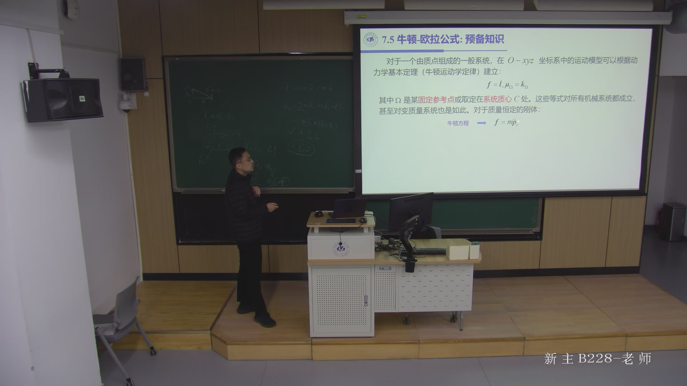

**① 动量。** 质量微元 $\rho\,\mathrm dV$ 的动量为 $\dot{\boldsymbol p}\,\rho\,\mathrm dV$，对刚体积分只剩质心速度：

$$\boldsymbol l=\int_{V_B}\dot{\boldsymbol p}\,\rho\,\mathrm dV=m\dot{\boldsymbol p}_C.$$

**② 角动量。** 对空间中任意参考点 $\Omega$（可固定、也可随参考系运动）：

$$\boldsymbol k_\Omega=\int_{V_B}\dot{\boldsymbol p}\times(\boldsymbol p_\Omega-\boldsymbol p)\,\rho\,\mathrm dV
=\boldsymbol I_C\boldsymbol\omega+m\dot{\boldsymbol p}_C\times(\boldsymbol p_\Omega-\boldsymbol p_C),$$

其中 $\boldsymbol I_C$ 是**相对质心**的惯性张量：第一项是绕质心的自转，第二项是把全部质量集中到质心的轨道角动量——不能「把整个动量放到质心上取矩」。

**③ 力系简化。** 一根杆受的力（重力、电机力、杆间力）可向任意点 $\Omega$ 简化为**主矢**与**主矩**：

$$\boldsymbol f=\int_{V_B}\boldsymbol g_0\,\rho\,\mathrm dV+\sum_i\boldsymbol f_i
=m\boldsymbol g_0+\sum_i\boldsymbol f_i,$$

$$\boldsymbol\mu_\Omega=\int_{V_B}\boldsymbol g_0\times(\boldsymbol p_\Omega-\boldsymbol p)\,\rho\,\mathrm dV
+\sum_i\boldsymbol f_i\times(\boldsymbol p_\Omega-\boldsymbol p_i)
=m\boldsymbol g_0\times(\boldsymbol p_\Omega-\boldsymbol p_C)+\sum_i\boldsymbol f_i\times(\boldsymbol p_\Omega-\boldsymbol p_i).$$

**④ 两条定理。** 动量定理与动量矩定理把运动与力接起来：

$$\boldsymbol f=\frac{\mathrm d\boldsymbol l}{\mathrm d t},\qquad
\boldsymbol\mu_\Omega=\frac{\mathrm d\boldsymbol k_\Omega}{\mathrm d t}.$$

对**质量恒定**的刚体，且 $\Omega$ 取**固定点或质心** $C$ 时：

$$\boldsymbol f=m\ddot{\boldsymbol p}_C,\qquad
\boldsymbol\mu_\Omega=\boldsymbol I_\Omega\dot{\boldsymbol\omega}
+\boldsymbol\omega\times(\boldsymbol I_\Omega\boldsymbol\omega).$$

后一式就是**欧拉方程（Euler equation）**，右边第二项 $\boldsymbol\omega\times(\boldsymbol I\boldsymbol\omega)$ 是转动坐标系带来的**陀螺项**；前提是参考点固定或取在质心，换成别的动点还要多一项（00:33:52–00:35:50）。


## 6.4.3 单连杆的牛顿–欧拉方程

把结论用到「连杆 $i$」上。课件先约定记号，再用一张表把 **18 个变量**一次列清（00:38:42–00:40:52）——整节的字典。

三个约定先说清楚。**其一，扩展连杆**：课件把「连杆 $i$ 本体 + 装在连杆 $i$ 上的关节 $i+1$ 电机」合称**扩展连杆 $i$**，质量记 $m_i$、惯性张量记 $\bar{\boldsymbol I}_i$；转子还会相对连杆 $i$ 自转，所以**绕轴**转动惯量 $I_{m_{i+1}}$ 与减速比 $k_{r,i+1}$ 单独出现。**其二，电机归属**：归前一个或后一个关节都行，「两种约定都行，但一本书里要统一」（00:39:19–00:39:45），本页按「归后一个」。**其三，关节变量**：转动关节记 $q_i,\dot q_i,\ddot q_i$（角量），移动关节记 $d_i,\dot d_i,\ddot d_i$（线量）；$\boldsymbol z_{i-1}$ 是关节 $i$ 的轴线单位向量，$\boldsymbol z_{m_i}$ 是转子轴单位向量，$k_{r_i}$ 是减速比，$I_{m_i}$ 是转子绕自身轴的转动惯量。

| 符号 | 含义 | 符号 | 含义 |
|:--|:--|:--|:--|
| $m_i$ | 扩展连杆质量 | $\ddot{\boldsymbol p}_i$ | 坐标系 $i$ 原点的线加速度 |
| $\bar{\boldsymbol I}_i$ | 扩展连杆的惯性张量 | $\dot{\boldsymbol\omega}_i$ | 连杆的角加速度 |
| $\boldsymbol r_{i-1,C_i}$ | 坐标系 $(i-1)$ 原点到质心 $C_i$ 的向量 | $\dot{\boldsymbol\omega}_{m_i}$ | 转子的角加速度 |
| $\boldsymbol r_{i,C_i}$ | 坐标系 $i$ 原点到质心 $C_i$ 的向量 | $\boldsymbol g_0$ | 重力加速度 |
| $\boldsymbol r_{i-1,i}$ | 坐标系 $(i-1)$ 原点到坐标系 $i$ 原点的向量 | $\boldsymbol f_i$ | 连杆 $i-1$ 对连杆 $i$ 的作用力 |
| $\dot{\boldsymbol p}_{C_i}$ | 质心 $C_i$ 的线速度 | $-\boldsymbol f_{i+1}$ | 连杆 $i+1$ 对连杆 $i$ 的作用力 |
| $\dot{\boldsymbol p}_i$ | 坐标系 $i$ 原点的线速度 | $\boldsymbol\mu_i$ | 连杆 $i-1$ 对连杆 $i$ 关于坐标系 $i-1$ 原点的力矩 |
| $\boldsymbol\omega_i$ | 连杆的角速度 | $-\boldsymbol\mu_{i+1}$ | 连杆 $i+1$ 对连杆 $i$ 关于坐标系 $i$ 原点的力矩 |
| $\boldsymbol\omega_{m_i}$ | 转子的角速度 | $\ddot{\boldsymbol p}_{C_i}$ | 质心 $C_i$ 的线加速度 |

**注意两个参考点不同**：$\boldsymbol\mu_i$ 关于 $O_{i-1}$，$\boldsymbol\mu_{i+1}$ 关于 $O_i$。力矩是自由矢量，换参考点不改变它本身，但**力对质心的矩**要用各自的力臂补上——这正是下面欧拉方程里 $\boldsymbol f_i\times\boldsymbol r_{i-1,C_i}$ 与 $\boldsymbol f_{i+1}\times\boldsymbol r_{i,C_i}$ 的来源。

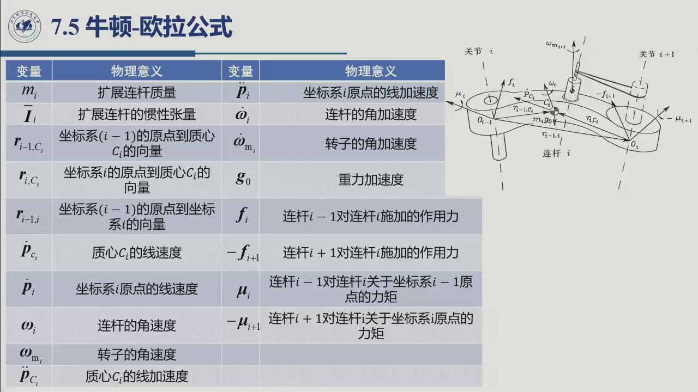

**牛顿方程**（对质心平移，取合力 = 质量 × 质心加速度）：

$$\boldsymbol f_i-\boldsymbol f_{i+1}+m_i\boldsymbol g_0=m_i\ddot{\boldsymbol p}_{C_i}.$$

**欧拉方程**（对质心 $C_i$ 取矩，取合力矩 = 角动量的时间导数）：

$$\boldsymbol\mu_i+\boldsymbol f_i\times\boldsymbol r_{i-1,C_i}
-\boldsymbol\mu_{i+1}-\boldsymbol f_{i+1}\times\boldsymbol r_{i,C_i}
=\frac{\mathrm d}{\mathrm d t}\Bigl(\bar{\boldsymbol I}_i\boldsymbol\omega_i
+k_{r,i+1}\dot q_{i+1}I_{m_{i+1}}\boldsymbol z_{m_{i+1}}\Bigr).$$

左边四项依次是：上一杆的力矩 $\boldsymbol\mu_i$、其力 $\boldsymbol f_i$ 对 $C_i$ 的矩、下一杆的反力矩 $-\boldsymbol\mu_{i+1}$、其反作用力对 $C_i$ 的矩。右边是**连杆 + 转子**对 $C_i$ 的角动量：连杆用 $\bar{\boldsymbol I}_i\boldsymbol\omega_i$，转子用 $k_{r,i+1}\dot q_{i+1}I_{m_{i+1}}\boldsymbol z_{m_{i+1}}$（只绕自身轴自转）。

**为什么重力不在欧拉方程里**：重力 $m_i\boldsymbol g_0$ 作用在质心，对 $C_i$ 的力臂为零，不产生力矩；所以牛顿方程写 $+m_i\boldsymbol g_0$，欧拉方程不写（课件在公式页下方专门标注）。

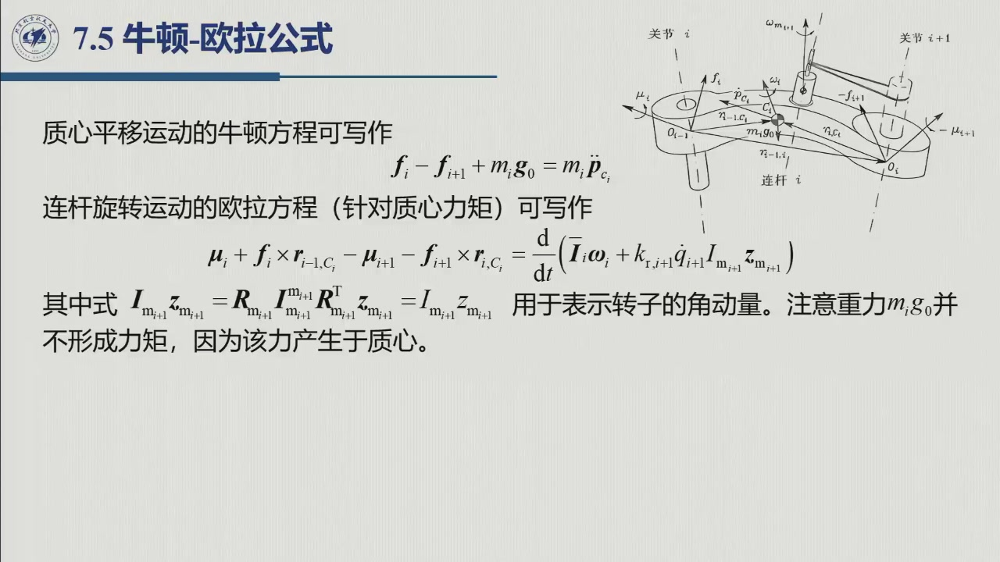

## 6.4.4 欧拉方程的展开：惯性张量、陀螺项与转子项

课件没有停在 $\mathrm d/\mathrm d t$ 的形式，而是把右边两项展开成真正用于递推的式子（00:44:00–00:49:00）：好处是把「惯性张量随位形变」换成「连杆系里的常数」，并把陀螺项、转子项显式写出。

**① 惯性张量的换系。** 与 [6.1.1](sec6-1-1.md) 完全一样：

$$\bar{\boldsymbol I}_i=\boldsymbol R_i\bar{\boldsymbol I}_i^i\boldsymbol R_i^{\mathrm T},$$

其中 $\boldsymbol R_i$ 是坐标系 $i$ 到基坐标系的旋转矩阵，$\bar{\boldsymbol I}_i^i$ 是**连杆系里的常数矩阵**——建模只存常数张量，运行时用 $R$ 变换。

**② 对角动量求导。** 把上式代进去，用 $\dot{\boldsymbol R}_i=S(\boldsymbol\omega_i)\boldsymbol R_i$、$\dot{\boldsymbol R}_i^{\mathrm T}=-\boldsymbol R_i^{\mathrm T}S(\boldsymbol\omega_i)$（$S(\cdot)$ 是叉乘反对称矩阵，$S(\boldsymbol a)\boldsymbol b=\boldsymbol a\times\boldsymbol b$，同 [6.1.1](sec6-1-1.md)）：

$$\begin{aligned}
\frac{\mathrm d}{\mathrm d t}\bigl(\bar{\boldsymbol I}_i\boldsymbol\omega_i\bigr)
&=\dot{\boldsymbol R}_i\bar{\boldsymbol I}_i^i\boldsymbol R_i^{\mathrm T}\boldsymbol\omega_i
+\boldsymbol R_i\bar{\boldsymbol I}_i^i\dot{\boldsymbol R}_i^{\mathrm T}\boldsymbol\omega_i
+\boldsymbol R_i\bar{\boldsymbol I}_i^i\boldsymbol R_i^{\mathrm T}\dot{\boldsymbol\omega}_i\\
&=S(\boldsymbol\omega_i)\bar{\boldsymbol I}_i\boldsymbol\omega_i
+\bar{\boldsymbol I}_iS^{\mathrm T}(\boldsymbol\omega_i)\boldsymbol\omega_i
+\bar{\boldsymbol I}_i\dot{\boldsymbol\omega}_i\\
&=\bar{\boldsymbol I}_i\dot{\boldsymbol\omega}_i
+\boldsymbol\omega_i\times(\bar{\boldsymbol I}_i\boldsymbol\omega_i).
\end{aligned}$$

中间那一项 $S^{\mathrm T}(\boldsymbol\omega)\boldsymbol\omega=-\boldsymbol\omega\times\boldsymbol\omega=0$，是唯一需要「看出为零」的地方；结果即熟悉的欧拉方程形式：**惯性力矩 + 陀螺力矩**。

**③ 转子项。** 转子轴 $\boldsymbol z_{m_{i+1}}$ 固连在连杆 $i$ 上，随连杆以 $\boldsymbol\omega_i$ 转动，于是

$$\frac{\mathrm d}{\mathrm d t}\bigl(k_{r,i+1}\dot q_{i+1}I_{m_{i+1}}\boldsymbol z_{m_{i+1}}\bigr)
=k_{r,i+1}\ddot q_{i+1}I_{m_{i+1}}\boldsymbol z_{m_{i+1}}
+k_{r,i+1}\dot q_{i+1}I_{m_{i+1}}\,\boldsymbol\omega_i\times\boldsymbol z_{m_{i+1}}.$$

**④ 合并。** 把 ②③ 代回欧拉方程，得到**本节的主方程**：

$$\boxed{\ \begin{aligned}
\boldsymbol\mu_i+\boldsymbol f_i\times\boldsymbol r_{i-1,C_i}
-\boldsymbol\mu_{i+1}-\boldsymbol f_{i+1}\times\boldsymbol r_{i,C_i}
={}&\bar{\boldsymbol I}_i\dot{\boldsymbol\omega}_i
+\boldsymbol\omega_i\times(\bar{\boldsymbol I}_i\boldsymbol\omega_i)\\
&+k_{r,i+1}\ddot q_{i+1}I_{m_{i+1}}\boldsymbol z_{m_{i+1}}
+k_{r,i+1}\dot q_{i+1}I_{m_{i+1}}\,\boldsymbol\omega_i\times\boldsymbol z_{m_{i+1}}
\end{aligned}\ }$$

右边四项按物理意义分别是**惯性力矩**、**陀螺力矩**、**转子惯性力矩**、**转子陀螺力矩**。陀螺项来自「惯性张量在基座系里不是常数」，与 [6.1.3](sec6-1-3.md) 中 $\dot B\dot{\boldsymbol q}$ 的速度耦合项同类：拉格朗日形式收进 $C\dot{\boldsymbol q}$，牛顿–欧拉形式逐杆出现。

## 6.4.5 关节广义力：把力/力矩投影到关节轴

牛顿–欧拉方程给出每根杆上的**力与力矩**；要得到关节空间的 $\tau_i$，还要把它们投影到关节轴上（00:55:52–00:56:30）：

- **移动关节**：力 $\boldsymbol f_i$ 投影到移动方向 $\boldsymbol z_{i-1}$，得 $\boldsymbol f_i^{\mathrm T}\boldsymbol z_{i-1}$；
- **转动关节**：力矩 $\boldsymbol\mu_i$ 投影到转轴 $\boldsymbol z_{i-1}$，得 $\boldsymbol\mu_i^{\mathrm T}\boldsymbol z_{i-1}$；
- 转子自身还有惯性转矩 $k_{r_i}I_{m_i}\dot{\boldsymbol\omega}_{m_i}^{\mathrm T}\boldsymbol z_{m_i}$，要加上。

于是

$$\boxed{\ \boldsymbol\tau_i=\begin{cases}
\boldsymbol f_i^{\mathrm T}\boldsymbol z_{i-1}+k_{r_i}I_{m_i}\dot{\boldsymbol\omega}_{m_i}^{\mathrm T}\boldsymbol z_{m_i}, & \text{移动关节}\\[1mm]
\boldsymbol\mu_i^{\mathrm T}\boldsymbol z_{i-1}+k_{r_i}I_{m_i}\dot{\boldsymbol\omega}_{m_i}^{\mathrm T}\boldsymbol z_{m_i}, & \text{旋转关节}
\end{cases}\ }$$

这就是教材式 **(7.114)**：关节 $i$ 的轴线过 $O_{i-1}$，而 $\boldsymbol\mu_i$ 已把**关节 $i$ 之后所有杆**的力与力矩汇总到 $O_{i-1}$，投影到轴线正是电机要克服的总力矩。

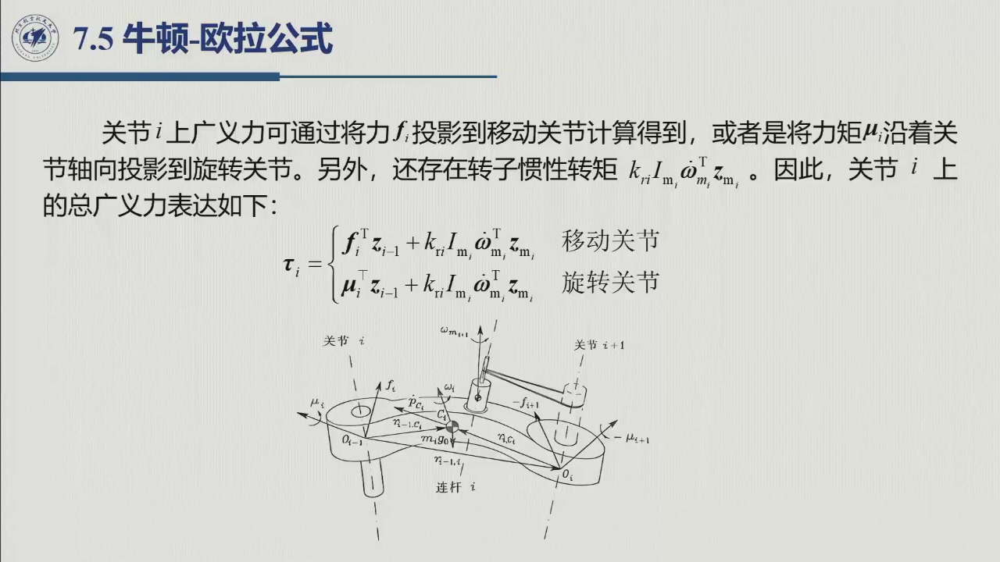

## 6.4.6 向外（前向）递推：连杆运动量

第一遍递推（00:56:30–01:04:00）。**已知** $\boldsymbol q,\dot{\boldsymbol q},\ddot{\boldsymbol q}$ 与基座运动量，**要求**每根连杆的 $\boldsymbol\omega_i,\dot{\boldsymbol\omega}_i,\ddot{\boldsymbol p}_i,\ddot{\boldsymbol p}_{C_i},\dot{\boldsymbol\omega}_{m_i}$。

基座初始化（基座固定的机械手）：

$$\boldsymbol\omega_0=\boldsymbol 0,\qquad\dot{\boldsymbol\omega}_0=\boldsymbol 0,\qquad
\dot{\boldsymbol p}_0=\boldsymbol 0,\qquad\ddot{\boldsymbol p}_0=-\boldsymbol g_0.$$

最后一条是**重力项处理的关键**，先记住结论，6.4.7 再解释。

**① 角速度**（转动关节多出自身转速）：

$$\boldsymbol\omega_i=\begin{cases}
\boldsymbol\omega_{i-1}, & \text{移动关节}\\[1mm]
\boldsymbol\omega_{i-1}+\dot q_i\boldsymbol z_{i-1}, & \text{旋转关节}
\end{cases}$$

**② 线速度**（移动关节多出沿轴平动）：

$$\dot{\boldsymbol p}_i=\begin{cases}
\dot{\boldsymbol p}_{i-1}+\dot d_i\boldsymbol z_{i-1}+\boldsymbol\omega_i\times\boldsymbol r_{i-1,i}, & \text{移动关节}\\[1mm]
\dot{\boldsymbol p}_{i-1}+\boldsymbol\omega_i\times\boldsymbol r_{i-1,i}, & \text{旋转关节}
\end{cases}$$

转角量与线量的递推，课件把它们并排放在两页上（下面两张图）。

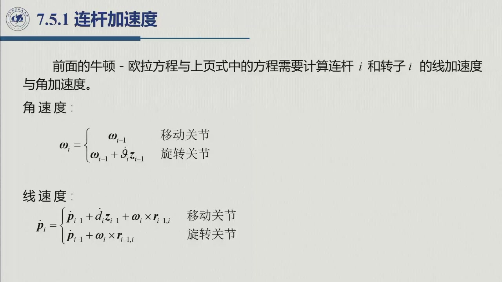

**③ 角加速度**（对 ① 求导；旋转关节多出「进动」项 $\dot q_i\boldsymbol\omega_{i-1}\times\boldsymbol z_{i-1}$）：

$$\dot{\boldsymbol\omega}_i=\begin{cases}
\dot{\boldsymbol\omega}_{i-1}, & \text{移动关节}\\[1mm]
\dot{\boldsymbol\omega}_{i-1}+\ddot q_i\boldsymbol z_{i-1}
+\dot q_i\,\boldsymbol\omega_{i-1}\times\boldsymbol z_{i-1}, & \text{旋转关节}
\end{cases}$$

**④ 线加速度**（旋转关节：切向 + 向心；移动关节再加平动项与科氏项 $2\dot d_i\boldsymbol\omega_i\times\boldsymbol z_{i-1}$）：

$$\ddot{\boldsymbol p}_i=\begin{cases}
\ddot{\boldsymbol p}_{i-1}+\ddot d_i\boldsymbol z_{i-1}
+2\dot d_i\,\boldsymbol\omega_i\times\boldsymbol z_{i-1}
+\dot{\boldsymbol\omega}_i\times\boldsymbol r_{i-1,i}
+\boldsymbol\omega_i\times(\boldsymbol\omega_i\times\boldsymbol r_{i-1,i}), & \text{移动关节}\\[1mm]
\ddot{\boldsymbol p}_{i-1}
+\dot{\boldsymbol\omega}_i\times\boldsymbol r_{i-1,i}
+\boldsymbol\omega_i\times(\boldsymbol\omega_i\times\boldsymbol r_{i-1,i}), & \text{旋转关节}
\end{cases}$$

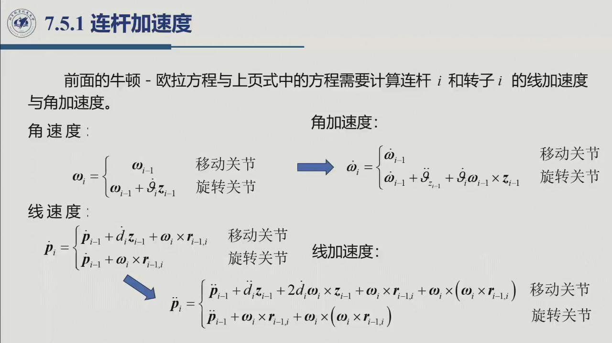

**⑤ 质心加速度**（把原点加速度搬到质心，再加一段刚体转动加速度）：

$$\ddot{\boldsymbol p}_{C_i}=\ddot{\boldsymbol p}_i
+\dot{\boldsymbol\omega}_i\times\boldsymbol r_{i,C_i}
+\boldsymbol\omega_i\times(\boldsymbol\omega_i\times\boldsymbol r_{i,C_i}).$$

**⑥ 转子角加速度**（转子轴随连杆 $i-1$ 转动，转速为 $k_{r_i}\dot q_i$）：

$$\dot{\boldsymbol\omega}_{m_i}=\dot{\boldsymbol\omega}_{i-1}
+k_{r_i}\ddot q_i\boldsymbol z_{m_i}
+k_{r_i}\dot q_i\,\boldsymbol\omega_{i-1}\times\boldsymbol z_{m_i}.$$

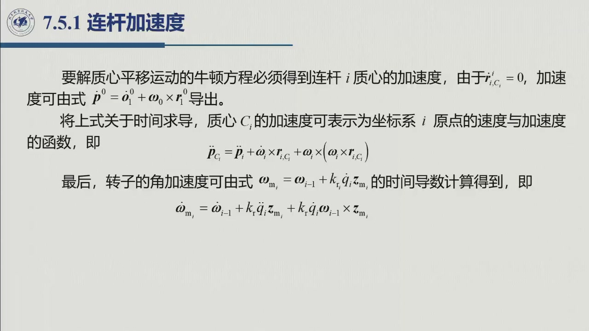

**六式为什么这样分组。** 六个式子其实是同一个模式：**继承第 $i-1$ 杆的量 + 关节 $i$ 自身的贡献 + 随速度出现的耦合项**。①③ 是角量、②④ 是线量、⑤⑥ 把前两组结果搬到质心与转子轴上，所以只需记住 ①③④，其余按同一模式套。

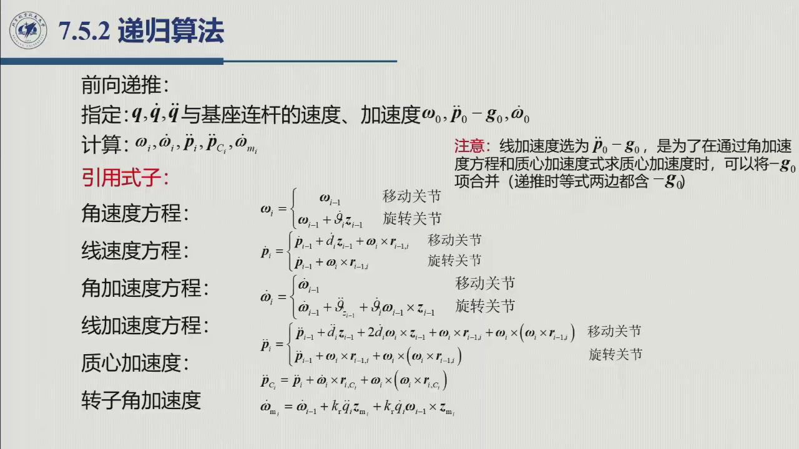

其中 $2\dot d\,\boldsymbol\omega\times\boldsymbol z$ 单独说一句：它是**科氏加速度（Coriolis acceleration）**——一根杆一边以 $\boldsymbol\omega$ 转动、一边沿轴以 $\dot d$ 伸缩，点的速度是「转动牵连 + 沿轴相对速度」，对时间求导的交叉项就是它；转动关节无相对平动，故无此项。反之 $\boldsymbol\omega\times(\boldsymbol\omega\times\boldsymbol r)$ 是**向心加速度**（常称离心项）。这两个名字在 [6.1.3](sec6-1-3.md) 的 $h_{ijk}$ 里都出现过：$h_{ijj}\dot q_j^2$ 对应离心、$h_{ijk}\dot q_j\dot q_k$ 对应科氏；牛顿–欧拉法不给它们分组，而让它们逐杆逐项出现在递推里。

## 6.4.7 向内（后向）递推：力、力矩与关节力矩

第一遍算完，所有运动量都已知。第二遍**从末端往基座**传递力和力矩（01:04:15–01:05:55；公式见课件 §7.5.2，01:10–01:13）。

**终端条件。** 末端执行器与环境的作用记作

$$\boldsymbol h_e=\begin{bmatrix}\boldsymbol f_{n+1}\\ \boldsymbol\mu_{n+1}\end{bmatrix}
\qquad(\text{自由运动时 }\boldsymbol h_e=\boldsymbol 0).$$

**① 牛顿方程递推**（重力已含在 $\ddot{\boldsymbol p}_{C_i}$ 里）：

$$\boxed{\ \boldsymbol f_i=\boldsymbol f_{i+1}+m_i\ddot{\boldsymbol p}_{C_i}\ }$$

**② 欧拉方程递推**（把 6.4.4 的主方程解出 $\boldsymbol\mu_i$）：

$$\begin{aligned}
\boldsymbol\mu_i={}&-\boldsymbol f_i\times(\boldsymbol r_{i-1,i}+\boldsymbol r_{i,C_i})
+\boldsymbol\mu_{i+1}+\boldsymbol f_{i+1}\times\boldsymbol r_{i,C_i}\\
&+\bar{\boldsymbol I}_i\dot{\boldsymbol\omega}_i
+\boldsymbol\omega_i\times(\bar{\boldsymbol I}_i\boldsymbol\omega_i)\\
&+k_{r,i+1}\ddot q_{i+1}I_{m_{i+1}}\boldsymbol z_{m_{i+1}}
+k_{r,i+1}\dot q_{i+1}I_{m_{i+1}}\,\boldsymbol\omega_i\times\boldsymbol z_{m_{i+1}}.
\end{aligned}$$

**③ 关节力矩**：再用 6.4.5 的投影式，得到 $\tau_i$（教材式 (7.114)）。

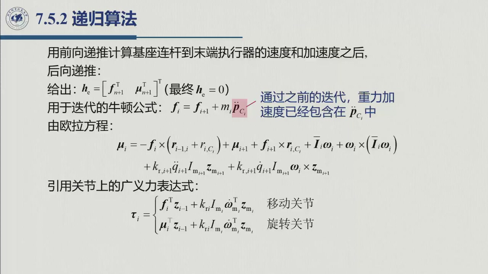

**重力项的两种处理**（本节最容易出错的地方）：

| 做法 | 递推初值 | 牛顿方程 | 备注 |
|:--|:--|:--|:--|
| **A（课件采用，推荐）** | $\ddot{\boldsymbol p}_0-\boldsymbol g_0=-\boldsymbol g_0$ | $\boldsymbol f_i=\boldsymbol f_{i+1}+m_i\ddot{\boldsymbol p}_{C_i}$ | 每个 $\ddot{\boldsymbol p}_{C_i}$ 里天然含 $-\boldsymbol g_0$，**自动含重力** |
| **B（显式加）** | $\boldsymbol 0$ | $\boldsymbol f_i-\boldsymbol f_{i+1}+m_i\boldsymbol g_0=m_i\ddot{\boldsymbol p}_{C_i}$ | 初值不吸收重力，方程里补 $m_i\boldsymbol g_0$ |

做法 A 等价于「让整个机器人处在一个以 $-\boldsymbol g_0$ 加速的参考系里」，重力变成惯性力。老师说这一步是「把重力挂到加速度上」，后面「$mg$ 这一项就可以直接用、不考虑它」（01:07:46–01:08:22）。两种做法只能选一种，混用会让重力算两遍；手算时在纸角写一行「$\ddot{\boldsymbol p}_0=-\boldsymbol g_0$，牛顿方程不加 $mg$」。无论哪种，**欧拉方程都没有重力矩**。

**末端力的记账方式。** 有接触时把末端力/力矩作为后向递推的起点 $\boldsymbol h_e$（自由运动取零），它与 [6.1.3](sec6-1-3.md) 右端的 $-J^{\mathrm T}\boldsymbol h_e$ 是同一外力的两种记法：拉格朗日法折回关节空间，牛顿–欧拉法留在末端让递推传回去。符号与参考点课件未展开，做题时按题目约定统一（见节末待核）。

## 6.4.8 两遍循环：算法、计算结构与复杂度

把 6.4.6–6.4.7 串起来就是教材的**牛顿–欧拉递推算法**（课件 §7.5.2）。老师一句话概括：「先从前往后算所有的运动量，再从后往前算所有的力和力矩」（01:05:44–01:05:55）。

```text
输入：q, q̇, q̈；末端力/力矩 h_e（自由运动 h_e = 0）
初始化：ω_0 = 0, ω̇_0 = 0, ṗ_0 = 0, p̈_0 = −g_0

# 第 1 遍：向外（前向），i = 1 → n
for i = 1, …, n:
    ω_i        ← 角速度式
    ω̇_i        ← 角加速度式
    p̈_i        ← 线加速度式
    p̈_{C_i}    ← 质心加速度式
    ω̇_{m_i}    ← 转子角加速度式

# 第 2 遍：向内（后向），i = n → 1
f_{n+1}, μ_{n+1} ← h_e
for i = n, …, 1:
    f_i  ← f_{i+1} + m_i p̈_{C_i}
    μ_i  ← 欧拉方程递推式
    τ_i  ← 关节广义力式

输出：τ
```

方向由方程结构决定：**运动量向外（$i=1\to n$），力向内（$i=n\to 1$）**——第 $i$ 根杆的运动量只依赖第 $i-1$ 根，力/力矩却依赖第 $i+1$ 根。

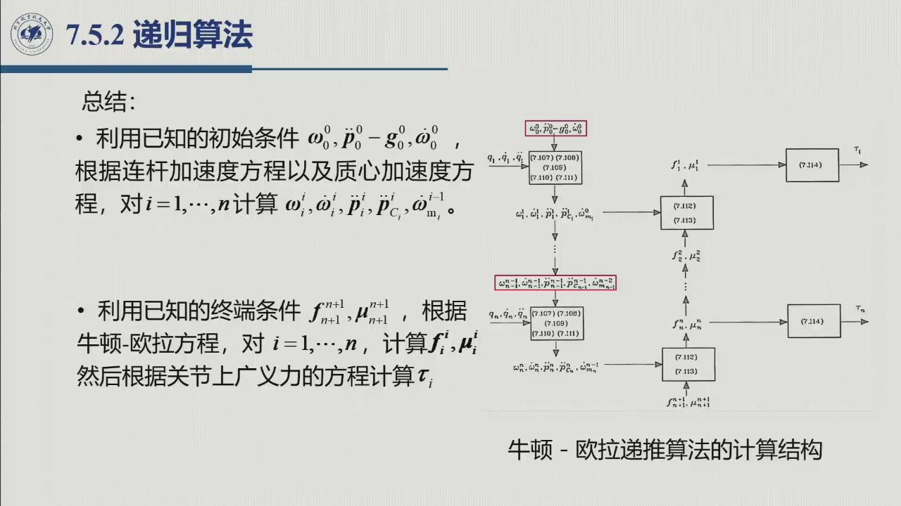

**计算结构。** 课件把两遍循环画成框图（左：前向，自上而下；右：后向，自下而上；最右投影出 $\tau_i$），标注的式号 (7.107)–(7.114) 是教材式号：

| 式号 | 内容 | 式号 | 内容 |
|:--|:--|:--|:--|
| (7.107) | 角速度 $\boldsymbol\omega_i$ | (7.111) | 转子角加速度 $\dot{\boldsymbol\omega}_{m_i}$ |
| (7.108) | 角加速度 $\dot{\boldsymbol\omega}_i$ | (7.112) | 力 $\boldsymbol f_i$ |
| (7.109) | 线加速度 $\ddot{\boldsymbol p}_i$ | (7.113) | 力矩 $\boldsymbol\mu_i$ |
| (7.110) | 质心加速度 $\ddot{\boldsymbol p}_{C_i}$ | (7.114) | 关节广义力 $\tau_i$ |

**为什么是 $O(n)$。** 两遍循环里每根杆只做**常数规模**的 $3\times3$ / $3\times1$ 运算（叉乘、矩阵乘向量、投影），既没有 $n\times n$ 求逆，也没有随 $n$ 增长的求和；计算量随 $n$ **线性**增长。这正是老师说的「每个方程并不长，矩阵运算少一些，计算速度会快一些」（01:15:10–01:15:26）。

**换到当前连杆系。** 上面为对照课堂推导把向量都写在基座系。实际实现时课件把向量乘 $\boldsymbol R_i^{i-1\mathrm T}$ 换到**当前连杆系**（课件 §7.5.2 末），好处是 $\bar{\boldsymbol I}_i^i$、$\boldsymbol r_{i,C_i}^i$ 都成为常数、可预先算好，代价是每步多一次旋转——与 [6.1.1](sec6-1-1.md) 同一招；换系后即教材 (7.107)–(7.114)。

## 6.4.9 与拉格朗日法的关系：好推难算 vs 难推好算

老师把两种方法放在一起对比（01:23:20–01:25:45，课件 §7.6），结论只有八个字：**拉格朗日：好推难算；牛顿–欧拉：难推好算。**

| | 拉格朗日法 | 牛顿–欧拉法 |
|:--|:--|:--|
| 形式 | 封闭解析式 $B\ddot{\boldsymbol q}+C\dot{\boldsymbol q}+\boldsymbol g=\boldsymbol\tau$ | 两遍递推（前向运动、后向力） |
| 推导 | 系统、直观 | 公式多、方向来回，难推、不直观 |
| 计算 | 构造 $B,C,\boldsymbol g$ 的代价随 $n$ 增长 | 每步常数规模，$O(n)$ |
| 擅长 | 分析、控制设计、参数辨识、柔性等复杂效应 | 实时逆动力学、仿真内环 |
| 结构性质 | $B$ 对称正定、$\dot B-2C$ 反对称、$\tau=Y\pi$ | 不显式给出 $B,C,\boldsymbol g$ |

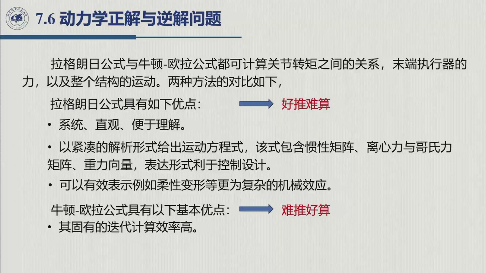

**两者结果完全一致。** 两种方式得到的方程「表现形式虽然不一样，计算量也不太一样，但实际上是统一的、完全一样」（01:22:36–01:22:59）：把递推展开，正是同一个 $B\ddot{\boldsymbol q}+C\dot{\boldsymbol q}+\boldsymbol g$。所以「要快」用牛顿–欧拉，「要结构、要设计控制器」用拉格朗日——这也是老师说「大部分论文基于拉格朗日方程」的原因（01:24:28–01:24:35）。

**复杂度要声明口径。** 课件 §7.6 的「计算复杂度」页（s05251，01:27:31）记**正解 $O(n^2)$、逆解 $O(n^2)$**，并说「两种方法都是 $N$ 方的关系」；这与牛顿–欧拉**递推**的 $O(n)$ 不矛盾，只是口径不同：

| 口径 | 计算量 | 来由 |
|:--|:--|:--|
| 牛顿–欧拉**递推** | $O(n)$ | 每杆常数规模运算，两遍循环（6.4.8） |
| **封闭模型**数值求值 | $O(n^2)$ | $B$ 有 $n^2$ 个元素，$C\dot q$ 与 $\boldsymbol g$ 也至少 $O(n^2)$；课件上表即此口径 |
| **符号展开**再代数值 | $O(n^3)$ | 符号构造量（文献口径） |

比较复杂度时**先声明口径**，不要把 $O(n)$ 与 $O(n^2)$ 混比。

**算例路标。** 老师随后用教材例 7.2 的两连杆平面臂演示完整递推（01:15:30–01:23:20，课件 §7.5.3）：初始条件 $\ddot{\boldsymbol p}_0^0-\boldsymbol g_0^0=[0,\ g,\ 0]^{\mathrm T}$、$\boldsymbol\omega_0^0=\dot{\boldsymbol\omega}_0^0=\boldsymbol 0$、$\boldsymbol h_e=\boldsymbol 0$，向量都在当前连杆系表达，旋转矩阵与 $\boldsymbol r_{i,C_i}$ 为常数；逐杆算完前向、后向得 $\tau_1,\tau_2$，与 [6.3.2](sec6-3-2.md) 的式 (7.82) 是**同一个模型**。中间结果较长，本页不展开。

一句话收束：牛顿–欧拉法不显式给出 $B,C$，更像「运行时的引擎」而不是「设计时的语言」；考试手算（6.3.2）、参数辨识（6.2.2）、理论分析归拉格朗日，控制器内环与仿真归牛顿–欧拉。

## 6.4.10 小结与常见错误

- **一句话**：牛顿–欧拉法 = **单杆的牛顿方程与欧拉方程 + 两遍递推 + 关节轴投影**；向外算运动，向内算力，重力用 $\ddot{\boldsymbol p}_0=-\boldsymbol g_0$ 吸收。
- **三个关键**：$\boldsymbol\mu_i$ 与 $\boldsymbol\mu_{i+1}$ 的参考点不同；移动关节多出 $\dot d$、$\ddot d$、$2\dot d\boldsymbol\omega\times\boldsymbol z$；转子项 $k_rI_m$ 不要漏。
- **一个结论**：$O(n)$ 比拉格朗日「构造 $B,C,\boldsymbol g$」快，但不显式给出这些矩阵。

### 常见错误清单

1. **力臂用错参考点**：$\boldsymbol\mu_i$ 关于 $O_{i-1}$、$\boldsymbol\mu_{i+1}$ 关于 $O_i$；写欧拉方程要把力对 $C_i$ 的矩补齐。
2. **重力算两遍、漏掉或加错位置**：用 $\ddot{\boldsymbol p}_0=-\boldsymbol g_0$ 就不要再在牛顿方程加 $m_i\boldsymbol g_0$；欧拉方程里也不要加 $m_i\boldsymbol g_0$ 的矩（重力过质心，对 $C_i$ 无力矩）。
3. **移动关节照抄转动关节**：$\boldsymbol\omega_i=\boldsymbol\omega_{i-1}$ 没错，但线加速度多出 $\ddot d_i\boldsymbol z_{i-1}$ 与科氏项 $2\dot d_i\boldsymbol\omega_i\times\boldsymbol z_{i-1}$。
5. **递推方向搞反**：运动量 $i=1\to n$，力 $i=n\to1$，反了算不出来。
6. **漏转子项**：欧拉方程是「关节 $i+1$ 的电机」$k_{r,i+1},I_{m_{i+1}}$，$\tau_i$ 投影式是「关节 $i$ 的电机」$k_{r_i},I_{m_i}$，下标不要混。
7. **把牛顿–欧拉的 $\tau$ 当作 $B,C,\boldsymbol g$**：它只给力矩，不显式给矩阵。
8. **末端力符号**：有接触时 $\boldsymbol h_e$ 的符号/参考点要与 6.1.3 统一（待核）。

### 默写点 · 合上书再写

1. 写出单连杆的牛顿方程与欧拉方程（含转子角动量项），并说明重力为什么不出现在欧拉方程里。
2. 写出前向递推六式（角速度、线速度、角加速度、线加速度、质心加速度、转子角加速度），移动/旋转关节分别写。
3. 写出后向递推的 $\boldsymbol f_i$、$\boldsymbol\mu_i$ 与 $\tau_i$ 三式。
4. 重力项有哪两种处理？为什么 $\ddot{\boldsymbol p}_0=-\boldsymbol g_0$ 能「自动含重力」？
5. 牛顿–欧拉法为什么是 $O(n)$？它与拉格朗日法各自的优缺点是什么？

::: note 待核（本节）
1. **转子项的 $k_r$ 幂次与 $I_m$ 的约定**：课件把转子项写成 $k_{r,i+1}$ **一次幂**，而 [6.1.1](sec6-1-1.md) 的转子动能里是 $k_r^2I_m$（$B$ 的对角元）。两者是否只差「$I_m$ 是否已折算到关节侧」的记号约定，课堂未说明；**待核**教材 (7.113) 与例 7.2 的用法。本页按课件原样转录，做题时以老师记号为准。
2. **式号与内容的逐条对应**：式号表按课件结构图自上而下整理，逐条与教材印刷版对照**待核**。
3. **末端力 $\boldsymbol h_e$ 的符号与参考点**：课件未在课堂展开，**待核**；与 6.1.3 的 $-J^{\mathrm T}\boldsymbol h_e$ 是否同号取决于题目的力方向约定。
:::
