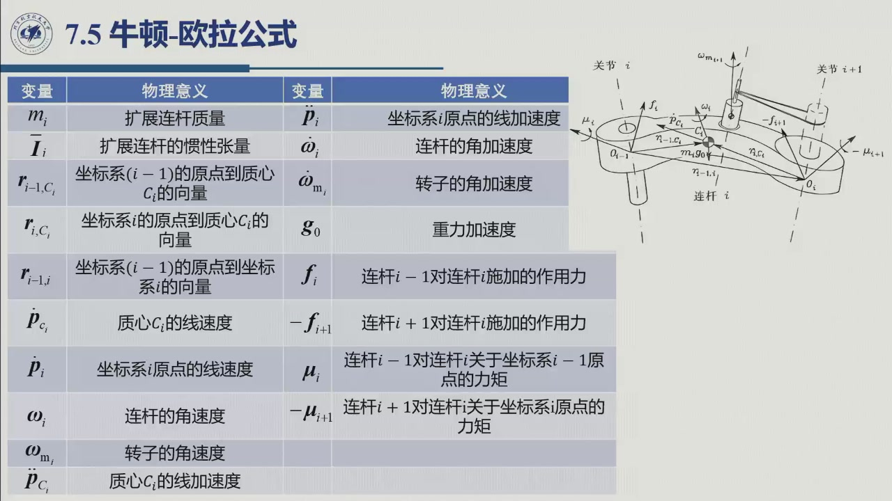
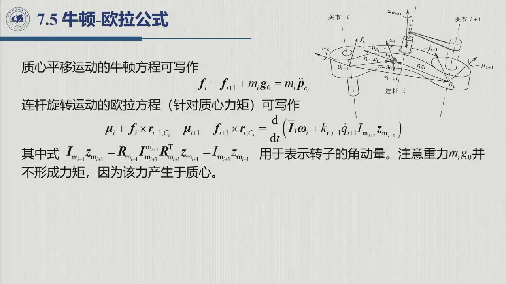
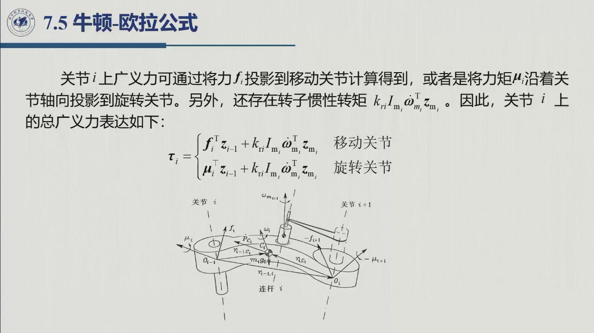
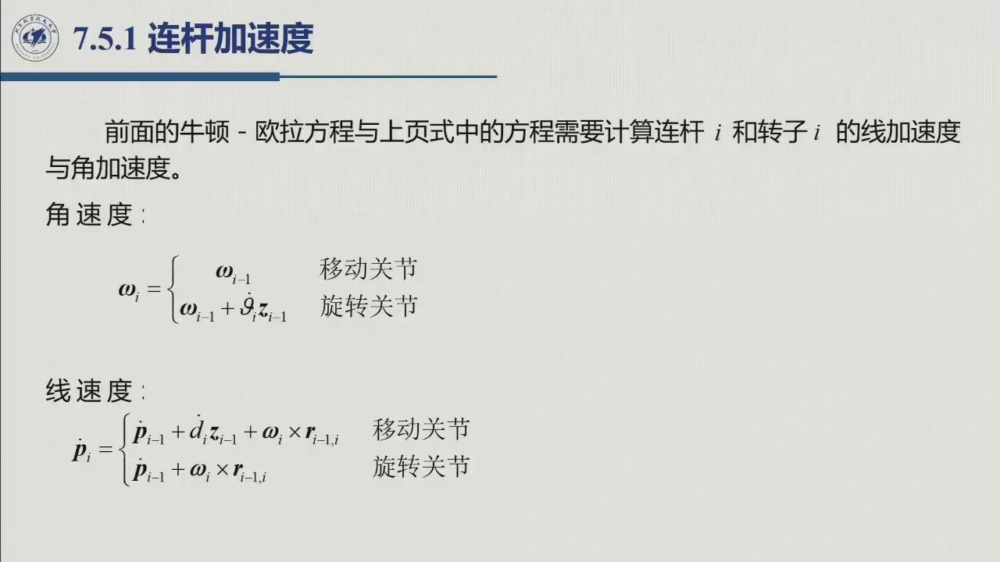
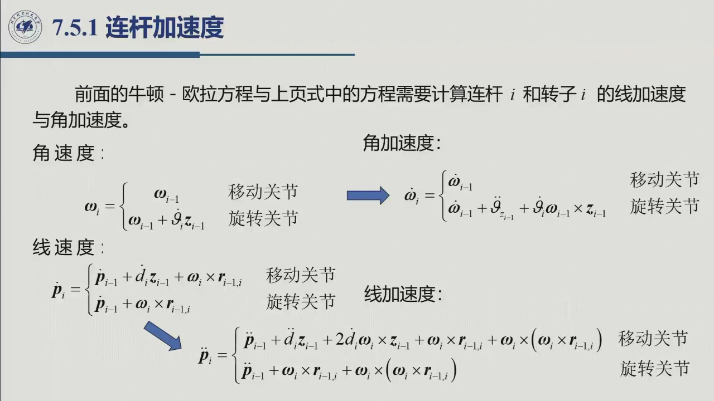
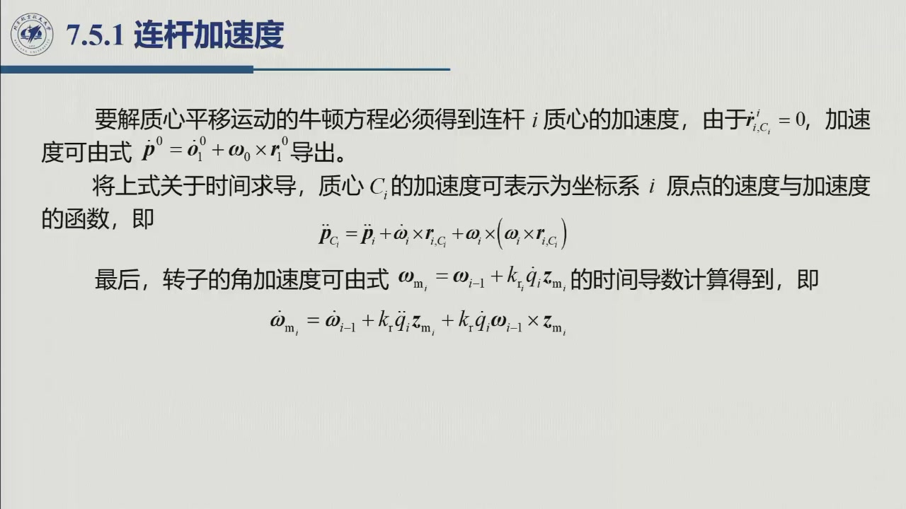
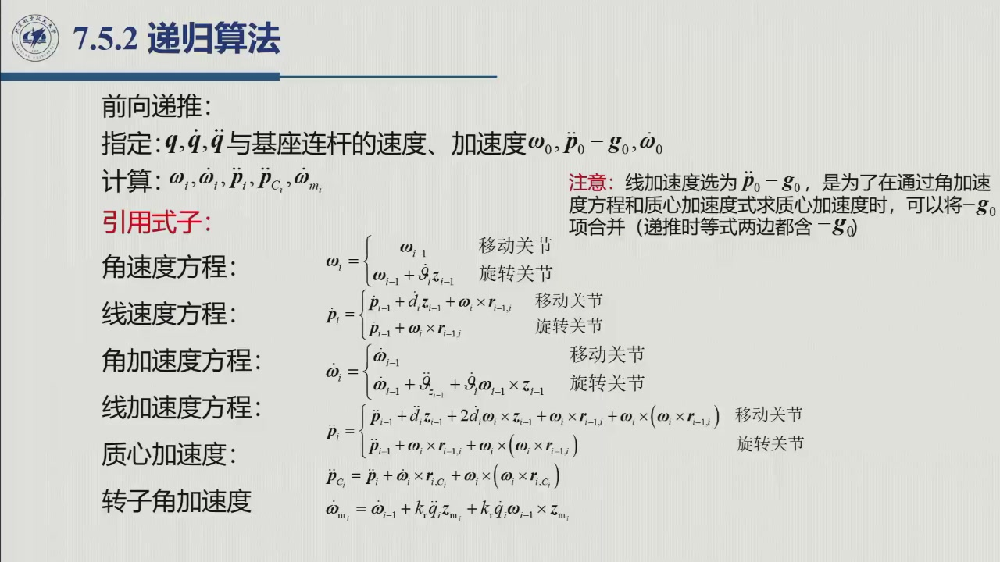
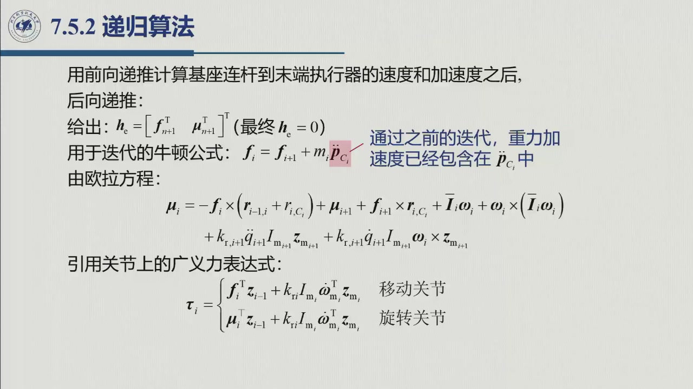
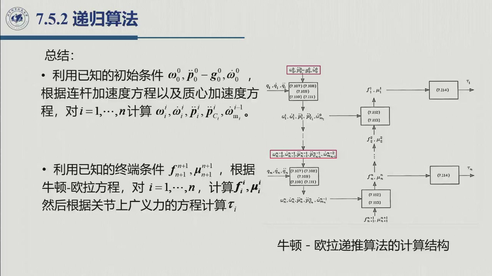
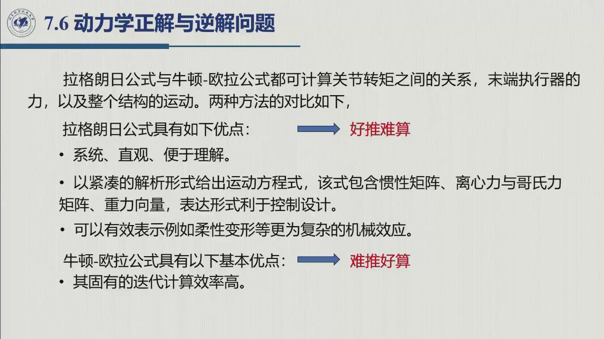

# 6.4 牛顿–欧拉递推

拉格朗日法把动能与势能整理成关节方程；牛顿–欧拉法则逐杆计算运动，再逐杆传回所需的力与力矩。如果输入已经是某一时刻的 $q,\dot q,\ddot q$，通常不必先构造整张惯性矩阵，就可以求出驱动力。课堂回看：00:04:30–01:30:00；教材§7.4，课堂课件编号为§7.5。

下面先把固定基座、刚性连杆、无摩擦且不单独计电机转子动态的模型推完整，再说明转子与传动怎样加入。所有向量先在同一基系表达，角度用rad、长度用m；每次叉乘必须保持这个约定。

## 6.4.1 为什么还要第二种方法

逆动力学的问题是：给定实际构形、速度和要求的加速度，求需要施加的关节广义力。拉格朗日形式可写为

$$\tau=B(q)\ddot q+C(q,\dot q)\dot q+g(q)+J^{\mathrm T}h_e.$$

这里 $h_e$ 仍取机器人施加给环境的力系。牛顿–欧拉递推计算同一模型下的同一输出，但中间保留杆间的传递力。

两遍递推对应两种依赖关系：连杆运动由上游运动决定，负载却还包括下游连杆的需求。因此先从基座向末端计算加速度，再由末端返回基座累加力和力矩。

## 6.4.2 预备知识：动量、角动量与力系简化

对质量 $m$ 的刚体，质心为 $C$，在惯性系中的线速度为 $v_C$，则动量为 $l=mv_C$。关于质心的角动量为 $k_C=I_C\omega$，其中 $I_C$ 与 $\omega$ 必须采用同一表达系。

对质心写牛顿和欧拉方程：

$$f_{ext}=ma_C,\qquad
\mu_{ext,C}=I_C\alpha+\omega\times(I_C\omega).$$

$\alpha=\dot\omega$ 是惯性系中的角加速度。这里惯量参考点固定为质心，所以不用处理任意运动取矩点的附加项。

若确实改用一个运动点 $O$，不能无条件写成 $\mu_O=\dot k_O$。以惯性系速度定义角动量时，需保留 $\dot p_O\times l$ 等移动取矩点修正。下面通过力臂迁移力矩，避免混用这些公式。


同一力关于不同点的矩也不同。力 $f$ 作用在 $P$，关于 $O$ 的矩为 $(p_P-p_O)\times f$。只有单独的力偶矩可以不依赖取矩点；一个由合力和合力矩组成的完整力系，换原点时必须同时迁移合力的矩。


## 6.4.3 单连杆的牛顿–欧拉方程

沿用标准DH编号：关节 $i$ 的轴为 $z_{i-1}$，经过原点 $O_{i-1}$；杆 $i$ 的末端原点为 $O_i$。定义

$$r_i=p_{O_i}-p_{O_{i-1}},\qquad c_i=p_{C_i}-p_{O_i}.$$

因此从本杆近端关节到质心的向量为 $r_i+c_i$。质心惯量为 $I_i$，质量为 $m_i$。

用 $f_i,\mu_i$ 表示上游对杆 $i$ 施加的力系，力矩关于 $O_{i-1}$；下游对本杆的力系则为 $-f_{i+1},-\mu_{i+1}$，其力矩关于 $O_i$。先不要把两个原点当成同一点。



若使用实际质心加速度 $a_{C_i}^{phys}$，牛顿方程为

$$f_i-f_{i+1}+m_ig_0=m_ia_{C_i}^{phys}.$$

关于质心的欧拉方程为

$$\mu_i+(-r_i-c_i)\times f_i
-\mu_{i+1}-(-c_i)\times f_{i+1}
=I_i\alpha_i+\omega_i\times(I_i\omega_i).$$

重力在牛顿方程里出现，但对质心的力臂为零，所以没有单独出现在这条质心欧拉方程中。以后把力矩迁移到关节原点时，重力影响会通过所需支撑力进入关节力矩，不能理解成重力永远不产生关节力矩。



## 6.4.4 欧拉方程的展开：惯性张量、陀螺项与转子项

若质心惯量在连杆系中是常矩阵 $I_i^i$，在基系中为 $I_i=R_iI_i^iR_i^{\mathrm T}$。由[旋转矩阵求导](../recall.md#angular)，

$$\dot I_i=S(\omega_i)I_i-I_iS(\omega_i).$$

对角动量求导，再用 $S(\omega_i)\omega_i=0$：

$$\frac{d}{dt}(I_i\omega_i)
=\dot I_i\omega_i+I_i\alpha_i
=\omega_i\times(I_i\omega_i)+I_i\alpha_i.$$

陀螺项来自角动量方向随刚体运动而变化，是角动量求导的一部分，不需要额外假设一个外力。省略它，三维转动的惯性力矩就可能算错。

电机转子可在已知安装和传动约束下另行计入。以轴对称转子为例，若其轴 $z_m$ 固连在承载连杆上，相对角速度为 $k_r\dot q$，其自转角动量贡献为 $k_rI_m\dot q\,z_m$。对时间求导，

$$\frac{d}{dt}(k_rI_m\dot q\,z_m)
=k_rI_m\ddot q\,z_m+k_rI_m\dot q\,(\omega_{parent}\times z_m).$$

这里出现一次 $k_r$ 不与动能里的 $k_r^2I_m$ 矛盾。前者是转子角动量，后者是折算到关节坐标后的动能系数；转子加速度本身已含一次 $k_r$，再折算驱动力时还要按传动关系处理。固定电机基座的单轴情况最终就是 $k_r^2I_m\ddot q$。

若电机随上游连杆运动，还会产生质量平移、母体转动及交叉项，不能仅在每个对角元上加 $k_r^2I_m$ 就声称得到了完整转子模型。可以按[§6.1.1](sec6-1-1.md)的转子动能统一计算，或采用与该能量一致的扩展连杆递推。后面的基本两遍递推按开头声明的纯刚性连杆模型运行。

## 6.4.5 关节广义力：把力/力矩投影到关节轴

本节的 $\mu_i$ 已关于关节 $i$ 所经过的 $O_{i-1}$。在未另外计转子与摩擦的模型中，

$$\tau_i=\begin{cases}
z_{i-1}^{\mathrm T}f_i,&\text{移动关节},\\
z_{i-1}^{\mathrm T}\mu_i,&\text{转动关节}.
\end{cases}$$

这个投影也能由虚功检查：移动关节只允许沿轴平移，虚功为 $f_i^{\mathrm T}z_{i-1}\delta q_i$；转动关节只允许绕轴旋转，虚功为 $\mu_i^{\mathrm T}z_{i-1}\delta q_i$。取相应系数，就是广义力。



## 6.4.6 向外（前向）递推：连杆运动量

设基座固定，先令 $\omega_0=\alpha_0=0$。为了统一处理重力，计算中存储

$$a_i=a_{O_i}^{phys}-g_0,\qquad a_0=-g_0.$$

这里的 $a_0$ 是减去重力后的计算量，不是说固定基座真的以 $-g_0$ 加速。以后由 $F_i=m_ia_{C_i}$ 直接得到惯性需求减去重力作用，不再另加一次重力。

**转动关节。** 在关节 $i$ 处，$z_{i-1}$ 随父杆运动，所以 $\dot z_{i-1}=\omega_{i-1}\times z_{i-1}$。由第三章速度递推求导，

$$\omega_i=\omega_{i-1}+\dot q_i z_{i-1},$$

$$\alpha_i=\alpha_{i-1}+\ddot q_i z_{i-1}
+\dot q_i(\omega_{i-1}\times z_{i-1}),$$

$$a_i=a_{i-1}+\alpha_i\times r_i
+\omega_i\times(\omega_i\times r_i).$$

**移动关节。** 父子连杆的相对姿态不变，但原点沿轴伸缩，故

$$\omega_i=\omega_{i-1},\qquad\alpha_i=\alpha_{i-1},$$

$$a_i=a_{i-1}+\ddot q_i z_{i-1}
+2\dot q_i(\omega_i\times z_{i-1})
+\alpha_i\times r_i+\omega_i\times(\omega_i\times r_i).$$

系数2来自两项贡献：旋转坐标中的相对平移速度会改变方向，牵连转动也作用在伸缩力臂上。两项求导后各贡献一次，只计算其中一项会漏掉一半。





两类关节算出原点运动后，都可用同一式移到质心：

$$a_{C_i}=a_i+\alpha_i\times c_i
+\omega_i\times(\omega_i\times c_i).$$

这里 $c_i$ 固连在杆 $i$ 上。若质心位置由另一个不随杆固连的变量决定，就不能原样使用刚体两点式。





## 6.4.7 向内（后向）递推：力、力矩与关节力矩

前向计算完成后，先构造本杆的动力学需求：

$$F_i=m_ia_{C_i},\qquad N_i=I_i\alpha_i+\omega_i\times(I_i\omega_i).$$

$F_i$ 已包含重力处理，$N_i$ 关于质心。令末端力系 $h_e=[f_{n+1};\mu_{n+1}]$ 为机器人对环境的作用，并预先换到 $O_n$ 参考点和当前统一表达系；自由运动时取零。

由牛顿方程移项，

$$f_i=F_i+f_{i+1}.$$

把本杆质心需求和下游力系都迁移到 $O_{i-1}$，得

$$\mu_i=N_i+\mu_{i+1}+(r_i+c_i)\times F_i+r_i\times f_{i+1}.$$

四项依次表示本杆绕质心的需求、下游传来的力偶、本杆合力对近端的矩，以及下游合力对近端的矩。将 $f_i=F_i+f_{i+1}$ 代回前面的质心欧拉方程，可逐项核对两种写法等价。最后按关节轴投影，取得 $\tau_i$。



若采用真实加速度初始化 $a_0^{phys}=0$，则需改用 $F_i=m_i(a_{C_i}^{phys}-g_0)$。两种方法只能选一种；同样，工具点上的外部力必须先迁移到终端原点，不能把不同参考点的六个分量直接填入终端条件。

### 完整跟算：一个加速关节为什么会使另一关节出力

取两杆各1 m，$q=(0,\pi/2)$，仅在末端放2 kg质点，杆本体无质量、忽略转子和摩擦。基系 $y$ 竖直向上，$g_0=(0,-9.81,0)$。此刻 $\dot q=0$，要求 $\ddot q=(2,0)$ rad/s²。

几何上 $r_1=(1,0,0)$、$r_2=(0,1,0)$，质点就是第二杆末端，所以 $c_2=0$。前向递推给 $\alpha_1=\alpha_2=(0,0,2)$。第一原点的物理加速度为 $(0,2,0)$，第二原点再加 $\alpha_2\times r_2=(-2,0,0)$，故

$$a_{C_2}^{phys}=(-2,2,0),\qquad a_{C_2}=(-2,11.81,0).$$

后向计算中 $F_2=2a_{C_2}=(-4,23.62,0)$ N，质点的质心转动需求 $N_2=0$，终端力为零。因此

$$\mu_2=r_2\times F_2=(0,0,4),$$

$$\mu_1=\mu_2+r_1\times F_2=(0,0,27.62).$$

投影到两根正向 $z$ 轴，得到 $\tau=(27.62,4)$ N·m。第二关节相对加速度为零，仍需4 N·m来约束下游运动。

用动能法独立检查：此构形的 $B=\begin{bmatrix}4&2\\2&2\end{bmatrix}$、$g=(19.62,0)^{\mathrm T}$，且零速时速度项为零。所以 $B(2,0)^{\mathrm T}+g=(27.62,4)^{\mathrm T}$，与递推一致。将要求加速度改成零，两关节保持力矩则为 $(19.62,0)$，可继续检查重力符号。

## 6.4.8 两遍循环：算法、计算结构与复杂度

```text
输入：q, qdot, qddot，连杆质量与质心惯量，终端力系
初值：omega[0] = alpha[0] = 0，a[0] = -g0

对 i = 1 到 n：
    由正运动学取得 r[i]、c[i]、z[i-1] 和惯量表达
    按关节类型计算 omega[i]、alpha[i]、a[i]
    移到质心，计算 aC[i]
    F[i] = m[i] * aC[i]
    N[i] = I[i] * alpha[i] + omega[i] × (I[i] * omega[i])

设置已经统一参考点与表达系的 f[n+1]、mu[n+1]
对 i = n 到 1：
    f[i] = F[i] + f[i+1]
    mu[i] = N[i] + mu[i+1] + (r[i]+c[i]) × F[i] + r[i] × f[i+1]
    转动关节取 tau[i] = z[i-1] · mu[i]
    移动关节取 tau[i] = z[i-1] · f[i]
```

每杆每遍使用固定维数的向量与矩阵运算，给定一次状态和要求加速度的逆动力学计算量因此随杆数线性增长。换到当前连杆系计算时，质心偏置与惯量可保持常数，但传递向量必须逐步旋转，不能只删掉基系中的 $RIR^{\mathrm T}$ 而保留其他基系向量。



## 6.4.9 与拉格朗日法的关系：好推难算 vs 难推好算

两种方法在相同建模假设下应给相同力矩，区别主要在组织计算的方式。能量法便于展示 $B,C,g$ 的来源，递推便于直接求一次逆动力学。不能仅凭方法名称给全部计算指定一个复杂度。

例如，输出完整的稠密 $B$ 就有 $n^2$ 个数，与只求一个 $n$ 维力矩向量不是同一任务。正动力学若先构造 $B$ 再作通用求解，又与专门的递推算法不同；符号表达式长度也不等于一次数值递推的成本。



## 6.4.10 小结与常见错误

应用递推前，先明确模型计入哪些部件，并标出各力矩的参考点。前向求运动需求，后向累加本杆与下游力系，再投影到关节轴。先核对零加速度保持和一组加速数据，确认基本模型后，再加入转子、摩擦与接触。

::: think 检查理解
1. 为什么固定基座仍可用 $a_0=-g_0$ 初始化？它是什么计算量？
2. $\mu_i$ 与 $\mu_{i+1}$ 为什么不能不迁移参考点就直接相减？
3. 关节2相对加速度为零，为什么算例中的 $\tau_2$ 仍然非零？
4. 转子角动量含一次 $k_r$，为什么折算到关节的惯量贡献却含平方？

::: sol 核对
计算中存的是实际加速度减去重力，固定基座实际加速度仍为零。两个力系关于不同原点，合力的力臂矩必须补齐。下游质点被第一关节带动加速，第二关节需施力约束其相对运动。转子转速随 $k_r$ 放大，力矩向关节折算还含一次传动系数，最终与动能的平方系数一致。
:::
:::
