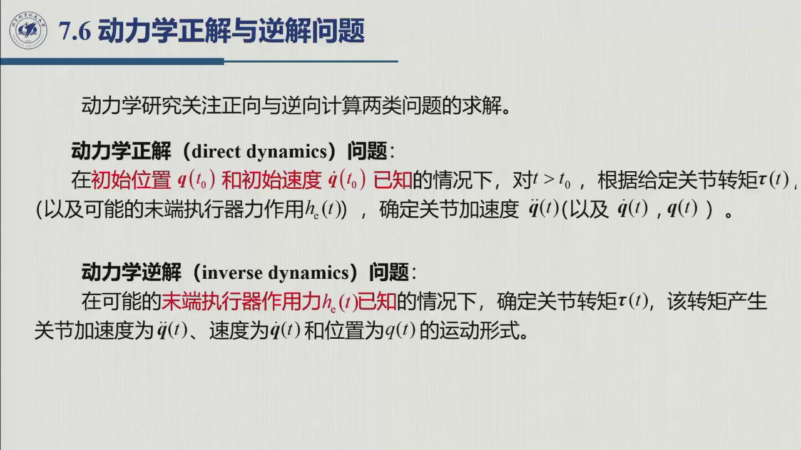
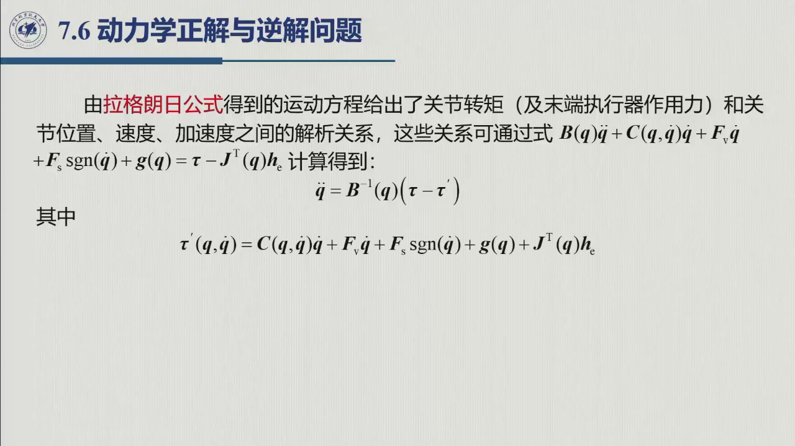
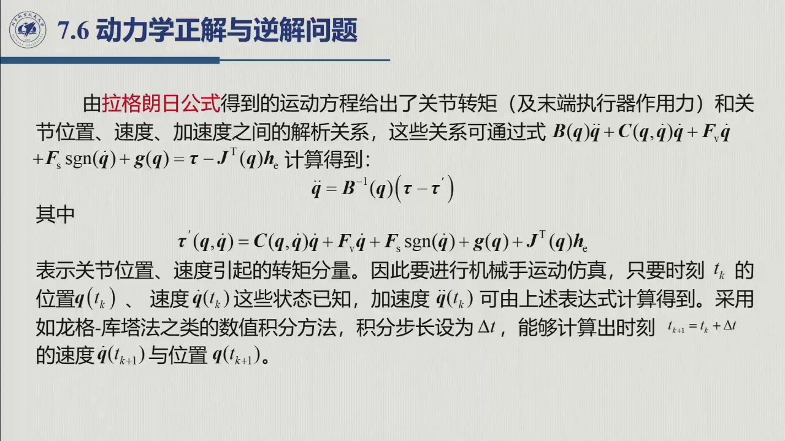
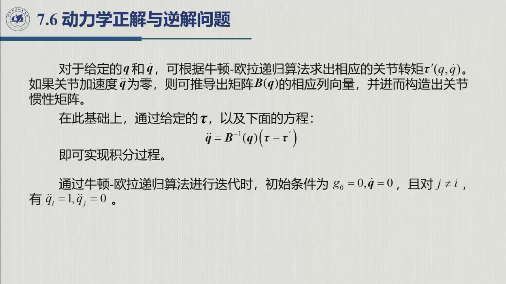
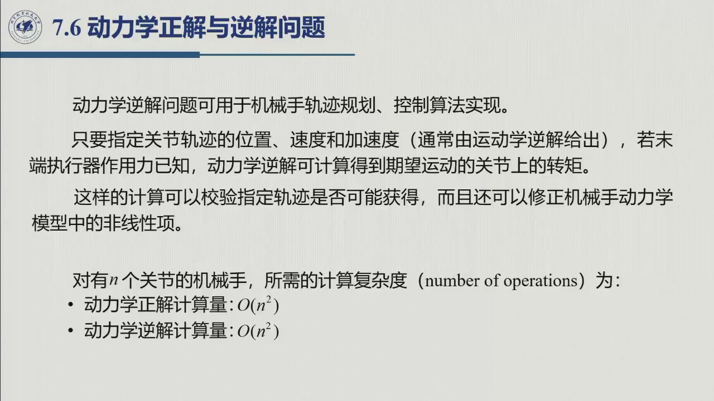

# 6.5 动力学正解与逆解

同一条[动力学方程](../recall.md#dynamics)可以从两个方向使用。给关节力矩和当前状态，求下一步怎样加速，是正动力学；给要求的构形、速度与加速度，求需要多大力矩，是逆动力学。前者还要随时间积分，后者在给定状态处是一次代数计算。课堂回看：01:20:24–01:28:15。

## 6.5.1 两个问题：正解与逆解

::: def 定义 6.5.1 · 动力学正解与逆解 {#def-6.5.1}
对本章模型，先将速度、重力、摩擦与已知末端负载收成偏置项 $b(q,\dot q,h_e)$：

$$B(q)\ddot q+b(q,\dot q,h_e)=\tau,$$

$$b=C(q,\dot q)\dot q+g(q)+F_v\dot q+F_s\operatorname{sgn}(\dot q)+J^{\mathrm T}h_e.$$

正动力学在给定 $q,\dot q,\tau,h_e$ 时求 $\ddot q$。若要求一段运动，还需初始状态 $q(t_0),\dot q(t_0)$ 和后续输入。

逆动力学在给定 $q,\dot q,\ddot q,h_e$ 时求 $\tau$。所有状态与外力均需采用同一时刻和相容单位。
:::

这里 $h_e$ 继续表示机器人对环境施加的力系，因此它移到力矩需求一侧时为正。如果接触力本身未知，还须结合接触约束求解，不能只把它当作已知数代入。

正、逆运动学处理关节坐标与末端位姿的几何关系，不需要质量与驱动力。同样使用“正、逆”命名，并不表示动力学会有相同的求解难度或多解情形。

## 6.5.2 正解：解出加速度，再数值积分

先移项得到线性方程

$$B(q)\ddot q=\tau-b.$$

模型满足独立坐标与正动能条件时，$B\succ0$，所以当前加速度唯一。公式可写为 $\ddot q=B^{-1}(\tau-b)$；数值实现通常直接求解线性系统，例如对称正定分解，不必显式构造逆矩阵。还要检查模型量纲、尺度与条件数，不能仅因数学上可逆就忽略数值误差。

用上一节的两杆质点模型检查一次。此刻 $B=\begin{bmatrix}4&2\\2&2\end{bmatrix}$、$b=g=(19.62,0)^{\mathrm T}$，输入 $\tau=(27.62,4)^{\mathrm T}$，因此

$$4\ddot q_1+2\ddot q_2=8,\qquad2\ddot q_1+2\ddot q_2=4.$$

两式相减得到 $2\ddot q_1=4$，故 $\ddot q_1=2$、$\ddot q_2=0$，恰好恢复上一节给定的加速度。

但加速度不是完整轨迹。写成一阶状态 $y=[q;v]$，还需积分

$$\dot y=\begin{bmatrix}v\\B(q)^{-1}(\tau-b(q,v,h_e))\end{bmatrix}.$$

例如显式Euler用 $v_{k+1}=v_k+h\ddot q_k$、$q_{k+1}=q_k+hv_k$。Runge–Kutta方法则在步内多次计算状态与加速度。步长和方法决定截断误差，输入变化、接触和摩擦过零也会影响计算；不能只检查第一步加速度正确就认为仿真轨迹正确。

## 6.5.3 逆解：给定运动，直接算转矩

逆动力学在同一时刻直接计算

$$\tau=B(q)\ddot q+b(q,\dot q,h_e).$$

若把上面的 $\ddot q=(2,0)$ 代入，惯性需求为 $(8,4)$ N·m，再加保持重力所需的 $(19.62,0)$ N·m，得到 $(27.62,4)$ N·m。正逆两次计算应互相恢复，这是程序的一个有效核验。

沿轨迹逐时刻计算逆动力学，可检查力矩限值，也可生成前馈或反馈补偿输入。要判断电机能否实际跟踪，还须加入模型误差、执行器能力与闭环分析，所需力矩本身不足以保证无误差运动。

## 6.5.4 与 6.4 的衔接：逆解的两种算法

一种做法先构造 $B,C,g$ 再代入；另一种用牛顿–欧拉递推直接求力矩。物理假设相同，两者应给一致结果。比较前要先统一转子等部件是否计入，否则差异可能来自模型，而非算法。

逆动力学还可用于提取 $B$ 的列。固定构形，关闭摩擦与末端负载，令速度为零。记

$$\tau_0=\operatorname{ID}(q,0,0),\qquad
\tau_i=\operatorname{ID}(q,0,e_i).$$

因为两次计算的重力相同，

$$\tau_i-\tau_0=B(q)e_i.$$

差值就是第 $i$ 列；无需为了这一步特意更改重力参数。也可以关闭重力，此时 $\tau_0=0$。对所有单位加速度各算一次，便得到整张惯性矩阵。

## 6.5.5 计算量：课件口径与递推口径

给定一次 $q,\dot q,\ddot q$ 的刚体逆动力学，标准两遍递推每杆进行固定规模运算，可实现 $O(n)$。若已经有稠密 $n\times n$ 矩阵，再做矩阵向量乘是另一个计算任务，通常需要 $O(n^2)$。

构造全部 $B$、对稠密矩阵作通用分解、使用专门正动力学递推，以及进行符号展开，各有不同成本。因此复杂度要连同算法和输出要求说明。对随构形变化的模型，也不能无条件假定逆矩阵已预先算好。

## 6.5.6 小结与常见错误

每次计算先列出已知量和所求量。逆动力学代入运动求力，正动力学解力平衡求加速度；只有后者进一步积分，才产生输入作用下的状态轨迹。验证时应同时做正逆互代、静止保持和步长收敛检查。

::: think 检查理解
1. 已知力矩但没有初始位置与速度，能否唯一预测后续运动？
2. 为什么建议解 $B\ddot q=r$，而不把显式求逆当成必经步骤？
3. 提取 $B$ 的列时，为什么需要减掉 $\tau_0$？

::: sol 核对
一般不能，动力学是状态微分方程，需要初值。解线性系统可以避免不必要的显式逆，并利用对称正定结构。$\tau_0$ 保留了相同构形下的偏置，取差后才能单独得到单位加速度产生的惯性力矩。
:::
:::
