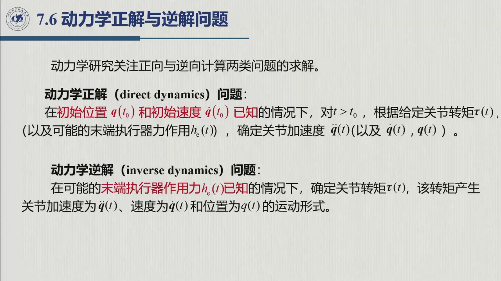
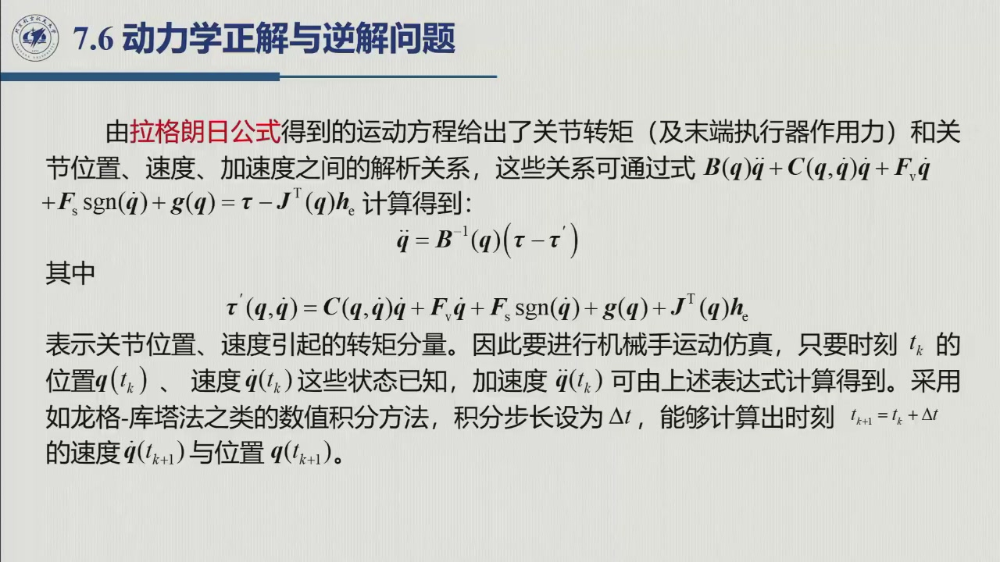
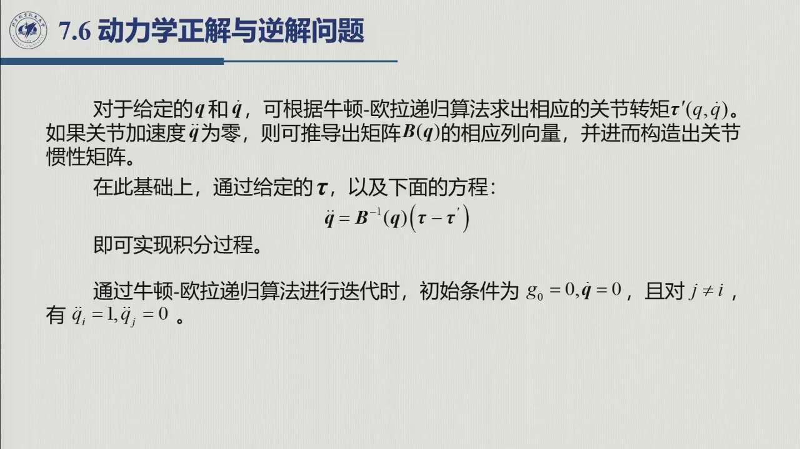
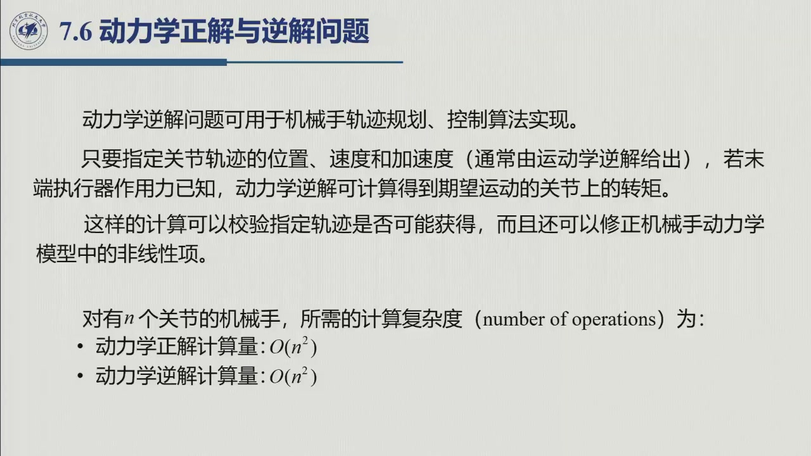

# 6.5 动力学正解与逆解

前面分别用拉格朗日法和牛顿–欧拉法写出了同一条[关节空间动力学方程](../recall.md#dynamics)。实际工程中，这条方程常被从两个相反方向使用：仿真器要从当前位置、速度和电机输入的力矩出发，预测下一瞬间怎样加速、运动到哪里去；控制律和轨迹校核则恰好反过来，已知这一瞬间希望走出的加速度，反推电机必须输出多大力矩。本节把这两种用法定义为正动力学与逆动力学，说明它们在数值求解和计算量上的根本差别，并补出如何用牛顿–欧拉逆动力学逐列提取整张惯性矩阵 $B(\boldsymbol q)$。课堂回看：01:20:24–01:28:15。

## 6.5.1 两个问题：正解与逆解

::: def 定义 6.5.1 · 动力学正解与逆解 {#def-6.5.1}
对本章刚体模型，先把除加速度项之外的速度耦合、重力、摩擦和已知末端接触力收成偏置转矩 $\boldsymbol\tau'(\boldsymbol q,\dot{\boldsymbol q},\boldsymbol h_e)$（或简记为 $\boldsymbol b$）：

$$B(\boldsymbol q)\ddot{\boldsymbol q}+\boldsymbol\tau'(\boldsymbol q,\dot{\boldsymbol q},\boldsymbol h_e)=\boldsymbol\tau,$$

$$\boldsymbol\tau'(\boldsymbol q,\dot{\boldsymbol q},\boldsymbol h_e)=C(\boldsymbol q,\dot{\boldsymbol q})\dot{\boldsymbol q}+\boldsymbol g(\boldsymbol q)+F_{\mathrm v}\dot{\boldsymbol q}+F_{\mathrm s}\operatorname{sgn}(\dot{\boldsymbol q})+J^{\mathrm T}(\boldsymbol q)\boldsymbol h_e.$$

- **正动力学（direct dynamics）**：给定初始状态 $\boldsymbol q(t_0),\dot{\boldsymbol q}(t_0)$ 以及时间区间上的输入力矩 $\boldsymbol\tau(t)$ 与末端力 $\boldsymbol h_e(t)$，求关节加速及随时间演化的运动轨迹 $\boldsymbol q(t),\dot{\boldsymbol q}(t)$。
- **逆动力学（inverse dynamics）**：给定某一时刻的关节运动 $\boldsymbol q,\dot{\boldsymbol q},\ddot{\boldsymbol q}$ 与已知末端力 $\boldsymbol h_e$，求实现该运动所需的关节驱动力矩 $\boldsymbol\tau$。所有状态与外力必须采用同一时刻和相容单位。
:::

按全章统一约定，$\boldsymbol h_e$ 是机器人施加在环境上的力系，所以移到左端力矩需求一侧时带正号 $+J^{\mathrm T}\boldsymbol h_e$；如果接触力本身未知，则需结合接触约束联立求解，不能直接当成已知输入。

第二章的正运动学容易、逆运动学常有多解或无解；动力学的难易关系恰好相反。逆动力学只是把已知的 $\boldsymbol q,\dot{\boldsymbol q},\ddot{\boldsymbol q}$ 代入公式或两遍递推，代数一次出数；正动力学每一步不仅要解线性方程组求 $\ddot{\boldsymbol q}$，还要对二阶微分方程做数值积分，一般没有闭式解。因此控制设计里绝大多数时候用逆解（01:26:23–01:27:01），仿真物理环境时才用正解。
## 6.5.2 正解：解出加速度，再数值积分

先移项得到线性方程

$$B(\boldsymbol q)\ddot{\boldsymbol q}=\boldsymbol\tau-\boldsymbol\tau'(\boldsymbol q,\dot{\boldsymbol q},\boldsymbol h_e).$$

在独立广义坐标和正动能模型下，$B(\boldsymbol q)$ 对称正定，因此 $B^{-1}$ 存在、当前时刻的加速度 $\ddot{\boldsymbol q}=B^{-1}(\boldsymbol\tau-\boldsymbol\tau')$ 唯一。程序求解这一步时，通常用 Cholesky 分解解对称正定线性方程组 $B\ddot{\boldsymbol q}=\boldsymbol r$，而不显式求逆矩阵 $B^{-1}$；同时还要检查尺度与条件数（高减速比或轻杆带重负载时 $B$ 的条件数可能很大，求逆容易放大数值误差）。

用 [6.4.7](sec6-4.md) 的两杆质点模型检查一次。构形 $q=(0,\pi/2)$、零速下有 $B=\begin{bmatrix}4&2\\2&2\end{bmatrix}$、$\boldsymbol\tau'=\boldsymbol g=(19.62,0)^{\mathrm T}$，若电机输入 $\boldsymbol\tau=(27.62,4)^{\mathrm T}\ \mathrm{N\cdot m}$，右侧净力矩 $\boldsymbol\tau-\boldsymbol\tau'=(8,4)^{\mathrm T}$，线性方程组为

$$\begin{cases}4\ddot q_1+2\ddot q_2=8,\\2\ddot q_1+2\ddot q_2=4.\end{cases}$$

两式相减得 $2\ddot q_1=4\Rightarrow\ddot q_1=2\ \mathrm{rad/s^2}$，代回得 $\ddot q_2=0\ \mathrm{rad/s^2}$，恰好恢复上一节给定的加速度。

单步算出 $\ddot{\boldsymbol q}$ 还不是一段运动轨迹。令状态向量 $\boldsymbol y=[\boldsymbol q;\,\dot{\boldsymbol q}]$（简记速度 $\boldsymbol v=\dot{\boldsymbol q}$），把二阶动力学方程写成一阶状态方程后沿时间步进积分：

$$\dot{\boldsymbol y}=\begin{bmatrix}\boldsymbol v\\B(\boldsymbol q)^{-1}\bigl(\boldsymbol\tau-\boldsymbol\tau'(\boldsymbol q,\boldsymbol v,\boldsymbol h_e)\bigr)\end{bmatrix}.$$

显式 Euler 法在步长 $h$ 下更新 $\boldsymbol v_{k+1}=\boldsymbol v_k+h\ddot{\boldsymbol q}_k$、$\boldsymbol q_{k+1}=\boldsymbol q_k+h\boldsymbol v_k$，Runge–Kutta（如 RK4）则在每步内多次采样状态与加速度以提高精度。实际仿真不仅要看第一步加速度对不对，还要检查步长收敛、输入跳变、库仑摩擦过零切换以及碰撞接触处的刚性问题。

## 6.5.3 逆解：给定运动，直接算转矩

逆动力学在同一时刻直接计算

$$\boldsymbol\tau=B(\boldsymbol q)\ddot{\boldsymbol q}+\boldsymbol\tau'(\boldsymbol q,\dot{\boldsymbol q},\boldsymbol h_e).$$

拿上面的数值反过来代回：将 $\ddot{\boldsymbol q}=(2,0)^{\mathrm T}$ 乘以 $B$ 得惯性需求 $(8,4)^{\mathrm T}\ \mathrm{N\cdot m}$，加上重力项 $(19.62,0)^{\mathrm T}\ \mathrm{N\cdot m}$，直接算出 $\boldsymbol\tau=(27.62,4)^{\mathrm T}\ \mathrm{N\cdot m}$。正动力学和逆动力学在同一点互为逆运算，写仿真或控制代码时常把两者互代当作第一道单元测试。沿第四章规划好的轨迹逐点做逆解，可以检查是否超出电机最大力矩（[6.6](sec6-6.md)），也可以作为前馈计算力矩送给控制器（第七章）；不过算出所需力矩不代表实际必定跟得上，还需结合模型误差、执行器限幅和闭环稳定性判断。

## 6.5.4 与 6.4 的衔接：逆解的两种算法

计算逆动力学有两条现成路线：用拉格朗日法构造 $B,C,\boldsymbol g$ 后代入，或者直接运行 [6.4](sec6-4.md) 的牛顿–欧拉两遍递推。只要模型假设（是否含转子、摩擦、重力）相同，两者算出的 $\boldsymbol\tau$ 完全相等。

如果手头只有一个编好的牛顿–欧拉逆解函数 $\operatorname{ID}(\boldsymbol q,\dot{\boldsymbol q},\ddot{\boldsymbol q})$（已关闭摩擦和末端外力），怎样反推出整张惯性矩阵 $B(\boldsymbol q)$？令速度 $\dot{\boldsymbol q}=\boldsymbol 0$（消去 $C\dot{\boldsymbol q}$），在当前构形 $\boldsymbol q$ 下先算一次零加速度输入，再分别给第 $i$ 个关节单位加速度 $\boldsymbol e_i$：

$$\boldsymbol\tau_0=\operatorname{ID}(\boldsymbol q,\boldsymbol 0,\boldsymbol 0)=\boldsymbol g(\boldsymbol q),\qquad
\boldsymbol\tau_i=\operatorname{ID}(\boldsymbol q,\boldsymbol 0,\boldsymbol e_i)=B(\boldsymbol q)\boldsymbol e_i+\boldsymbol g(\boldsymbol q).$$

两式相减，重力项 $\boldsymbol g(\boldsymbol q)$ 自动消去，不必手动修改算法里的重力开关：

$$\boldsymbol\tau_i-\boldsymbol\tau_0=B(\boldsymbol q)\boldsymbol e_i.$$

这就是 $B(\boldsymbol q)$ 的第 $i$ 列（若本来已把重力设为零，则 $\boldsymbol\tau_0=\boldsymbol 0$，直接算 $\operatorname{ID}(\boldsymbol q,\boldsymbol 0,\boldsymbol e_i)$ 即可）。对 $i=1,\dots,n$ 做 $n$ 次逆解调用，就能逐列拼出完整的 $B(\boldsymbol q)$。

## 6.5.5 计算量：课件口径与递推口径

计算复杂度必须连同任务和算法口径一起说（01:27:31 课件口径与 6.4.8 递推口径不同）：如果用标准牛顿–欧拉两遍递推计算一次逆动力学 $\boldsymbol\tau$，每杆只做固定规模的 $3\times3$ 运算，复杂度是 $O(n)$；但如果已经构造出稠密的 $n\times n$ 矩阵 $B,C$ 再做矩阵向量乘法求值，或者用上述 $n$ 次逆解拼出 $B$，计算量就变成 $O(n^2)$（课件把基于封闭模型求一次正/逆解记作 $O(n^2)$ 即指此口径）。专门的递推正动力学算法（如 Featherstone 关节空间惯量法）也能把无约束正动力学降到 $O(n)$，而先构造 $B$ 再做 Cholesky 分解通常是 $O(n^3)$。讨论快慢时先说清是否需要构造整张矩阵、用哪种算法。

## 6.5.6 小结与常见错误

逆动力学给定 $(\boldsymbol q,\dot{\boldsymbol q},\ddot{\boldsymbol q},\boldsymbol h_e)$ 代数求出驱动力矩 $\boldsymbol\tau$，用于轨迹校验和控制前馈；正动力学给定 $(\boldsymbol q,\dot{\boldsymbol q},\boldsymbol\tau,\boldsymbol h_e)$ 先解 $B\ddot{\boldsymbol q}=\boldsymbol\tau-\boldsymbol\tau'$ 再沿时间数值积分，用于物理仿真。用牛顿–欧拉逆解 $\operatorname{ID}(\boldsymbol q,\boldsymbol 0,\boldsymbol e_i)-\operatorname{ID}(\boldsymbol q,\boldsymbol 0,\boldsymbol 0)$ 还可以直接逐列提取 $B(\boldsymbol q)$。

::: think 常见错误清单
1. **把正解当成“代一次公式就结束”**：算出 $\ddot{\boldsymbol q}$ 只完成一个瞬时步，完整运动必须配合数值积分从初值推进。
2. **逆解或正解漏掉 $\boldsymbol\tau'$ 中的项**：速度项 $C\dot{\boldsymbol q}$、摩擦、重力、$J^{\mathrm T}\boldsymbol h_e$ 漏掉任何一项，加速度或力矩都会对不上。
3. **以为 $B^{-1}$ 一定数值好算**：高减速比或轻杆重载会让 $B$ 条件数很大，宜解线性方程组并检查条件数，不要盲目显式求逆。
4. **把 $O(n)$ 与 $O(n^2)$ 口径混着说**：递推逆动力学一次求 $\boldsymbol\tau$ 为 $O(n)$，构造或乘以完整 $n\times n$ 封闭矩阵为 $O(n^2)$。
5. **把正/逆动力学与正/逆运动学混淆**：运动学是关节角 $\leftrightarrow$ 末端位姿（正易逆难），动力学是力矩 $\leftrightarrow$ 关节运动（逆易正难）。
:::

::: think 检查理解
1. 已知输入力矩曲线 $\boldsymbol\tau(t)$ 但不知道初始位置 $\boldsymbol q(t_0)$ 和初始速度 $\dot{\boldsymbol q}(t_0)$，能否唯一预测后续运动？
2. 为什么数值求正动力学加速度时，建议直接解线性方程组 $B\ddot{\boldsymbol q}=\boldsymbol r$ 而不显式构造 $B^{-1}$？
3. 用逆动力学函数提取 $B(\boldsymbol q)$ 的第 $i$ 列时，为什么要减去 $\boldsymbol\tau_0=\operatorname{ID}(\boldsymbol q,\boldsymbol 0,\boldsymbol 0)$？

::: sol 核对
1. 不能。动力学方程是二阶微分方程，只有给定初始构形和初始速度，积分结果才唯一。
2. 显式求逆计算量更大且舍入误差更严重；直接利用 $B$ 的对称正定性做 Cholesky 分解解方程组更稳健高效。
3. 在速度为零、加速度也为零时，逆动力学输出的 $\boldsymbol\tau_0$ 恰好等于重力项 $\boldsymbol g(\boldsymbol q)$，相减后才能单独消去重力、只留 $B(\boldsymbol q)\boldsymbol e_i$。
:::
:::

::: think 默写点 · 合上书再写
1. 写出正动力学与逆动力学的定义（已知量、所求量、适用场合与难易差异）。
2. 写出 $\ddot{\boldsymbol q}=B^{-1}(\boldsymbol\tau-\boldsymbol\tau')$ 与偏置项 $\boldsymbol\tau'$ 的完整表达式，并写出一阶状态积分方程。
3. 写出利用牛顿–欧拉逆动力学逐列提取 $B(\boldsymbol q)$ 的两步公式。
4. 解释递推逆动力学 $O(n)$ 与封闭形式 $O(n^2)$ 两种复杂度口径分别对应什么运算。
:::
