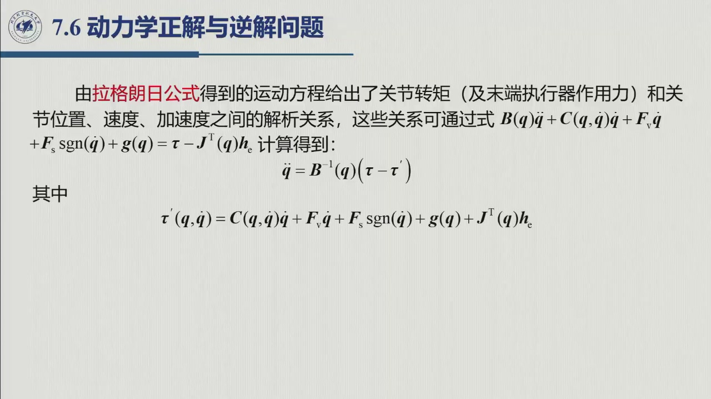
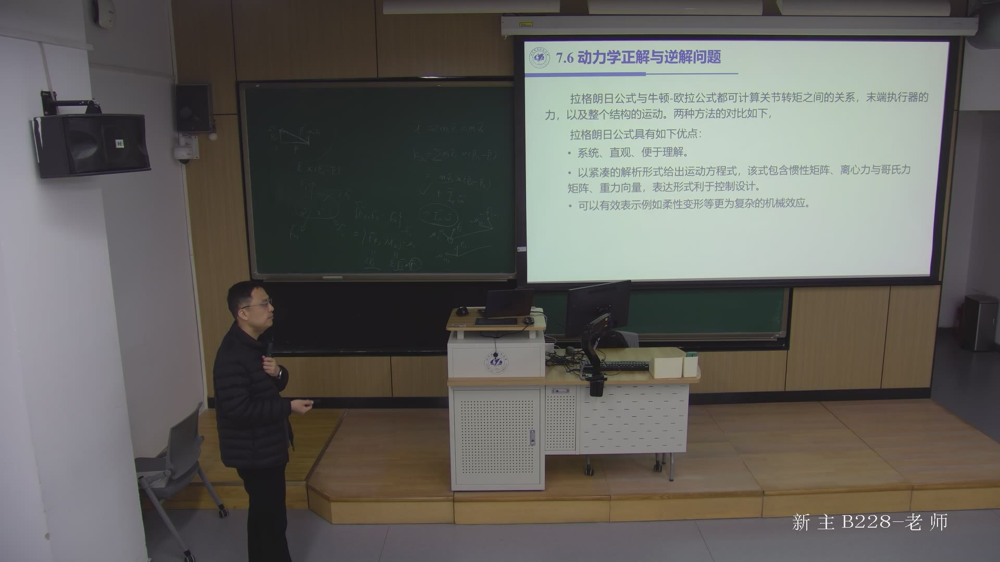

# 6.5 动力学正解与逆解

> 录播 01:20:24–01:28:15。课件 **§7.6「动力学正解与逆解问题」**（01:21:04 起），本书编为 6.5；
> 01:20:24 起老师先接着 6.4 把两种方法对比完，再转入这一对问题。
> 本节回答：**给了力，机器人怎么动**（正解，仿真用）；**要它这样动，需要多大力**（逆解，控制与轨迹规划用）。

::: note 来源、边界与待核（本节）
- **教材对应**：教材第 7 章在牛顿–欧拉之后讨论同一对问题；课件这一节没有再标教材式号，具体节号与式号**待核**。
- **课堂 vs 教材**：定义与两个计算公式按课堂整理；计算量一节的课件口径与递推口径及其关系在本页讲清。文中「课件」指幻灯片、「老师」指口述。
- **待核（计算量口径）**：$O(n)$ 与 $O(n^2)$ 的口径差异已在本节说明，教材印刷版对 $O(n)$ 的写法**待核**（见 [6.4.9](sec6-4.md) 的注）。
:::

## 6.5.1 两个问题：正解与逆解

动力学方程

$$B(\boldsymbol q)\ddot{\boldsymbol q}+C(\boldsymbol q,\dot{\boldsymbol q})\dot{\boldsymbol q}
+F_{\mathrm v}\dot{\boldsymbol q}+F_{\mathrm s}\operatorname{sgn}(\dot{\boldsymbol q})
+\boldsymbol g(\boldsymbol q)=\boldsymbol\tau-J^{\mathrm T}(\boldsymbol q)\boldsymbol h_c$$

此处沿课件将接触力记作 $\boldsymbol h_c$，与前文 $\boldsymbol h_e$ 为同一量：机器人作用于环境的力/力矩，须与几何雅可比 $J$ 使用同一坐标系、同一参考点。后文 6.6–6.7 也沿用该下标。

把「力」和「运动」连在一起。沿着两个方向读，就是两个问题（01:22:51–01:23:12）：

::: def 定义 6.5.1 · 动力学正解与逆解 {#def-6.5.1}
- **动力学正解（direct dynamics）**：已知初值 $\boldsymbol q(t_0),\dot{\boldsymbol q}(t_0)$ 与 $t>t_0$ 的关节转矩 $\boldsymbol\tau(t)$（和可能的末端力 $\boldsymbol h_c(t)$），求 $\ddot{\boldsymbol q}(t)$，再积分出 $\dot{\boldsymbol q}(t),\boldsymbol q(t)$。
- **动力学逆解（inverse dynamics）**：已知关节轨迹 $\boldsymbol q(t),\dot{\boldsymbol q}(t),\ddot{\boldsymbol q}(t)$（通常由运动学逆解或轨迹规划给出）与末端力 $\boldsymbol h_c(t)$，求实现该运动所需的关节转矩 $\boldsymbol\tau(t)$。
:::

两个问题的难度完全不同：

- **逆解是代数代入**：$\boldsymbol q,\dot{\boldsymbol q},\ddot{\boldsymbol q}$ 已知，右边全是已知量，直接算 $\boldsymbol\tau$ 即可，不需求解微分方程。
- **正解要解微分方程**：$\boldsymbol\tau$ 已知，但 $\ddot{\boldsymbol q}$ 藏在质量矩阵后面，先解线性方程再做数值积分；一般没有闭式解，误差还会随积分累积。

正、逆动力学的关系与正、逆运动学类似：都是把同一模型沿两个方向使用，但两者的输入输出不同。运动学连接关节运动与末端位姿；动力学连接广义力与运动。老师在 01:26:23–01:27:01 说「具体方法了解一下即可」，同时指出仿真常用正解，控制常用逆解；规划时也可用逆解检查驱动能力。

## 6.5.2 正解：解出加速度，再数值积分

把运动方程移项。记

$$\boldsymbol\tau'(\boldsymbol q,\dot{\boldsymbol q})
=C(\boldsymbol q,\dot{\boldsymbol q})\dot{\boldsymbol q}
+F_{\mathrm v}\dot{\boldsymbol q}
+F_{\mathrm s}\operatorname{sgn}(\dot{\boldsymbol q})
+\boldsymbol g(\boldsymbol q)+J^{\mathrm T}(\boldsymbol q)\boldsymbol h_c,$$

它表示**由当前位置、速度（及末端力）引起的转矩分量**，与加速度无关。于是

$$\boxed{\ \ddot{\boldsymbol q}=B^{-1}(\boldsymbol q)\bigl(\boldsymbol\tau-\boldsymbol\tau'\bigr)\ }$$

这是正解的一步：给定状态与输入转矩，算出当前加速度。

**什么时候 $B^{-1}$ 存在。** 在 [6.1.1](sec6-1.md#part-6.1.1) 的非退化假设下，任意非零关节速度都对应正动能，$B(\boldsymbol q)$ 对称正定，因而可逆。若理想化模型含无惯量的运动方向，则这个假设不成立。即使 $B$ 可逆，它仍可能病态；实际计算通常直接求解线性方程，而不是显式形成逆矩阵。

得到 $\ddot{\boldsymbol q}(t_k)$ 后，用数值积分推进一个步长 $\Delta t$：

$$\dot{\boldsymbol q}(t_{k+1})=\dot{\boldsymbol q}(t_k)+\int_{t_k}^{t_{k+1}}\ddot{\boldsymbol q}\,\mathrm d t,
\qquad
\boldsymbol q(t_{k+1})=\boldsymbol q(t_k)+\int_{t_k}^{t_{k+1}}\dot{\boldsymbol q}\,\mathrm d t.$$

课件明确说可用**龙格–库塔法（Runge–Kutta）**等数值积分方法（01:26:00 前后）。步长影响精度和计算量，但遇到刚性系统或摩擦切换时，还需选合适的算法和误差控制；单凭缩小步长不能保证所得结果可靠。把「解 $B\ddot{\boldsymbol q}=\boldsymbol\tau-\boldsymbol\tau'$ → 积分 → 更新状态」循环下去，就能模拟给定转矩下的运动。

## 6.5.3 逆解：给定运动，直接算转矩

逆解把方程反过来用：

$$\boxed{\ \boldsymbol\tau=B(\boldsymbol q)\ddot{\boldsymbol q}
+C(\boldsymbol q,\dot{\boldsymbol q})\dot{\boldsymbol q}
+F_{\mathrm v}\dot{\boldsymbol q}
+F_{\mathrm s}\operatorname{sgn}(\dot{\boldsymbol q})
+\boldsymbol g(\boldsymbol q)+J^{\mathrm T}(\boldsymbol q)\boldsymbol h_c\ }$$

指定关节轨迹的 $\boldsymbol q,\dot{\boldsymbol q},\ddot{\boldsymbol q}$（通常由运动学逆解给出）与末端力，就能算出所需关节转矩。用途清单（01:26:06–01:26:23）：

- **轨迹规划 / 可行性校验**：算出的 $\boldsymbol\tau$ 若超过电机最大转矩，轨迹不可执行，需改轨迹或改时间（见 [6.6](sec6-6.md) 的动态标度）；
- **控制算法**：把逆解作前馈项（计算力矩控制、逆动力学控制），反馈只处理误差与扰动；
- **模型修正**：用实测轨迹与逆解对照，检查/修正模型非线性项。

## 6.5.4 与 6.4 的衔接：逆解的两种算法

6.4 的牛顿–欧拉递推本质上就是**逆解的高效算法**：给定 $\boldsymbol q,\dot{\boldsymbol q},\ddot{\boldsymbol q}$，两遍循环直接得 $\boldsymbol\tau$，不必显式构造 $B,C,\boldsymbol g$。分工与 6.4.9 一致（01:22:19–01:22:49）：**控制器与分析用拉格朗日，实时逆解与仿真内环用牛顿–欧拉。**

课件还给出一个「反过来」的技巧：**用牛顿–欧拉递推求惯性矩阵 $B(\boldsymbol q)$ 的列**（01:27:03 前后）：

1. 令 $\boldsymbol g_0=\boldsymbol 0$、$\dot{\boldsymbol q}=\boldsymbol 0$，末端力与摩擦为零；
2. 取 $\ddot{\boldsymbol q}=\boldsymbol e_i$（第 $i$ 个分量为 1，其余为 0）；
3. 此时递推得到的关节转矩就是 $\boldsymbol\tau=B(\boldsymbol q)\boldsymbol e_i$，即 $B$ 的**第 $i$ 列**；
4. 对 $i=1,\dots,n$ 各做一次，拼起来就是完整的 $B(\boldsymbol q)$。

需要矩阵时可用 $n$ 次递推把它「采」出来，代价是 $n$ 倍逆解计算量——两者并不互斥。

## 6.5.5 计算量：课件口径与递推口径

课件 §7.6 末尾给出（01:27:31）：

| 问题 | 课件写的计算量 |
|:--|:--|
| 动力学正解 | $O(n^2)$ |
| 动力学逆解 | $O(n^2)$ |

课件给出的是数量级，没有在这一页说明具体采用的算法或是否计入模型构造。下面给一个可核算的**运算口径**，不能把它当作课件对表格的证明：如果 $B,C,\boldsymbol g$ 已经算好，一次稠密矩阵–向量乘法是 $O(n^2)$，因此按矩阵公式求逆动力学至少可按这一口径计数；如果正动力学的 $B^{-1}$ 也已算好，乘法同样是 $O(n^2)$。但 $B$ 通常随位形变化，不能默认各步都已有逆矩阵；每步对一般稠密矩阵重新分解需要 $O(n^3)$。

6.4 的牛顿–欧拉递推是另一种口径：对串联机械手，不显式构造 $B,C,\boldsymbol g$，每根杆做固定规模的运算，逆解为 $O(n)$。两种计数所含的计算步骤不同，不能直接把课件的 $O(n^2)$ 当成所有正、逆动力学算法的复杂度。老师在 01:26:17 口述「$N$ 个关节……都是 $N$ 方的关系」，与课件表格一致。

## 6.5.6 小结与常见错误

- **一句话**：正解 = 解 $B\ddot{\boldsymbol q}=\boldsymbol\tau-\boldsymbol\tau'$ + 数值积分，逆解 = 把 $\boldsymbol q,\dot{\boldsymbol q},\ddot{\boldsymbol q}$ 代进方程算 $\boldsymbol\tau$；前者「以力求运动」（仿真），后者「以运动求力」（控制、规划）。
- **两种算法**：拉格朗日封闭式（好推难算）、牛顿–欧拉递推（难推好算，$O(n)$）。

### 常见错误清单

1. **把正解当「代公式」**：正解要先解线性方程再积分，只算 $\ddot{\boldsymbol q}$ 只算一步。
2. **逆解漏掉末端力**：$\boldsymbol\tau$ 含 $J^{\mathrm T}\boldsymbol h_c$，有接触必须加。
3. **正解漏掉 $\boldsymbol\tau'$**：它含 $C\dot{\boldsymbol q}$、摩擦、重力、末端力，漏一项加速度就错。
4. **以为 $B^{-1}$ 一定好算**：$B$ 可逆但可能病态，高减速比/轻杆尤其要查条件数。
5. **把 $O(n^2)$ 与 $O(n)$ 混着说**：先问「在说封闭模型还是递推算法」。
6. **把正/逆动力学与正/逆运动学混淆**：前者是力↔运动，后者是关节角↔末端位姿。

### 默写点 · 合上书再写

1. 写出正解与逆解的定义（已知什么、求什么），说明哪个要解微分方程。
2. 写出 $\ddot{\boldsymbol q}=B^{-1}(\boldsymbol\tau-\boldsymbol\tau')$ 与 $\boldsymbol\tau'$ 的完整表达式。
3. 正解为何要数值积分？常用什么方法？
4. 牛顿–欧拉递推如何求 $B(\boldsymbol q)$ 的列？
5. 课件写正/逆解各 $O(n^2)$、递推逆解 $O(n)$——这两种说法分别在说什么？
