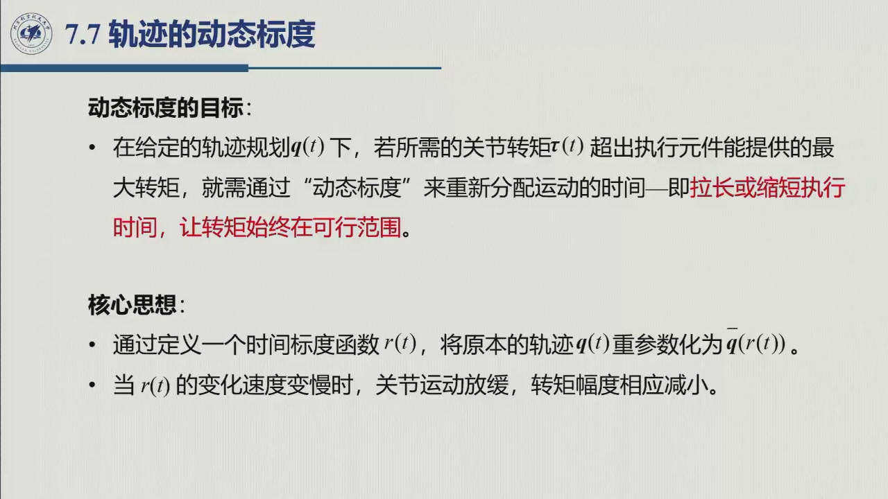
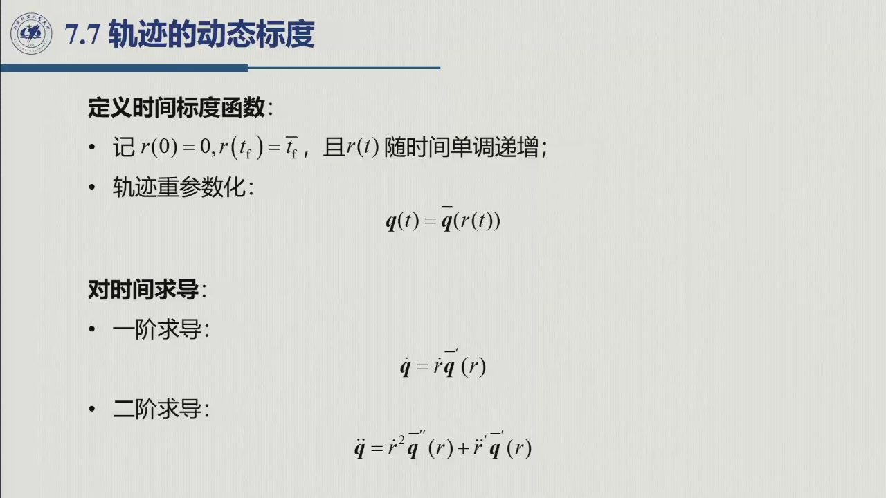
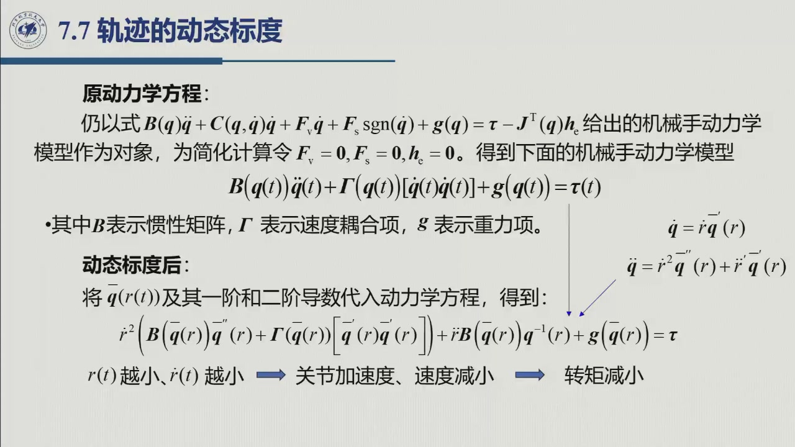
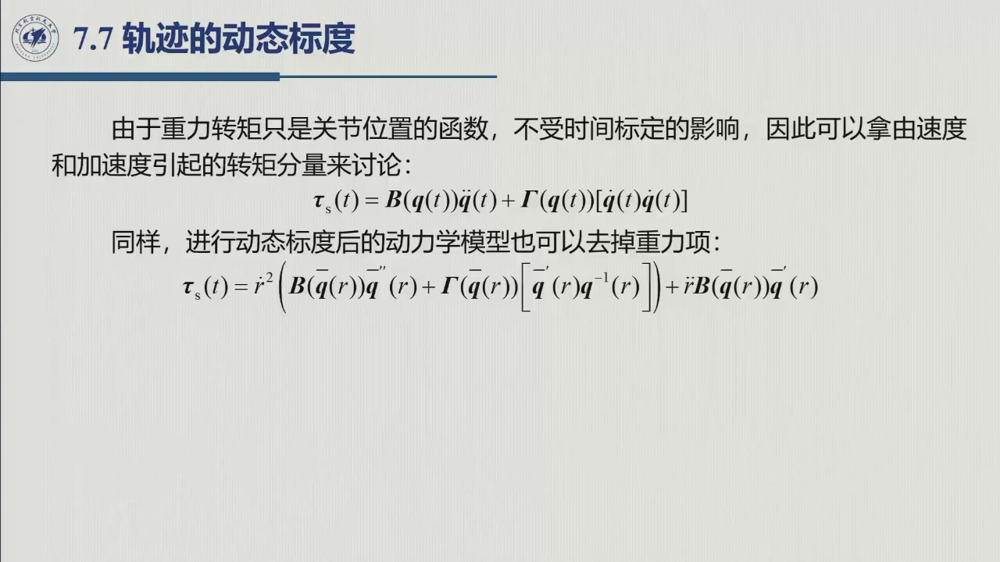
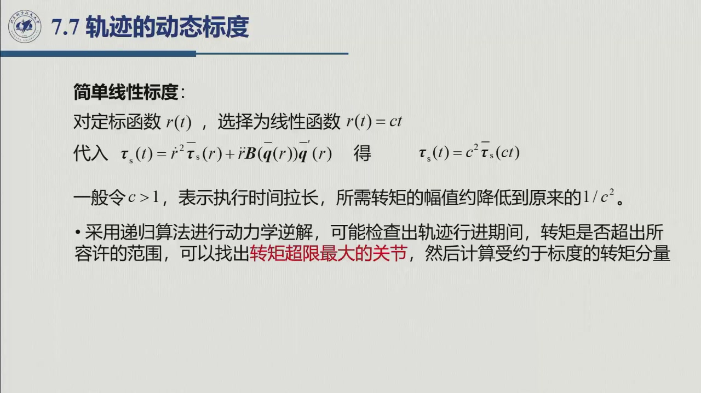
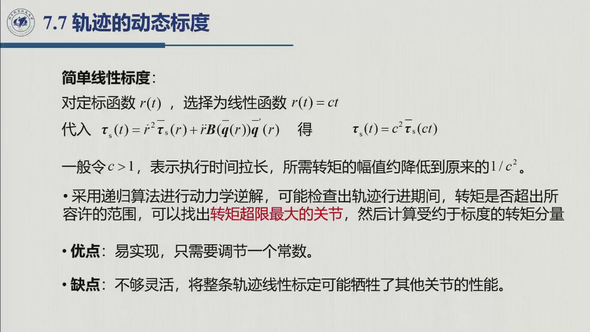

# 6.6 轨迹的动态标度

轨迹满足速度、加速度限制后，仍可能在逆动力学验算中超力矩。此时可保持几何路径，调整[时间律](../recall.md#time-law)。不过动态项、重力和摩擦随时间的变化规律不同，需要分别计算，不能先假定放慢必然可行。课堂回看：01:27:15–01:36:48。

## 6.6.1 为什么需要动态标度

第四章可以先按运动学条件规划，再用第六章模型核查力矩。若超限主要来自加速度或速度二次项，延长时间可能有效；若主要来自无法保持的重力负载，单纯延时并不能提供额外支撑力。

动态标度保持经过的关节构形，只改变到达时刻。原路径若存在碰撞或越限，几何问题仍然存在，不能单靠调整时间消除。

## 6.6.2 时间标度函数与轨迹重参数化

先将原参考运动写为 $\bar q(r)$，$r\in[0,\bar t_f]$。这里 $r$ 可直接取原运动的时间标签；新运动使用时间 $t\in[0,t_f]$，另选非递减映射

$$r(0)=0,\qquad r(t_f)=\bar t_f,\qquad q(t)=\bar q(r(t)).$$

不改变 $\bar q$，只改变 $r(t)$，就不会改变经过的路径。停顿时可有 $\dot r=0$；若允许反向遍历，则还要另外规定方向与边界，本节不讨论。

先求一阶导数 $\dot q=\bar q'(r)\dot r$。再对两个因子分别求导：

$$\ddot q=\frac{d\bar q'}{dr}\dot r\dot r+\bar q'\ddot r
=\bar q''\dot r^2+\bar q'\ddot r.$$

撇号始终表示对路径标签 $r$ 求导，点号始终对新时间 $t$ 求导。两种导数若混用，就无法得到正确的平方项。

## 6.6.3 代入动力学方程

先忽略摩擦与接触。将速度二次项记成 $\Gamma(q)[v,v]$，意思是第 $i$ 项为相应系数与 $v_jv_k$ 的求和，并不是普通矩阵平方。它与本章的 $C(q,v)v$ 表示同一个速度项。

将两阶导数代入 $B\ddot q+\Gamma(q)[\dot q,\dot q]+g=\tau$：

$$\tau=\dot r^2\left(B(\bar q)\bar q''+
\Gamma(\bar q)[\bar q',\bar q']\right)
+\ddot r\,B(\bar q)\bar q'+g(\bar q).$$

速度二次项含两个 $\dot r$，因此与路径曲率产生的加速度项具有相同缩放因子。时间律不匀速时，额外的 $\ddot r\,B\bar q'$ 仍然存在。

## 6.6.4 重力项与「速度/加速度转矩分量」

定义原路径在单位标签推进速度下的动态部分

$$\bar\tau_s(r)=B(\bar q(r))\bar q''(r)
+\Gamma(\bar q(r))[\bar q'(r),\bar q'(r)].$$

则新运动所需力矩为

$$\tau(t)=\dot r^2\bar\tau_s(r)+\ddot rB(\bar q)\bar q'+g(\bar q).$$

$g(\bar q)$ 只由当前构形决定。同一构形慢慢经过或快速经过，重力项相同；改变速度不能直接把它除以某个时间倍数。

## 6.6.5 简单线性标度：$r(t)=ct$

取 $r=ct$，$c>0$，则 $\dot r=c$、$\ddot r=0$，新时长满足 $t_f=\bar t_f/c$，并有

$$\tau_s(t)=c^2\bar\tau_s(ct).$$

所以 $c>1$ 表示更快，$c<1$ 表示更慢。若改用时长倍数 $T=t_f/\bar t_f$，则 $c=1/T$：

$$r(t)=t/T,\qquad \tau_s(t)=\frac{1}{T^2}\bar\tau_s(t/T).$$

在这个理想模型中，对应路径点的动态力矩精确按 $1/T^2$ 缩放，总力矩还需加回不变的重力项。若计入黏滞摩擦，其项按 $1/T$ 变化；方向保持不变时，库仑摩擦也不会按平方规律下降。

### 带重力时，实际怎样检查时间倍数

在一个路径点，令原动态力矩为 $a$，重力项为 $g$，限制为 $|\tau|\le\tau_{\max}$。记 $z=1/T^2$；只考虑放慢时 $0<z\le1$，限制成为

$$-\tau_{\max}\le g+az\le\tau_{\max}.$$

例如 $g=4,a=8,\tau_{\max}=6$ N·m，要求 $z\le1/4$，故 $T\ge2$。这一点动态项与重力同向，放慢可降低峰值。

反过来若 $g=8,a=-6,\tau_{\max}=5$，原总力矩为2 N·m；约束要求 $z\ge1/2$，即 $T\le\sqrt2$。动态项原本抵消了部分重力，放得太慢反而超限。

对所有路径点和所有关节求上述可行区间的交集，再换回 $T$。没有交集时，一种统一延时无法满足全程限制。若完全忽略重力等其他项，才可单独使用 $T\ge\sqrt{\max|\bar\tau_s|/\tau_{\max}}$ 这类平方根估计。

## 6.6.6 优缺点与适用场合

统一延时只调整一个数，容易实现，但会让整条轨迹都受最紧约束点限制。非线性时间律可在不同区间采用不同速度，不过其 $\ddot r$ 项也会产生力矩，不能只逐点缩放 $\dot r^2$ 而漏掉加减速过程。

重选时间后，还要回查端点：原先为零的端点速度仍为零，原先指定的非零端点速度却会改变。最终需一起验证速度、加速度、力矩、采样和工艺要求。

## 6.6.7 小结与常见错误

先区分路径导数和时间导数，再区分动态项与重力、摩擦。只有在假设明确的对应路径点上，才能使用平方缩放。最终可行性由完整力矩带符号相加后的结果决定，而不是分别比较各项绝对值。

::: think 检查理解
1. 总时长翻倍后，速度、加速度和本节动态力矩分别变成多少？
2. 具有 $g=8,a=-6$ 的例子为什么不能无限放慢？
3. 非线性 $r(t)$ 中若只保留 $\dot r^2$，漏掉的力矩对应什么运动？

::: sol 核对
速度为一半，加速度和动态力矩为四分之一，重力不变。第二例的动态项原本抵消重力，放慢后抵消减弱。漏掉的是改变路径推进速度产生的切向加速度需求 $\ddot rB\bar q'$。
:::
:::
