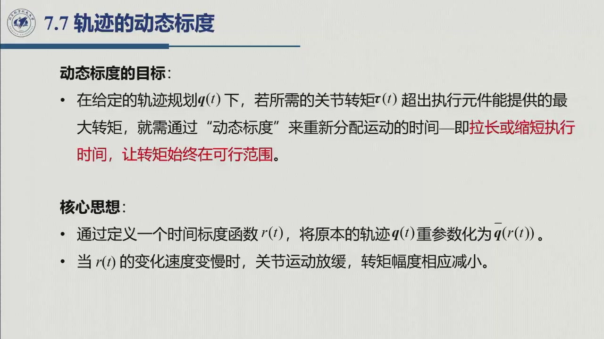
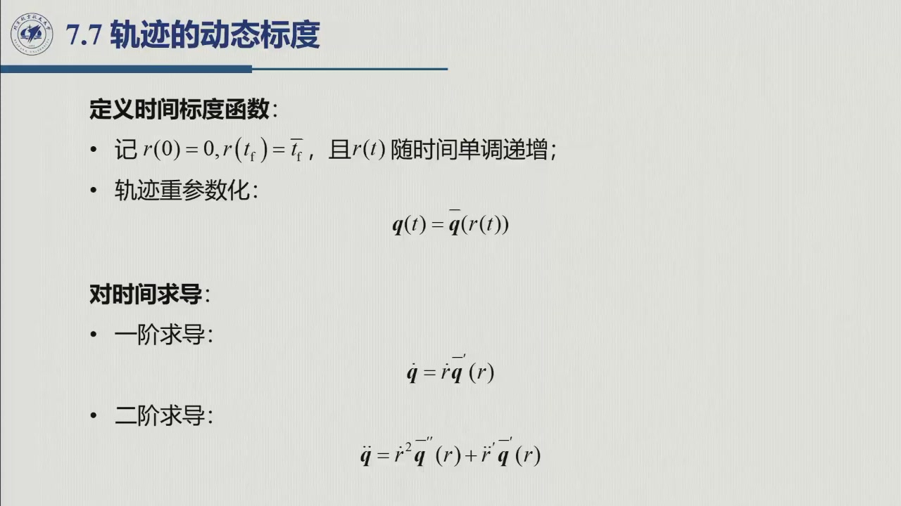
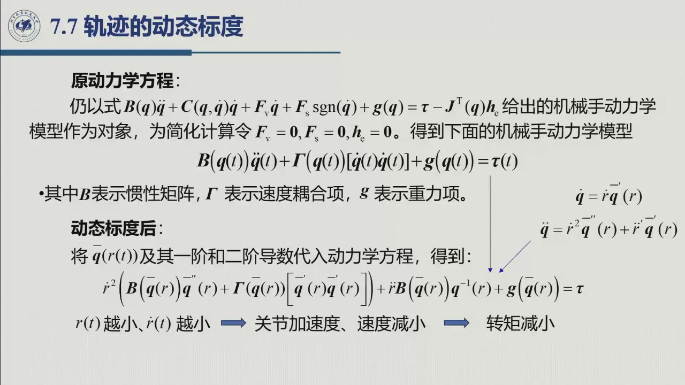
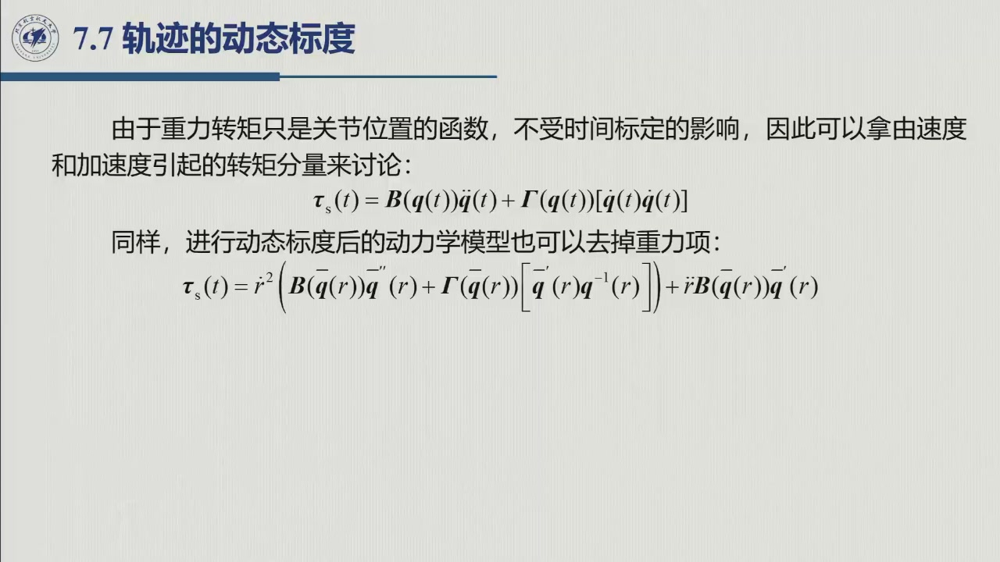
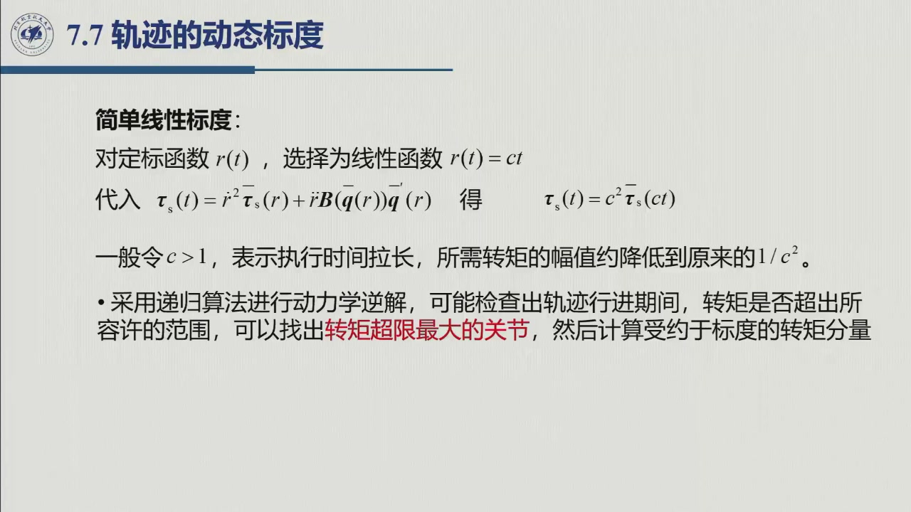
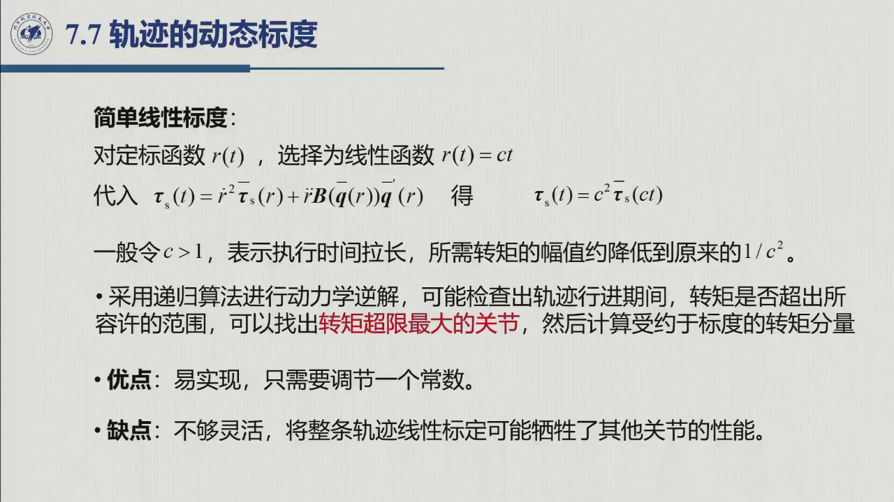
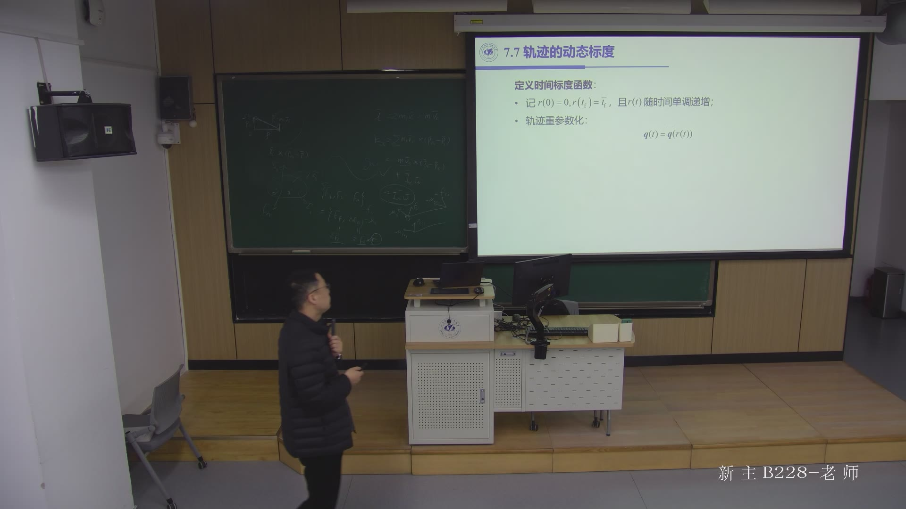

# 6.6 轨迹的动态标度

> 录播 01:27:15–01:36:48。课件 **§7.7「轨迹的动态标度」**（标题 01:28:15、目标页 01:31:08），本书编为 6.6。
> 本节回答：**规划好的轨迹如果超出电机转矩，能不能不重画路径、只改时间？** 答案是可以——把时间拉长或缩短，这就是**动态标度（dynamic scaling）**。

::: note 来源与边界（本节）
- **教材对应**：教材第 7 章没有把这一节单独编号（或在习题/附注中），本页以课件为准；对应关系见节末待核。
- **课堂 vs 教材**：推导按课件板书整理；口述与公式符号方向不一致处保留原样，一并列入节末待核。文中「课件」指幻灯片、「老师」指口述。
:::

## 6.6.1 为什么需要动态标度

第 4 章的轨迹规划只保证**几何路径**与**时间律**平滑（位置、速度、加速度连续），**没有检查力矩**。老师把问题说得直白（01:27:35–01:28:18）：若关节转矩**超过电机的最大转矩**，这条轨迹就执行不了，实际运动到不了规划的位置。

路径本身是好的，不想重画，怎么办？**重新分配时间**——「把这个时间处理一下，拉长，或者缩短这个时间」，机器人跑慢一点，转矩就降下来。**路径不变，只改「什么时候走到路径的哪一点」**，相当于给这条路径重配一个「速度表」，让全程力矩都不超过电机能力。

## 6.6.2 时间标度函数与轨迹重参数化

设原来的轨迹为 $\boldsymbol q(t)$，$t\in[0,t_f]$。定义一个**时间标度函数** $r(t)$，满足

$$r(0)=0,\qquad r(t_f)=\bar t_f,\qquad r(t)\ \text{随时间单调递增},$$

并把原轨迹**重参数化**为

$$\boxed{\ \boldsymbol q(t)=\bar{\boldsymbol q}\bigl(r(t)\bigr)\ }$$

其中 $\bar{\boldsymbol q}(r)$ 是「按路径参数 $r$ 描述的几何路径」，与原时间律无关；$r$ 走得快慢就决定机器人沿路径的快慢。

对时间求导（链式法则）：

$$\dot{\boldsymbol q}=\dot r\,\bar{\boldsymbol q}'(r),$$

$$\ddot{\boldsymbol q}=\dot r^2\,\bar{\boldsymbol q}''(r)+\ddot r\,\bar{\boldsymbol q}'(r),$$

其中 $\bar{\boldsymbol q}'=\mathrm d\bar{\boldsymbol q}/\mathrm d r$、$\bar{\boldsymbol q}''=\mathrm d^2\bar{\boldsymbol q}/\mathrm d r^2$。第一项是「路径二阶导数 × 速度平方」（弯曲/向心效应），第二项是「路径切向 × 切向加速度」；**时间标度的全部信息就藏在 $\dot r,\ddot r$ 里。**

## 6.6.3 代入动力学方程

为看清本质，课件略去阻尼、摩擦和末端力（$F_{\mathrm v}=F_{\mathrm s}=0,\boldsymbol h_c=\boldsymbol 0$），把关节空间方程写成

$$B(\boldsymbol q)\ddot{\boldsymbol q}+\Gamma(\boldsymbol q)[\dot{\boldsymbol q}\dot{\boldsymbol q}]
+\boldsymbol g(\boldsymbol q)=\boldsymbol\tau,$$

其中 $\Gamma(\boldsymbol q)[\dot{\boldsymbol q}\dot{\boldsymbol q}]$ 就是 [6.1.3](sec6-1-3.md) 的 $C\dot{\boldsymbol q}$（课件用 $\Gamma$ 记）代入 $\dot{\boldsymbol q}=\dot r\bar{\boldsymbol q}'$、$\ddot{\boldsymbol q}=\dot r^2\bar{\boldsymbol q}''+\ddot r\bar{\boldsymbol q}'$：

$$\boxed{\ \dot r^2\Bigl(B(\bar{\boldsymbol q})\bar{\boldsymbol q}''(r)
+\Gamma(\bar{\boldsymbol q})[\bar{\boldsymbol q}'(r)\bar{\boldsymbol q}'(r)]\Bigr)
+\ddot r\,B(\bar{\boldsymbol q})\bar{\boldsymbol q}'(r)
+\boldsymbol g(\bar{\boldsymbol q})=\boldsymbol\tau\ }$$

所以：**同一个几何路径，换不同的 $r(t)$ 就得到不同的力矩曲线**；$\dot r,\ddot r$ 越小，关节速度/加速度越小，转矩越小（01:31:04–01:31:24）。

## 6.6.4 重力项与「速度/加速度转矩分量」

关键观察：**重力只依赖位置，不依赖时间标度**——同一点不管快慢经过，$\boldsymbol g(\bar{\boldsymbol q})$ 都一样。于是转矩分成两部分：

$$\boldsymbol\tau(t)=\underbrace{B\ddot{\boldsymbol q}+\Gamma[\dot{\boldsymbol q}\dot{\boldsymbol q}]}_{\boldsymbol\tau_s(t)}
+\underbrace{\boldsymbol g(\boldsymbol q)}_{\text{不随标度变}}.$$

去掉重力项，得到**速度/加速度引起的转矩分量**的换标关系：

$$\boldsymbol\tau_s(t)=\dot r^2\Bigl(B(\bar{\boldsymbol q})\bar{\boldsymbol q}''(r)
+\Gamma(\bar{\boldsymbol q})[\bar{\boldsymbol q}'(r)\bar{\boldsymbol q}'(r)]\Bigr)
+\ddot r\,B(\bar{\boldsymbol q})\bar{\boldsymbol q}'(r).$$

再定义**单位路径速度下的转矩分量**

$$\boxed{\ \bar{\boldsymbol\tau}_s(r)=B(\bar{\boldsymbol q}(r))\bar{\boldsymbol q}''(r)
+\Gamma(\bar{\boldsymbol q}(r))[\bar{\boldsymbol q}'(r)\bar{\boldsymbol q}'(r)]\ }$$

就有紧凑的换标式

$$\boxed{\ \boldsymbol\tau_s(t)=\dot r^2\,\bar{\boldsymbol\tau}_s(r)+\ddot r\,B(\bar{\boldsymbol q}(r))\bar{\boldsymbol q}'(r)\ }$$

它把「路径」与「时间律」彻底分开：$\bar{\boldsymbol\tau}_s(r)$ 只由几何路径决定，$\dot r,\ddot r$ 只由时间律决定。

## 6.6.5 简单线性标度：$r(t)=ct$

最简单的时间律是**线性标度**

$$r(t)=ct.$$

此时 $\dot r=c$、$\ddot r=0$，换标式退化为

$$\boxed{\ \boldsymbol\tau_s(t)=c^2\,\bar{\boldsymbol\tau}_s(ct)\ }$$

**方向要小心。** 按 $r=ct$，$c>1$ 是推进更快、$\boldsymbol\tau_s$ 放大 $c^2$ 倍，$c<1$ 才是放慢。工程上更习惯用**时间拉长倍数 $T$**（新时长 $=T\times$ 原时长，$T>1$ 表示放慢）：

$$r(t)=\frac{t}{T}\quad\Longleftrightarrow\quad c=\frac{1}{T},
\qquad
\boldsymbol\tau_s(t)=\frac{1}{T^2}\,\bar{\boldsymbol\tau}_s\!\left(\frac{t}{T}\right).$$

即**时间拉长 $T$ 倍，速度/加速度引起的转矩分量约降到 $1/T^2$**。例：$T=2$（时间拉长一倍），$\boldsymbol\tau_s$ 降到原来的 **$1/4$**（01:33:03–01:33:21）。

注意这是**约**降到 $1/T^2$：完整转矩里的重力项 $\boldsymbol g$ 不变，总转矩不会严格按 $T^2$ 缩小；重力占主导时，拉长时间帮助有限。

**怎么选 $T$（或 $c$）**（01:33:48–01:34:01）：①用**逆动力学**（6.5，实际用牛顿–欧拉递推 6.4）沿原轨迹逐点算 $\boldsymbol\tau(t)$；②找出**转矩超限最大的关节**与时刻；③由 $1/T^2$ 估 $T$（如 $T=\sqrt{|\boldsymbol\tau_s|_{\max}/\tau_{\max}}$；用课件 $c$ 则 $c=1/T$）；④用新 $T$ 重做逆解检查，确认全程可行。

## 6.6.6 优缺点与适用场合

线性标度的优劣（01:34:01–01:34:20）：

| | 线性标度 $r=ct$ |
|:--|:--|
| **优点** | 极易实现，只需要调一个常数（$T$ 或 $c$）；不改变几何路径 |
| **缺点** | 不够灵活：整条轨迹统一拉长/缩短，可能为了一个超限点牺牲其他关节的性能，只是全局折中 |
| **适用** | 离线轨迹快速修正、教学演示、实时性要求不高的场合 |

更精细的做法是选**非线性** $r(t)$：超限时段慢、其余保持原速（「局部降速」），但要解带约束的时间律优化问题，实现复杂得多；课件只提了一句「你可以取其他形式来满足你的要求」（01:33:40–01:33:48）。

## 6.6.7 小结与常见错误

- **一句话**：动态标度 = **路径不变，重排时间**；$r(t)$ 重参数化原轨迹，$\dot r,\ddot r$ 决定新的速度/加速度与转矩，换标后 $\boldsymbol\tau_s=\dot r^2\bar{\boldsymbol\tau}_s(r)+\ddot r B\bar{\boldsymbol q}'$。
- **一个特例**：$r=ct$ 时 $\boldsymbol\tau_s=c^2\bar{\boldsymbol\tau}_s(ct)$；用 $T=1/c$ 说，拉长 $T$ 倍约降 $1/T^2$。
- **一个限制**：重力项不随标度变，总转矩不是严格 $c^2$ 缩放。

### 常见错误清单

1. **把 $r$ 当成时间**：$r$ 是**路径参数**；$r(t)$ 单调递增但不一定等于 $t$。
2. **漏掉 $\ddot r$ 项**：只有 $r=ct$（$\ddot r=0$）时可省，一般时间律下 $\ddot r B\bar{\boldsymbol q}'$ 必须保留。
3. **以为重力也按 $c^2$ 缩放**：重力只依赖位置，同一点标度前后相同。
4. **把「转矩降到 $1/T^2$」当精确结论**：只对 $\boldsymbol\tau_s$ 成立，总转矩要加回重力。
5. **只检查一个关节**：应沿轨迹逐点逆解、取所有关节的最大值。
6. **线性标度万能论**：它简单但保守；局部超限时宜用非线性时间律或局部降速。

### 默写点 · 合上书再写

1. 写出 $r(t)$ 的定义与重参数化 $\boldsymbol q(t)=\bar{\boldsymbol q}(r(t))$。
2. 写出 $\dot{\boldsymbol q},\ddot{\boldsymbol q}$ 关于 $\dot r,\ddot r,\bar{\boldsymbol q}',\bar{\boldsymbol q}''$ 的表达式。
3. 写出换标后的动力学方程与 $\bar{\boldsymbol\tau}_s(r)$ 的定义。
4. $r=ct$ 时 $\boldsymbol\tau_s$ 与 $c$ 的关系？时间拉长 2 倍时降到多少？
5. 为什么重力项不随标度变化？这对「拉长时间降转矩」有什么限制？

::: note 待核（本节）
1. **课件公式里的一个上标**：投影上 $\bar{\boldsymbol\tau}_s$ 定义式括号内的第二个因子有时像 $\bar{\boldsymbol q}^{-1}(r)$；按上下文应取 $\bar{\boldsymbol q}'(r)$（速度耦合项换标后为 $\Gamma[\bar{\boldsymbol q}'\bar{\boldsymbol q}']$）。本页按 $\bar{\boldsymbol q}'$ 处理，建议对照原稿确认。
2. **课件口述的 $c$ 与公式的 $c$ 方向相反**：课件 §7.7 写「一般令 $c>1$，表示执行时间拉长，所需转矩的幅值约降低到原来的 $1/c^2$」；但按同页 $r(t)=ct$，$c>1$ 会让 $\dot r$ 更大、运动更快、转矩更大。最合理的解释是口述的 $c$ 为**时间拉长倍数**（本页 $T$），公式里 $c=1/T$，两者只差倒数。**待核**课件原稿/教材。
3. **与教材的对应**：教材第 7 章是否单列本节**待核**（可能在习题/附注中）。
:::
