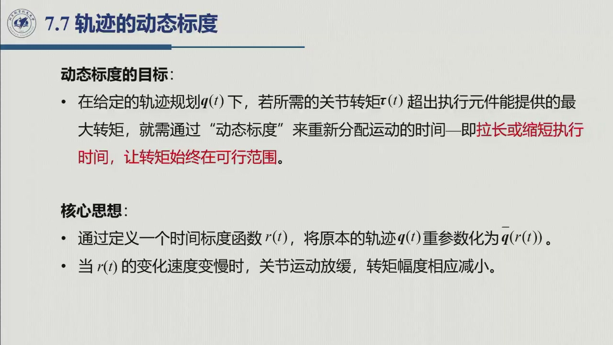
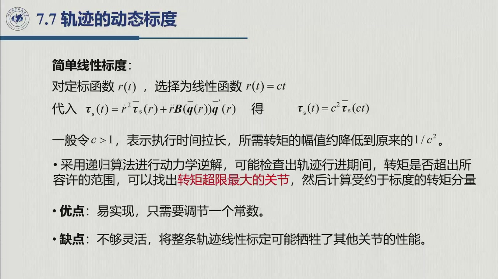

# 6.6 轨迹的动态标度

第四章的轨迹规划只保证位置、速度和加速度曲线平滑连续，却没有检查电机能不能出得起这个力矩。用 [6.5](sec6-5.md) 的逆动力学逐点一算，某个加速段超出了电机额定峰值，机器人就走不到规划位置。几何路径本身没有碰撞或越限，不想推翻重画，最直接的办法是保持路径点顺序不变、把走完这段路的时间重新拉长，让速度与加速度降下来——这就是**动态标度（dynamic scaling）**。不过放慢之后，惯性和速度二次项会下降，重力和库仑摩擦却不会跟着按平方缩小，因此必须先拆开各项再算时间倍数，不能假定放慢一定能压低总力矩。课堂回看：01:27:15–01:36:48。

## 6.6.1 为什么需要动态标度

在运动学层按梯形速度或三次多项式规划好轨迹后，若逆动力学验算发现力矩超限，先看超限来自哪一项：如果主要来自加速段惯性力矩或高速科氏/离心力矩，把时间拉长就能压低动态需求；如果某个悬停位姿的重力矩本身已经超过电机最大连续转矩，放慢运动速度也托不住它。同样，几何路径本身的障碍碰撞或关节超限必须回第四章重规划，不能指望改变[时间律](../recall.md#time-law)来消除。

## 6.6.2 时间标度函数与轨迹重参数化

设原参考轨迹记为 $\bar{\boldsymbol q}(r)$，其中路径参数 $r\in[0,\bar t_f]$ 可以直接取原轨迹的时间标签。新运动采用新时间 $t\in[0,t_f]$，引入光滑非递减的**时间标度函数** $r(t)$：

$$r(0)=0,\qquad r(t_f)=\bar t_f,\qquad \boldsymbol q(t)=\bar{\boldsymbol q}\bigl(r(t)\bigr).$$

只要不改动 $\bar{\boldsymbol q}(r)$ 的函数形状、只调整 $r(t)$，机器人在空间中走过的每一个位形点就完全不变（不允许反向遍历时须保持 $\dot r\ge0$，停顿点可取 $\dot r=0$）。用链式法则对新时间 $t$ 求一次导，再对乘积 $\bar{\boldsymbol q}'(r(t))\dot r(t)$ 求二次导（下面统一用撇号表示对 $r$ 求导 $\mathrm d/\mathrm dr$，点号表示对 $t$ 求导 $\mathrm d/\mathrm dt$）：

$$\dot{\boldsymbol q}=\bar{\boldsymbol q}'(r)\,\dot r,$$

$$\ddot{\boldsymbol q}=\frac{\mathrm d}{\mathrm dt}\bigl(\bar{\boldsymbol q}'(r)\bigr)\dot r+\bar{\boldsymbol q}'(r)\ddot r
=\bar{\boldsymbol q}''(r)\,\dot r^2+\bar{\boldsymbol q}'(r)\,\ddot r.$$

切记区分对 $r$ 的路径导数（$\bar{\boldsymbol q}',\bar{\boldsymbol q}''$）与对 $t$ 的时间导数（$\dot r,\ddot r$）：前者由原路径几何决定，后者才承载了所有速度缩放与加减速调度的信息。

## 6.6.3 代入动力学方程

先忽略摩擦与末端接触力。为看清各因子对 $\dot{\boldsymbol q}$ 的次数，把速度二次项 $C(\boldsymbol q,\dot{\boldsymbol q})\dot{\boldsymbol q}$ 记作双线性形式 $\Gamma(\boldsymbol q)[\dot{\boldsymbol q},\dot{\boldsymbol q}]$（第 $i$ 分量为 $\sum_{j,k}c_{ijk}(\boldsymbol q)\dot q_j\dot q_k$，对速度变量齐二次）。将 $\dot{\boldsymbol q}=\dot r\bar{\boldsymbol q}'$ 和 $\ddot{\boldsymbol q}=\dot r^2\bar{\boldsymbol q}''+\ddot r\bar{\boldsymbol q}'$ 代入关节动力学方程 $B(\boldsymbol q)\ddot{\boldsymbol q}+\Gamma(\boldsymbol q)[\dot{\boldsymbol q},\dot{\boldsymbol q}]+\boldsymbol g(\boldsymbol q)=\boldsymbol\tau$：

$$\begin{aligned}
\boldsymbol\tau
&=B(\bar{\boldsymbol q})\bigl(\dot r^2\bar{\boldsymbol q}''+\ddot r\bar{\boldsymbol q}'\bigr)
+\Gamma(\bar{\boldsymbol q})\bigl[\dot r\bar{\boldsymbol q}',\ \dot r\bar{\boldsymbol q}'\bigr]+\boldsymbol g(\bar{\boldsymbol q})\\
&=\dot r^2\Bigl(B(\bar{\boldsymbol q})\bar{\boldsymbol q}''+\Gamma(\bar{\boldsymbol q})[\bar{\boldsymbol q}',\bar{\boldsymbol q}']\Bigr)
+\ddot r\,B(\bar{\boldsymbol q})\bar{\boldsymbol q}'+\boldsymbol g(\bar{\boldsymbol q}).
\end{aligned}$$

由于 $\Gamma(\bar{\boldsymbol q})[\dot r\bar{\boldsymbol q}',\dot r\bar{\boldsymbol q}']=\dot r^2\Gamma(\bar{\boldsymbol q})[\bar{\boldsymbol q}',\bar{\boldsymbol q}']$，速度二次项和路径曲率加速度项拿到了完全相同的缩放因子 $\dot r^2$；而如果时间标度不是匀速（$\ddot r\neq0$），还会多出切向时间调速项 $\ddot r\,B(\bar{\boldsymbol q})\bar{\boldsymbol q}'$。

## 6.6.4 重力项与「速度/加速度转矩分量」

把原轨迹在单位推进速率 $\dot r=1,\ddot r=0$ 下所需要的动态力矩分量定义为

$$\bar{\boldsymbol\tau}_s(r)=B(\bar{\boldsymbol q}(r))\bar{\boldsymbol q}''(r)
+\Gamma(\bar{\boldsymbol q}(r))[\bar{\boldsymbol q}'(r),\bar{\boldsymbol q}'(r)].$$

这样新运动在时刻 $t$ 的完整驱动力矩拆成三块：

$$\boldsymbol\tau(t)=\dot r^2\bar{\boldsymbol\tau}_s(r)+\ddot r\,B(\bar{\boldsymbol q})\bar{\boldsymbol q}'+\boldsymbol g(\bar{\boldsymbol q}).$$

关键在于重力项 $\boldsymbol g(\bar{\boldsymbol q})$ 只依赖当前经过的位形 $\bar{\boldsymbol q}(r)$，与 $\dot r,\ddot r$ 完全无关：同一个姿态慢慢经过还是快速掠过，需要的静重力补偿完全一样，不能按时间倍数缩小。

## 6.6.5 简单线性标度：$r(t)=ct$

取最简单的线性时间标度 $r(t)=ct$（$c>0$ 为常数），则 $\dot r=c$、$\ddot r=0$，总时长变为 $t_f=\bar t_f/c$。前面多出来的 $\ddot r\,B\bar{\boldsymbol q}'$ 项消失，动态分量直接按常数平方缩放：

$$\boldsymbol\tau_s(t)=c^2\bar{\boldsymbol\tau}_s(ct).$$

注意 $c$ 与时间拉长倍数 $T=t_f/\bar t_f=1/c$ 互为倒数（课上口述常把拉长两倍称为“$T=2$、转矩约降到 $1/4$”，对应公式里的 $c=1/2$）：用时长倍数 $T$ 写出即

$$r(t)=\frac{t}{T},\qquad \boldsymbol\tau_s(t)=\frac{1}{T^2}\,\bar{\boldsymbol\tau}_s\!\left(\frac{t}{T}\right).$$

在此理想无摩擦无外力模型下，时间拉长到原来的 $T=2$ 倍，纯动态力矩 $\boldsymbol\tau_s$ 精确降到原来的 $1/4$；但完整驱动力矩还要加上不变的 $\boldsymbol g(\bar{\boldsymbol q})$。如果进一步计入摩擦，黏滞摩擦 $F_{\mathrm v}\dot{\boldsymbol q}=F_{\mathrm v}\bar{\boldsymbol q}'/T$ 只按 $1/T$ 下降，方向不变时库仑摩擦 $F_{\mathrm s}\operatorname{sgn}(\dot{\boldsymbol q})$ 根本不随 $T$ 下降。

### 带重力时，实际怎样检查时间倍数

在一个给定路径点处，设原动态力矩为 $a=\bar\tau_s$、重力项为 $g$，允许力矩范围为 $|\tau|\le\tau_{\max}$。记缩放因子 $z=1/T^2$（仅考虑不加快原轨迹时 $0<z\le1$），总力矩不等式为

$$-\tau_{\max}\le g+az\le\tau_{\max}.$$

- 若 $g=4,a=8,\tau_{\max}=6$ N·m（原力矩 $12$ N·m 超限，动态项与重力同向），不等式化为 $-6\le4+8z\le6\Rightarrow z\le1/4$，故时间必须拉长 $T\ge2$ 倍。
- 若 $g=8,a=-6,\tau_{\max}=5$ N·m（原总力矩 $2$ N·m 原本合格，动态负加速度刚好帮电机抵消了一部分重力），不等式化为 $-5\le8-6z\le5\Rightarrow z\ge1/2$，即 $T\le\sqrt2$。此时如果盲目把轨迹放得太慢（例如 $T=2\Rightarrow z=1/4$），总力矩反而涨到 $8-1.5=6.5>\tau_{\max}$ 而超限。

实际选 $T$ 时（01:33:48–01:34:01）：先用牛顿–欧拉逆动力学沿原轨迹逐点算出 $\boldsymbol\tau(r)$ 并分出 $\bar{\boldsymbol\tau}_s(r)$ 与 $\boldsymbol g$，对所有路径点和所有关节分别解出合法的 $z$ 区间再取交集；只有交集非空时，统一线性拉长时间才可行。只有在完全忽略重力与摩擦的特殊水平面机构里，才退化为直接估计 $T\ge\sqrt{\max|\bar\tau_s|/\tau_{\max}}$。

## 6.6.6 优缺点与适用场合

线性标度 $r=ct$ 只需调整一个标量参数，实现最简单，缺点是“全轨迹一起降速”——整条路上只要有一个点力矩超限，整段运动都得跟着放慢，牺牲了其余安全段的节拍。如果要兼顾效率，可以改用非线性时间律 $r(t)$，只在超限路段压低 $\dot r$、其余路段保持高速，但这需要求解带约束的时间优化问题，且调速引入的 $\ddot r\,B\bar{\boldsymbol q}'$ 也会反过来占掉一部分力矩余量。

最后别忘了检查端点与工程约束：对非零端点速度的原轨迹做缩放后，端点速度会按 $\dot r$ 改变；重新标定后还须用完整逆动力学再跑一遍全轨迹，核对速度、加速度、力矩、采样周期与工艺节拍。

## 6.6.7 小结与常见错误

动态标度通过 $\boldsymbol q(t)=\bar{\boldsymbol q}(r(t))$ 保持几何路径不变、只重排时间律，得到 $\boldsymbol\tau(t)=\dot r^2\bar{\boldsymbol\tau}_s(r)+\ddot r\,B\bar{\boldsymbol q}'+\boldsymbol g(\bar{\boldsymbol q})$；在线性标度 $r=t/T$ 下动态力矩按 $1/T^2$ 缩放，而重力项不变，可行时间区间必须按 $g+a/T^2$ 对所有时刻和关节带符号取交集。

::: think 常见错误清单
1. **把路径参数 $r$ 当成物理时间 $t$**：$r$ 是原轨迹的路径标签，$\dot r$ 和 $\ddot r$ 是新时间对它的调速导数。
2. **非线性标度漏掉 $\ddot r\,B\bar{\boldsymbol q}'$**：只有线性标度 $r=ct$ 下 $\ddot r=0$ 才消去该项，分段加减速或任意 $r(t)$ 必须保留它。
3. **以为重力与摩擦也按 $1/T^2$ 缩放**：重力只取决于构形，黏滞摩擦按 $1/T$ 缩放，库仑摩擦不随时间拉长减小。
4. **按绝对值分别估算，忽略重力与动态项同号还是抵消**：当 $g$ 与 $a$ 异号时，放得太慢反而可能让总力矩超过 $\tau_{\max}$。
5. **只按一个关节估算时间倍数**：必须逐点逐关节计算可行区间并取交集，再用逆动力学重新验算全轨迹。
:::

::: think 检查理解
1. 在线性标度下把总时长翻倍（$T=2$），速度、加速度和纯动态力矩 $\boldsymbol\tau_s$ 分别变成原来的几分之几？重力项呢？
2. 上面第二个算例（$g=8,\ a=-6,\ \tau_{\max}=5$）里，为什么不能无限放慢轨迹？
3. 非线性时间标度 $r(t)$ 中如果只保留 $\dot r^2\bar{\boldsymbol\tau}_s$ 而漏掉 $\ddot r\,B\bar{\boldsymbol q}'$，丢掉的是哪种物理需求？

::: sol 核对
1. 速度变为 $1/2$，加速度和纯动态力矩变为 $1/4$，重力项保持不变。
2. 原先负的动态加速度帮电机抵消了一部分重力；放得太慢使动态项削弱后，电机反而要独自承担更多重力，超过 $5$ N·m。
3. 丢掉的是沿路径切向改变推进速率 $\dot r$ 时所需要的惯性加速力矩 $\ddot r\,B(\bar{\boldsymbol q})\bar{\boldsymbol q}'$。
:::
:::

::: think 默写点 · 合上书再写
1. 写出时间标度函数 $r(t)$ 的边界条件，以及 $\dot{\boldsymbol q},\ddot{\boldsymbol q}$ 关于 $\dot r,\ddot r,\bar{\boldsymbol q}',\bar{\boldsymbol q}''$ 的表达式。
2. 写出换标后的完整动力学方程与 $\bar{\boldsymbol\tau}_s(r)$ 的定义。
3. 写出线性标度 $r(t)=ct$（与 $r(t)=t/T$）下动态力矩的缩放关系，并说明总力矩不按 $1/T^2$ 精确缩放的原因。
4. 写出带重力时的不等式约束 $-\tau_{\max}\le g+a/T^2\le\tau_{\max}$，说明不同符号下 $T$ 的上下界意义。
:::
