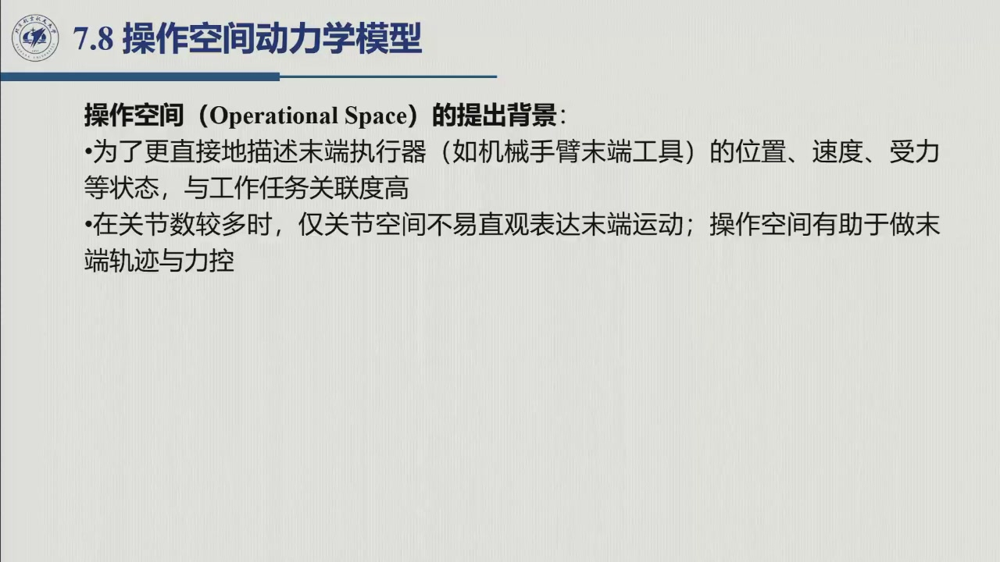
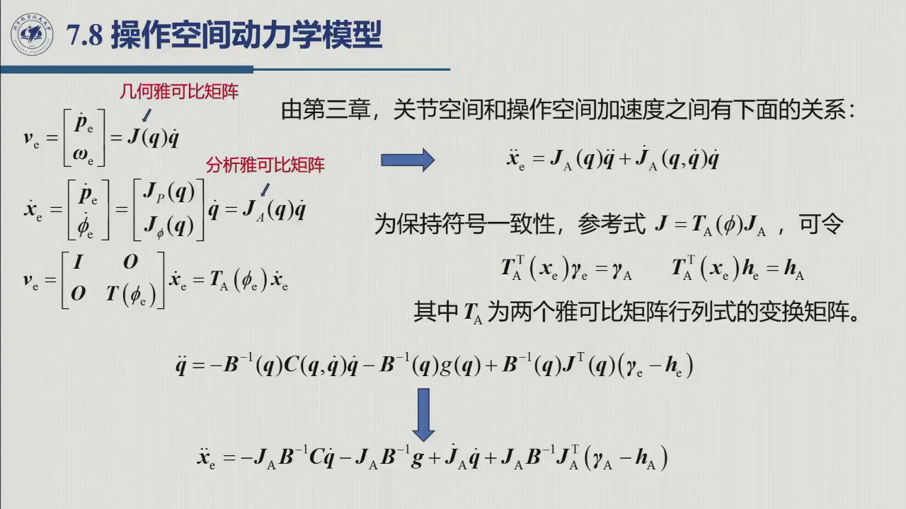
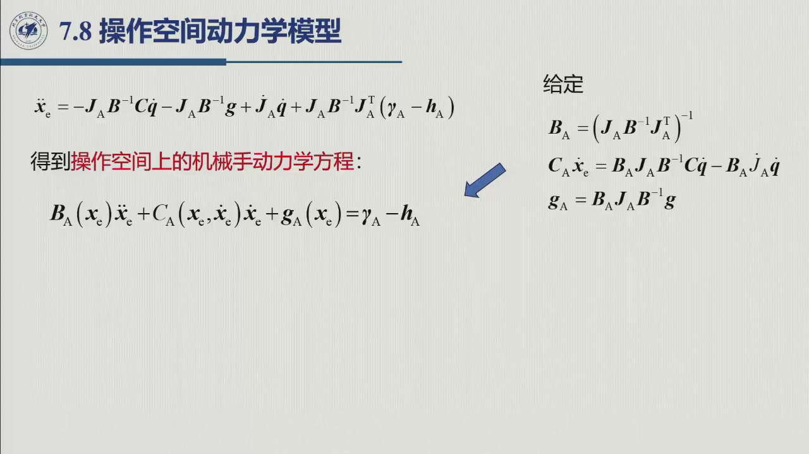
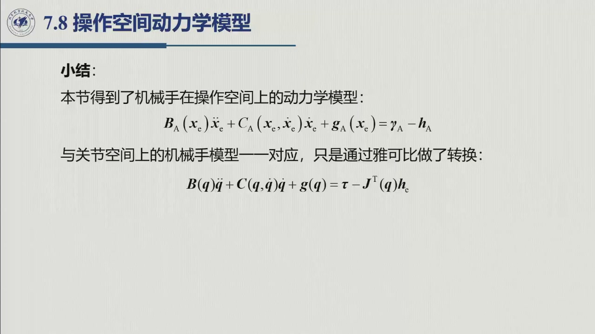
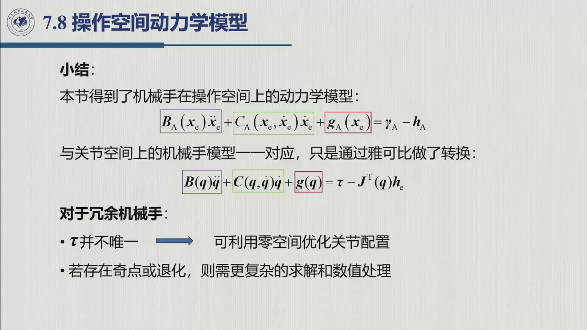
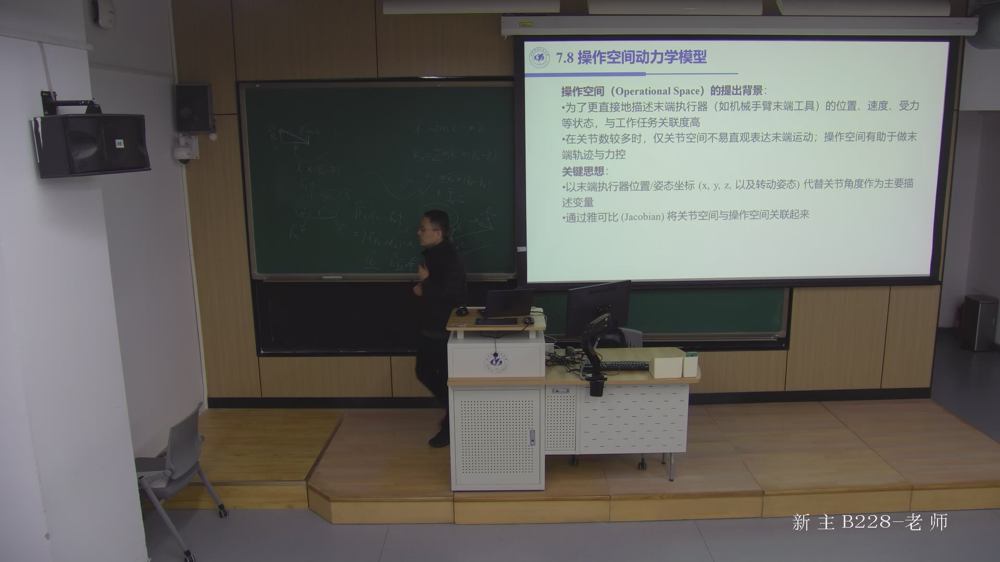

# 6.7 操作空间动力学模型

> 录播 01:36:48–01:53:19。课件 **§7.8「操作空间动力学模型」**（标题 01:36:48），本书编为 6.7；
> 01:38:48–01:44:28 为课间，讲解主体 01:44:28–01:53:19。
> 本节回答：把自变量从关节角 $\boldsymbol q$ 换成末端位姿 $\boldsymbol x_e$，方程长什么样、与关节空间什么关系、代价在哪。

::: note 来源与边界（本节）
- **教材对应**：教材第 7 章未把操作空间动力学单列一节（通常归入原书第 8 章运动控制或第 9 章力控制），本页以课件为准。
- **课堂 vs 教材**：三步推导按课件板书整理；下标 $A$（analytical Jacobian）为课件记号，文献常用 $x$。文中「课件」指幻灯片、「老师」指口述。
:::

## 6.7.1 为什么需要操作空间

6.6 之前，所有动力学模型都以关节变量 $\boldsymbol q$ 为自变量：

$$B(\boldsymbol q)\ddot{\boldsymbol q}+C(\boldsymbol q,\dot{\boldsymbol q})\dot{\boldsymbol q}
+\boldsymbol g(\boldsymbol q)=\boldsymbol\tau-J^{\mathrm T}(\boldsymbol q)\boldsymbol h_c.$$

它完整、紧凑，但**不直观**：我们真正关心的是末端的位置、姿态、速度、受力，而不是七个关节角。动机有两点（01:44:28–01:47:29）：**任务关联度高**——打磨、抓取、装配的指标都写在末端（位置误差、接触力）；**关节多时不直观**——「哪个方向是靠近工件」很难一眼看出，而操作空间可直接描述末端的运动与力。

做法是把关节空间方程**投影**到操作空间：改以**末端位姿** $\boldsymbol x_e$（位置 $x,y,z$ + 姿态，如欧拉角）为主描述变量，两空间由**雅可比**关联 $\dot{\boldsymbol x}_e=J_A(\boldsymbol q)\dot{\boldsymbol q}$，投影后即得同形式的 $B_A,C_A,\boldsymbol g_A$。**冗余机械手**（自由度多于任务维数）要注意：一部分关节运动不影响末端位姿，却影响能量分配、碰撞规避、关节行程（01:47:31–01:48:18）；操作空间模型只描述「末端那几维」，冗余自由度靠**零空间**另算。

## 6.7.2 两个雅可比：几何雅可比与分析雅可比

先分清两个雅可比（01:49:53–01:51:23）。**几何雅可比** $J(\boldsymbol q)$ 把关节速度映射到末端的**线速度 + 角速度**：

$$\boldsymbol v_e=\begin{bmatrix}\dot{\boldsymbol p}_e\\ \boldsymbol\omega_e\end{bmatrix}
=J(\boldsymbol q)\dot{\boldsymbol q}.$$

**分析雅可比** $J_A(\boldsymbol q)$ 把关节速度映射到**末端位姿坐标的导数**。若位姿坐标取 $\boldsymbol x_e=[\boldsymbol p_e;\ \boldsymbol\phi_e]$（位置 + 欧拉角），则

$$\dot{\boldsymbol x}_e=\begin{bmatrix}\dot{\boldsymbol p}_e\\ \dot{\boldsymbol\phi}_e\end{bmatrix}
=\begin{bmatrix}J_P(\boldsymbol q)\\ J_\phi(\boldsymbol q)\end{bmatrix}\dot{\boldsymbol q}
=J_A(\boldsymbol q)\dot{\boldsymbol q}.$$

**欧拉角的导数不是角速度**——这是老师反复强调的一点（01:50:30–01:50:45）。两者差一个变换矩阵：

$$\boldsymbol v_e=\begin{bmatrix}I&O\\ O&T(\boldsymbol\phi_e)\end{bmatrix}\dot{\boldsymbol x}_e
=T_A(\boldsymbol\phi_e)\dot{\boldsymbol x}_e,
\qquad
J=T_A(\boldsymbol\phi_e)J_A.$$

$T(\boldsymbol\phi_e)$ 就是 [第 3 章](../ch03/sec3-1.md) 把欧拉角速度换成角速度的矩阵，$T_A$ 则是两个雅可比之间的变换矩阵。

对 $\dot{\boldsymbol x}_e=J_A\dot{\boldsymbol q}$ 再求一次时间导数，得到**分析加速度**：

$$\boxed{\ \ddot{\boldsymbol x}_e=J_A(\boldsymbol q)\ddot{\boldsymbol q}
+\dot J_A(\boldsymbol q,\dot{\boldsymbol q})\dot{\boldsymbol q}\ }$$

多出来的 $\dot J_A\dot{\boldsymbol q}$ 是雅可比随位形变化产生的项；**做操作空间动力学时不能漏**。

## 6.7.3 从关节空间推到操作空间

**第一步：解出 $\ddot{\boldsymbol q}$。** 忽略阻尼与摩擦，

$$B\ddot{\boldsymbol q}+C\dot{\boldsymbol q}+\boldsymbol g
=\boldsymbol\tau-J^{\mathrm T}\boldsymbol h_c.$$

把关节力矩写成「等效到末端的操作力」的形式

$$\boldsymbol\tau=J^{\mathrm T}\boldsymbol\gamma_e,$$

其中 $\boldsymbol\gamma_e$ 是由关节转矩等效到末端的力/力矩，$\boldsymbol h_c$ 是环境接触力。于是

$$\ddot{\boldsymbol q}=-B^{-1}C\dot{\boldsymbol q}-B^{-1}\boldsymbol g
+B^{-1}J^{\mathrm T}\bigl(\boldsymbol\gamma_e-\boldsymbol h_c\bigr).$$

**第二步：代入分析加速度。** 把上式代进 $\ddot{\boldsymbol x}_e=J_A\ddot{\boldsymbol q}+\dot J_A\dot{\boldsymbol q}$：

$$\ddot{\boldsymbol x}_e=-J_AB^{-1}C\dot{\boldsymbol q}
-J_AB^{-1}\boldsymbol g
+\dot J_A\dot{\boldsymbol q}
+J_AB^{-1}J^{\mathrm T}\bigl(\boldsymbol\gamma_e-\boldsymbol h_c\bigr).$$

**第三步：统一记号。** 由 $J^{\mathrm T}=J_A^{\mathrm T}T_A^{\mathrm T}$，令

$$\boldsymbol\gamma_A=T_A^{\mathrm T}(\boldsymbol x_e)\boldsymbol\gamma_e,
\qquad
\boldsymbol h_A=T_A^{\mathrm T}(\boldsymbol x_e)\boldsymbol h_c,$$

则最后一项变成 $J_AB^{-1}J_A^{\mathrm T}(\boldsymbol\gamma_A-\boldsymbol h_A)$，全式只含 $\boldsymbol x_e,\dot{\boldsymbol x}_e,\ddot{\boldsymbol x}_e,\boldsymbol\gamma_A,\boldsymbol h_A$。

## 6.7.4 操作空间动力学方程

把上式整理成与关节空间**同形式**的方程：

$$\boxed{\ B_A(\boldsymbol x_e)\ddot{\boldsymbol x}_e
+C_A(\boldsymbol x_e,\dot{\boldsymbol x}_e)\dot{\boldsymbol x}_e
+\boldsymbol g_A(\boldsymbol x_e)=\boldsymbol\gamma_A-\boldsymbol h_A\ }$$

其中

$$\boxed{\ B_A=\bigl(J_AB^{-1}J_A^{\mathrm T}\bigr)^{-1}\ }$$

$$\boxed{\ C_A\dot{\boldsymbol x}_e=B_AJ_AB^{-1}C\dot{\boldsymbol q}
-B_A\dot J_A\dot{\boldsymbol q}\ }$$

$$\boxed{\ \boldsymbol g_A=B_AJ_AB^{-1}\boldsymbol g\ }$$

各项与关节空间一一对应：

| 操作空间量 | 对应关节空间量 | 物理意义 |
|:--|:--|:--|
| $B_A(\boldsymbol x_e)$ | $B(\boldsymbol q)$ | **有效惯量矩阵**（末端各方向的等效质量/惯量） |
| $C_A(\boldsymbol x_e,\dot{\boldsymbol x}_e)$ | $C(\boldsymbol q,\dot{\boldsymbol q})$ | 速度耦合（离心/科氏）项 |
| $\boldsymbol g_A(\boldsymbol x_e)$ | $\boldsymbol g(\boldsymbol q)$ | 重力项（末端各方向的重力等效力） |
| $\boldsymbol\gamma_A$ | $\boldsymbol\tau$ | 广义力（由关节力矩等效到末端） |
| $\boldsymbol h_A$ | $\boldsymbol h_c$ | 末端接触力（经 $T_A^{\mathrm T}$ 变换） |

三点补充。**其一，几何雅可比版本**：若用 $J$ 与 $\boldsymbol v_e$ 替换 $J_A,\dot{\boldsymbol x}_e,\ddot{\boldsymbol x}_e$，可得同形式的 $B_x\dot{\boldsymbol v}_e+C_x\boldsymbol v_e+\boldsymbol g_x=\boldsymbol\gamma_e-\boldsymbol h_e$；课件为与 $\boldsymbol x_e$ 坐标一致才用 $J_A$。**其二，$C_A$ 不唯一**：课件只给乘积 $C_A\dot{\boldsymbol x}_e$，与 [6.2.1](sec6-2-1.md) 的「$C$ 不唯一」同理。**其三，$B_A$ 与奇点**：$B_A$ 要求 $J_A$ **满秩**，奇异位形下 $J_A$ 降秩、$B_A$ 趋于无穷，模型失效，实际控制要加阻尼、伪逆或退回关节空间——老师也提到「若存在奇点或退化，则需要更复杂的求解和数值处理」（01:52:43 前后）。

## 6.7.5 操作空间的正解、逆解与冗余

**操作空间正解**：已知 $\boldsymbol x_e(t_0),\dot{\boldsymbol x}_e(t_0)$，由 $\boldsymbol\tau(t)$、$\boldsymbol h_c(t)$ 算出 $\boldsymbol\gamma_A$，再解 $\ddot{\boldsymbol x}_e$ 并积分（与 6.5 同构）。**操作空间逆解**：已知 $\boldsymbol x_e,\dot{\boldsymbol x}_e,\ddot{\boldsymbol x}_e$（由末端轨迹规划给出），算出 $\boldsymbol\gamma_A$，再换回关节力矩：

$$\boldsymbol\tau=J_A^{\mathrm T}(\boldsymbol q)\boldsymbol\gamma_A.$$

由 $J=T_AJ_A$、$\boldsymbol\gamma_A=T_A^{\mathrm T}\boldsymbol\gamma_e$ 得 $\boldsymbol\tau=J^{\mathrm T}\boldsymbol\gamma_e=J_A^{\mathrm T}\boldsymbol\gamma_A$；文献把 $\boldsymbol\gamma_A$ 记作 $\boldsymbol\tau_x$ 或 $\boldsymbol F_x$，故 $\boldsymbol\tau_x=J_A^{-\mathrm T}\boldsymbol\tau$（$J_A$ 满秩方阵时）。**转置不要写反：关节力矩 = 雅可比转置 × 操作力。**

**冗余与奇点。** **冗余**（$n>6$）：给定末端运动 $\boldsymbol\tau$ 不唯一，可用**零空间**优化关节配置（避障、省能、远离限位），这是相对关节空间的又一好处；**奇点/退化**：$J_A$ 不满秩，$B_A$ 无定义或病态，需阻尼最小二乘、伪逆或任务优先级。

## 6.7.6 小结与常见错误

- **一句话**：把关节空间方程投影到操作空间，得 $B_A\ddot{\boldsymbol x}_e+C_A\dot{\boldsymbol x}_e+\boldsymbol g_A=\boldsymbol\gamma_A-\boldsymbol h_A$，形式与关节空间完全一样；三个定义 $B_A=(J_AB^{-1}J_A^{\mathrm T})^{-1}$、$C_A\dot{\boldsymbol x}_e=B_AJ_AB^{-1}C\dot{\boldsymbol q}-B_A\dot J_A\dot{\boldsymbol q}$、$\boldsymbol g_A=B_AJ_AB^{-1}\boldsymbol g$。
- **两个雅可比**：几何 $J$ 对 $[\dot{\boldsymbol p}_e;\boldsymbol\omega_e]$，分析 $J_A$ 对 $[\dot{\boldsymbol p}_e;\dot{\boldsymbol\phi}_e]$，$J=T_AJ_A$；**限制**是 $J_A$ 必须满秩，奇点处 $B_A$ 病态。

### 常见错误清单

1. **把 $J_A$ 当 $J$**：$\dot{\boldsymbol x}_e$ 的姿态导数是欧拉角导数，不是角速度，两者差 $T_A$。
2. **漏掉 $\dot J_A\dot{\boldsymbol q}$**：$\ddot{\boldsymbol x}_e=J_A\ddot{\boldsymbol q}+\dot J_A\dot{\boldsymbol q}$ 第二项不能省。
3. **把 $B_A$ 写成 $J_ABJ_A^{\mathrm T}$**：惯量是 $(J_AB^{-1}J_A^{\mathrm T})^{-1}$，不是直接投影。
4. **忘记 $\boldsymbol g_A$ 里的 $B_A$**：$\boldsymbol g_A=B_AJ_AB^{-1}\boldsymbol g$，不是 $J_A\boldsymbol g$。
5. **在奇点硬算 $B_A$**：$J_A$ 降秩时 $B_A$ 发散，要加阻尼/伪逆或退回关节空间。
6. **把 $\boldsymbol\tau=J_A^{\mathrm T}\boldsymbol\gamma_A$ 写成 $\boldsymbol\gamma_A=J_A^{\mathrm T}\boldsymbol\tau$**：转置反了，量纲也不对。
7. **以为操作空间一定更好**：描述直观，但依赖雅可比、奇点更脆弱；关节空间模型仍是控制器设计的基础。

### 默写点 · 合上书再写

1. 写出几何雅可比与分析雅可比的定义与关系 $J=T_AJ_A$。
2. 写出 $\dot{\boldsymbol x}_e=J_A\dot{\boldsymbol q}$、$\ddot{\boldsymbol x}_e=J_A\ddot{\boldsymbol q}+\dot J_A\dot{\boldsymbol q}$。
3. 从 $B\ddot{\boldsymbol q}+C\dot{\boldsymbol q}+\boldsymbol g=\boldsymbol\tau-J^{\mathrm T}\boldsymbol h_c$ 推到操作空间方程，并写出 $B_A,C_A,\boldsymbol g_A$ 的定义。
4. 操作空间模型何时失效？冗余机械手怎样利用零空间？

::: note 待核（本节）
1. **$T_A$ 的措辞**：课件称 $T_A$ 为「两个雅可比矩阵行列式的变换矩阵」，此说**待核**（从上下文看它是把 $\dot{\boldsymbol x}_e$ 换成 $\boldsymbol v_e$ 的变换矩阵，与「行列式」无关）。
2. **与教材的对应**：教材第 7 章是否单列此节**待核**；若在原书第 8/9 章出现，节号与式号一并核对。
:::
