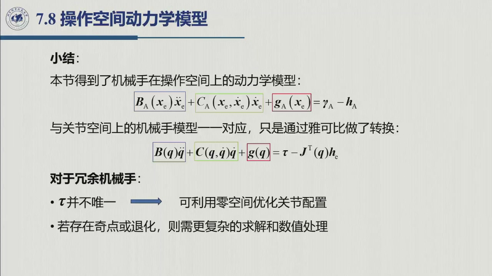
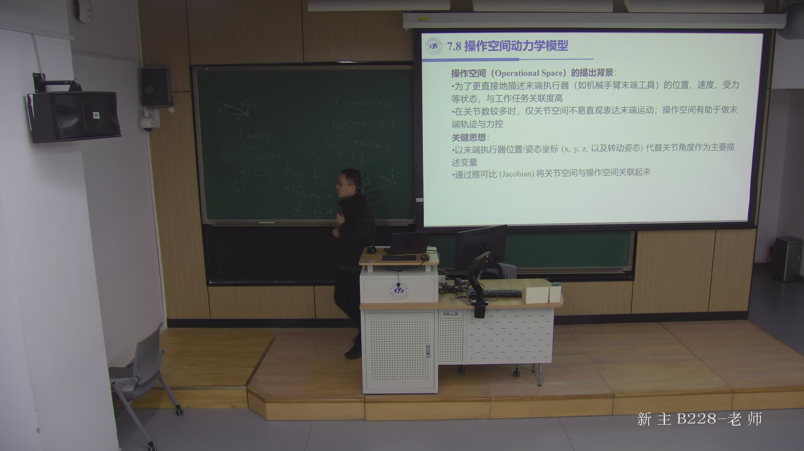

# 6.7 操作空间动力学模型

> 录播 01:36:48–01:53:19。课件 **§7.8「操作空间动力学模型」**（标题 01:36:48），本书编为 6.7；
> 01:38:48–01:44:28 为课间，讲解主体 01:44:28–01:53:19。
> 本节回答：把自变量从关节角 $\boldsymbol q$ 换成末端位姿 $\boldsymbol x_e$，方程长什么样、与关节空间什么关系、代价在哪。

::: note 来源与边界（本节）
- **教材对应**：教材第 7 章未把操作空间动力学单列一节（通常归入原书第 8 章运动控制或第 9 章力控制），本页以课件为准。
- **课堂 vs 教材**：三步推导按课件板书整理；下标 $A$（analytical Jacobian）为课件记号，文献常用 $x$。文中「课件」指幻灯片、「老师」指口述。
:::

## 6.7.1 为什么需要操作空间

6.6 之前，所有动力学模型都以关节变量 $\boldsymbol q$ 为自变量：

$$B(\boldsymbol q)\ddot{\boldsymbol q}+C(\boldsymbol q,\dot{\boldsymbol q})\dot{\boldsymbol q}
+\boldsymbol g(\boldsymbol q)=\boldsymbol\tau-J^{\mathrm T}(\boldsymbol q)\boldsymbol h_c.$$

它完整、紧凑，但**不直观**：我们真正关心的是末端的位置、姿态、速度、受力，而不是七个关节角。动机有两点（01:44:28–01:47:29）：**任务关联度高**——打磨、抓取、装配的指标都写在末端（位置误差、接触力）；**关节多时不直观**——「哪个方向是靠近工件」很难一眼看出，而操作空间可直接描述末端的运动与力。

做法是将关节空间方程转换到操作空间：用末端位姿 $\boldsymbol x_e$（位置与姿态坐标）描述运动，两空间由分析雅可比关联，$\dot{\boldsymbol x}_e=J_A(\boldsymbol q)\dot{\boldsymbol q}$。先考虑任务维数等于关节数、且 $J_A$ 可逆的情形：此时在选定的逆运动学分支上，末端状态能够确定关节状态。冗余机械手还需要描述不改变末端位姿的关节运动，不能只用末端坐标闭合整个动力学模型；老师在 01:47:31–01:48:18 也提到了这部分运动。

## 6.7.2 两个雅可比：几何雅可比与分析雅可比

先分清两个雅可比（01:49:53–01:51:23）。**几何雅可比** $J(\boldsymbol q)$ 把关节速度映射到末端的**线速度 + 角速度**：

$$\boldsymbol v_e=\begin{bmatrix}\dot{\boldsymbol p}_e\\ \boldsymbol\omega_e\end{bmatrix}
=J(\boldsymbol q)\dot{\boldsymbol q}.$$

**分析雅可比** $J_A(\boldsymbol q)$ 把关节速度映射到**末端位姿坐标的导数**。若位姿坐标取 $\boldsymbol x_e=[\boldsymbol p_e;\ \boldsymbol\phi_e]$（位置 + 欧拉角），则

$$\dot{\boldsymbol x}_e=\begin{bmatrix}\dot{\boldsymbol p}_e\\ \dot{\boldsymbol\phi}_e\end{bmatrix}
=\begin{bmatrix}J_P(\boldsymbol q)\\ J_\phi(\boldsymbol q)\end{bmatrix}\dot{\boldsymbol q}
=J_A(\boldsymbol q)\dot{\boldsymbol q}.$$

**欧拉角的导数不是角速度**——这是老师反复强调的一点（01:50:30–01:50:45）。两者差一个变换矩阵：

$$\boldsymbol v_e=\begin{bmatrix}I&O\\ O&T(\boldsymbol\phi_e)\end{bmatrix}\dot{\boldsymbol x}_e
=T_A(\boldsymbol\phi_e)\dot{\boldsymbol x}_e,
\qquad
J=T_A(\boldsymbol\phi_e)J_A.$$

$T(\boldsymbol\phi_e)$ 把欧拉角坐标导数换成同一基系中的角速度，$T_A$ 对位置块保持不变（见[第 3 章](../ch03/sec3-1.md)）。本节转换同时要求姿态坐标图有效、$T_A$ 非奇异；欧拉角参数化奇点与机械臂几何奇点是两种不同来源。

对 $\dot{\boldsymbol x}_e=J_A\dot{\boldsymbol q}$ 再求一次时间导数，得到**分析加速度**：

$$\boxed{\ \ddot{\boldsymbol x}_e=J_A(\boldsymbol q)\ddot{\boldsymbol q}
+\dot J_A(\boldsymbol q,\dot{\boldsymbol q})\dot{\boldsymbol q}\ }$$

多出来的 $\dot J_A\dot{\boldsymbol q}$ 是雅可比随位形变化产生的项；**做操作空间动力学时不能漏**。

## 6.7.3 从关节空间推到操作空间

**第一步：解出 $\ddot{\boldsymbol q}$。** 忽略阻尼与摩擦，

$$B\ddot{\boldsymbol q}+C\dot{\boldsymbol q}+\boldsymbol g
=\boldsymbol\tau-J^{\mathrm T}\boldsymbol h_c.$$

**先限定驱动力的形式。** 假定末端任务维数为 $m$、关节数为 $n$，且 $J\in\mathbb R^{m\times n}$ 满行秩。本节先考虑能写成下面形式的关节力矩：

$$\boldsymbol\tau=J^{\mathrm T}\boldsymbol\gamma_e,$$

其中 $\boldsymbol\gamma_e$ 是与末端几何速度共轭的广义力，$\boldsymbol h_c$ 沿本章约定的方向表示末端对环境的力。对于 $m=n$ 且 $J$ 可逆的情形，每个关节力矩都可这样表示；冗余机械手的任意关节力矩未必属于 $J^{\mathrm T}$ 的值域，还可能包含零空间控制分量。

在这个假定下，关节加速度为

$$\ddot{\boldsymbol q}=-B^{-1}C\dot{\boldsymbol q}-B^{-1}\boldsymbol g
+B^{-1}J^{\mathrm T}\bigl(\boldsymbol\gamma_e-\boldsymbol h_c\bigr).$$

**第二步：代入分析加速度。** 把上式代进 $\ddot{\boldsymbol x}_e=J_A\ddot{\boldsymbol q}+\dot J_A\dot{\boldsymbol q}$：

$$\ddot{\boldsymbol x}_e=-J_AB^{-1}C\dot{\boldsymbol q}
-J_AB^{-1}\boldsymbol g
+\dot J_A\dot{\boldsymbol q}
+J_AB^{-1}J^{\mathrm T}\bigl(\boldsymbol\gamma_e-\boldsymbol h_c\bigr).$$

**第三步：统一记号。** 由 $J^{\mathrm T}=J_A^{\mathrm T}T_A^{\mathrm T}$，令

$$\boldsymbol\gamma_A=T_A^{\mathrm T}(\boldsymbol x_e)\boldsymbol\gamma_e,
\qquad
\boldsymbol h_A=T_A^{\mathrm T}(\boldsymbol x_e)\boldsymbol h_c,$$

这个转置来自功率：$\gamma_e^{\mathrm T}v_e=\gamma_e^{\mathrm T}T_A\dot x_e=\gamma_A^{\mathrm T}\dot x_e$。物理力的平移分量单位为 N，物理力矩为 N·m；分析广义力的姿态部分与所选角坐标共轭，一般不是原物理力矩分量。所有力/力矩须与雅可比使用同一坐标系和参考点。

则最后一项变成 $J_AB^{-1}J_A^{\mathrm T}(\boldsymbol\gamma_A-\boldsymbol h_A)$。其余项仍含 $\boldsymbol q,\dot{\boldsymbol q}$；只有在可由末端坐标和速度确定关节状态的条件下，才能把它们完全改写成末端状态的函数。

## 6.7.4 操作空间动力学方程

先回到非冗余、$J_A$ 可逆的情况。此时 $\dot{\boldsymbol q}=J_A^{-1}\dot{\boldsymbol x}_e$，可以把速度项写成矩阵乘以 $\dot{\boldsymbol x}_e$，从而整理为

$$\boxed{\ B_A(\boldsymbol x_e)\ddot{\boldsymbol x}_e
+C_A(\boldsymbol x_e,\dot{\boldsymbol x}_e)\dot{\boldsymbol x}_e
+\boldsymbol g_A(\boldsymbol x_e)=\boldsymbol\gamma_A-\boldsymbol h_A\ }$$

当 $B$ 正定且 $J_A$ 满行秩时，$J_AB^{-1}J_A^{\mathrm T}$ 可逆；两边左乘它的逆矩阵，并把速度项和重力项分别合并。在本节先讨论的方阵可逆情形下，得到

$$\boxed{\ B_A=\bigl(J_AB^{-1}J_A^{\mathrm T}\bigr)^{-1}\ }$$

$$\boxed{\ C_A\dot{\boldsymbol x}_e=B_AJ_AB^{-1}C\dot{\boldsymbol q}
-B_A\dot J_A\dot{\boldsymbol q}\ }$$

$$\boxed{\ \boldsymbol g_A=B_AJ_AB^{-1}\boldsymbol g\ }$$

**非冗余时怎样看出这三个量。** 当 $J_A$ 为可逆方阵，有 $B_A=J_A^{-\mathrm T}BJ_A^{-1}$，所以 $B_AJ_AB^{-1}=J_A^{-\mathrm T}$。再将 $\dot{\boldsymbol q}=J_A^{-1}\dot{\boldsymbol x}_e$ 代入速度项，可选

$$C_A=J_A^{-\mathrm T}CJ_A^{-1}-B_A\dot J_AJ_A^{-1},\qquad
\boldsymbol g_A=J_A^{-\mathrm T}\boldsymbol g.$$

这正是课件 `s06677` 给出的非冗余写法。第二项并非额外的物理外力，而是变换坐标时，$J_A$ 本身也随运动变化所产生的速度项。

**课件为什么提醒“伪动能”。** `s06682` 说明，任务空间模型主要描述末端运动，$\tfrac12\dot{\boldsymbol x}_e^{\mathrm T}B_A\dot{\boldsymbol x}_e$ 不应一概当作全机器人的动能。非冗余且 $J_A$ 可逆时，代入上面的合同变换，确实有

$$\tfrac12\dot{\boldsymbol x}_e^{\mathrm T}B_A\dot{\boldsymbol x}_e
=\tfrac12\dot{\boldsymbol q}^{\mathrm T}B\dot{\boldsymbol q}=T.$$

但冗余时，同一末端速度还允许非零的零空间关节速度；末端静止不等于各关节静止，更不等于机器人动能为零。因此课件将只由任务速度构成的二次型称作“伪动能”（kinetic pseudo-energy），是提醒不要漏掉内部运动的能量，而不是说这个二次型没有物理意义。

各项与关节空间一一对应：

| 操作空间量 | 对应关节空间量 | 物理意义 |
|:--|:--|:--|
| $B_A(\boldsymbol x_e)$ | $B(\boldsymbol q)$ | **有效惯量矩阵**（末端各方向的等效质量/惯量） |
| $C_A(\boldsymbol x_e,\dot{\boldsymbol x}_e)$ | $C(\boldsymbol q,\dot{\boldsymbol q})$ | 速度耦合（离心/科氏）项 |
| $\boldsymbol g_A(\boldsymbol x_e)$ | $\boldsymbol g(\boldsymbol q)$ | 重力项（末端各方向的重力等效力） |
| $\boldsymbol\gamma_A$ | $\boldsymbol\tau$ | 广义力（由关节力矩等效到末端） |
| $\boldsymbol h_A$ | $\boldsymbol h_c$ | 末端接触力（经 $T_A^{\mathrm T}$ 变换） |

三点补充。**其一，几何雅可比版本**：若用 $J$ 与 $\boldsymbol v_e$ 替换 $J_A,\dot{\boldsymbol x}_e,\ddot{\boldsymbol x}_e$，可得同形式的 $B_x\dot{\boldsymbol v}_e+C_x\boldsymbol v_e+\boldsymbol g_x=\boldsymbol\gamma_e-\boldsymbol h_e$。**其二，$C_A$ 的选法**：这里定义的是乘积 $C_A\dot{\boldsymbol x}_e$，矩阵本身并不唯一。**其三，奇点**：$J_A$ 必须满行秩；接近降秩时，$J_AB^{-1}J_A^{\mathrm T}$ 可能病态，失去秩后不能再求上面的逆。老师在 01:52:43 也指出，奇点或退化需要另外处理。

**冗余时为什么不能只看 $\boldsymbol x_e$？** 设两移动关节的任务为 $x=q_1$，$J_A=[1\ 0]$，$B=\operatorname{diag}(1+(q_2/L)^2,1)\ \mathrm{kg}$，其中 $L=1\ \mathrm m$。于是 $B_A=[1+(q_2/L)^2]\ \mathrm{kg}$：即使末端位置相同，不同 $q_2$ 也给出不同任务惯量。满行秩足以保证逆矩阵存在，却不保证 $B_A$ 只由 $x$ 决定。零空间速度也可能影响末端加速度；即使 $\dot x_e=0$，由 $\dot q$ 构成的速度残量仍未必为零，不能直接写成有限矩阵乘 $\dot x_e$。冗余时须保留关节状态与零空间贡献，或另行规定消除冗余的方式。

## 6.7.5 操作空间的正解、逆解与冗余

**操作空间正解**：在非冗余、雅可比可逆且逆运动学分支已选定时，可由 $\boldsymbol x_e,\dot{\boldsymbol x}_e$ 得到对应的关节状态；再由输入广义力和接触力求 $\ddot{\boldsymbol x}_e$ 并积分。若输入直接给为任意关节力矩，须先利用当前 $\boldsymbol q$ 进行力的变换。**操作空间逆解**：已知末端轨迹及所选的关节状态，可算出满足模型的 $\boldsymbol\gamma_A$，再换回关节力矩：

$$\boldsymbol\tau=J_A^{\mathrm T}(\boldsymbol q)\boldsymbol\gamma_A.$$

由 $J=T_AJ_A$、$\boldsymbol\gamma_A=T_A^{\mathrm T}\boldsymbol\gamma_e$ 得 $\boldsymbol\tau=J^{\mathrm T}\boldsymbol\gamma_e=J_A^{\mathrm T}\boldsymbol\gamma_A$；文献把 $\boldsymbol\gamma_A$ 记作 $\boldsymbol\tau_x$ 或 $\boldsymbol F_x$，故 $\boldsymbol\tau_x=J_A^{-\mathrm T}\boldsymbol\tau$（$J_A$ 满秩方阵时）。**转置不要写反：关节力矩 = 雅可比转置 × 操作力。**

**冗余与奇点。** 任务维数为 $m$ 而关节数 $n>m$ 时，可能存在不改变末端瞬时运动的关节速度，额外自由度可用于避障或远离限位。零空间控制力矩也会影响关节运动，其对末端的影响取决于动力学投影方式，不能简单并入上面假设的 $J_A^{\mathrm T}\boldsymbol\gamma_A$。奇点处 $J_A$ 降秩，式中逆矩阵不再存在；阻尼、伪逆或切换任务是可能的处理方式，但得到的是修改后的模型或控制律。

## 6.7.6 小结与常见错误

- **一句话**：将关节动力学与分析雅可比结合，可得到末端加速度和广义力的关系；$B_A=(J_AB^{-1}J_A^{\mathrm T})^{-1}$ 要求 $B$ 正定、$J_A$ 满行秩。将系数只写成末端状态的函数，还需要能由末端状态确定关节状态。
- **两个雅可比**：几何 $J$ 对 $[\dot{\boldsymbol p}_e;\boldsymbol\omega_e]$，分析 $J_A$ 对 $[\dot{\boldsymbol p}_e;\dot{\boldsymbol\phi}_e]$，$J=T_AJ_A$。冗余时还须保留关节或零空间状态。

### 常见错误清单

1. **把 $J_A$ 当 $J$**：$\dot{\boldsymbol x}_e$ 的姿态导数是欧拉角导数，不是角速度，两者差 $T_A$。
2. **漏掉 $\dot J_A\dot{\boldsymbol q}$**：$\ddot{\boldsymbol x}_e=J_A\ddot{\boldsymbol q}+\dot J_A\dot{\boldsymbol q}$ 第二项不能省。
3. **把 $B_A$ 写成 $J_ABJ_A^{\mathrm T}$**：惯量是 $(J_AB^{-1}J_A^{\mathrm T})^{-1}$，不是直接投影。
4. **忘记 $\boldsymbol g_A$ 里的 $B_A$**：$\boldsymbol g_A=B_AJ_AB^{-1}\boldsymbol g$，不是 $J_A\boldsymbol g$。
5. **在奇点硬算 $B_A$**：$J_A$ 降秩时不能求该逆矩阵；接近奇点时还应检查数值病态。
6. **把 $\boldsymbol\tau=J_A^{\mathrm T}\boldsymbol\gamma_A$ 写成 $\boldsymbol\gamma_A=J_A^{\mathrm T}\boldsymbol\tau$**：转置反了，量纲也不对。
7. **以为操作空间一定更好**：描述直观，但依赖雅可比、奇点更脆弱；关节空间模型仍是控制器设计的基础。

### 默写点 · 合上书再写

1. 写出几何雅可比与分析雅可比的定义与关系 $J=T_AJ_A$。
2. 写出 $\dot{\boldsymbol x}_e=J_A\dot{\boldsymbol q}$、$\ddot{\boldsymbol x}_e=J_A\ddot{\boldsymbol q}+\dot J_A\dot{\boldsymbol q}$。
3. 从 $B\ddot{\boldsymbol q}+C\dot{\boldsymbol q}+\boldsymbol g=\boldsymbol\tau-J^{\mathrm T}\boldsymbol h_c$ 推到操作空间方程，并写出 $B_A,C_A,\boldsymbol g_A$ 的定义。
4. 操作空间模型何时失效？冗余机械手怎样利用零空间？

::: note 待核（本节）
1. **$T_A$ 的措辞**：课件称 $T_A$ 为「两个雅可比矩阵行列式的变换矩阵」，此说**待核**（从上下文看它是把 $\dot{\boldsymbol x}_e$ 换成 $\boldsymbol v_e$ 的变换矩阵，与「行列式」无关）。
2. **与教材的对应**：教材第 7 章是否单列此节**待核**；若在原书第 8/9 章出现，节号与式号一并核对。
:::
