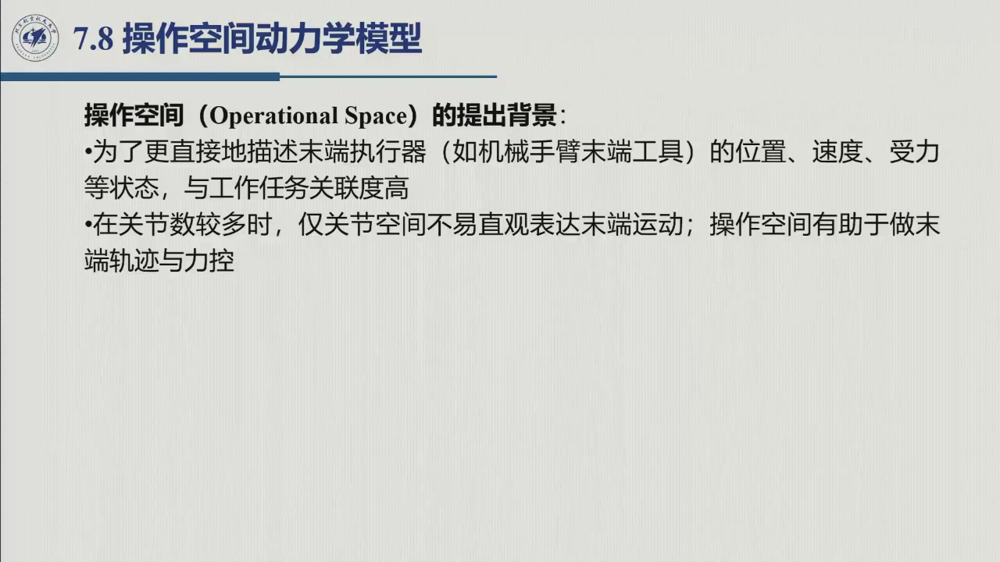
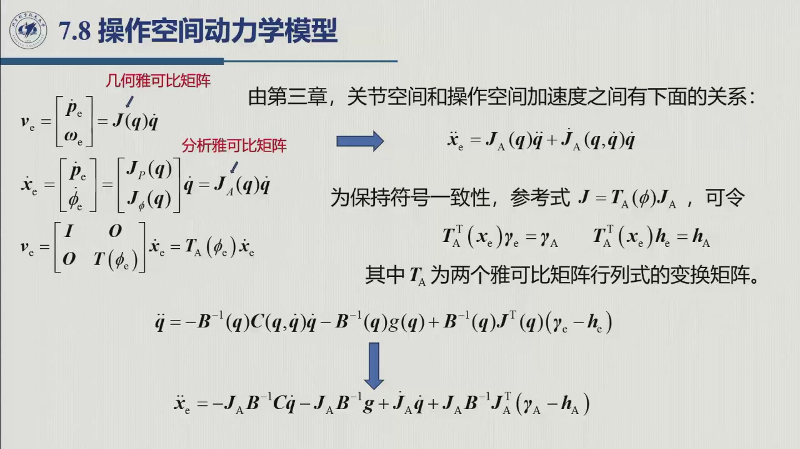
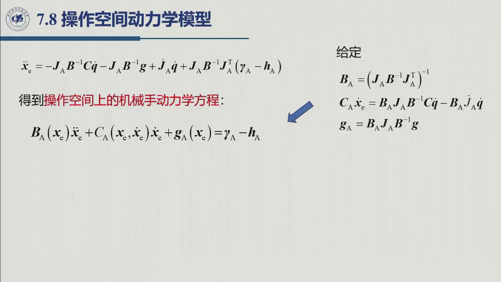
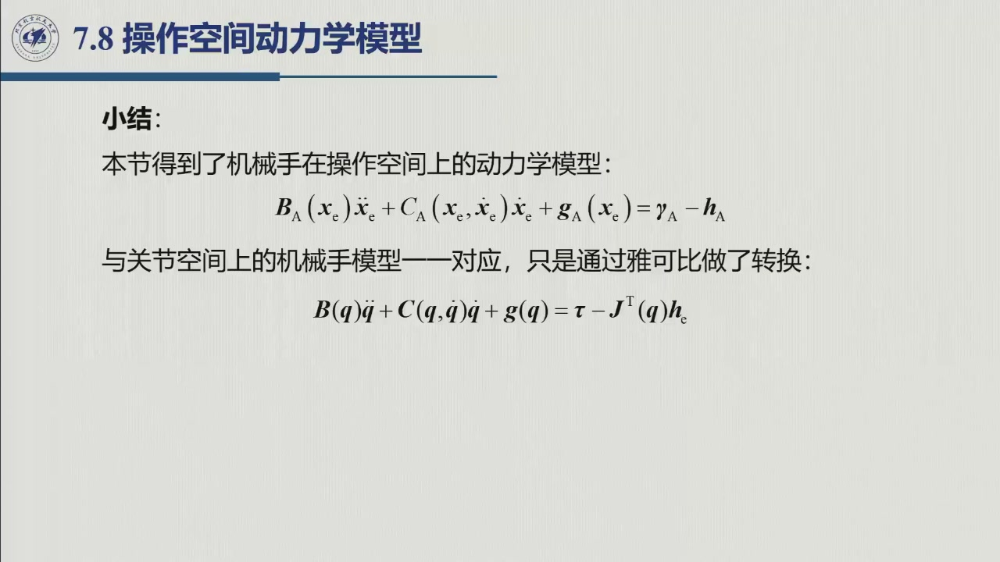

# 6.7 操作空间动力学模型

打磨、装配或抓取等任务直接规定末端执行器怎么走、沿哪个方向施力。前面的关节空间动力学 $B(\boldsymbol q)\ddot{\boldsymbol q}+C(\boldsymbol q,\dot{\boldsymbol q})\dot{\boldsymbol q}+\boldsymbol g(\boldsymbol q)=\boldsymbol\tau-J^{\mathrm T}\boldsymbol h_e$ 虽能算出整机响应，但关节数较多时，很难从关节转角直观看出末端沿工件法向受多大力、加速度朝哪个方向。把模型从关节坐标 $\boldsymbol q$ 换到末端任务坐标 $\boldsymbol x$（或 $\boldsymbol x_e$），就能在任务坐标里直接写出惯量、速度耦合和重力，交给第七章的[操作空间控制](../ch07/sec7-4.md)设计控制律。

本节先在局部非冗余分支上同时换算速度、加速度和功率配对，导出操作空间动力学方程，再讨论奇点与冗余机械手的力矩零空间。课堂回看：01:36:48–01:53:19（课件编为 §7.8；01:38:48–01:44:28 为课间，讲解主体在 01:44:28–01:53:19）。

## 6.7.1 为什么需要操作空间

不计摩擦时，关节空间动力学模型为

$$B(\boldsymbol q)\ddot{\boldsymbol q}+C(\boldsymbol q,\dot{\boldsymbol q})\dot{\boldsymbol q}+\boldsymbol g(\boldsymbol q)=\boldsymbol\tau-J^{\mathrm T}(\boldsymbol q)\boldsymbol h_e,$$

其中 $\boldsymbol h_e$ 按全章约定取机器人施加给环境的广义力系。直接用这套方程设计末端打磨或装配任务时有两处不便（01:44:28–01:47:29）：任务指标（位置误差、接触力）都写在末端；关节较多时（如六轴或七轴机械臂），从关节转角很难直观看出“哪个方向靠近工件、哪个方向正抵住表面”。

因此希望把自变量换成描述末端位置和局部姿态的任务坐标 $\boldsymbol x$（如 $\boldsymbol x_e=[\boldsymbol p_e;\ \boldsymbol\phi_e]$，三维位置加一组局部欧拉角）。需要注意前提：换坐标只是换了一套描述方式，关节限位、机构奇点和冗余机械手的内部构形仍然存在。

后面先在**非冗余且局部可逆**的范围内推导完整操作空间方程：令任务维数等于关节数（$r=n$），选定连续光滑的姿态参数和固定的逆运动学分支，且分析雅可比 $J_A$ 满秩可逆。在这个局部区域内，关节构形才可唯一表为任务坐标的函数 $\boldsymbol q=\boldsymbol q(\boldsymbol x)$，速度也可唯一反解为 $\dot{\boldsymbol q}=J_A^{-1}\dot{\boldsymbol x}$；随后在 6.7.5 再说明 $r<n$ 的冗余机械手哪些关系照样成立、哪些额外需要零空间。

## 6.7.2 两个雅可比：几何雅可比与分析雅可比

把动力学方程搬到任务坐标，必须把**速度、加速度和广义力**三者一起按同一套坐标换算。先分清第三章的两个雅可比（01:49:53–01:51:23）。

[几何雅可比](../recall.md#jacobian) $J(\boldsymbol q)$ 把关节速度映成物理线速度 $\dot{\boldsymbol p}$ 与空间角速度 $\boldsymbol\omega$；**分析雅可比** $J_A(\boldsymbol q)$ 则对选定的任务坐标 $\boldsymbol x=[\boldsymbol p;\ \boldsymbol\phi]$ 直接求时间导数：

$$\boldsymbol v=\begin{bmatrix}\dot{\boldsymbol p}\\\boldsymbol\omega\end{bmatrix}=J(\boldsymbol q)\dot{\boldsymbol q},\qquad
\dot{\boldsymbol x}=\begin{bmatrix}\dot{\boldsymbol p}\\\dot{\boldsymbol\phi}\end{bmatrix}=J_A(\boldsymbol q)\dot{\boldsymbol q}.$$

老师反复提醒（01:50:30–01:50:45）：**欧拉角的导数 $\dot{\boldsymbol\phi}$ 不是角速度 $\boldsymbol\omega$**（它甚至不是三维空间中的矢量），两者通过第三章的姿态速率变换矩阵 $\boldsymbol\omega=T(\boldsymbol\phi)\dot{\boldsymbol\phi}$ 联系。对完整六维位姿任务，构造块对角变换矩阵 $T_A(\boldsymbol\phi)=\operatorname{diag}(I_3,T(\boldsymbol\phi))$，于是有

$$\boldsymbol v=T_A\dot{\boldsymbol x},\qquad J=T_AJ_A.$$

如果任务只包含末端位置 $\boldsymbol x=\boldsymbol p$，则没有姿态导数转换，$T_A$ 退化为单位阵 $I$，$J_A$ 就是位置雅可比 $J_P$。

有速度关系后，广义力的换算由**虚功（功率）守恒**唯一钉死（[功率对偶](../recall.md#wrench)）。设与物理速度 $\boldsymbol v$ 配对的物理力/力矩为 $\boldsymbol F$，与任务坐标导数 $\dot{\boldsymbol x}$ 配对的任务广义力为 $\boldsymbol F_A$，要求两者瞬时功率相等：

$$\boldsymbol F_A^{\mathrm T}\dot{\boldsymbol x}=\boldsymbol F^{\mathrm T}\boldsymbol v=\boldsymbol F^{\mathrm T}T_A\dot{\boldsymbol x}=(T_A^{\mathrm T}\boldsymbol F)^{\mathrm T}\dot{\boldsymbol x}\qquad\Longrightarrow\qquad \boldsymbol F_A=T_A^{\mathrm T}\boldsymbol F.$$

同样地，对关节与末端功率 $\boldsymbol\tau^{\mathrm T}\dot{\boldsymbol q}=\boldsymbol F_A^{\mathrm T}\dot{\boldsymbol x}=\boldsymbol F_A^{\mathrm T}J_A\dot{\boldsymbol q}$，得到 $\boldsymbol\tau=J_A^{\mathrm T}\boldsymbol F_A$。正因为 $\dot{\boldsymbol\phi}$ 不是物理角速度，姿态坐标所配对的广义力分量一般也不同于物理力矩在三个坐标轴上的分量。

最后对 $\dot{\boldsymbol x}=J_A(\boldsymbol q)\dot{\boldsymbol q}$ 再求一次时间导数，因为 $J_A$ 随位形 $\boldsymbol q$ 变化，乘积求导必出一项雅可比时间导数：

$$\boxed{\ \ddot{\boldsymbol x}=J_A(\boldsymbol q)\ddot{\boldsymbol q}+\dot J_A(\boldsymbol q,\dot{\boldsymbol q})\dot{\boldsymbol q}\ }$$

第二项 $\dot J_A\dot{\boldsymbol q}$ 类似于曲线坐标系中的向心/曲率加速度：即使关节加速度 $\ddot{\boldsymbol q}=\boldsymbol 0$（各关节匀速转动），只要雅可比随位形改变，末端的坐标加速度 $\ddot{\boldsymbol x}$ 仍可非零，推导操作空间动力学时绝不能漏掉。

## 6.7.3 从关节空间推到操作空间

按上面功率配对的约定，在任务坐标中定义与 $\dot{\boldsymbol x}$ 对偶的**等效任务驱动广义力** $\boldsymbol\gamma_A$ 和**等效任务接触广义力** $\boldsymbol h_A$，使

$$\boldsymbol\tau=J_A^{\mathrm T}\boldsymbol\gamma_A,\qquad
J^{\mathrm T}\boldsymbol h_e=J_A^{\mathrm T}\boldsymbol h_A.$$

在完整六维位姿任务下，把 $J=T_AJ_A$ 代入 $J^{\mathrm T}\boldsymbol h_e=J_A^{\mathrm T}T_A^{\mathrm T}\boldsymbol h_e$，可直接读出 $\boldsymbol h_A=T_A^{\mathrm T}\boldsymbol h_e$（和 $\boldsymbol\gamma_A=T_A^{\mathrm T}\boldsymbol\gamma_e$，$\boldsymbol\gamma_e$ 为按几何雅可比等效到末端的物理广义力）；$\boldsymbol h_A$ 的方向仍保持“机器人施加给环境”的约定。将二者代回关节空间模型：

$$B\ddot{\boldsymbol q}+C\dot{\boldsymbol q}+\boldsymbol g=J_A^{\mathrm T}(\boldsymbol\gamma_A-\boldsymbol h_A).$$

接着分三步消去 $\ddot{\boldsymbol q}$：

1. **在关节空间解出 $\ddot{\boldsymbol q}$**：由 $B\succ 0$ 左乘 $B^{-1}$，得

   $$\ddot{\boldsymbol q}=-B^{-1}C\dot{\boldsymbol q}-B^{-1}\boldsymbol g+B^{-1}J_A^{\mathrm T}(\boldsymbol\gamma_A-\boldsymbol h_A).$$

2. **代入任务加速度关系 $\ddot{\boldsymbol x}=J_A\ddot{\boldsymbol q}+\dot J_A\dot{\boldsymbol q}$**：左乘 $J_A$ 并加上 $\dot J_A\dot{\boldsymbol q}$，得到

   $$\ddot{\boldsymbol x}=-J_AB^{-1}C\dot{\boldsymbol q}-J_AB^{-1}\boldsymbol g+\dot J_A\dot{\boldsymbol q}+J_AB^{-1}J_A^{\mathrm T}(\boldsymbol\gamma_A-\boldsymbol h_A).$$

3. **按物理作用核对乘序**：上式最后一项的矩阵积 $J_AB^{-1}J_A^{\mathrm T}$ 从右到左依次做三件事：$J_A^{\mathrm T}$ 把任务广义力折回关节空间力矩，$B^{-1}$ 把关节力矩映成关节加速度，最左边的 $J_A$ 再把关节加速度映回任务加速度。三者连乘，正好表示“单位任务广义力产生的任务加速度”，即任务空间有效惯量矩阵的逆。

## 6.7.4 操作空间动力学方程

要从上式解回“广义力”放在右端的标准动力学形式，需要把 $\boldsymbol\gamma_A-\boldsymbol h_A$ 前面的矩阵 $J_AB^{-1}J_A^{\mathrm T}$ 求逆移到左端。先确认它的逆存在：当 $B\succ 0$（从而 $B^{-1}\succ 0$）且 $J_A\in\mathbb R^{r\times n}$ **行满秩**时，对任意非零任务向量 $\boldsymbol a\in\mathbb R^r$，由行满秩可知 $J_A^{\mathrm T}\boldsymbol a\neq\boldsymbol 0$（因为 $J_A^{\mathrm T}$ 列满秩，零空间只有 $\boldsymbol 0$），于是

$$\boldsymbol a^{\mathrm T}\bigl(J_AB^{-1}J_A^{\mathrm T}\bigr)\boldsymbol a
=(J_A^{\mathrm T}\boldsymbol a)^{\mathrm T}B^{-1}(J_A^{\mathrm T}\boldsymbol a)>0.$$

因此 $J_AB^{-1}J_A^{\mathrm T}$ 对称正定，必可逆。定义**操作空间有效惯量矩阵**：

$$\boxed{\ B_A=\bigl(J_AB^{-1}J_A^{\mathrm T}\bigr)^{-1}\ }$$

用 $B_A$ 左乘上一小节的 $\ddot{\boldsymbol x}$ 表达式，右端只留 $\boldsymbol\gamma_A-\boldsymbol h_A$，再把负号各项移到左端：

$$B_A\ddot{\boldsymbol x}=-B_AJ_AB^{-1}C\dot{\boldsymbol q}-B_AJ_AB^{-1}\boldsymbol g+B_A\dot J_A\dot{\boldsymbol q}+(\boldsymbol\gamma_A-\boldsymbol h_A),$$

整理即得**操作空间动力学方程**：

$$\boxed{\ B_A(\boldsymbol x)\ddot{\boldsymbol x}+C_A(\boldsymbol x,\dot{\boldsymbol x})\dot{\boldsymbol x}+\boldsymbol g_A(\boldsymbol x)=\boldsymbol\gamma_A-\boldsymbol h_A\ }$$

其中速度耦合项和重力项定义为

$$\boxed{\ C_A\dot{\boldsymbol x}=B_AJ_AB^{-1}C\dot{\boldsymbol q}-B_A\dot J_A\dot{\boldsymbol q},\qquad
\boldsymbol g_A=B_AJ_AB^{-1}\boldsymbol g\ }$$

这里先按当前位形 $\boldsymbol q$ 和速度 $\dot{\boldsymbol q}$ 写出式子，已经只含任务坐标的加速度 $\ddot{\boldsymbol x}$ 和广义力 $\boldsymbol\gamma_A,\boldsymbol h_A$；若要进一步把 $B_A,C_A,\boldsymbol g_A$ 全部改写为 $\boldsymbol x,\dot{\boldsymbol x}$ 的函数，才需在局部非冗余分支上代入 $\boldsymbol q=\boldsymbol q(\boldsymbol x)$ 与 $\dot{\boldsymbol q}=J_A^{-1}\dot{\boldsymbol x}$。

| 操作空间量 | 对应关节空间量 | 物理意义 |
|:--|:--|:--|
| $B_A$ | $B$ | 末端任务各方向的等效惯量矩阵 |
| $C_A$ | $C$ | 任务空间速度耦合项（含连杆速度项与 $-\dot J_A\dot{\boldsymbol q}$ 曲率项） |
| $\boldsymbol g_A$ | $\boldsymbol g$ | 任务空间重力项（静止保持所需任务广义力） |
| $\boldsymbol\gamma_A$ | $\boldsymbol\tau$ | 任务驱动广义力（经 $J_A^{\mathrm T}$ 折回关节） |
| $\boldsymbol h_A$ | $\boldsymbol h_e$ | 机器人向环境施加的任务接触广义力 |

注意式子只唯一确定乘积 $C_A\dot{\boldsymbol x}$，就像 [6.2.1](sec6-2-1.md) 中关节方程只唯一确定 $C\dot{\boldsymbol q}$ 一样。若要继续保留 $\dot B_A-2C_A$ 的反对称性，须取与动力学一致的广义逆来构造 $C_A$（见[作业六·补 7-10](homework06b.md)）。此外，若改用几何雅可比 $J$、物理速度 $\boldsymbol v$ 与物理力系 $\boldsymbol\gamma_e,\boldsymbol h_e$，可推得完全同构的几何版操作空间模型（第七章常记作 $B_x,C_x,\boldsymbol g_x$）。

### 用动能独立检查惯量变换

在非冗余局部可逆区域（$r=n$，$J_A$ 为可逆方阵），$(J_AB^{-1}J_A^{\mathrm T})^{-1}$ 可用矩阵逆性质展开为 $J_A^{-\mathrm T}BJ_A^{-1}$。直接把 $\dot{\boldsymbol q}=J_A^{-1}\dot{\boldsymbol x}$ 代入系统动能，也能独立得到同一矩阵：

$$T=\frac12\dot{\boldsymbol q}^{\mathrm T}B\dot{\boldsymbol q}=\frac12\bigl(J_A^{-1}\dot{\boldsymbol x}\bigr)^{\mathrm T}B\bigl(J_A^{-1}\dot{\boldsymbol x}\bigr)=\frac12\dot{\boldsymbol x}^{\mathrm T}\bigl(J_A^{-\mathrm T}BJ_A^{-1}\bigr)\dot{\boldsymbol x}.$$

因此非冗余时

$$B_A=J_A^{-\mathrm T}BJ_A^{-1}=\bigl(J_AB^{-1}J_A^{\mathrm T}\bigr)^{-1}.$$

拿一个二维数例核对：$B=\operatorname{diag}(4,1)$、$J_A=\operatorname{diag}(2,1/2)$，按上式算出 $B_A=\operatorname{diag}(4/4,\ 1/(1/4))=\operatorname{diag}(1,4)$。给定 $\dot{\boldsymbol q}=(1,1)^{\mathrm T}$，有 $\dot{\boldsymbol x}=(2,1/2)^{\mathrm T}$，两端动能均为 $\frac12(4\cdot1^2+1\cdot1^2)=2.5\ \mathrm J$ 与 $\frac12(1\cdot2^2+4\cdot(1/2)^2)=2.5\ \mathrm J$。若误把坐标变换写成顺向投影 $J_ABJ_A^{\mathrm T}=\operatorname{diag}(16,1/4)$，算出动能成了 $32.03125\ \mathrm J$，量纲和能量全错。

当机构靠近或处于**奇异位形**时，$J_A$ 降秩，存在非零 $\boldsymbol a$ 使 $J_A^{\mathrm T}\boldsymbol a=\boldsymbol 0$：前面的正定性证明立即失效，$J_AB^{-1}J_A^{\mathrm T}$ 奇异，逆矩阵 $B_A$ 不存在。即使接近奇点，$B_A$ 的某些特征值也会急剧增大、求解病态。实际控制中面对奇点或退化，需要阻尼最小二乘、任务降维或退回关节空间，同时重新界定引入的跟踪误差与适用范围，而不能把无穷惯量硬填进方程继续算（老师在 01:52:43 前后指出：「若存在奇点或退化，则需要更复杂的求解和数值处理」）。

## 6.7.5 操作空间的正解、逆解与冗余

把模型写成操作空间形式后，[6.5](sec6-5.md) 的正逆动力学可直接对应搬过来：

- **操作空间正解**：给定当前任务状态、驱动力矩 $\boldsymbol\tau$ 与接触力，换算出 $\boldsymbol\gamma_A,\boldsymbol h_A$，由 $B_A\ddot{\boldsymbol x}=\boldsymbol\gamma_A-\boldsymbol h_A-C_A\dot{\boldsymbol x}-\boldsymbol g_A$ 解出 $\ddot{\boldsymbol x}$ 并沿时间数值积分（非冗余局部范围内还需监控分支是否切换）。
- **操作空间逆解**：已知末端规划的 $\boldsymbol x,\dot{\boldsymbol x},\ddot{\boldsymbol x}$，先代入方程求任务广义力 $\boldsymbol\gamma_A$，再通过 $\boldsymbol\tau=J_A^{\mathrm T}\boldsymbol\gamma_A$ 换回关节力矩。注意转置的方向：**关节力矩 = 雅可比转置 × 任务广义力**，只有在 $J_A$ 方阵满秩时才可反向写成 $\boldsymbol\gamma_A=J_A^{-\mathrm T}\boldsymbol\tau$。另外，写出末端方程后，实际应用仍须检查末端力/位姿测量是否可得，以及换回的关节位置、速度、力矩是否超出物理限位。

当机械臂**冗余**（任务维数 $r<n$，例如七自由度臂只控制六维位姿，或三连杆平面臂只控制二维末端位置）时，只要 $J_A\in\mathbb R^{r\times n}$ 仍保持行满秩，上面的正定性证明依然成立，因此 $B_A=(J_AB^{-1}J_A^{\mathrm T})^{-1}$、$C_A\dot{\boldsymbol x}$ 和 $\boldsymbol g_A$ 照样有定义。区别在于两点：

1. **模型仍依赖内部构形 $\boldsymbol q$**：同一个末端位姿 $\boldsymbol x$ 对应无穷多种关节自运动构形，不同内部姿态下的 $B_A(\boldsymbol q)$ 不同，因此只能写成 $B_A(\boldsymbol q)$，单靠 $(\boldsymbol x,\dot{\boldsymbol x})$ 不足以唯一决定整机后续运动。
2. **必须区分「速度零空间」与「动力学力矩零空间」**：给定末端加速需求，实现它的关节力矩 $\boldsymbol\tau$ 不唯一，多余自由度可用于避障、省能或远离关节限位（01:47:31–01:48:18）。但要让额外加入的零空间关节力矩 $\boldsymbol\tau_0$ 在当前状态下**不改变末端任务加速度 $\ddot{\boldsymbol x}$**，它必须满足

   $$J_AB^{-1}\boldsymbol\tau_0=\boldsymbol 0,$$

   而不是运动学里的 $J_A\boldsymbol\tau_0=\boldsymbol 0$：力矩先经关节惯量逆 $B^{-1}$ 变成关节加速度 $\ddot{\boldsymbol q}=B^{-1}\boldsymbol\tau_0+\cdots$，再经 $J_A$ 才变成任务加速度。

   拿一个两连杆一维任务验证这个差别：取 $B=\operatorname{diag}(4,1)$、$J_A=[1\ 1]$。运动学速度零空间向量是 $\boldsymbol v_0=(1,-1)^{\mathrm T}$（满足 $J_A\boldsymbol v_0=0$）；若错把它直接当力矩加在关节上，它产生的任务加速度贡献为 $J_AB^{-1}\boldsymbol v_0=[1\ 1]\operatorname{diag}(\tfrac14,1)\begin{bmatrix}1\\-1\end{bmatrix}=\tfrac14-1=-\tfrac34\neq 0$，反而把末端推偏了。把力矩改为 $\boldsymbol\tau_0=(4,-1)^{\mathrm T}$，才满足 $J_AB^{-1}\boldsymbol\tau_0=[1\ 1]\begin{bmatrix}1\\-1\end{bmatrix}=0$。

一般地，为把任意次任务期望力矩 $\boldsymbol\tau_{\text{null}}$ 投影到动力学力矩零空间，可以取动态一致力矩投影阵

$$N_\tau=I-J_A^{\mathrm T}B_AJ_AB^{-1}.$$

左乘 $J_AB^{-1}$ 立即验证：

$$J_AB^{-1}N_\tau=J_AB^{-1}-\bigl(J_AB^{-1}J_A^{\mathrm T}\bigr)B_AJ_AB^{-1}=J_AB^{-1}-B_A^{-1}B_AJ_AB^{-1}=O,$$

因此总控制律取 $\boldsymbol\tau=J_A^{\mathrm T}\boldsymbol\gamma_A+N_\tau\boldsymbol\tau_{\text{null}}$ 时，附加力矩只在当前瞬时不产生任务加速度；内部自运动是否稳定、是否碰到关节限位，还需要在第七章结合闭环动力学单独分析。

## 6.7.6 小结与常见错误

换到末端任务坐标 $\boldsymbol x$ 时，速度 $\dot{\boldsymbol x}=J_A\dot{\boldsymbol q}$、加速度 $\ddot{\boldsymbol x}=J_A\ddot{\boldsymbol q}+\dot J_A\dot{\boldsymbol q}$ 与功率对偶力 $\boldsymbol\tau=J_A^{\mathrm T}\boldsymbol\gamma_A$ 必须配套换算。由关节动力学消去 $\ddot{\boldsymbol q}$ 后得到 $B_A\ddot{\boldsymbol x}+C_A\dot{\boldsymbol x}+\boldsymbol g_A=\boldsymbol\gamma_A-\boldsymbol h_A$，其中有效惯量 $B_A=(J_AB^{-1}J_A^{\mathrm T})^{-1}$ 在 $B\succ 0$ 且 $J_A$ 行满秩时正定可逆；非冗余局部区域可退化为 $B_A=J_A^{-\mathrm T}BJ_A^{-1}$，冗余情况下模型仍依赖内部构形 $\boldsymbol q$，附加优化力矩必须满足动力学力矩零空间 $J_AB^{-1}\boldsymbol\tau_0=\boldsymbol 0$。第七章将直接基于这套方程设计末端空间的位置与力控制律。

::: think 常见错误清单
1. **把分析雅可比 $J_A$ 当成几何雅可比 $J$**：$\dot{\boldsymbol x}$ 中的姿态部分是欧拉角导数 $\dot{\boldsymbol\phi}$ 而非物理角速度 $\boldsymbol\omega$，两者差一个 $T_A=\operatorname{diag}(I_3,T(\boldsymbol\phi))$，配对广义力也要乘 $T_A^{\mathrm T}$。
2. **求任务加速度时漏掉 $\dot J_A\dot{\boldsymbol q}$**：由 $\dot{\boldsymbol x}=J_A\dot{\boldsymbol q}$ 求导得到的 $\ddot{\boldsymbol x}=J_A\ddot{\boldsymbol q}+\dot J_A\dot{\boldsymbol q}$ 包含雅可比随位形变化的项，漏掉它会导致 $C_A\dot{\boldsymbol x}$ 缺少 $-B_A\dot J_A\dot{\boldsymbol q}$。
3. **把任务惯量写成顺向投影 $J_ABJ_A^{\mathrm T}$**：正确定义是 $B_A=(J_AB^{-1}J_A^{\mathrm T})^{-1}$（非冗余时等于 $J_A^{-\mathrm T}BJ_A^{-1}$），可用动能不变性 $\frac12\dot{\boldsymbol x}^{\mathrm T}B_A\dot{\boldsymbol x}=\frac12\dot{\boldsymbol q}^{\mathrm T}B\dot{\boldsymbol q}$ 随时检查。
4. **把速度零空间当成力矩零空间**：在冗余臂上加次任务力矩，要求 $J_AB^{-1}\boldsymbol\tau_0=\boldsymbol 0$（由 $N_\tau=I-J_A^{\mathrm T}B_AJ_AB^{-1}$ 投影），直接用 $J_A\boldsymbol\tau_0=\boldsymbol 0$ 会在任务空间产生虚假加速度。
5. **在奇点硬算 $B_A$ 或忽略内部限位**：$J_A$ 降秩时 $B_A$ 不存在，近奇点会病态；同时局部变换只在连续光滑的分支内有效，且操作空间方程本身不自动检查关节限位与力矩饱和。
:::

::: think 检查理解
1. 为什么物理力矩与欧拉角坐标的广义力一般不是同一组三个数？
2. 用什么条件证明 $J_AB^{-1}J_A^{\mathrm T}$ 正定？任务降秩时哪一步失效？
3. 为什么满足运动学零空间 $J_A\boldsymbol\tau_0=\boldsymbol 0$ 的额外关节力矩，仍会引起末端任务加速度？

::: sol 核对
1. 功率要求 $\boldsymbol F_A^{\mathrm T}\dot{\boldsymbol x}=\boldsymbol F^{\mathrm T}\boldsymbol v$，由于 $\boldsymbol\omega=T(\boldsymbol\phi)\dot{\boldsymbol\phi}$，姿态广义力与物理力矩之间隔着转置矩阵 $T^{\mathrm T}(\boldsymbol\phi)$。
2. 需要 $B\succ 0$（故 $B^{-1}\succ 0$）且 $J_A$ 行满秩；后者保证对任意非零 $\boldsymbol a$ 有 $J_A^{\mathrm T}\boldsymbol a\neq\boldsymbol 0$，从而二次型 $(J_A^{\mathrm T}\boldsymbol a)^{\mathrm T}B^{-1}(J_A^{\mathrm T}\boldsymbol a)>0$。降秩时存在非零 $\boldsymbol a$ 使 $J_A^{\mathrm T}\boldsymbol a=\boldsymbol 0$，正定与可逆性一起失效。
3. 关节力矩必须先经过惯量矩阵的逆 $B^{-1}$ 变成关节加速度 $\ddot{\boldsymbol q}$，再乘 $J_A$ 映成任务加速度，因此不扰动末端加速度的条件是 $J_AB^{-1}\boldsymbol\tau_0=\boldsymbol 0$，而非 $J_A\boldsymbol\tau_0=\boldsymbol 0$。
:::
:::

::: think 默写点 · 合上书再写
1. 写出几何雅可比 $J$、分析雅可比 $J_A$、变换矩阵 $T_A$ 的关系，以及二阶运动学关系 $\ddot{\boldsymbol x}=J_A\ddot{\boldsymbol q}+\dot J_A\dot{\boldsymbol q}$。
2. 从关节动力学方程出发，写出消去 $\ddot{\boldsymbol q}$ 推到 $B_A\ddot{\boldsymbol x}+C_A\dot{\boldsymbol x}+\boldsymbol g_A=\boldsymbol\gamma_A-\boldsymbol h_A$ 的步骤，并默写 $B_A,C_A,\boldsymbol g_A$ 的定义。
3. 说明非冗余时 $B_A=J_A^{-\mathrm T}BJ_A^{-1}$ 如何由动能不变性直接导出。
4. 写出冗余机械手的动力学力矩零空间条件 $J_AB^{-1}\boldsymbol\tau_0=\boldsymbol 0$ 与投影阵 $N_\tau$。
:::
