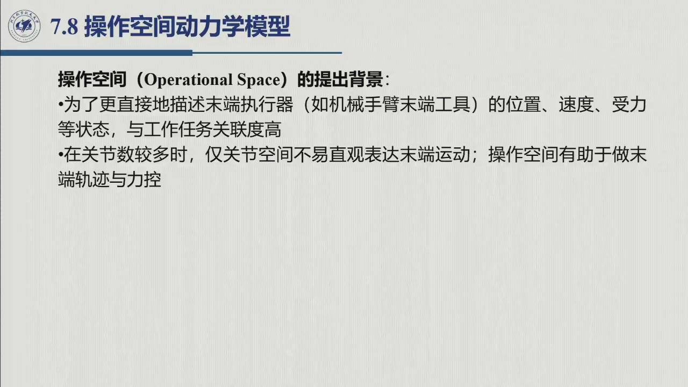
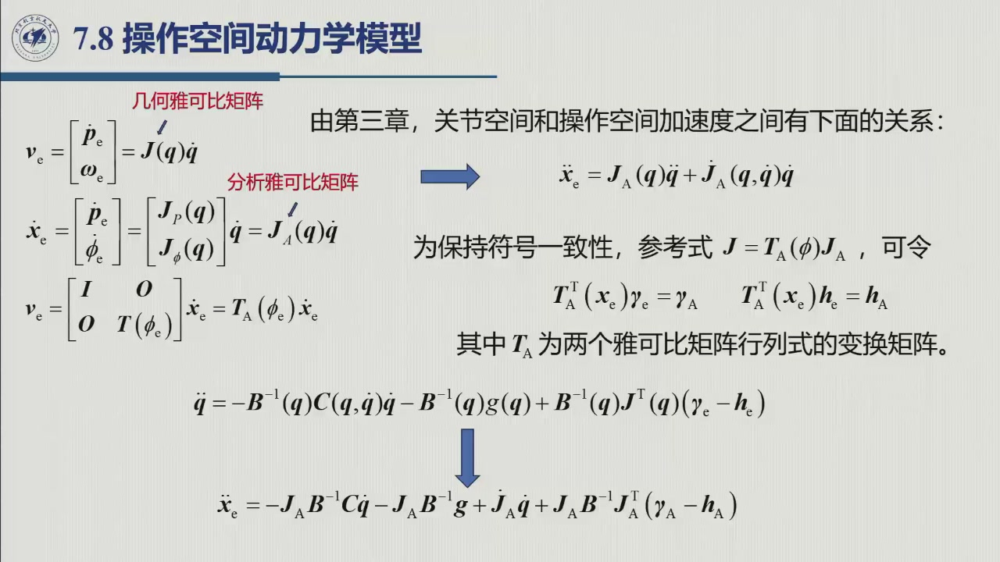
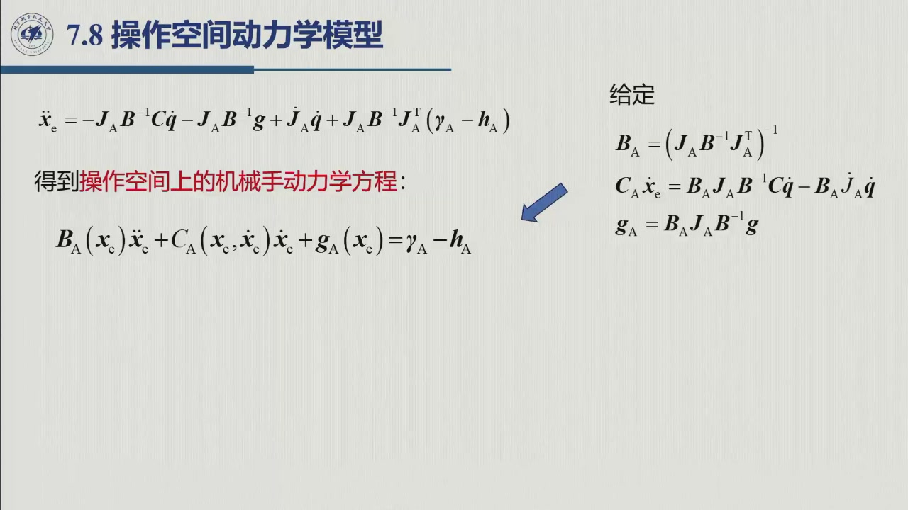
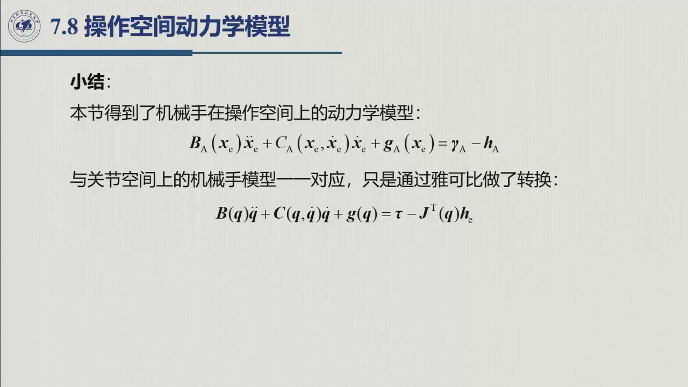
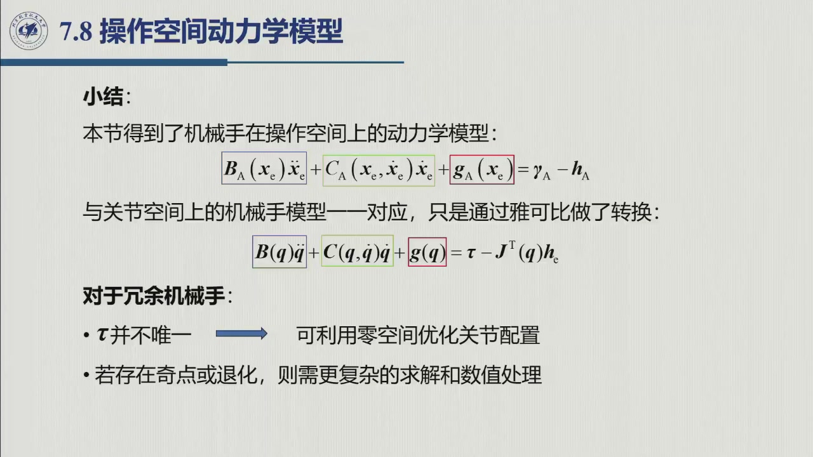

# 6.7 操作空间动力学模型

打磨或装配任务往往直接规定末端怎样运动、沿哪个方向施力。关节动力学已经能计算整机响应，但若要在末端坐标中设计任务，就需要把速度、加速度与功率配对一起换算。本节先处理局部可逆的非冗余情况，再说明冗余时哪些关系仍成立。课堂回看：01:36:48–01:53:19。

## 6.7.1 为什么需要操作空间

关节模型为 $B(q)\ddot q+C(q,\dot q)\dot q+g(q)=\tau-J^{\mathrm T}h_e$，暂不计摩擦。设任务坐标 $x$ 包括末端位置和一组局部姿态参数。它便于表达任务，但不增加新的物理执行能力；奇点、关节限位、内部构形仍然存在。

先考虑任务维数等于关节数、分析雅可比 $J_A$ 可逆的情况，并固定光滑姿态坐标和逆解分支。在这个局部范围内，才可将关节坐标 $q$ 改写为 $q(x)$，后面的求逆与坐标替换都以此为前提。

## 6.7.2 两个雅可比：几何雅可比与分析雅可比

[几何雅可比](../recall.md#jacobian)给出线速度与角速度，分析雅可比则对选定任务坐标求导：

$$v=\begin{bmatrix}\dot p\\\omega\end{bmatrix}=J\dot q,\qquad
\dot x=\begin{bmatrix}\dot p\\\dot\phi\end{bmatrix}=J_A\dot q.$$

局部姿态速度关系为 $\omega=T(\phi)\dot\phi$，故完整位姿任务满足

$$v=T_A\dot x,\qquad T_A=\operatorname{diag}(I_3,T),\qquad J=T_AJ_A.$$

$T_A$ 将姿态坐标导数换成物理角速度。广义力则按[功率对偶](../recall.md#wrench)一起转换：若功率为 $F^{\mathrm T}v$，应取 $F_A=T_A^{\mathrm T}F$ 与 $\dot x$ 配对，因此姿态坐标的广义力一般不同于物理力矩的三个分量。

对 $\dot x=J_A\dot q$ 再求导，

$$\ddot x=J_A\ddot q+\dot J_A\dot q.$$

后一项来自雅可比随构形变化，类似曲线路径中的曲率项。即使关节加速度为零，它也未必为零。

## 6.7.3 从关节空间推到操作空间

先在任务坐标中定义驱动广义力 $\gamma_A$ 和接触广义力 $h_A$，使

$$\tau=J_A^{\mathrm T}\gamma_A,\qquad
J^{\mathrm T}h_e=J_A^{\mathrm T}h_A.$$

在完整位姿坐标下 $h_A=T_A^{\mathrm T}h_e$，其方向仍按机器人向环境施力约定。因此关节模型为

$$B\ddot q+C\dot q+g=J_A^{\mathrm T}(\gamma_A-h_A).$$

解出关节加速度再代入任务加速度：

$$\ddot x=-J_AB^{-1}C\dot q-J_AB^{-1}g
+\dot J_A\dot q+J_AB^{-1}J_A^{\mathrm T}(\gamma_A-h_A).$$

乘序也可按各步作用核对：$J_A$ 的行、列分别对应任务与关节，$B^{-1}$ 在关节空间将力矩映成加速度，$J_A^{\mathrm T}$ 则先把任务广义力折回关节。三者的乘积因此表示任务广义力对任务加速度的影响。

## 6.7.4 操作空间动力学方程

若 $B\succ0$ 且 $J_A$ 行满秩，对非零任务向量 $a$，有

$$a^{\mathrm T}J_AB^{-1}J_A^{\mathrm T}a
=(J_A^{\mathrm T}a)^{\mathrm T}B^{-1}(J_A^{\mathrm T}a)>0.$$

所以可定义任务惯量

$$B_A=(J_AB^{-1}J_A^{\mathrm T})^{-1}.$$

用它左乘加速度方程并移项，得到

$$B_A\ddot x+C_A\dot x+g_A=\gamma_A-h_A,$$

$$C_A\dot x=B_AJ_AB^{-1}C\dot q-B_A\dot J_A\dot q,\qquad
g_A=B_AJ_AB^{-1}g.$$

这里确定的是整个速度项，矩阵 $C_A$ 本身仍可有不同写法。若要进一步把模型写成任务坐标的函数，还需使用主推导中的局部关系 $q=q(x)$ 和 $\dot q=J_A^{-1}\dot x$。

### 用动能独立检查惯量变换

非冗余时把 $\dot q=J_A^{-1}\dot x$ 代入动能：

$$T=\tfrac12\dot x^{\mathrm T}J_A^{-\mathrm T}BJ_A^{-1}\dot x.$$

因此同一任务惯量也可写成

$$B_A=J_A^{-\mathrm T}BJ_A^{-1}=(J_AB^{-1}J_A^{\mathrm T})^{-1}.$$

例如取两维局部坐标变换，$B=\operatorname{diag}(4,1)$、$J_A=\operatorname{diag}(2,1/2)$，得到 $B_A=\operatorname{diag}(1,4)$。给 $\dot q=(1,1)$，有 $\dot x=(2,1/2)$，两种动能均为2.5 J。若误写 $J_ABJ_A^{\mathrm T}$，将得不到同一能量。

任务秩下降时，存在非零 $a$ 使 $J_A^{\mathrm T}a=0$，上面的正定证明失效，所写逆矩阵不存在。接近奇点时某些方向可能病态，但不能在奇点直接填一个“无穷惯量矩阵”继续算。阻尼或降维会改变求解问题，须重新说明误差和任务范围。

## 6.7.5 操作空间的正解、逆解与冗余

在非冗余局部坐标中，给定状态和驱动力可解 $\ddot x$，再积分；给定任务运动可求 $\gamma_A$，再用 $\tau=J_A^{\mathrm T}\gamma_A$ 转回关节。模型与关节空间等价，不意味着任务力可以无条件测得，也不意味着任何任务轨迹都能通过限位与力矩检查。

若任务维数 $r<n$，但 $J_A$ 仍行满秩，$B_A=(J_AB^{-1}J_A^{\mathrm T})^{-1}$ 依然存在。不过通常应写成 $B_A(q)$：同一个末端位置可能对应不同内部构形、不同惯量，单独给 $x,\dot x$ 不足以唯一决定整机后续运动。

还要区分速度零空间与力矩零空间。想让额外关节力矩在当前状态下不改变任务加速度，要求

$$J_AB^{-1}\tau_0=0,$$

而不是 $J_A\tau_0=0$。例如取 $B=\operatorname{diag}(4,1)$、一维任务雅可比 $J_A=[1\ 1]$。运动学零空间方向 $(1,-1)^{\mathrm T}$ 若直接当力矩使用，其任务加速度贡献为 $1/4-1=-3/4$，并非零；改用力矩 $(4,-1)^{\mathrm T}$，才有 $J_AB^{-1}\tau_0=1-1=0$。

一般可取力矩投影

$$N_\tau=I-J_A^{\mathrm T}B_AJ_AB^{-1}.$$

直接相乘，利用 $J_AB^{-1}J_A^{\mathrm T}=B_A^{-1}$，即可验证 $J_AB^{-1}N_\tau=0$。这保证当前模型中的额外力矩不改变任务加速度；内部状态、限位与闭环稳定性仍要另外设计。

## 6.7.6 小结与常见错误

换任务坐标时，速度、加速度和广义力要一起换算。先用功率确定力的转置关系，再用加速度方程得到惯量。非冗余时可作局部坐标变换；冗余时任务模型仍依赖内部构形，动力学力矩投影也不能直接替代成速度投影。

::: think 检查理解
1. 为什么物理力矩与欧拉角坐标的广义力一般不是同一组三个数？
2. 用什么条件证明 $J_AB^{-1}J_A^{\mathrm T}$ 正定？任务降秩时哪一步失效？
3. 为什么有 $J_A\tau_0=0$ 仍不能保证任务加速度不受影响？

::: sol 核对
两者分别与角速度和欧拉角导数配对，须按 $T_A^{\mathrm T}$ 换算。正定性需要 $B\succ0$ 与 $J_A$ 行满秩，后者保证非零 $a$ 的 $J_A^{\mathrm T}a$ 不为零。力矩先经 $B^{-1}$ 变成关节加速度，所以要消掉的是 $J_AB^{-1}\tau_0$。
:::
:::
