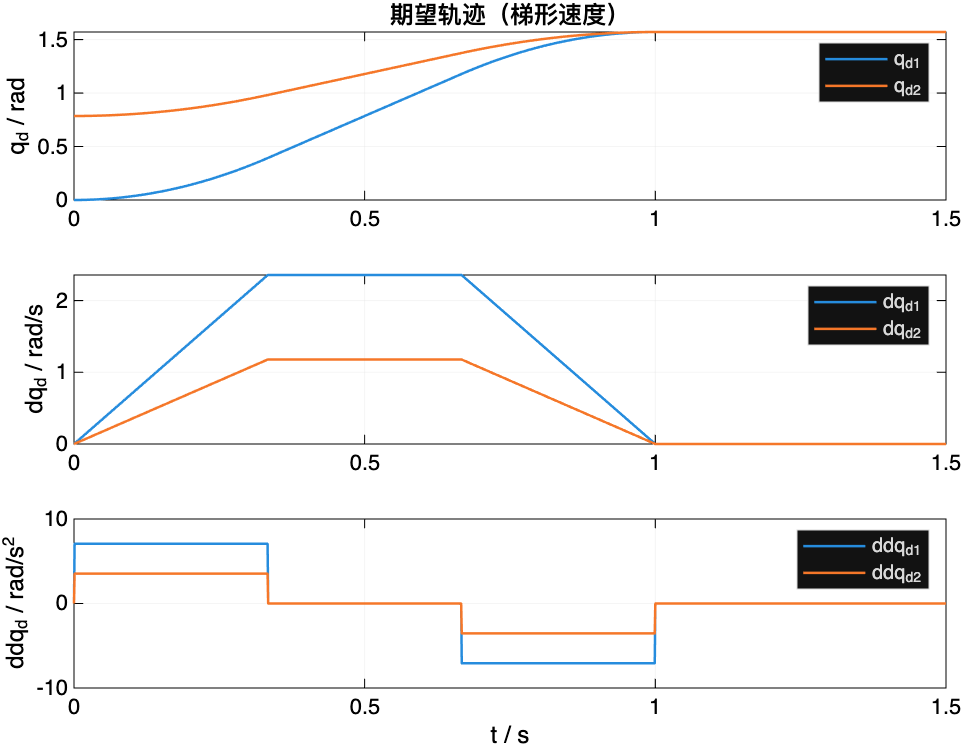
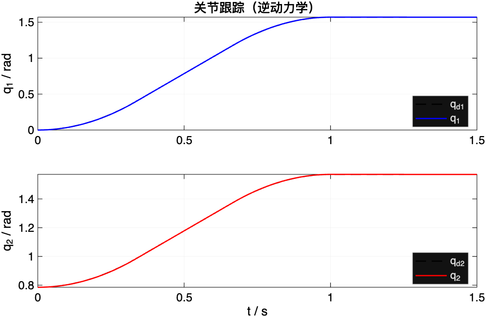
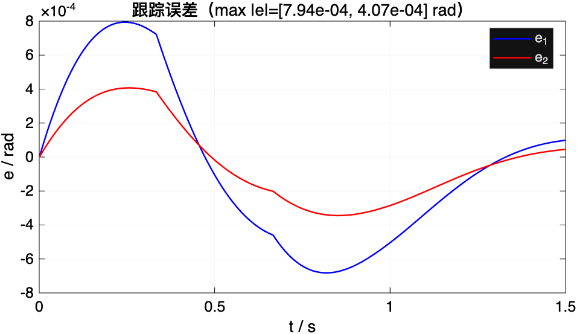
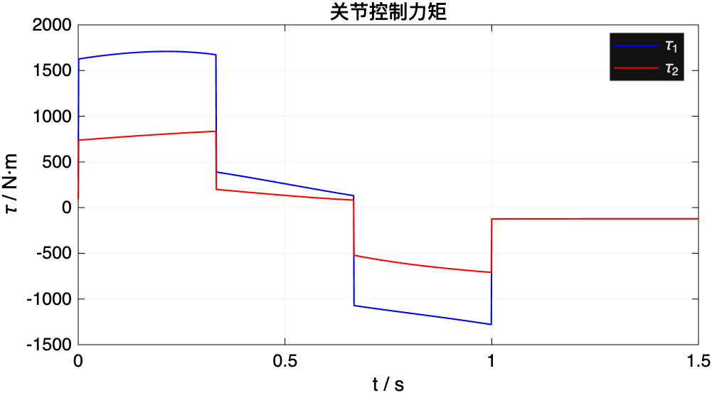

# 作业七：教材习题 8-10～8-16 任选一题（附 8-12 详细解答与仿真验算）

> **布置时间**：2026-11-02 第 9 周课末（课件最后一页，02:17:50）。
> **题目**：教材习题 **8-10～8-16 任选一题**。
> **提交内容**：**模型、控制设计、仿真代码及结果**，四样缺一不可。


::: note 提交与评分
- **渠道与截止**：智学北航 → 机器人控制技术 → **课程作业 →「第8章 运动控制」→ 做作业**；
  平台窗口 **2026-11-02 00:00 至 2026-11-09 00:00**（周一零点截止，满分 1 分）——**平台提交，不需要去教室**。
- **老师原话**（02:17:33–02:18:42）：「不是理论计算」；用 MATLAB 直观感受；
  「并不是说从头从零开始编」；基础代码课上分发（没拿到可找助教乔涛/王赫荪）；
  两连杆即可，「找一个参数，看看控制效果是不是有变化」。
- **本页建议的报告组织权重**（用于自查，不是教师公布的评分细则）：

| 项 | 权重 | 要求 |
|:--|:--:|:--|
| **模型** | 30% | 写出 $B,C,\boldsymbol g$（或等效），说明参数与假设 |
| **控制设计** | 30% | 控制律、增益取法、误差方程/稳定性；不要只贴公式 |
| **仿真代码** | 25% | 可运行、有注释、参数集中在开头；能复现你的图 |
| **结果与分析** | 15% | 跟踪/误差/力矩曲线；至少比较两种方案或两组参数 |

**自查重点**：只贴代码没有推导；只贴公式没有图；图没有坐标/单位；把「仿真通过」当成「控制有效」。
:::

本页写法与前几周一致：**先选题，再把推荐题 8-12 走完「建模 → 控制 → 仿真 → 读图 → 对比」**；
数值由 `tools/verify_homework07.py`（`make verify`）与配套 MATLAB（`tools/hw07_8_12_matlab/`）双端复算。
教材原题文字请查原书第 8 章习题——本页只转述题意，避免与中英译本句读纠缠。

---

## 先看这七道题在考什么

| 题 | 给定量 | 要求的量 | 真正考的是一句话 | 难度 |
|:--|:--|:--|:--|:--|
| **8-10** | §8.7 两连杆参数 | 重力补偿 PD；两姿态点位镇定 | **点对点 ≠ 跟踪**（$\dot q_d=0$） | ★ |
| **8-11** | 同上 + $m_L=10$ | 分散控制 + 计算转矩前馈；梯形轨迹跟踪 | **前馈用 $q_d$，反馈压残差** | ★★ |
| **8-12** | 同 8-11 | **逆动力学**关节控制；同轨迹 | **用实测 $q$ 全对消 → 解耦二阶** | ★★ |
| **8-13** | 同 8-11 | 鲁棒关节控制 | 不确定界 $\rho$ + 边界层 | ★★★ |
| **8-14** | 同 8-11 | 自适应；要参数化 | $Y\hat\pi$ 回归 + 自适应律 | ★★★★ |
| **8-15** | 同 8-11 | 操作空间重力补偿 PD；两末端点 | 直接在 $x$ 闭环；要 $J_A$ | ★★★ |
| **8-16** | 同 8-11 | 操作空间逆动力学；末端直线 | $J_A^{-1}$ + 关节侧逆动力学 | ★★★ |

**本书推荐选 8-12**：它是第 9 周主线（[7.3.4](sec7-3.md#sec-7.3.4)）的旗舰方案，又比 8-13～8-16 少一层理论；
与课堂 §8.7 方案 G、[7.5](sec7-5.md) 的误差量级表直接对得上。若只求最省事，选 **8-10**（无轨迹规划）。

对象一律是 **§8.7 / 课堂 7.5 的两连杆平面臂**；8-11 起加末端集中负载 $m_L=10\,\mathrm{kg}$；
离散实现统一 **$T_s=1\,\mathrm{ms}$**。

::: note 参数口径：课件 $m=5$ vs 英文原书 $m=50$
课堂幻灯片 §8.7 写 $m_{\ell_1}=m_{\ell_2}=5\,\mathrm{kg}$（见 [本章参数表](sec7-5.md#sec-7.5.1)）；
英文原书 §8.7 / 例 7.2 写 $m_1=m_2=50\,\mathrm{kg}$。**本详解跟课堂课件**（与 [7.5.1](sec7-5.md#sec-7.5.1) 一致）。
交作业时在报告里写清「参数取自课堂 §8.7」即可；若助教要求跟原书，把 $m_1,m_2$ 改成 50 重跑，控制律不变。
:::

---

## 习题 8-12：关节空间逆动力学控制（完整详解）

::: ex 题目（转述）
对与 §8.7 相同参数的两连杆平面臂，在题 8-11 的设定下（末端集中负载 $m_L=10\,\mathrm{kg}$；
关节空间直线路径 $\boldsymbol q_i=[0,\pi/4]^{\mathrm T}\to\boldsymbol q_f=[\pi/2,\pi/2]^{\mathrm T}$，
梯形速度剖面，$t_f=1\,\mathrm s$）：
**设计逆动力学关节控制**，用计算机仿真该轨迹跟踪，**离散实现采样时间 $1\,\mathrm{ms}$**。
:::

一句话：**把非线性整机模型塞进反馈里对消掉，让误差服从 $n$ 个解耦的线性二阶方程**。

### 第 0 步：这道题在考什么

| 给定量 | 要求的量 | 真正考的是 |
|:--|:--|:--|
| $B,C,F,\boldsymbol g$（含 $m_L$） | 完整被控对象 | 第六章模型会不会用 |
| $\boldsymbol q_d(t)$（梯形） | 参考轨迹及其一、二阶导 | 第四章规划接口 |
| 逆动力学律 + $K_P,K_D$ | 控制设计 | [7.3.4](sec7-3.md#sec-7.3.4) 反馈线性化 |
| $T_s=1\,\mathrm{ms}$ 仿真 | 跟踪/误差/力矩图 | 离散实现与读图 |

### 第 1 步：建模（含末端负载与摩擦）

无接触力时，关节侧方程（教材 (8.7) / 课堂 (7.3-8)）：

$$B(\boldsymbol q)\ddot{\boldsymbol q}
+C(\boldsymbol q,\dot{\boldsymbol q})\dot{\boldsymbol q}
+F\dot{\boldsymbol q}
+\boldsymbol g(\boldsymbol q)
=\boldsymbol u. \tag{H7.1}$$

**无负载时的 $B,C,\boldsymbol g$** 直接引用 [6.3.2](../ch06/sec6-3-2.md)。题 8-11 要求末端集中质量 $m_L$，
等价于在末端追加动能与势能：

$$
\begin{aligned}
\Delta b_{11}&=m_L(a_1^2+a_2^2+2a_1a_2c_2),\\
\Delta b_{12}=\Delta b_{21}&=m_L(a_2^2+a_1a_2c_2),\\
\Delta b_{22}&=m_La_2^2,
\end{aligned}
\qquad
h=-m_2a_1\ell_2s_2-m_La_1a_2s_2.
$$

重力（$y$ 轴向上，$\boldsymbol g_0=[0,-g,0]^{\mathrm T}$）多出两项：

$$
\begin{aligned}
g_1&=(m_1\ell_1+m_{m_2}a_1+m_2a_1+m_La_1)gc_1+(m_2\ell_2+m_La_2)gc_{12},\\
g_2&=(m_2\ell_2+m_La_2)gc_{12}.
\end{aligned}
\tag{H7.2}
$$

电机黏性摩擦折算到关节侧：

$$F=\mathrm{diag}(F_{m_1}k_{r_1}^2,\ F_{m_2}k_{r_2}^2). \tag{H7.3}$$

**本详解采用的数值**（课堂 §8.7 + 题 8-11 的 $m_L$）：

| 量 | 值 | 量 | 值 |
|:--|:--|:--|:--|
| $a_1=a_2$ | $1\,\mathrm m$ | $\ell_1=\ell_2$ | $0.5\,\mathrm m$ |
| $m_1=m_2$ | $5\,\mathrm{kg}$ | $I_1=I_2$ | $10\,\mathrm{kg\cdot m^2}$ |
| $k_{r1}=k_{r2}$ | $100$ | $m_{m1}=m_{m2}$ | $5\,\mathrm{kg}$ |
| $I_{m1}=I_{m2}$ | $0.01\,\mathrm{kg\cdot m^2}$ | $F_{m1}=F_{m2}$ | $0.01\,\mathrm{N\cdot m\cdot s/rad}$ |
| $m_L$ | $10\,\mathrm{kg}$ | $g$ | $9.81\,\mathrm{m/s^2}$ |


::: note 为什么 $F$ 要乘 $k_r^2$
电机侧摩擦力矩 $F_m\omega_m$，而 $\omega_m=k_r\dot q$，折到关节侧再乘一次 $k_r$（虚功），
于是出现 $F_mk_r^2\dot q$。漏掉这一步，匀速段的力矩对不上重力+摩擦的静平衡。
:::

### 第 2 步：逆动力学控制律与误差方程

把 (H7.1) 写成 $B\ddot{\boldsymbol q}+\boldsymbol n=\boldsymbol u$，其中
$\boldsymbol n=C\dot{\boldsymbol q}+F\dot{\boldsymbol q}+\boldsymbol g$。取

$$
\boldsymbol u=B(\boldsymbol q)\boldsymbol y+\boldsymbol n(\boldsymbol q,\dot{\boldsymbol q}),
\qquad
\boldsymbol y=\ddot{\boldsymbol q}_d+K_D\dot{\tilde{\boldsymbol q}}+K_P\tilde{\boldsymbol q},
\tag{H7.4}
$$

即（课堂 (7.3-9)）

$$
\boxed{
\boldsymbol u=B(\boldsymbol q)\bigl(\ddot{\boldsymbol q}_d+K_D\dot{\tilde{\boldsymbol q}}+K_P\tilde{\boldsymbol q}\bigr)
+C\dot{\boldsymbol q}+F\dot{\boldsymbol q}+\boldsymbol g(\boldsymbol q)
}
\tag{H7.5}
$$

其中 $\tilde{\boldsymbol q}=\boldsymbol q_d-\boldsymbol q$。$B$ 可逆（第六章性质一），代入得

$$
\ddot{\tilde{\boldsymbol q}}+K_D\dot{\tilde{\boldsymbol q}}+K_P\tilde{\boldsymbol q}=\boldsymbol 0.
\tag{H7.6}
$$

本题使用对角正增益，因而得到两个独立的线性二阶误差系统。一般对称正定增益也可使系统稳定，但坐标不一定解耦。


整机转矩前馈沿期望运动计算模型项，再加独立误差反馈；本题用实际状态计算 $B,n$，并在虚拟加速度中注入反馈。模型输入、反馈位置与增益单位都需对应，不能只替换自变量而沿用全部参数。

{{#include ../assets/figures/robot-control.md}}

### 第 3 步：增益与期望轨迹

反馈线性化后等效惯量为单位阵，按课堂 §8.7 方案 G 取

$$\omega_n=5\,\mathrm{rad/s},\quad\zeta=0.5
\quad\Rightarrow\quad
K_P=\omega_n^2I_2=25I_2,\quad
K_D=2\zeta\omega_n I_2=5I_2. \tag{H7.7}$$

（分散控制里才有 $K_P=J\omega_n^2$；这里 $J$ 已被 $B$ 对消，**不要再乘 $J$**。）

期望轨迹：路径参数 $s(t)\in[0,1]$ 走梯形速度剖面，加减速时间 $t_c=t_f/3$，

$$
\boldsymbol q_d(t)=\boldsymbol q_i+s(t)(\boldsymbol q_f-\boldsymbol q_i),\qquad
t_f=1\,\mathrm s.
\tag{H7.8}
$$

于是 $\dot{\boldsymbol q}_d=\dot s\,\Delta\boldsymbol q$、$\ddot{\boldsymbol q}_d=\ddot s\,\Delta\boldsymbol q$，两关节**同步**起停——这就是「关节空间直线路径」。



### 第 4 步：离散仿真怎么做

题目要求 **$T_s=1\,\mathrm{ms}$**。实现口径：

1. 每个采样时刻用当前 $\boldsymbol q,\dot{\boldsymbol q}$ 算 (H7.5)，力矩**零阶保持**一个周期；
2. 周期内用 **RK4**（或 `ode45`）积分被控对象 (H7.1)；
3. 初值取 $\boldsymbol q(0)=\boldsymbol q_i$、$\dot{\boldsymbol q}(0)=\boldsymbol 0$（从期望姿态静止出发）。

配套代码：

| 文件 | 作用 |
|:--|:--|
| `tools/hw07_8_12_matlab/run_hw812.m` | 主仿真 + 出图 |
| `tools/hw07_8_12_matlab/plant_dyn.m` | (H7.1)–(H7.3) |
| `tools/hw07_8_12_matlab/traj_trap.m` | (H7.8) |
| `tools/verify_homework07.py` | Python 复算（`make verify`） |

```matlab
% 核心三行（完整脚本见 tools/hw07_8_12_matlab/run_hw812.m）
[B,C,F,g] = plant_dyn(q, dq, p);
y = ddqd + Kd*de + Kp*e;                 % 外环
u = B*y + C*dq + F*dq + g;               % 内环对消
```

### 第 5 步：结果与读图

本机 MATLAB R2026b 与 `verify_homework07.py` 一致：

| 指标 | 关节 1 | 关节 2 |
|:--|--:|--:|
| $\max\|e_i\|$ | $7.94\times10^{-4}\,\mathrm{rad}$ | $4.07\times10^{-4}\,\mathrm{rad}$ |
| $\mathrm{rms}\,e_i$ | $4.70\times10^{-4}\,\mathrm{rad}$ | $2.42\times10^{-4}\,\mathrm{rad}$ |
| $\max\|u_i\|$ | $1709\,\mathrm{N\cdot m}$ | $836\,\mathrm{N\cdot m}$ |







**读图三句话**

1. **跟踪**：肉眼上看 $q$ 与 $q_d$ 重合——逆动力学在模型精确时把误差压到 $10^{-4}$ 量级，
   与课堂 [7.5.3](sec7-5.md#sec-7.5.3) 方案 G 的结论同档。
2. **误差**：在 $t\approx t_c$ 与 $t\approx t_f-t_c$（加速度跳变点）出现折角；
   这是梯形剖面 $\ddot{\boldsymbol q}_d$ 不连续 + 1 ms 零阶保持的残差，**不是发散**。
3. **力矩**：加减速段尖峰大、匀速段回落、到位后约 $-120\,\mathrm{N\cdot m}$（抗重力）；
   峰值大是因为 $k_r=100$ 把转子惯量折到关节侧、$m_L=10\,\mathrm{kg}$ 加重负载——
   **误差小 ≠ 力矩小**。

### 第 6 步：必做的对比实验（老师要的「改一个参数」）

控制器仍用标称 $m_1=m_2=5$、$m_L=10$，**被控对象质量整体放大 10%**（`plant_scale=1.10`）：

| 情形 | $\max\|e_1\|$ | $\max\|e_2\|$ |
|:--|--:|--:|
| 模型精确 | $7.94\times10^{-4}$ | $4.07\times10^{-4}$ |
| 对象 +10%，控制用标称 | $1.10\times10^{-2}$ | $6.28\times10^{-3}$ |

本次质量失配使最大跟踪误差增大约一个数量级，比较结论限定于表中固定的参考、增益和采样设置。
报告中应限定结论：本次固定增益与采样周期，只改变对象质量，跟踪误差随之增大。它说明模型失配会影响性能，不能推出性能与增益无关。可以再做[两连杆第八关](../training/two-link.md#mission-feedback)的简化扰动题，检查位置增益如何改变稳态误差；实际调参还要同时检查噪声、采样与力矩限幅。

复算命令：

```bash
cd robot && python3 tools/verify_homework07.py
# 或：make verify   （已并入总校验）
```

### 验算清单（交卷前勾）

- [ ] $B$ 含 $m_L$ 三项、$\boldsymbol g$ 含 $m_L$ 两项、$h$ 含 $-m_La_1a_2s_2$
- [ ] $F=\mathrm{diag}(F_mk_r^2)$，不是直接用 $F_m$
- [ ] 控制律自变量是实测 $q$，不是 $q_d$（否则退回前馈）
- [ ] $K_P=25I$、$K_D=5I$（反馈线性化后**不乘** $J$）
- [ ] 图有坐标轴、单位、图例；结论写了误差量级与对比实验

::: think 8-12 易错点 · 五条 {#hw7-812-pitfalls}
1. **模型状态与控制结构混用**：把实际状态改成期望状态后，原精确抵消通常失效；要改成题8-11，应重新写完整前馈和反馈及其增益单位。
2. **增益再乘惯量**：$K_P=J\omega_n^2$ 是分散回路的公式；这里对消后 $J=I$。
3. **漏 $m_L$**：题面写「of Problem 8.11」，负载必须进 $B,C,g$。
4. **漏摩擦或摩擦未折算**：匀速段力矩会对不上；对消不完全时误差地板抬高。
5. **只给图而缺少模型**：读者无法判断是否能复现，也无法核对误差方程。
:::

---

## 若你选的是其他题（怎么改这一份骨架）

| 你选的题 | 改哪里 | 回看 |
|:--|:--|:--|
| **8-10** | 去掉轨迹，改成两点姿态；$u=g(q)-K_Dq\dot{}-K_P(q-q_d)$ | [7.3.3](sec7-3.md#sec-7.3.3) |
| **8-11** | 沿期望运动计算转矩前馈，再添加单位匹配的分散反馈，检查是否重复补偿 | [7.2.7](sec7-2.md#sec-7.2.7) |
| **8-13** | 在逆动力学上加鲁棒项 $\boldsymbol\omega$（边界层） | [7.3.5](sec7-3.md#sec-7.3.5) |
| **8-14** | 写成 $Y\hat{\boldsymbol\pi}$，加自适应律 | [7.3.6](sec7-3.md#sec-7.3.6) |
| **8-15** | 固定任务误差 $e_x=x_d-x$，加入 $g+J_A^{\mathrm T}K_Pe_x-J_A^{\mathrm T}K_DJ_A\dot q$，核查秩和内部阻尼 | [7.4.4](sec7-4.md#sec-7.4.4) |
| **8-16** | $y=J_A^{-1}(\ddot x_d+\cdots-\dot J_A\dot q)$，再套 (H7.5) | [7.4.5](sec7-4.md#sec-7.4.5) |

通用五步（建模 → 选律 → 误差方程 → 代码 → 读图）对七题都成立；**差别只在第 2 步的控制律**。

---

## 交卷前自查 {#hw7-final-check}

::: think 按「模型 / 设计 / 代码 / 结果」四段勾
**模型段**：是否写出含 $m_L$ 与 $F$ 的完整 (H7.1)？参数表是否标明来源（课堂 §8.7）？

**设计段**：是否写出 (H7.5) 与误差方程 (H7.6)？是否说明 $K_P,K_D$ 由 $\omega_n,\zeta$ 反算、且不乘 $J$？
是否用一两句话对比「逆动力学 vs 计算转矩前馈」？

**代码段**：参数是否集中在开头？能否用你的代码复现你贴的图？采样是否 1 ms？

**结果段**：是否有跟踪、误差、力矩三张图（带单位）？是否有「改参数」的对比与量级结论？
:::

四段组织建议见文首；实际评分以课程公布要求为准。数值复算见 `tools/verify_homework07.py`。
