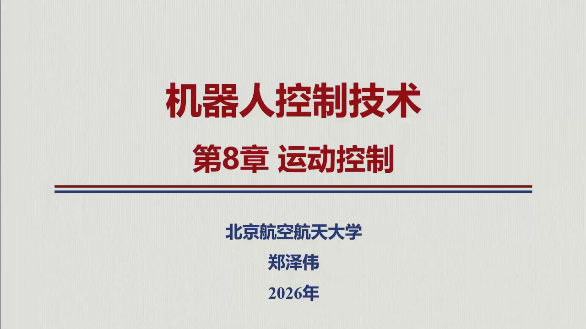
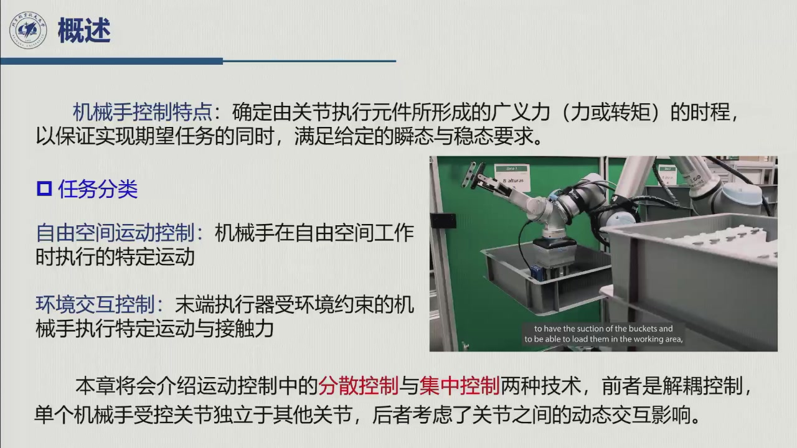
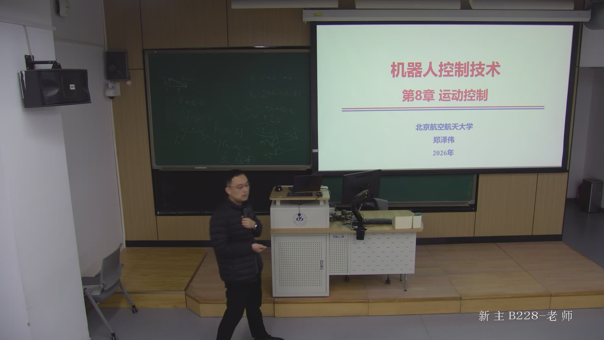
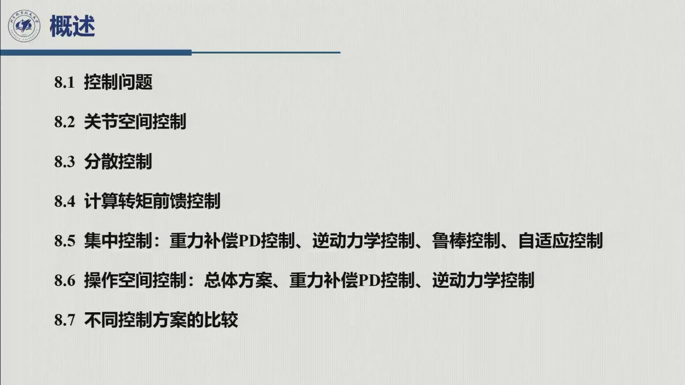

# 第七章 · 运动控制

> **对应原书第 8 章 Motion Control**。本章依据《机器人控制技术》**第 8 周**（2026-10-26，
> 01:55:58–02:19:40，只开了头）与**第 9 周**（2026-11-02，00:04:44–02:20:40，全程）两次录播整理。
> 第 8 周讲完**控制问题的提法、两套空间方案、分散/集中两大类、$\boldsymbol\tau$ 怎样落到电机
> 电压/电流**；第 9 周把**分散控制的三种单轴控制器、李雅普诺夫稳定性、重力补偿 PD、逆动力学、
> 鲁棒、自适应、操作空间控制、九种方案仿真比较**全部讲完。本章现在覆盖课件 §8.1–§8.7 的
> 全部内容，不再有「教材补」占位。
> 前六章回答「机器人**在哪、动多快、要多大力**」；本章回答「**给定要它怎么动，该出多大的力**」
> ——动力学是模型，控制是决策，两者之间隔着一个工程接口：算出的 $\boldsymbol\tau$ 只是纸上的数，
> 电机只认电压或电流。

::: note 章号说明（本书与原书在此错位）
- **原书第 6 章「控制架构」本课程没有覆盖**（第 6 周讲原书第 5 章，第 7 周直接进第 7 章），
  因此本书没有「控制架构」一章。
- **本书第六章 = 原书第 7 章**（动力学）；**本章第七章 = 原书第 8 章**（运动控制），
  不要按书号去找原书第 6 章。
- **课件自带编号与本书不同**：课件第七章是动力学，把动力学正解/逆解、轨迹的动态标度、
  操作空间动力学模型编为 §7.6–§7.8；第八章才是运动控制，§8.1–§8.7。本书第六章已覆盖原书
  §7.1–§7.8（牛顿–欧拉 6.4、正解逆解 6.5、动态标度 6.6、操作空间动力学 6.7），
  本章只在必要处引用它们的结论，不重复推导。
- 本章正文按**节名**对照原书、不引页码；7.1–7.5 是**本书编号**，与课件 §8.x 的对应见「五节一览」。
:::

## 本编信息（录播）

::: note 素材与生成方式
- **第 8 周录播**：2026-10-26 09:50–12:15，学院路校区 B-228；平台会话 `sub_id=5890058`、
  教师流 `resource_guid=c41a510b84b447e885a00955c377d0f0`。本讲自 01:55:58 起转入第八章，
  只讲到 §8.2。
- **第 9 周录播**：2026-11-02 09:50–12:15，同一教室；平台会话 `sub_id=5896402`，教师流
  `809C677768FB970493EBE7E65C0201E8_1920_1080.mp4`（2.25 GB，8939 s）。本讲从 00:04:44
  开始，到 02:20:40 结束，覆盖 §8.3–§8.7 全部内容。
- **主讲**：课表任课教师**刘正华**，课件封面署名**郑泽伟**（第 8 周后半段与第 9 周由他主讲）。
- **课件与口述**：第 9 周教师流按 10 s 抽帧 894 张，去重得 **63 幅**（`slides_unique/`），
  随文嵌入；板书帧 298 张（`b{NNN}.jpg`，30 s/帧，$b_{NNN}$ 对应 $(NNN-1)\times30$ s）。
  平台 ASR 2868 段 + whisper large-v3-turbo 2255 段，均未逐字校对；公式一律以**课件帧**为准，
  ASR 只用于定位与语气。
- **教材**：Siciliano 等《Robotics: Modelling, Planning and Control》第 8 章（中文版第 8 章）；
  公式编号（7.1）起，按节名与原书对照。
:::

| 录播时间 | 内容 | 属于 |
|:--|:--|:--|
| 第 8 周 00:04–01:24 | 牛顿–欧拉递推（动力学第二方法） | 原书 §7.4（本书 [6.4](../ch06/sec6-4.md)） |
| 第 8 周 01:25–01:30 | 动力学正解与逆解问题 | 课件 §7.6（本书 [6.5](../ch06/sec6-5.md)） |
| 第 8 周 01:30–01:38 | 轨迹的动态标度（$\tau=c^2\tau'$） | 课件 §7.7（本书 [6.6](../ch06/sec6-6.md)） |
| 第 8 周 01:42:53–01:55 | 操作空间动力学模型 | 课件 §7.8（本书 [6.7](../ch06/sec6-7.md)） |
| **第 8 周 01:55:58–02:19:40** | **控制问题、两套方案、分散/集中、$\tau$→电机量** | **原书 §8.1–§8.2（本章 7.1、7.2.5）** |
| **第 9 周 00:09:46–00:55:30** | **分散控制：独立关节近似、三种控制器、根轨迹、干扰抑制、前馈** | **§8.3–§8.4（本章 7.2）** |
| **第 9 周 00:56:32–01:58:20** | **集中控制：李雅普诺夫、重力补偿 PD、逆动力学、鲁棒、自适应** | **§8.5（本章 7.3）** |
| **第 9 周 01:58:34–02:10:12** | **操作空间控制：两种实现、重力补偿 PD、逆动力学** | **§8.6（本章 7.4）** |
| **第 9 周 02:10:13–02:17:50** | **九种方案仿真比较、作业 8-10～8-16** | **§8.7（本章 7.5）** |



## 为什么学控制：从「算得出力矩」到「出得对力矩」

第六章结束时我们有了这一行：

$$B(\boldsymbol q)\ddot{\boldsymbol q}+C(\boldsymbol q,\dot{\boldsymbol q})\dot{\boldsymbol q}
+\boldsymbol g(\boldsymbol q)=\boldsymbol\tau .$$

**它是模型，不是控制律。** 它只回答「如果这样动，需要多大力」；控制要回答的是反过来的问题：
**我希望它这样动（$\boldsymbol q_d(t)$ 或 $\boldsymbol x_d(t)$ 已由第四章规划好），该出多大力；
而且实际有摩擦、有噪声、有负载、有模型偏差，怎样保证它真的按希望的动？**

老师在转入第八章前专门把这层关系说了一遍（01:55:10–01:56:00）：

> 「虽然我们叫机器人控制技术，但你要真的设计控制之前，有大量的运动学、动力学、规划这些知识要垫。」

也就是说，**前六章不是「基础课」，而是控制器的设计输入**：第三章的雅可比给出两空间之间的变换，
第四章的轨迹给出跟踪目标，第五章的驱动与传感器给出被控对象和反馈通道，第六章的
$B,C,\boldsymbol g$ 给出补偿项。本章要做的事只有一件：**把这些输入组装成一个能闭环的
$\boldsymbol\tau(t)$**。



**第 8 周只到「体系」，第 9 周把「控制律」全部补齐。** 第 8 周收尾时老师说（02:19:49–02:20:40）：
「后面就分散了具体的控制率设计，我们下一节课再讲——分散控制、集中控制，还有操作空间的那个控制。」
第 9 周兑现了这句话：00:09 起讲分散控制，00:56 起讲集中控制（含李雅普诺夫、鲁棒、自适应），
01:58 起讲操作空间，02:10 起用九种方案的仿真曲线做比较。**本章现在没有「待补」的节**，每一节都能
对上课件页码与录播时间。



## 全章路线图

本章的逻辑是一条「先分空间、再分架构、最后落到电机」的三级漏斗：

```text
控制问题的提法（7.1.1）
   │  控制 = 设计广义力 τ(t)，使 q(t) 跟踪 q_d(t)（或 x(t) 跟踪 x_d(t)）
   │
   ├─ 任务分类：自由运动（本章）  vs  环境交互（第九章 力控制）
   │
   ├─ 按空间分：任务在操作空间提出 → 两套方案
   │     ├─ 关节空间方案：x_d ─逆运动学→ q_d ─→ 控制器 ─→ τ，反馈 q      （x 开环！）
   │     └─ 操作空间方案：x_d ─→ 控制器 ─→ F，反馈 x                     （x 闭环，但 x 难测）
   │
   ├─ 按架构分：分散控制（各关节独立）  vs  集中控制（整机模型统一设计）
   │     ↑ 合法性来自驱动系统：大减速比 + 小电枢电阻 + 小转矩 ⇒ q̇ ∝ v_c（速度源）
   │
   ├─ 具体控制律（7.2–7.5）
   │     ├─ 分散：单轴 PI/PID（位置/速度/加速度）→ 根轨迹整定 → 分散前馈 → 计算转矩前馈
   │     ├─ 集中：重力补偿 PD → 逆动力学 → 鲁棒 → 自适应
   │     └─ 操作空间：转置/逆雅可比 → 重力补偿 PD → 逆动力学
   │
   └─ 方案比较（课件 §8.7）：九种方案的跟踪误差、模型/计算量/驱动器要求
```

**一句话主线**：**任务在操作空间提出，控制动作在关节空间实现**。这句话决定了本章所有结构——
要么把任务翻译到关节空间（逆运动学，$x$ 开环），要么把控制器搬到操作空间（$x$ 闭环，但要测 $x$）。

## 五节一览



| 节 | 这一节回答的问题 | 课堂上 | 优先级 |
|:--|:--|:--|:--|
| [7.1 控制问题与控制体系](sec7-1.md) | 控制到底在控什么？两套方案怎么画框图？分散与集中差在哪？ | **第 8 周 01:56–02:09** | **核心（必知）** |
| [7.2 分散（独立关节）控制](sec7-2.md) | 为什么可以各关节单干？三种控制器怎么选？根轨迹怎么读？$\boldsymbol\tau$ 怎么变电压？ | **第 9 周 00:09–00:55 全讲** | **核心（重点）** |
| [7.3 集中控制](sec7-3.md) | 模型不准时怎么办？重力补偿 PD、逆动力学、鲁棒、自适应各补什么？ | **第 9 周 00:56–01:58 全讲** | **核心（难点）** |
| [7.4 操作空间控制](sec7-4.md) | 为什么不翻译成关节角，直接在 $x$ 空间闭环？两种实现差在哪？ | **第 9 周 01:58–02:10 全讲** | 精读（选学） |
| [7.5 九种方案的仿真比较与选型](sec7-5.md) | 同样一台两连杆臂，九套控制律的误差差多少？给定任务怎么选？ | **第 9 周 02:10–02:17 全讲** | **核心（会选）** |

- **核心 · 必知**（7.1）：「任务在操作空间提出、控制动作在关节空间实现」是本章总纲，
  后面所有方案、所有框图都是这句话的展开。
- **核心 · 重点**（7.2）：从「拆耦合」到「三种单轴控制器」再到「驱动接口」，一条线回答
  「分散为什么能成立」。根轨迹与干扰抑制因子是工程上真正会用的两把尺子。
- **核心 · 难点**（7.3）：李雅普诺夫 + 拉萨尔是工具，四种控制律是四个「用模型用到多深」的档位。
  先记结论与适用条件，再回头补证明。
- **精读 · 选学**（7.4）：操作空间模型本身属第六章（课件 §7.8），本章重点在两种实现与代价。
- **核心 · 会选**（7.5）：九种方案的误差量级与选型表，是本章的「工程出口」。

> **第一遍的验收标准**：能说清控制问题与动力学问题的区别；能画出关节空间与操作空间两套框图并
> 指出各自的闭环量；能说出分散/集中两大类控制的判别依据；能默写驱动系统五式（四组关系）并推出
> $\boldsymbol\tau=K_rK_tR_a^{-1}(G_v\boldsymbol v_c-K_vK_r\dot{\boldsymbol q})$；能用三条假设解释
> 「为什么低速大减速比时独立关节控制成立、高速大转矩时不成立」；能写出重力补偿 PD、逆动力学、
> 鲁棒、自适应四套控制律并说出各自的适用条件；能背出九种方案的误差量级相对关系。

## 老师在两次课上定下的四个基调

> 据第 8 周 01:55–02:20、第 9 周 00:04–02:20 口述整理。

1. **控制的目标不是关节角，是末端。** 老师反复说（02:06:05）：「我们的目标都是让末端执行器……
我们更关注的其实是末端执行器它的位置和姿态。$\boldsymbol q$ 我们并不关心」——关节空间方案只是
**手段**，这正是它的 $x$ 开环成为缺点的原因。
2. **分散/集中不是两个算法，是两种结构。** 分散 = 忽略耦合、解耦、单关节设计（结构近似）；
   集中 = 整机模型一起设计、考虑关节间动态交互。选择依据是**工况**，不是「哪个更先进」。
3. **能不能分散控制，由驱动器决定，不由算法决定。** 大减速比 + 小电枢电阻 + 小转矩 ⇒
   电压与速度成正比 ⇒ 每轴一个速度环就够；高速大转矩时这个近似失效，必须进电流环、用整机模型。
   **这是第五章（驱动）与第八章（控制）之间真正的接缝。**
4. **学术分工的现实提醒**（02:03–02:04）：分散控制「公认上已经很成熟」，集中控制里的鲁棒、自适应
   「理论性很强」，可与强化学习结合做创新——这既是对研究生的选题建议，也解释了本章为何在 7.3
   末尾点到鲁棒/自适应。

## 与第六章、与后续章的关系

| 第六章给出 | 本章怎么用 |
|:--|:--|
| $B(\boldsymbol q)$ 对称正定 | 7.3 逆动力学要**求逆**并消掉它；正定保证可逆、误差方程成立 |
| $C(\boldsymbol q,\dot{\boldsymbol q})\dot{\boldsymbol q}$、$\boldsymbol g(\boldsymbol q)$ | 7.2 的重力补偿、7.3 的完全补偿项 |
| $\dot B-2C$ 反对称 | 7.3 四条控制律的李雅普诺夫证明都靠它消交叉项 |
| $\boldsymbol\tau=Y(\boldsymbol q,\dot{\boldsymbol q},\ddot{\boldsymbol q})\boldsymbol\pi$ | 7.3.6 自适应控制的直接入口 |

**向后**：第九章力控制把「环境交互」这一半补上（第 9 周 02:19:45 点了题）；第十章视觉伺服
回答「$x$ 怎么测」，正好补上 7.4 里操作空间方案「$x$ 难测」这个短板；第十二章运动规划在
轨迹之上加避障。

## 怎么用这一编

- **对照录播**：每节标题后的括注是该节在录播中的时间区间；第 9 周的时间以 `00:00` 起算，
  第 8 周的引用会标「第 8 周」。
- **先看图，再看式**：7.1 的两张框图比任何文字都清楚，读法见 [7.1.4.1](sec7-1.md#sec-7.1.4.1)
  ——看反馈线从哪里引出、回到哪里，就知道哪个量是闭环的。
- **7.2 的驱动接口要动手推一遍**：五条方程消元只有三行，却是「为什么能分散控制」的全部理由，
  推一遍才知道三条假设各消掉了哪一项。
- **7.3 的证明先记结论**：李雅普诺夫 + 拉萨尔是工具，第一遍只要记住「$V$ 怎么构造、
  $\dot V$ 为什么负」，推导细节第二遍再看。
- **本章进度**：§8.1–§8.7 已全部按第 9 周录播覆写；章末五件套（勘误/习题/自检表/回忆卡/自测卷）
  已补。第 9 周作业是 **8-10～8-16 任选一题**（建模 + 控制设计 + 仿真代码 + 结果）；
  选题导引与 **8-12 完整详解**见 [作业七](homework07.md)，布置页见 [7.5.5](sec7-5.md#sec-7.5.5)。
