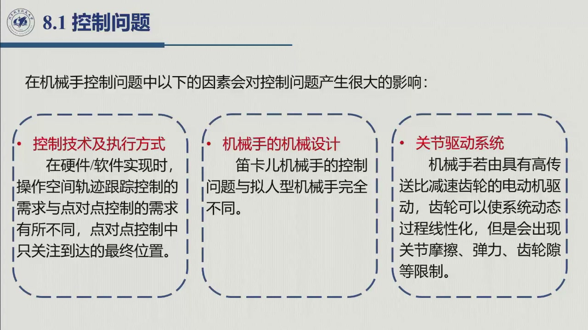
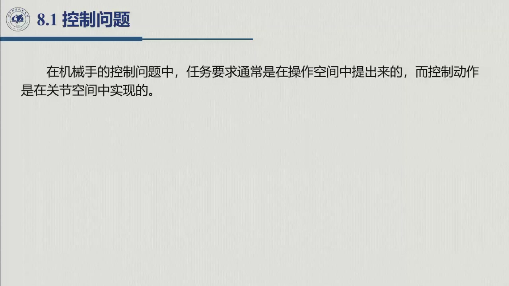
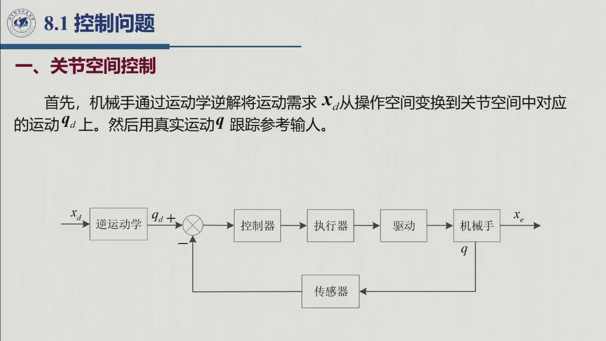
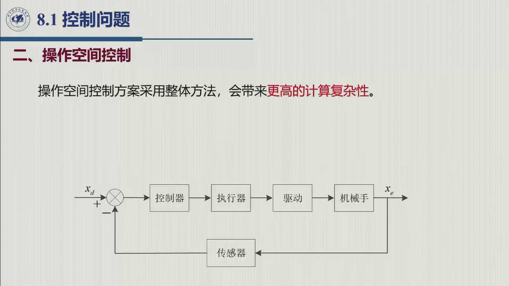

# 7.1 控制问题与控制体系

第四章给出期望运动，第六章可以按模型计算实现它所需的力矩。真实机械臂仍会遇到初始偏差、负载变化和测量误差。控制器要利用实际反馈，在运动过程中修正这些偏差。本节先明确反馈量与驱动接口，再区分关节空间、操作空间以及分散、集中两组分类。课堂回看：01:55:58–02:10:12。

下标 $d$ 表期望量：$q_d,\dot q_d,\ddot q_d$ 由规划给出，$q,\dot q$ 表实际状态。统一取[误差](../recall.md#error) $e=q_d-q$。例如目标在当前位置的正方向时，正的比例反馈应促使关节正向运动。

## 7.1.1 给定运动以后，为什么还需要反馈

自由运动中的刚体模型写成

$$B(q)\ddot q+C(q,\dot q)\dot q+F_v\dot q+F_s\operatorname{sgn}(\dot q)+g(q)=\tau.\tag{7.1}$$

这里 $F_v$ 是黏性摩擦系数矩阵，$F_s$ 是库仑摩擦幅值矩阵，符号函数按分量作用。它是滑动摩擦的近似，零速附近的静摩擦还需另作处理。后续证明会说明采用哪一种摩擦模型。

将给定的 $q_d,\dot q_d,\ddot q_d$ 代入模型求力矩，完成的是逆动力学计算。若只播放这些力矩，初始偏差即使在准确模型下也未必消失。反馈进一步将当前 $q,\dot q$ 引入控制律，使实际误差能够改变后续输入。

评价控制还需看误差是否收敛、超调多大、多久进入允许误差带，以及是否碰到驱动限值。点到点调节要求停到固定目标，轨迹跟踪要求全程跟随移动参考；两者的中途运动都仍需满足碰撞和运动约束。

## 7.1.2 自由运动与环境交互

| 情形 | 主要任务 | 模型中的变化 |
|:--|:--|:--|
| 自由运动 | 在空中移动、定位、跟踪 | 本章先不计持续接触力 |
| 环境交互 | 打磨、压装、沿表面运动 | 接触约束和环境反力必须进入模型 |

自由运动仍然需要关节力矩，并不表示系统“没有力”。若机器人向环境施加末端力系 $h_e$，环境反作用在关节方程中为 $-J^{\mathrm T}h_e$，沿用[第三章的符号约定](../ch03/sec3-8.md)。

本章重点是自由运动。持续接触时要处理运动与力之间的约束，但并非每次接触都必须同时独立控制全部位姿与全部接触力；接触方向上的目标和自由方向上的目标通常要分别安排。

## 7.1.3 方案选择依赖哪些条件

| 条件 | 需要确认的事实 | 对设计的影响 |
|:--|:--|:--|
| 任务 | 固定目标还是随时间变化的参考 | 决定是否需要速度、加速度前馈及全程跟踪指标 |
| 机构 | 惯量是否随构形变化，轴间耦合多大 | 决定单轴近似是否足够 |
| 驱动 | 接收位置、速度、转矩、电流还是电压命令 | 决定外层控制律实际能指定什么 |
| 测量与计算 | 能读到哪些状态，更新率和延迟多大 | 限制可实现的反馈与模型补偿 |

笛卡儿臂在特定结构下可有常惯量，但常矩阵未必对角，不能只凭“常数”就断言各轴独立，见[§6.3.1](../ch06/sec6-3-1.md)。大减速比也只是改变负载在电机侧的相对影响，不会消除摩擦、柔度和齿隙。

## 7.1.4 反馈关节误差还是任务误差

任务常用工具位姿表达，执行器最终作用在关节上。两种方案的区别主要在误差在哪里形成，不在于电机是否还需要关节输入。

### 7.1.4.1 关节空间反馈

若任务先给末端参考 $x_d$，可用连续选支的逆运动学得到 $q_d$，再反馈 $q_d-q$。若任务本来就给关节轨迹，则不需要这一步逆解。关节控制器既可逐轴设计，也可使用整机动力学。

关节闭环也在控制末端运动，只是这里没有独立末端测量来修正任务误差。因此即使关节准确到达算出的 $q_d$，杆长或安装标定错误仍可能使真实工具偏离目标；标定方法见[§2.11](../ch02/sec2-11.md)。

### 7.1.4.2 操作空间反馈

直接由 $e_x=x_d-x$ 形成任务误差，再通过雅可比和适当控制模型计算关节输入。例如任务空间弹簧可先给一个任务广义力，再由转置映射折回关节，详见[§7.4](sec7-4.md)。

$x$ 可以由外部视觉或跟踪设备测量，也可以由编码器读数经正运动学估计。后者仍能用于操作空间控制，只是无法看见同一运动学模型自身的标定偏差。外部测量则需另外处理坐标标定、噪声和延迟。

小的关节测量误差通过 $\delta x\approx J_A\delta q$ 传播，其放大量由对应方向和奇异值决定。近奇点时，困难主要出现在逆映射的 $1/\sigma_{\min}$；不能据此声称正向测量误差也必然无限放大。例如单位两杆伸直时，位置雅可比为 $[0,0;2,1]$，第一关节误差0.001 rad只产生约0.002 m的切向位置误差，尽管该矩阵已经降秩。

### 7.1.4.3 用同一个任务比较

| 比较项 | 关节空间反馈 | 操作空间反馈 |
|:--|:--|:--|
| 误差 | $q_d-q$ | $x_d-x$ |
| 参考来源 | 直接给关节轨迹，或由任务逆解得到 | 直接给任务轨迹 |
| 需要核查 | 逆解连续性、关节跟踪与标定 | 任务反馈质量、雅可比与坐标分支 |
| 动力学设计 | 可分散，也可集中 | 可用任务弹簧或模型补偿等不同实现 |

::: intuition 几何实验 · 两种参考路径
下面的控件比较“关节角直接插值”和“沿末端直线逐点求解”产生的几何路径。两端相同，中途走向可以不同。它展示参考生成的区别，不是控制稳定性或精度排名：关节空间反馈也可以跟踪由末端直线逆解得到的关节参考。

:::

## 7.1.5 分散与集中是另一组分类

分散控制分别设计单轴反馈，把其余轴造成的影响并入扰动。集中控制利用多轴状态和模型，显式处理动态耦合。这个分类与误差空间不同：关节空间的计算力矩控制就是集中控制。

刚性理想减速器满足 $q_m=K_rq$。负载惯量折到电机侧带有 $K_r^{-1}BK_r^{-1}$，关节负载力矩则带有 $K_r^{-1}\tau$，见[第五章的轴侧折算](../ch05/sec5-2-3.md)。大减速比可能使负载耦合相对电机惯量减小，但能否采用分散近似，还要沿实际任务检查残余扰动、反馈带宽和限幅。

高速和直驱工况通常需要重点核查耦合，但架构仍应由具体验算决定；同样，低速轻载也不能直接保证耦合可忽略。

## 7.1.6 最后要接上真实驱动接口

若外层计算关节转矩，需要下层电流或转矩环在相应带宽内实现它；若驱动器只接受位置或速度指令，则应先明确内环模型和接口，再设计外环。电压指令经过电阻、电感与反电动势才产生电流，不能天然当作理想速度源或理想力矩源。

[§7.2.5](sec7-2.md#sec-7.2.5)会把这条换算写出来。后面的理想力矩控制证明，都包含“命令力矩能够被执行”的假设。

## 7.1.7 阅读后续控制律的顺序

阅读控制律时，先确定误差、对象模型和实际输入，再代回动力学求误差方程；随后检查证明条件、采样与驱动限制。按这个顺序，§7.2先处理单轴近似，§7.3加入整机动力学，§7.4再将反馈误差移到任务空间。