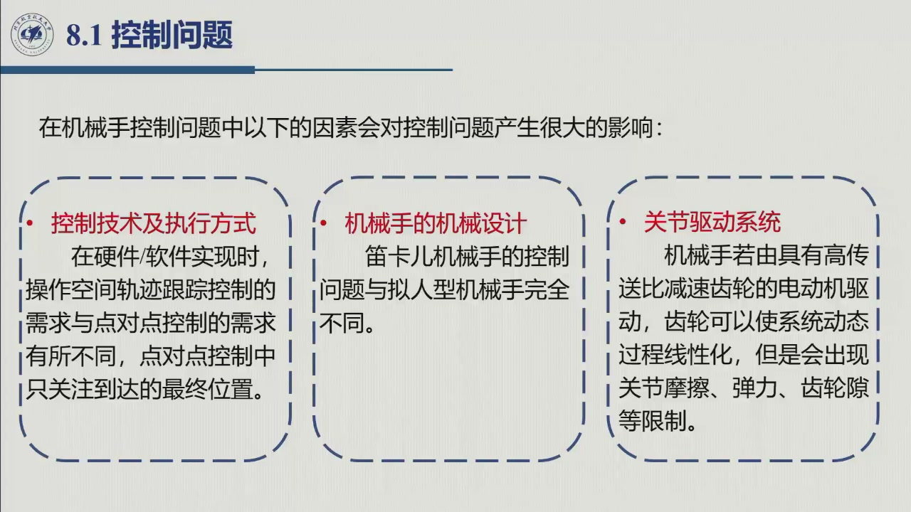
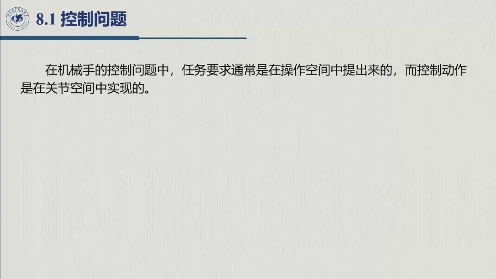
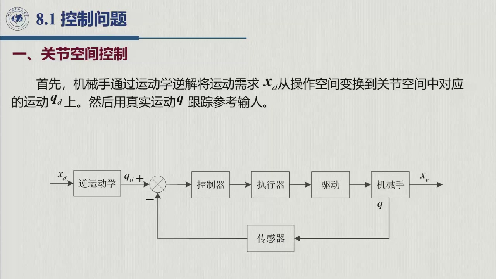
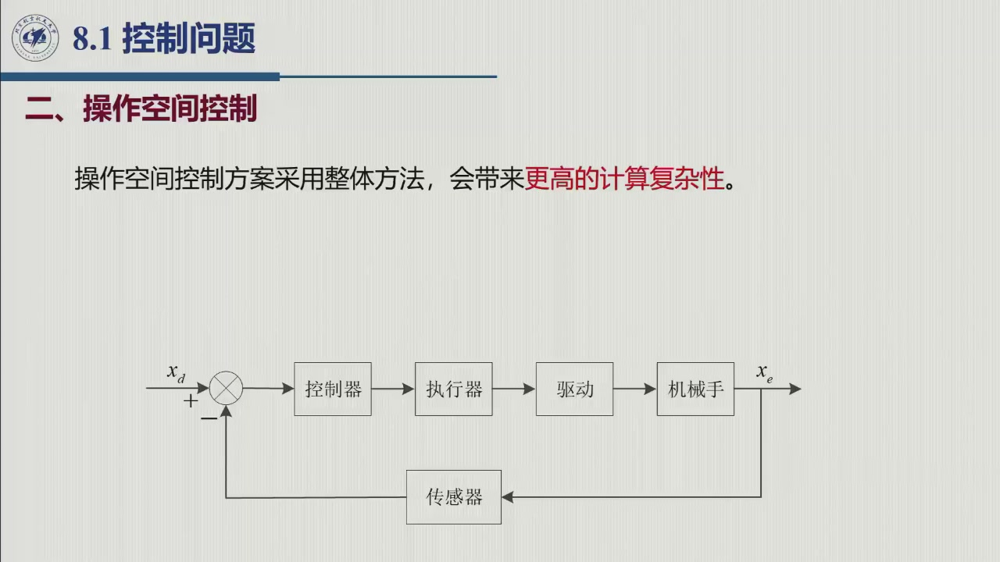

# 7.1 控制问题与控制体系

> 录播 01:55:58–02:10:12（课件 §8.1–§8.2 前半，**全部是课堂内容**）。本节不写控制律，只回答
> 四个问题：**控制到底在控什么？任务是哪一类？任务提在哪、控制动作落在哪？有哪两大类架构？**
> 这四个答案决定了后面所有方案，所以每一句都要能对上框图；具体控制律从 7.2 起（驱动接口仍是
> 课堂内容，PD/PID 之后为教材补）。

## 7.1.1 控制问题的提法

本章的被控对象仍是第六章那一行方程（这里补上摩擦项，写成控制用的形式）：

$$B(\boldsymbol q)\ddot{\boldsymbol q}+C(\boldsymbol q,\dot{\boldsymbol q})\dot{\boldsymbol q}
+F_{\mathrm v}\dot{\boldsymbol q}+F_{\mathrm s}\operatorname{sgn}\dot{\boldsymbol q}
+\boldsymbol g(\boldsymbol q)=\boldsymbol\tau .\tag{7.1}$$

**控制问题**是：已知期望运动（关节空间的 $\boldsymbol q_d(t)$ 或操作空间的 $\boldsymbol x_d(t)$），
设计广义力 $\boldsymbol\tau(t)$，使实际运动跟踪它。课件 §8.1 的原话是：

> 「机械手控制特点：确定由关节执行元件所形成的**广义力（力或转矩）的时程**，
> 以保证实现期望任务的同时，**满足给定的瞬态与稳态要求**。」

老师把这句话讲成了一句大白话（01:56:36–01:57:30）：「控制呢，就是你设计它的广义力，就是
$\boldsymbol\tau$……你要是在关节空间规划的，那就（让）所有关节空间的状态量都满足你所规划的
这些轨迹」，并且要满足稳态、超调量、调节时间、稳态误差这些指标。
**一句话：跟踪轨迹或点到点，且满足瞬态/稳态指标。**

::: note 控制问题不是动力学问题的重复
第六章的方程是**正问题**：给定运动，算出力。控制是**反问题 + 闭环**：给定运动、给定模型
（可能不准）、给定测量（有噪声），**实时决定**出力，并保证模型有偏差、有扰动时误差不发散。
差别集中在三点上，后面每一节都会碰到：

1. **模型只是近似**：$B,C,\boldsymbol g$ 永远算不到精确（连杆参数、摩擦、负载都在变），
   所以任何「用模型算出力」的方案都必须配反馈；
2. **测量是有限的**：能可靠测到的通常只有关节位置（编码器）与速度，末端位姿要靠运动学**算**出来
   ——这正是 7.1.4 里操作空间方案的短板；
3. **有指标**：稳态误差、超调、调节时间、带宽——第 6 章没这些词，从本章起是硬指标。
:::

## 7.1.2 任务的两大类：自由运动与环境交互

课件在进入方法之前先给任务分类（幻灯片 01:56:43）：

| 任务类别 | 定义（课件原话） | 约束 | 归哪一章 |
|:--|:--|:--|:--|
| **自由空间运动控制** | 机械手在自由空间工作时执行的特定运动 | 与环境**不接触**，不涉及力/力矩 | **本章（第八章）** |
| **环境交互控制** | 末端执行器受环境约束的机械手执行特定运动与接触力 | 末端受环境约束，同时控运动与**接触力** | 第九章（力控制） |

老师举的例子很具体（01:58:14–01:58:41）：打磨、钻孔、人形机器人行走——「跟地面有接触，也就是跟
环境有交互的，末端执行器受环境约束的」，属于力控制；「跟环境并不接触、不涉及力（力矩）的，那这个
是自由空间的运动控制，这是我们第八章讲的内容」。

**这条分界为什么重要**：本章所有控制律都假定右端只有 $\boldsymbol\tau$，没有环境反力
（第六章方程里的 $-J^{\mathrm T}\boldsymbol h_e$ 项被丢掉或当作扰动）。一旦末端真的碰到环境，
接触力就成了必须**主动控制**的量，控制目标从「跟踪位置」变成「跟踪位置 + 跟踪力」——
那是第九章的正题。

## 7.1.3 影响控制问题的四个因素

课件用三个虚线框列出「对控制问题产生很大影响」的因素，老师口述时把「控制技术及执行方式」拆开
数成了四个（02:04:19–02:04:35）。四个因素合起来，就是本章所有方案的选择依据：

| 因素 | 课件/老师原话 | 对控制方案的影响 |
|:--|:--|:--|
| **控制技术及执行方式** | 「在硬件/软件实现时，操作空间轨迹跟踪控制的需求与点对点控制的需求有所不同，点对点控制中只关注到达的最终位置」 | 点对点（PTP）可以不管中间过程，轨迹跟踪必须管；前者可用更简单的律，后者要前馈 |
| **机械手的机械设计** | 「笛卡儿机械手的控制问题与拟人型机械手完全不同」 | 笛卡儿臂 $B$ 常数、$C=0$（[6.3.1](../ch06/sec6-3-1.md)），控制近似线性；拟人臂强耦合，要整机模型 |
| **关节驱动系统** | 「若由具有高传动比减速齿轮的电动机驱动，齿轮可以使系统动态过程线性化，但是会出现关节摩擦、弹力、齿轮隙等限制」 | 大减速比 ⇒ 可分散控制（7.2 的核心）；摩擦/齿隙 ⇒ 稳态误差与低速爬行 |
| **（口述补充）控制目的与指标** | 「你得满足稳态的要求、超调量、调节时间……」 | 决定要不要积分（消稳态误差）、要多高带宽 |

「机械设计」这一条值得单独记：它说明**控制方案不是算法偏好，而是结构决定的**——同样的 PID，
笛卡儿臂（三轴解耦、惯量常数）几乎不用整定；拟人臂（惯量随位形变、重力耦合）必须逐位形整定，
甚至要上重力补偿。7.2「独立关节近似」的合法性，一半来自驱动（大减速比）、一半来自机械（耦合弱）
——两者缺一，分散控制就只是「凑合」。

## 7.1.4 任务提在操作空间，控制动作落在关节空间

这是本章的**总纲**，也是课件 §8.1 的核心命题（幻灯片 02:02:39）：

> 「在机械手的控制问题中，**任务要求通常是在操作空间中提出来**的，而**控制动作是在关节空间中
> 实现**的。这就导致了两种不同控制方案的提出，分别称为**关节空间控制方案**和**操作空间控制方案**。」

为什么必须这样？因为**执行器长在关节上**（电机只能出力矩），而**任务长在末端上**（要抓的东西
在世界上，不在关节里）。两套方案，就是把这个错位补上的两种办法：

- **关节空间方案**：把任务**翻译**成关节运动（逆运动学），然后在关节空间闭环；
- **操作空间方案**：把控制器**搬到**操作空间（用操作空间动力学模型），直接在 $x$ 空间闭环。

### 7.1.4.1 关节空间控制方案

先把期望位姿 $\boldsymbol x_d$ 用**逆运动学**解成关节期望 $\boldsymbol q_d$，再让实际关节运动
$\boldsymbol q$ 跟踪 $\boldsymbol q_d$——闭环发生在关节空间，$n$ 个关节各有一个反馈通道。

**框图这样读**（本章两张框图都用同一套读法）：

1. **前向通道**：$\boldsymbol x_d$ →〔逆运动学〕→ $\boldsymbol q_d$ →〔比较点〕→ 控制器 → 执行器 → 驱动 → 机械手 → $\boldsymbol x_e$；
2. **反馈通道**：从机械手引出 $\boldsymbol q$，经**传感器**回到比较点取负号——**闭环量是 $\boldsymbol q$**；
3. **开环的那一段**：$\boldsymbol x_d$ 到 $\boldsymbol x_e$ 之间，除了逆运动学这一层「算」，
   没有任何反馈去校正 $x$ 的误差。

课件把缺点写得很直白：「**关节空间控制方案不影响操作空间变量 $\boldsymbol x_e$，
$\boldsymbol x_e$ 通过机械手的机械结构以开环形式控制**」。老师补了因果链（02:07:49–02:08:27）：
「你这个 $\boldsymbol q$ 控制住，它是通过逆运动学来影响 $\boldsymbol x_e$ 的，并不直接控制
$\boldsymbol x_e$……那运动学要是算不准，那它们这些就有误差了」，所以 $\boldsymbol x_d$ 到
$\boldsymbol x_e$ 之间是一个开环。

**误差从哪来**（这句话要能自己复述）：

- **逆解的模型误差**：DH 参数、连杆长度、减速比标定不准 ⇒ $\boldsymbol q_d$ 本身就偏了
  （[2.11 运动学标定](../ch02/sec2-11.md)）；
- **逆解的多解与奇异**：选错分支、靠近奇异位形时 $\boldsymbol q_d$ 跳变（[3.3 奇点](../ch03/sec3-3.md)）；
- **关节跟踪误差**：$\boldsymbol q$ 闭环只能保证「关节跟得上 $\boldsymbol q_d$」，保证不了「末端到位」。

### 7.1.4.2 操作空间控制方案

不翻译了。直接以末端位姿 $\boldsymbol x_e$ 为被控量做闭环，控制器输出的是末端广义力
$\boldsymbol F$（再经 $J^{\mathrm T}$ 折回关节）。

课件给的评价是「一优一劣」，而且**优的那条打了折**：「操作空间控制方案采用**整体方法**，会带来
**更高的计算复杂性**。该方案的优点是**可以直接影响操作空间变量**。但操作空间变量的**直接测量
难以实现**，而是通过对被测关节空间变量进行运动学方程**间接得到**，因此**这种优点只是潜在的**。」

老师把「间接得到」这句展开了（02:08:54–02:10:20），解释了「为什么工业上仍以关节空间方案为主」：
不用逆运动学、看起来更方便，但「你这个反馈的 $\boldsymbol x_e$ 并不那么容易（得到）……机械（手）
在室内，（得）建立（测量）系统，视觉或者其他方式，而且也会（有误差），（不）准」，有些量「还是通过
电机准确的测量之后算出来的」，所以「这个看起来很优势，实际上也不一定很优势」。
一句话：**你要是没法测末端位姿，就用不了操作空间的控制方案。**

::: note 「优点只是潜在的」——一句话点破两套方案的本质
操作空间方案的**卖点**是「直接控 $x$」，**成本**是「必须知道 $x$」。如果 $x$ 是由关节量经正
运动学算出来的，那么：

- 关节量的测量误差会被**雅可比放大/缩小**传到 $x$（靠近奇异位形时放大得厉害）；
- 你算出的 $x$ 与真实的 $x$ 之间的偏差，控制器看不见（它以为那就是真值）。

于是「直接控 $x$」在信息上仍然是**间接**的——**闭环通道里的信息质量，才是方案优劣的真正判据**，
不是框图上那条线画到了哪里。这也是第十章视觉伺服存在的理由：它给 $x$ 提供**独立的**测量。
:::

### 7.1.4.3 两套方案对照

| | 关节空间控制 | 操作空间控制 |
|:--|:--|:--|
| 被控量 | 关节运动 $\boldsymbol q$ | 末端位姿 $\boldsymbol x_e$ |
| 闭环量 | $\boldsymbol q$（编码器直接测） | $\boldsymbol x_e$（多数情况下要靠 $\boldsymbol q$ 算） |
| 需要的模型 | 关节空间动力学 $B,C,\boldsymbol g$（+ 逆运动学） | 操作空间动力学（课件 §7.8，见 [7.4](sec7-4.md)） |
| $\boldsymbol x_d\to\boldsymbol x_e$ | **开环**（只经运动学） | 闭环（若 $x$ 可测/可估） |
| 计算量 | 小（逆解 + $n$ 个单轴律） | 大（整机模型 + 雅可比及其导数） |
| 主要误差源 | 运动学标定误差、逆解分支 | $x$ 的测量/估计误差、$J$ 奇异 |
| 工业现状 | 主流（每条轴一个伺服） | 需要力控/柔顺或对末端精度要求高时 |

三句读法：**看闭环量**——一个闭 $\boldsymbol q$、一个闭 $\boldsymbol x_e$；**看成本**——操作空间
把误差搬到了测量上，不是消灭了误差；**看场合**——精度要求高、标定充分时关节空间更稳。
老师没有说哪一套更好，他说的是「各有各的（适用）理念」（02:10:18）：本章后半的所有方法，都是在
这两套骨架里填控制律，而不是在不同骨架之间排优劣。

## 7.1.5 自由空间控制的两大类：分散与集中

第二级分类与「空间」无关，与「**要不要把整机模型放在一起**」有关。老师的分法是
（01:58:46–02:00:29）：

| | **分散控制**（decentralized） | **集中控制**（centralized） |
|:--|:--|:--|
| 设计对象 | **各个关节**，一轴一个控制器 | **整个机器人**，统一「打到一起」设计 |
| 对耦合的处理 | 忽略（当作扰动）——「结构近似」 | 显式建模——「考虑关节之间的动态交互影响」 |
| 常见手段 | PID 等线性单回路方法（自动控制原理里那套） | 计算力矩、反馈线性化、自适应、鲁棒控制等非线性方法 |
| 老师原话 | 「对各个关节进行控制，直接控制各个关节」 | 「不对每个关节进行设计，而是对整个机器人统一，打到一起，集中到一起」 |
| 本课程位置 | 课件 §8.3–§8.4（下一讲） | 课件 §8.5（下一讲） |

课件概述页的对照更精炼（01:56:43 幻灯片底部）：前者是**解耦控制**，「单个机械手受控关节独立于
其他关节」；后者**考虑了关节之间的动态交互影响**。

::: intuition 「解耦」是假设，不是事实
机械手的关节从来不是真的解耦的——第六章的 $b_{ij}\ (i\neq j)$ 与 $h_{ijk}$ 就是耦合的量化。
分散控制的做法是**把这些项当成未知扰动丢掉**，然后依靠两点让这个「丢掉」不至于出事：

1. **驱动器的减速比**把耦合折算到电机侧时被 $1/k_r$（力矩）与 $1/k_r^2$（惯量）削弱
   （第五章 [定理 5.2.C](../ch05/sec5-2-3.md#thm-5.2.C) 的两条折算，[定义 5.2.5](../ch05/sec5-2-4.md) 独立关节近似）；
2. **反馈的鲁棒性**：只要单轴闭环有足够增益与带宽，残余耦合表现为输出端的「小扰动」而不是发散。

所以「分散控制能不能用」等价于「**耦合折算后还剩多少、反馈压不压得住**」——这正是 7.2 要算的账，
**不是一个可以拍脑袋决定的设计选择。**
:::

## 7.1.6 还有一环：$\boldsymbol\tau$ 落地成电机的电压/电流

设计出来的 $\boldsymbol\tau$ 是「关节侧的广义力」，而控制器真正能给的只有**功率放大器的控制电压
$\boldsymbol v_c$**（或电流环的指令）。老师把这件事当成 §8.2 的第二个正题（02:10:22–02:11:00）：
「我们后面的设计控制都是设计 $\boldsymbol\tau$ 的，但是你设计出来的 $\boldsymbol\tau$，最终还要
（落）到电机的控制量。那它们之间是什么关系呢？其实第五章已经讲了，我们在这里再（回）过来看一下。」

这一环的推导、三条假设与结论是 [7.2.5](sec7-2.md#sec-7.2.5) 的正题，这里先记住**结论**：低速、
大减速比、小转矩 ⇒ 控制电压与关节速度近似成正比、每个关节独立 ⇒ 分散控制；高速大转矩时这个近似
失效 ⇒ 必须用整机模型（集中控制），并在驱动器里加**电流环**把「转矩—电压」变成比例关系。

## 7.1.7 小结与常见错误

- **一句话**：控制 = 设计 $\boldsymbol\tau(t)$ 让状态量跟踪期望；任务提在操作空间、动作落在关节空间，
  于是有「关节/操作空间」两套方案；按要不要整机模型，又有「分散/集中」两大类。
- **三个坐标**：空间 × 架构 × 工况（低速小转矩/高速大转矩）——本章所有方法都在这个三维格子里占位。
- **一条判据**：闭环通道里有什么量、信息质量如何，决定方案的真正优劣。

::: think 常见错误清单
1. **把「关节空间控制」当成「分散控制」**：两者是**不同维度**的分类——关节空间方案里也能用集中控制，
   操作空间方案里也可以有分散近似。
2. **以为操作空间方案一定更好**：「直接控 $x$」的前提是 $x$ 可信；若 $x$ 由 $\boldsymbol q$ 算出，
   信息上仍是间接的。
3. **忽略逆运动学这一环的误差**：关节空间方案的 $x$ 通道是开环，标定误差与逆解分支错误**不会**
   被关节闭环纠正。
4. **把「点对点」和「轨迹跟踪」用同一套指标**：前者只看终点稳态精度，后者要管全程动态滞后。
5. **忘记摩擦与齿隙**：大减速比带来线性化的同时带来这些非线性，它们会在 7.2 的稳态误差里再现。
:::

::: think 默写点 · 合上书再写
1. 用一句话写出控制问题的定义，并说明它与第六章动力学正问题的三点区别。
2. 画出关节空间控制框图，标出闭环量与开环段；说出至少两个误差来源。
3. 画出操作空间控制框图，说明「优点只是潜在的」是什么意思。
4. 写出分散控制与集中控制的四条对照（设计对象、耦合处理、常见手段、本课程位置）。
5. 说出影响控制问题的四个因素，并各举一个对控制方案的影响。
:::
