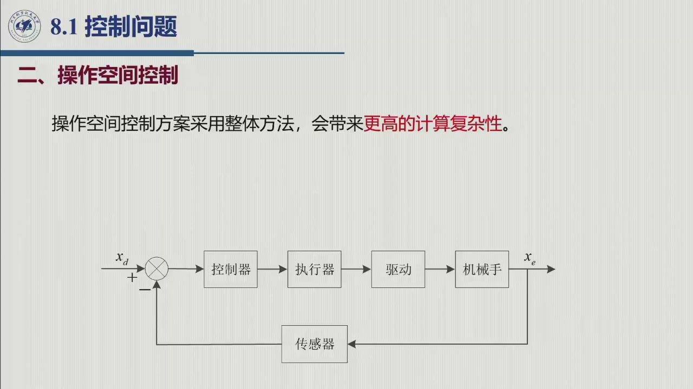

# 7.1 控制问题与控制体系

第四章给出了期望运动，第六章能按模型算出实现它所需的力矩。真实机械臂还有初始偏差、负载变化和测量误差，只按模型播放力矩，这些偏差没有途径被修正。控制器要用实测状态在运动中修正它们。本节先说明为什么要反馈，再从两个互不决定的角度给控制方案分类：误差在关节空间还是任务空间形成，控制律用了多少整机模型；最后把算出的力矩接到电机真正接收的输入上。课堂回看：01:55:58–02:10:12。

## 7.1.1 给定运动以后，为什么还需要反馈

自由运动中的刚体模型写成

$$B(q)\ddot q+C(q,\dot q)\dot q+F_v\dot q+F_s\operatorname{sgn}(\dot q)+g(q)=\tau.\tag{7.1}$$

这里 $F_v$ 是黏性摩擦系数矩阵，$F_s$ 是库仑摩擦幅值矩阵，符号函数按分量作用。它是滑动摩擦的近似，零速附近的静摩擦还需另作处理；后续证明会说明各自采用哪一种摩擦模型。

下标 $d$ 表示期望量：$q_d,\dot q_d,\ddot q_d$ 由规划给出；不带下标的 $q,\dot q$ 是实际状态。控制问题就是确定关节广义力 $\tau(t)$ 的时程，使实际运动跟上规划的运动。点到点调节只要求停到固定目标，轨迹跟踪要求全程跟随移动参考，两者的中途运动都还要满足碰撞和运动约束。评价一个控制器，要看误差是否收敛、超调多大、多久进入允许误差带，以及是否碰到驱动限值。

最直接的做法是把 $q_d,\dot q_d,\ddot q_d$ 代入式 (7.1) 左边，算出一条力矩曲线照着输出。这是[逆动力学](../ch06/sec6-5.md)计算；反过来由力矩和状态求加速度再积分，才是正动力学。这条力矩曲线只由规划决定，与实际状态无关。用最简单的单轴模型 $J\ddot q+b\dot q=\tau$ 看后果，其中 $J>0$ 是该轴惯量（不是雅可比），$b>0$ 是黏性系数。设模型完全准确，输出 $\tau=J\ddot q_d+b\dot q_d$，与对象方程相减，误差 $e=q_d-q$ 满足

$$J\ddot e+b\dot e=0,\qquad e(t)=e(0)+\frac{J}{b}\,\dot e(0)\Bigl(1-\exp\bigl(-\tfrac{b}{J}t\bigr)\Bigr).$$

方程里没有 $e$ 本身，初始位置偏差原样保留。取 $J=0.02$ kg·m²、$b=0.1$ N·m·s/rad，则 $J/b=0.2$ s。初始偏差 $e(0)=0.05$ rad、$\dot e(0)=0$ 时，误差一直停在 0.05 rad；若 $\dot e(0)=0.1$ rad/s，误差最后停在 $0.05+0.2\times0.1=0.07$ rad。模型有误差或负载变化时，右端还会多出扰动项，同样没有机制把误差拉回来。

反馈把当前 $q,\dot q$ 引入控制律，让实际误差改变后续输入。本章统一采用上面的[误差](../recall.md#error)符号 $e=q_d-q$：目标在当前位置的正方向时 $e>0$，正的比例反馈就推动关节正向运动。在上例的力矩上加 $k_pe+k_d\dot e$，再与对象方程相减，得到

$$J\ddot e+(b+k_d)\dot e+k_pe=0.$$

$k_p>0$、$b+k_d>0$ 时，任意初始偏差都按指数衰减到零。怎样选增益、负载下还剩多少误差，从 [§7.2.3](sec7-2.md#sec-7.2.3) 起逐步推导。

## 7.1.2 自由运动与环境交互

式 (7.1) 里没有环境力，因为它只描述末端不碰环境的运动。按是否与环境接触，任务分成两类：

| 情形 | 主要任务 | 模型中的变化 |
|:--|:--|:--|
| 自由运动 | 在空中移动、定位、跟踪 | 本章先不计持续接触力 |
| 环境交互 | 打磨、钻孔、压装、沿表面运动；人形机器人行走时脚与地面接触 | 接触约束和环境反力必须进入模型 |

自由运动也需要关节力矩去克服惯性、重力和摩擦，只是没有持续的接触力。若机器人向环境施加末端力系 $h_e$，环境反作用在关节方程中为 $-J^{\mathrm T}h_e$，沿用[第三章的符号约定](../ch03/sec3-8.md)，式 (7.1) 右端由 $\tau$ 变为 $\tau-J^{\mathrm T}h_e$。本章讨论自由运动，取 $h_e=0$。

持续接触时，环境同时约束运动和力，控制目标要按方向分开安排。例如沿刚性无摩擦平面打磨：法向位置由平面决定，能指定的是压紧力；沿平面的两个方向不受约束，能指定的是运动。所以一接触就不能同时独立指定全部位姿与全部接触力。这类问题留到第八章力控制处理。

## 7.1.3 方案选择依赖哪些条件

即使只做自由运动，方案也要随任务和硬件变。课件把影响控制问题的因素归为三类。第一类是控制技术及执行方式：点到点控制只关注最终到达的位置，操作空间轨迹跟踪要求每一时刻都跟上参考，因此还要给出参考速度和加速度，对软硬件实现的要求也不同。第二类是机械手的机械设计：笛卡儿机械手在特定结构下可有常惯量（[§6.3.1](../ch06/sec6-3-1.md)），拟人型机械手的惯量随构形变化且各轴耦合（[§6.3.2](../ch06/sec6-3-2.md)），课件说两者的控制问题完全不同。第三类是关节驱动系统：用大传动比减速齿轮的电机驱动时，齿轮使系统动态接近线性，同时带来关节摩擦、弹性和齿隙。

后面几小节逐类用到这些因素：机构和减速比决定能否逐轴设计（[§7.1.5](#sec-7.1.5)），驱动接口决定外层控制律实际能指定什么（[§7.1.6](#sec-7.1.6)）。课件之外还要补一类测量与计算条件：能读到哪些状态、更新率和延迟多大，[§7.1.4](#sec-7.1.4) 用它判断任务误差能否直接反馈。[§7.1.7](#sec-7.1.7) 把四类条件汇成选方案前的核对表。

## 7.1.4 反馈关节误差还是任务误差

课件 §8.1 这样概括控制问题：“任务要求通常是在操作空间中提出来的，而控制动作是在关节空间中实现的。”任务用工具位姿表达，电机只能驱动关节。老师在约 02:06:05 也说明，最终关心的是末端执行器的位置和姿态，各关节转多少只要不出问题即可。框图里的逆运动学、正运动学、执行器、驱动器、传感器和动力学模型前几章都已讲过，只剩控制器一块（约 02:05:00）。两种方案最终都给出关节输入，也都在控制末端运动，区别在于误差在哪里形成。

### 7.1.4.1 关节空间反馈

若任务先给末端参考 $x_d$，可用连续选支的逆运动学得到 $q_d$，再反馈 $q_d-q$。若任务本来就给关节轨迹，则不需要这一步逆解。关节控制器既可逐轴设计，也可使用整机动力学。

图中传感器只测关节变量 $q$，末端实际位姿 $x_e$（下文简记为 $x$）不回到比较点。从 $x_d$ 经逆运动学到 $q_d$，再从 $q$ 经机构到 $x_e$，这两段都在闭环之外，老师称之为开环（约 02:08:18）。关节闭环也在控制末端运动，只是没有独立的末端测量来修正任务误差。因此即使关节准确到达算出的 $q_d$，杆长或安装标定错误仍可能使真实工具偏离目标，控制器却看不到这个偏差；标定方法见[§2.11](../ch02/sec2-11.md)。

### 7.1.4.2 操作空间反馈

直接由 $e_x=x_d-x$ 形成任务误差，再通过[分析雅可比](../ch03/sec3-6.md) $J_A$ 和适当控制模型计算关节输入，不必先求逆解。例如任务空间弹簧先给一个任务广义力 $F_A=K_Pe_x$，再由[静力学](../ch03/sec3-8.md)的转置关系折回关节：$\tau=J_A^{\mathrm T}F_A$，详见[§7.4](sec7-4.md)。

这样做有两项代价，老师从约 02:09:01 起逐条讲过。第一是计算量。课件写明“操作空间控制方案采用整体方法，会带来更高的计算复杂性”：每个控制周期都要按当前构形重算 $J_A$，用操作空间模型时还要算 [§6.7](../ch06/sec6-7.md) 的 $B_x$ 等矩阵。第二是 $x$ 不容易得到。老师拿室外飞行器作对比，它有导航系统直接给出位姿；室内机械臂没有这种手段测末端执行器的位置和姿态，就用不了操作空间方案（约 02:09:08–02:10:04）。$x$ 可以由外部视觉或跟踪设备测量，这时需另外处理坐标标定、噪声和延迟；也可以由编码器读数经正运动学估计，课上指出这种做法很常见。用估计值仍能运行操作空间控制律，只是无法看见同一运动学模型自身的标定偏差，“直接修正任务误差”这一优点也就不再兑现。

小的关节测量误差通过 $\delta x\approx J_A\delta q$ 传播，放大量取决于误差方向，单位关节误差最多被放大到最大奇异值 $\sigma_{\max}$ 倍。近奇点时，困难主要出现在逆映射：由任务误差反求关节修正要经过 $J_A^{-1}$，放大量为 $1/\sigma_{\min}$；不能据此声称正向测量误差也必然无限放大。例如单位两杆伸直时，位置雅可比为 $[0,0;2,1]$，奇异值为 $\sqrt5\approx2.24$ 和 0；第一关节误差0.001 rad只产生约0.002 m的切向位置误差，尽管该矩阵已经降秩。

### 7.1.4.3 用同一个任务比较

| 比较项 | 关节空间反馈 | 操作空间反馈 |
|:--|:--|:--|
| 误差 | $q_d-q$ | $x_d-x$ |
| 参考来源 | 直接给关节轨迹，或由任务逆解得到 | 直接给任务轨迹 |
| 需要核查 | 逆解连续性、关节跟踪与标定 | 任务反馈质量、雅可比与坐标分支、每周期计算量 |
| 动力学设计 | 可分散，也可集中 | 可用任务弹簧或模型补偿等不同实现 |

::: intuition 几何实验 · 两种参考路径
下面的控件比较“关节角直接插值”和“沿末端直线逐点求解”产生的几何路径。两端相同，中途走向可以不同。它展示参考生成的区别，不是控制稳定性或精度排名：关节空间反馈也可以跟踪由末端直线逆解得到的关节参考。

:::

## 7.1.5 分散与集中是另一组分类

上面按误差在哪里形成给方案分类。另一组分类看控制律用了多少模型信息。分散控制分别设计单轴反馈，把其余轴造成的影响并入扰动，常用 PID 一类线性方法；集中控制把整台机器人一起设计，利用多轴状态和模型显式处理关节间的动态耦合。耦合项是非线性的，所以集中控制多用计算力矩（逆动力学）、反馈线性化、鲁棒和自适应等非线性方法（约 01:59:34）。两组分类互不决定：关节空间的计算力矩控制就是集中控制。§7.2 讲分散控制，§7.3 讲集中控制。

分散近似能不能用，要看其余轴的影响占本轴动态多大。刚性理想减速器满足 $q_m=K_rq$。负载惯量折到电机侧带有 $K_r^{-1}BK_r^{-1}$，关节负载力矩则带有 $K_r^{-1}\tau$，见[第五章的轴侧折算](../ch05/sec5-2-3.md)；电机转子自身的惯量不经过这层缩小。在[两连杆平面臂](../ch06/sec6-3-2.md)的惯性矩阵里，这表现为 $b_{11},b_{22}$ 分别含 $k_{r_1}^2I_{m_1}$、$k_{r_2}^2I_{m_2}$，耦合元 $b_{12}$ 只含 $k_{r_2}I_{m_2}$。用 [§7.5.1](sec7-5.md#sec-7.5.1) 的参数算无量纲比值 $b_{12}/\sqrt{b_{11}b_{22}}$：直驱 $k_r=1$ 时，它随 $\vartheta_2$ 在 0.50–0.67 之间变化；$k_r=100$ 时降到 0.08–0.12。大减速比可能使负载耦合相对电机惯量减小，但能否采用分散近似，还要沿实际任务检查残余扰动、反馈带宽和限幅。

减速比只改变负载在电机侧的相对影响，不会消除摩擦、柔度和齿隙。常惯量也不等于各轴独立：笛卡儿臂的两个移动轴夹 45° 时，惯性矩阵仍是常数，$b_{12}=m_2/\sqrt2$ 却不为零（[§6.3.1](../ch06/sec6-3-1.md)）。高速和直驱工况通常需要重点核查耦合：直驱时上面的比值没有被减速比压低，速度项又随关节速度的平方增长。低速轻载也不能直接保证耦合可忽略，惯性耦合 $b_{12}\ddot q_2$ 取决于加速度而不是速度。架构应由具体验算决定。

## 7.1.6 算出的力矩怎样接到驱动接口

后面各节的控制律算的都是关节力矩 $\tau$，电机实际接收的却是电压或电流指令，老师在课上专门提出了这个衔接问题（约 02:10:28）。电压指令经过电阻、电感与反电动势才产生电流，不能天然当作理想速度源或理想力矩源。课堂按工况给出两种接法（约 02:14:19–02:19:00）。减速比大、电枢电阻小、所需力矩小时，电阻压降可以忽略，控制电压近似正比于关节速度，比例矩阵是对角阵，各轴互不相干，可以逐轴设计、直接用电压控制电机。速度高、加速度大或力矩大时这个近似不成立，就统一计算 $\tau$，并在力矩与电压之间加一个电流环，使输出力矩与电流指令成正比。这是典型搭配；分类仍按 [§7.1.5](#sec-7.1.5) 看控制律用了什么信息，电压近似成立的定量条件见 [§7.2.5](sec7-2.md#sec-7.2.5)。

所以设计外环前要先明确内环模型和接口。若外层计算关节转矩，需要下层电流或转矩环在相应带宽内实现它；若驱动器只接受位置或速度指令，则应先写出内环模型，再设计外环。后面的理想力矩控制证明，都包含“命令力矩能够被执行”的假设。

## 7.1.7 选方案前的核对与后续阅读顺序

控制要设计 $\tau(t)$，用实际误差修正偏差；只播放逆动力学力矩，即使模型准确，初始偏差也未必消失。误差在关节空间还是任务空间形成，控制律是分散还是集中，是两组互不决定的分类。无论哪一种，算出的 $\tau$ 都要经过驱动接口才能执行。具体选型时，按下表逐项核对：

| 条件 | 需要确认的事实 | 对设计的影响 |
|:--|:--|:--|
| 任务 | 固定目标还是随时间变化的参考 | 决定是否需要速度、加速度前馈（[§7.2.6](sec7-2.md#sec-7.2.6)）及全程跟踪指标 |
| 机构 | 惯量是否随构形变化，轴间耦合多大 | 决定单轴近似是否足够（[§7.1.5](#sec-7.1.5)） |
| 驱动 | 接收位置、速度、转矩、电流还是电压命令 | 决定外层控制律实际能指定什么（[§7.1.6](#sec-7.1.6)） |
| 测量与计算 | 能读到哪些状态，更新率和延迟多大 | 限制可实现的反馈与模型补偿（[§7.1.4](#sec-7.1.4)） |

阅读后面的控制律时，先确定误差、对象模型和实际输入，再代回动力学求误差方程；随后检查证明条件、采样与驱动限制。按这个顺序，§7.2 先处理单轴近似，§7.3 加入整机动力学，§7.4 再将反馈误差移到任务空间。