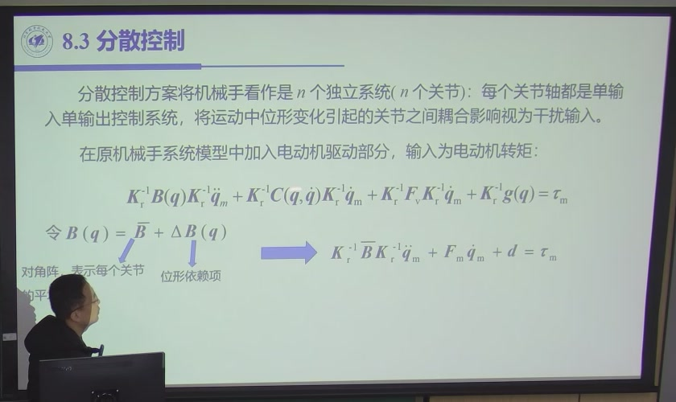
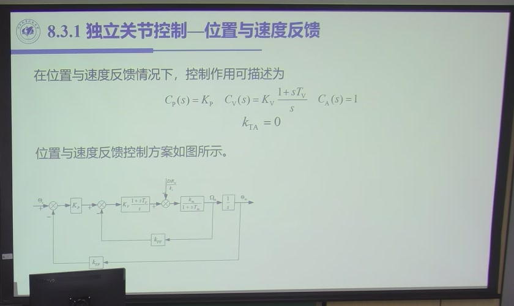
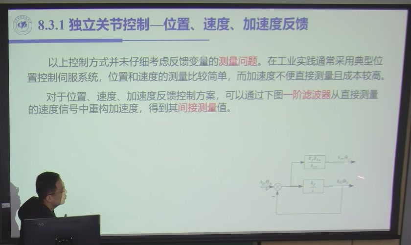
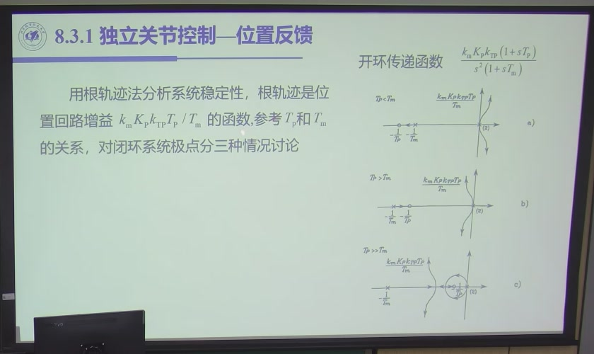
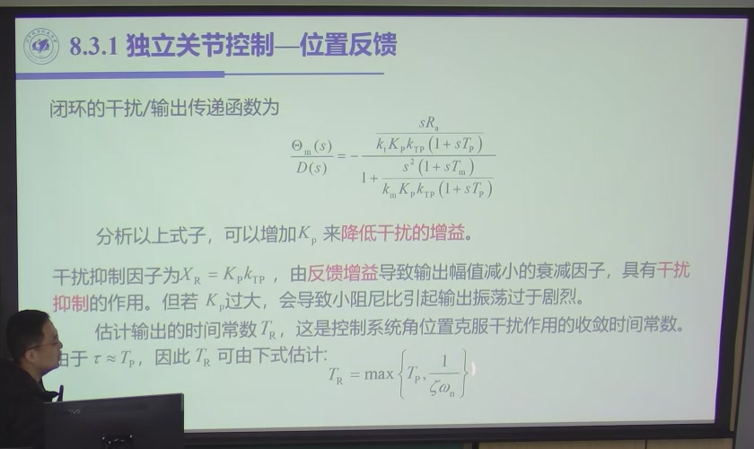
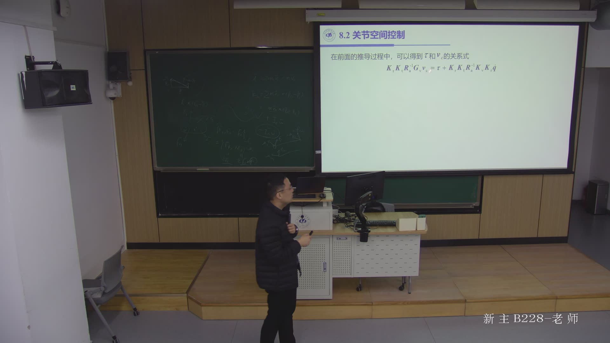
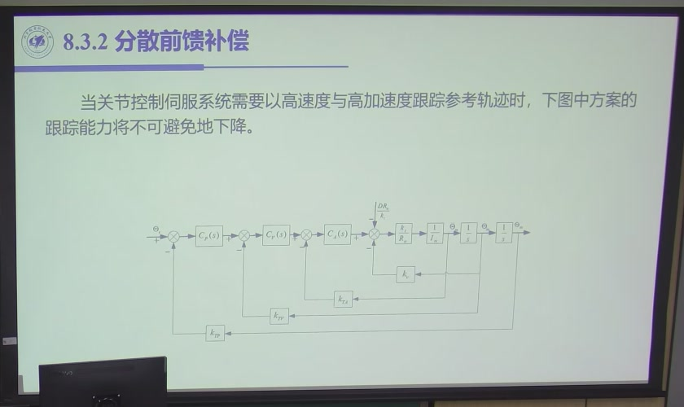
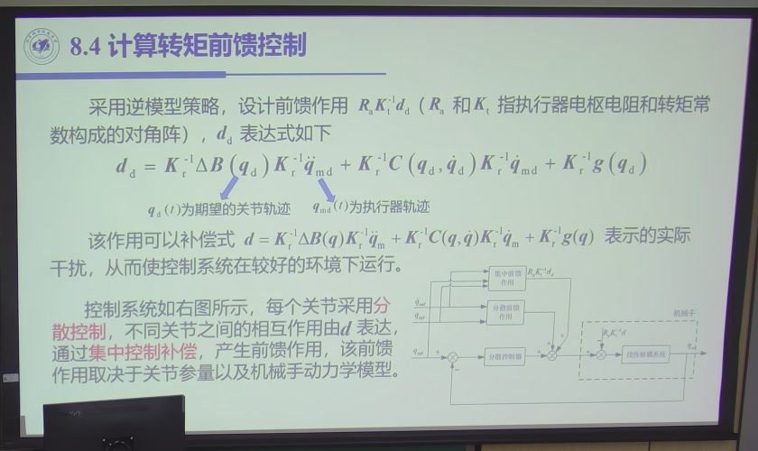

# 7.2 分散（独立关节）控制

> 录播 00:09:46–00:55:30（课件 §8.3–§8.4，**全部是课堂内容**）。这一节回答三个问题：
> **凭什么可以把 $n$ 个关节拆开、各管各的？拆开以后每个关节用什么控制器？这些控制器为什么能压住
> 耦合与重力？** 最后落到两张工程上真正会用的图：位置环的根轨迹，与加速度环的重构滤波器。

## 7.2.1 独立关节近似：把耦合塞进 $d$

分散控制的第一句话是**换坐标**：控制器看到的不是关节角 $\boldsymbol q$，而是电机轴上的转角
$\boldsymbol q_m=K_r\boldsymbol q$。把第六章的关节空间方程左乘 $K_r^{-1}$、并把 $\boldsymbol q$
换成 $K_r^{-1}\boldsymbol q_m$，得到课件 §8.3 的开式（图 7.2-1）：

$$K_r^{-1}B(\boldsymbol q)K_r^{-1}\ddot{\boldsymbol q}_m
+K_r^{-1}C(\boldsymbol q,\dot{\boldsymbol q})K_r^{-1}\dot{\boldsymbol q}_m
+K_r^{-1}F_{\mathrm v}K_r^{-1}\dot{\boldsymbol q}_m
+K_r^{-1}\boldsymbol g(\boldsymbol q)=\boldsymbol\tau_m .\tag{7.2-1}$$

**关键的一步是拆 $B$**。把惯量矩阵写成「标称对角阵 + 位形依赖项」：

$$B(\boldsymbol q)=\bar B+\Delta B(\boldsymbol q),\qquad
\bar B=\operatorname{diag}\{\bar b_1,\dots,\bar b_n\},\tag{7.2-2}$$

$\bar B$ 的每个对角元取该关节惯量的**平均值**（工程上就是「一个常数」）。代回 (7.2-1)，**左边只保留常数系数的两项**——标称惯量 $\bar B\ddot{\boldsymbol q}_m$ 与黏性摩擦
$F_m\dot{\boldsymbol q}_m$；把「位形依赖的惯量偏差、耦合非线性、重力」三项收进一个 $d$：

$$\boxed{\ K_r^{-1}\bar B K_r^{-1}\ddot{\boldsymbol q}_m
+F_m\dot{\boldsymbol q}_m+d=\boldsymbol\tau_m\ }\tag{7.2-3}$$

$$d=K_r^{-1}\Delta B(\boldsymbol q)K_r^{-1}\ddot{\boldsymbol q}_m
+K_r^{-1}C(\boldsymbol q,\dot{\boldsymbol q})K_r^{-1}\dot{\boldsymbol q}_m
+K_r^{-1}\boldsymbol g(\boldsymbol q).\tag{7.2-4}$$

**这一步在数学上是恒等变形，在工程上是一次赌博**：赌 $d$ 足够小、且闭环能压住它。赌注的大小由
三件事决定——**模型准不准、任务精不精、负载重不重**。老师在 00:12:53–00:14:00 把这句话说得很直白：

> 「如果并没有要求负载那么大、指标没那么高，那就简单点，这样比较简单……但这一项并不是不存在，
> 你的忽略是否合理，跟你的实际机器人情况、操作任务是否精细有关。」

::: note 摩擦去哪了（课件与本书口径的差异）
课件 §8.3 的模型只保留黏性摩擦 $F_m\dot{\boldsymbol q}_m$（速度的线性函数，并得进「线性定常
系统」），**库仑摩擦 $F_{\mathrm s}\operatorname{sgn}\dot{\boldsymbol q}_m$ 没有单独出现**——它是
不连续项，若计入只能归入 $d$，且低速换向时跳变。本书第六章的被控对象 (7.1) 含库仑摩擦，
做 7.5 的仿真对照时要注意这一口径差；分散控制在爬行速度下抖动，根源就在这里
（第五章 5.2.3 讲过摩擦对低速性能的影响）。
:::

拆完以后，第 $i$ 个关节就是一个**单输入单输出线性定常系统 + 一个未知干扰**：

$$J_i\ddot q_{m_i}+F_{m_i}\dot q_{m_i}+d_i=\tau_{m_i},\qquad
J_i=\bar b_i/k_{r_i}^2 .\tag{7.2-5}$$

**「分散」两个字到这里才落地**：不是把耦合「消灭」了，而是把它从**模型**里搬到了**干扰**里，
再用反馈去压。压得住压不住，是 7.2.3–7.2.4 要回答的事。

## 7.2.2 三种单轴控制器：位置、速度、加速度

课件 §8.3.1 给了三套并列的方案，它们的区别只在**反馈哪一个状态**：

| 方案 | 反馈量 | 控制器 | 适用 |
|:--|:--|:--|:--|
| **位置反馈** | $\theta_m$ | $C_p(s)=K_P$ | 点位控制、工业臂最常用 |
| **位置 + 速度反馈** | $\theta_m,\dot\theta_m$ | $C_p=K_P$，$C_v(s)=K_v(1+sT_v)/s$ | 需要阻尼、要压超调 |
| **位置 + 速度 + 加速度反馈** | $\theta_m,\dot\theta_m,\ddot\theta_m$ | $C_p=K_P$，$C_v$ 同上，$C_A(s)=1$ | 高速、高加速度跟踪 |

**老师反复强调的一点：三套不是叠加关系，选一套即可**（00:19:42–00:21:45）：

> 「这三个呢，是单独对于这个机器人的关节的控制来说，**只需要一个就行**……设计位置的时候，
> 就把速度、加速度置 1；设计速度的时候，其他置 1 或者给个比例就行。并不是说每一个位置、速度、
> 加速度都给它设一个 PID。」

三套控制器都取 **比例-积分（PI）** 形式：

$$C(s)=K_c\frac{1+sT_c}{s}=K_c\left(\frac{1}{s}+T_c\right),\tag{7.2-6}$$

即「积分 + 比例」：积分项负责**消掉常值扰动下的稳态误差**（重力、常值负载），比例项负责**带宽**。
老师原话（00:15:57–00:18:40）：「要消除稳态误差，需要增加积分项目，所以这里设计的几个控制器都是
PI 的方式……当然你说设计成 PID 也可以，都没问题。」

**加速度反馈为什么要单独说**：加速度计贵、噪声大，工业上通常不直接测，而是用**一阶滤波器从速度
信号重构**（图 7.2-2，课件 39:10）：

$$\hat{\ddot\theta}_m(s)=\frac{s}{1+sT_a}\dot\theta_m(s).\tag{7.2-7}$$

这是一条**近似微分**：低频段它等于 $s\dot\theta_m$（真微分），高频段被 $1/(1+sT_a)$ 压住，
避免把编码器噪声放大成力矩抖动。$T_a$ 越小，重构越接近真微分，但噪声越大——**又是带宽与噪声的
取舍**。

::: note 内外环不是「三个 PID 串起来」
老师提到无人机/多环系统时说的是「内外环分别设计」（00:20:30–00:21:40）：外环位置、内环速度、
再内环电流，**每个环单独设计、单独整定**。机器人单关节通常只用一个环，是因为电机驱动器内部
已经有一个**电流环/速度环**（第五章的伺服驱动器）；控制器只需要在外面再包一层位置环。
:::

## 7.2.3 单轴闭环：传递函数与根轨迹

把 (7.2-5) 与 PI 控制器接成闭环，位置环的开环传递函数是（课件 23:40，图 7.2-3）：

$$L(s)=\frac{k_mK_Pk_{tp}(1+sT_p)}{s^2(1+sT_m)},\tag{7.2-8}$$

其中 $k_m$ 是电机增益，$k_{tp}$ 是位置传感器常数，$T_p$ 是位置环时间常数，$T_m$ 是电机时间常数。
**分母的两个原点极点来自「电机 + 积分」**，分子的一阶零点来自 PI 的比例项。

**根轨迹怎么读**（老师 23:50–31:10 带着走了一遍）：

1. **$T_p<T_m$**：零点在极点右边，根轨迹分支向右半平面走——**系统不稳定**。物理上就是
   「位置环太快、电机跟不上」，一有扰动就发散。
2. **$T_p>T_m$**：零点在极点左边，分支留在左半平面——**稳定**。这是设计的最低要求。
3. **$T_p\gg T_m$**：分支向左走得更远，**响应更快**。但 $T_p$ 不能无限大，它受采样与噪声限制。

渐近线与实轴的交点由「极点之和减零点之和」决定，老师给的下界是

$$\sigma_a\ge-\frac{1}{2T_m}:\tag{7.2-9}$$

即使 $K_P\to\infty$，闭环极点也不会比 $-1/(2T_m)$ 更靠左——**电机时间常数决定了这个关节的带宽上限**。
这就是「执行器选型决定控制上限」在单轴上的具体形式。

**闭环可以近似成二阶系统**。在 $T_p\gg T_m$、且 $K_P$ 足够大时，闭环主导极点是一对共轭复根，
于是可以反算增益：

$$\boxed{\ K_{P_i}=J_i\omega_{n_i}^2,\qquad
K_{D_i}=2\zeta_iJ_i\omega_{n_i}\ }\tag{7.2-10}$$

（$K_D$ 由速度环的 $K_vT_v$ 提供；若只有位置环，则靠电机内环的阻尼。）整定的四条经验与上一版
相同：$\zeta$ 取 $0.7$–$1.0$；$\omega_n$ 不超过采样频率的 $1/10$–$1/5$；避开结构共振；
从惯量最大的轴开始整定。

## 7.2.4 稳态误差与干扰抑制

**PI 为什么能消掉常值误差**：把 (7.2-6) 写成 $K_c(1+sT_c)/s$，前向通道多了一个原点极点，
系统从「0 型」变成「1 型」。对常值干扰 $d$，终值定理给出 $e_{\rm ss}=0$；对斜坡干扰，
误差是一个常数，正比于 $1/K_c$。**代价**是相位滞后（稳定性变差）、积分饱和、以及积分与摩擦
形成的低速极限环。

**干扰到底被压掉多少**，课件给了一条闭式（图 7.2-4，31:10）：

$$\frac{\Theta_m(s)}{D(s)}
=-\frac{\dfrac{sR_a}{k_tK_Pk_{tp}(1+sT_p)}}
{1+\dfrac{s^2(1+sT_m)}{k_mK_Pk_{tp}(1+sT_p)}} .\tag{7.2-11}$$

低频段（$s\to0$）分子有一个 $s$，所以**常值干扰的稳态输出为零**——这是积分的作用；中频段的衰减
由**干扰抑制因子**

$$X_R=K_Pk_{tp}\tag{7.2-12}$$

决定：$K_P$ 越大，同样的干扰产生的输出幅值越小。但 $K_P$ 太大有两个后果：① 阻尼比变小，
超调/振荡加剧；② 高频噪声被放大。老师用一句话总结（00:29:30）：「可以增加这个 $K_P$ 比例系数
来降低干扰的增益，但你也不能无限大，大了之后会导致阻尼变小、振荡。」

**收敛时间**可以用一个经验式估：

$$T_R=\max\left\{T_p,\ \frac{1}{\zeta\omega_n}\right\}.\tag{7.2-13}$$

它告诉你：干扰发生后，位置大约要多久才回到稳态。$T_p$ 是传感器/滤波器的时间常数，
$1/(\zeta\omega_n)$ 是闭环衰减时间——**两者取大**，谁慢谁主导。

::: think 常见错误（本节）
1. **把三套控制器串起来**：位置环外面再套速度环、再套加速度环，三套 PID 互相打架。选一套，
   其余置 1。
2. **以为 $K_P$ 越大越好**：$K_P$ 提高会压低干扰增益，但同时也压低阻尼比；超过电机时间常数
   允许的范围就振荡。
3. **忽略积分饱和**：PI 的积分项在启动/大误差时会积到很大，退饱和慢，表现为「冲过头再慢慢回来」。
   工程上必须加 clamping 或 back-calculation。
4. **把 $T_p<T_m$ 当成「参数没调好」**：这是**结构不稳定**，不是调参能救的——要么换更快的电机，
   要么降低位置环带宽。
:::

## 7.2.5 从 $\boldsymbol\tau$ 到控制电压：分散控制成立的条件

到这里，控制器算出的还是**电机转矩** $\boldsymbol\tau_m$。真实驱动器接受的是**电压**（或电流）。
第 8 周已经把这层接口推完，这里只复述结论并把它接回 7.2.1 的 $d$。

驱动系统五式（减速器 + 电机 + 功率放大器）：

$$\left.\begin{aligned}
\boldsymbol q_m&=K_r\boldsymbol q\\
\boldsymbol\tau_m&=K_r^{-1}\boldsymbol\tau=K_t\boldsymbol i_a
\end{aligned}\right\}\qquad
\left.\begin{aligned}
\boldsymbol v_a&=R_a\boldsymbol i_a+K_v\dot{\boldsymbol q}_m\\
\boldsymbol v_a&=G_v\boldsymbol v_c
\end{aligned}\right\}\tag{7.2-14}$$

消元得

$$\boxed{\ \boldsymbol\tau=K_rK_tR_a^{-1}\bigl(G_v\boldsymbol v_c-K_vK_r\dot{\boldsymbol q}\bigr)\ }\tag{7.2-15}$$

**三条假设**（大减速比 $K_r\gg I$、小电枢电阻 $R_a\to0$、小转矩 $\boldsymbol\tau$）使括号趋于零：

$$G_v\boldsymbol v_c\approx K_vK_r\dot{\boldsymbol q}
\quad\Longrightarrow\quad
\boldsymbol v_c\approx G_v^{-1}K_vK_r\dot{\boldsymbol q}.\tag{7.2-16}$$

**结论**：$\dot{\boldsymbol q}$ 与 $\boldsymbol v_c$ 成比例，且比例矩阵 $G_v^{-1}K_vK_r$ 是**对角阵**
——每个关节的速度可以由独立的电压控制，**这就是「分散」在驱动层的合法性**（定理 7.2.A）。

::: thm 定理 7.2.A · 分散控制成立的两条结论（第 8 周课件 §8.2） {#thm-7.2.A}
**结论一（鲁棒性）**：$\dot{\boldsymbol q}$ 与 $\boldsymbol v_c$ 的比例关系**与机械手参数无关**，
速度控制对模型参数变化具有固有鲁棒性。

**结论二（可分散）**：$G_v^{-1}K_vK_r$ 是对角阵，每个关节的速度都可以由独立电压控制。
:::

**反过来**：若三条假设不成立，(7.2-15) 里 $\boldsymbol\tau$ 与 $\boldsymbol v_c$ 之间隔着
$K_vK_r\dot{\boldsymbol q}$——它把**所有关节的速度**混在一起，想精确算 $\tau_i$ 就必须知道整机状态。
这就是 7.3 集中控制的入口。

**两条工程出路**（第 8 周 02:16:29–02:17:48）：

| 出路 | 做法 | 结果 |
|:--|:--|:--|
| ① 接受近似 | 保持电压控制，用三条假设把 $\boldsymbol v_c\leftrightarrow\dot{\boldsymbol q}$ 当比例 | 只能分散，高速/大转矩时误差大 |
| ② 加电流环 | 在转矩命令与电压之间插电流内环，强制 $\boldsymbol i_a=G_i\boldsymbol v_c$ | $\boldsymbol\tau=K_rK_tG_i\boldsymbol v_c$，可集中控制 |

## 7.2.6 分散前馈补偿：给「跟不上」加一条旁路

分散反馈有一个绕不过去的短板：**它只看误差，不看接下来要多大的加速度**。当轨迹的速度、加速度
很高时，误差还没形成，输出已经落后了——课件 §8.3.2 的原话是「跟踪能力将不可避免地下降」
（图 7.2-5）。

**做法**：把期望轨迹 $\boldsymbol q_d(t)$ 送进一个**逆模型**，提前算出「按名义模型应该出多大力」，
再折算成电压前馈：

$$\boldsymbol v_{c,\rm ff}=R_aK_t^{-1}\,\boldsymbol d_d,\qquad
\boldsymbol d_d=K_r^{-1}\Delta B(\boldsymbol q_d)K_r^{-1}\ddot{\boldsymbol q}_{md}
+K_r^{-1}C(\boldsymbol q_d,\dot{\boldsymbol q}_d)K_r^{-1}\dot{\boldsymbol q}_{md}
+K_r^{-1}\boldsymbol g(\boldsymbol q_d).\tag{7.2-17}$$

注意 $d_d$ 的自变量全是**期望值**（带下标 $d$），所以它可以**离线预算**——这是它与 7.3 逆动力学
控制的本质区别。

**效果**（课件 §8.7 的仿真，02:13–02:16）：

| 方案 | 控制器 | 最大跟踪误差 |
|:--|:--|:--|
| A | 位置 + 速度反馈（分散） | $\sim0.2$ rad |
| C | A + 分散前馈 | $<0.01$ rad |
| E | C + 计算转矩前馈 | $\sim0.005$ rad |

**一个前馈把误差压了一个数量级，再加一个又压一半**——这就是「反馈管稳定、前馈管精度」的量化版本。

## 7.2.7 计算转矩前馈：用逆模型算「应该出多大力」

把 7.2.6 的前馈项写完整，就是课件 §8.4 的**计算转矩前馈**（computed torque feedforward）：

$$\boxed{\ \boldsymbol v_{c,\rm ff}=R_aK_t^{-1}\Bigl[
K_r^{-1}\Delta B(\boldsymbol q_d)K_r^{-1}\ddot{\boldsymbol q}_{md}
+K_r^{-1}C(\boldsymbol q_d,\dot{\boldsymbol q}_d)K_r^{-1}\dot{\boldsymbol q}_{md}
+K_r^{-1}\boldsymbol g(\boldsymbol q_d)\Bigr]\ }\tag{7.2-18}$$

它补偿的是 7.2.1 里那个 $d$（实际干扰）。之所以叫「计算转矩」，是因为它**把动力学模型反过来用**：
不是「给运动算力矩」（正问题），而是「给期望运动算应该施加的力矩」（逆问题）。

**与 7.3 逆动力学控制的区别，只在自变量**：

| | 计算转矩前馈（本节） | 逆动力学控制（7.3.4） |
|:--|:--|:--|
| 模型自变量 | $\boldsymbol q_d,\dot{\boldsymbol q}_d,\ddot{\boldsymbol q}_d$（期望） | $\boldsymbol q,\dot{\boldsymbol q}$（实测） |
| 能否离线预算 | 能 | 不能，每周期在线算 |
| 对消精度 | 跟踪误差小时才准 | 误差大也能对消 |
| 本质 | **前馈** | **反馈线性化** |

::: note 为什么前馈用了 $\Delta B$ 而不是 $B$
因为 7.2.1 已经把标称惯量 $\bar B$ 留在了左边（它是「线性定常系统」的一部分），$d$ 里只剩
**位形依赖的偏差** $\Delta B$。前馈补的是 $d$，所以用 $\Delta B$；如果把 $\bar B$ 也算进去，
就变成 7.3 的完全逆动力学了。
:::

## 7.2.8 小结与常见错误

- **一句话**：分散控制 = 把 $n$ 维耦合方程拆成 $n$ 个「线性定常单轴 + 干扰 $d$」，每轴用一个
  PI/PID 闭环；再用前馈把 $d$ 里能算的部分提前补掉。
- **三笔账**：耦合折算账（$1/k_r^2$、$1/k_r$）、干扰抑制账（$X_R=K_Pk_{tp}$、$T_R=\max\{T_p,1/(\zeta\omega_n)\}$）、
  电压—速度账（$G_v\boldsymbol v_c\approx K_vK_r\dot{\boldsymbol q}$）。
- **一个判据**：$\tau$ 与 $v_c$ 的关系式里有没有 $\dot{\boldsymbol q}$——有它，就得整机一起算；
  靠电流环把它消掉才能做集中控制。

::: method 判别流程（工程上怎么用这一节） {#method-7.2.A}
给定一台机械手，要决定用分散还是集中：

1. **算折算**：减速比 $k_r$、电枢电阻 $R_a$、额定转矩/惯量比——判断是否落在「大 $k_r$、小 $R_a$、
   小 $\tau$」的区；
2. **看工况**：轨迹规划给出的 $\dot q_{\max},\ddot q_{\max}$ 是否让转矩逼近额定值（第四章的规划结果在这里用上）；
3. **看耦合**：$b_{ij}/b_{ii}$ 的量级、$C\dot q$ 与 $\boldsymbol g$ 的占比（第六章算过）；
4. **选架构**：低速轻载 ⇒ 分散（电压控制 + 单轴 PI/PID）；高速重载 ⇒ 集中（电流环 + 整机模型，
   见 [7.3](sec7-3.md)）；
5. **兜底**：无论选哪条，都要留反馈与限幅/保护——**模型永远有偏差**。
:::

::: think 常见错误清单
1. **把 $d$ 当成「小量」而不检查**：$d$ 的大小随位形、速度、负载变；高速/直驱时它可能和
   $\tau_m$ 同量级，这时分散控制的假设已经破了。
2. **三种控制器全上**：位置、速度、加速度三套 PID 串在一起，互相抢带宽。选一套。
3. **用期望值算反馈环里的重力**：反馈环里的补偿必须用**实测** $\boldsymbol q$；只有前馈才用
   $\boldsymbol q_d$。
4. **把根轨迹的 $T_p<T_m$ 当归一化问题**：那是结构不稳定，调 $K_P$ 救不了。
5. **前馈与反馈用同一个 $\boldsymbol q$**：前馈用 $\boldsymbol q_d$、反馈用 $\boldsymbol q$，
   混用会让前馈变成「延迟的反馈」，效果打折。
:::

::: think 默写点 · 合上书再写
1. 写出 (7.2-3) 与 $d$ 的表达式，说明 $d$ 里至少包含哪三项。
2. 画出位置环、位置 + 速度环的框图，写出各自的 $C_p,C_v,C_A$。
3. 写出位置环开环传递函数 (7.2-8)，说明 $T_p<T_m$ 为什么不稳定。
4. 写出干扰抑制因子 $X_R$ 与收敛时间 $T_R$，说明 $K_P$ 的取舍。
5. 写出驱动五式并推出 (7.2-15)；说明三条假设各自消掉了什么。
6. 写出分散前馈与计算转矩前馈的表达式，说明两者与逆动力学控制的区别。
:::
