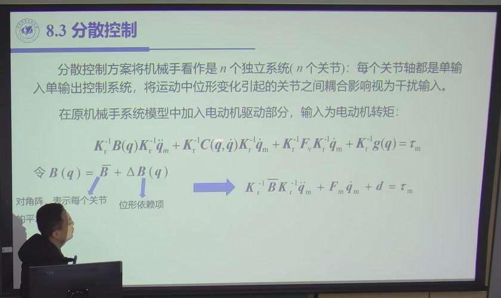
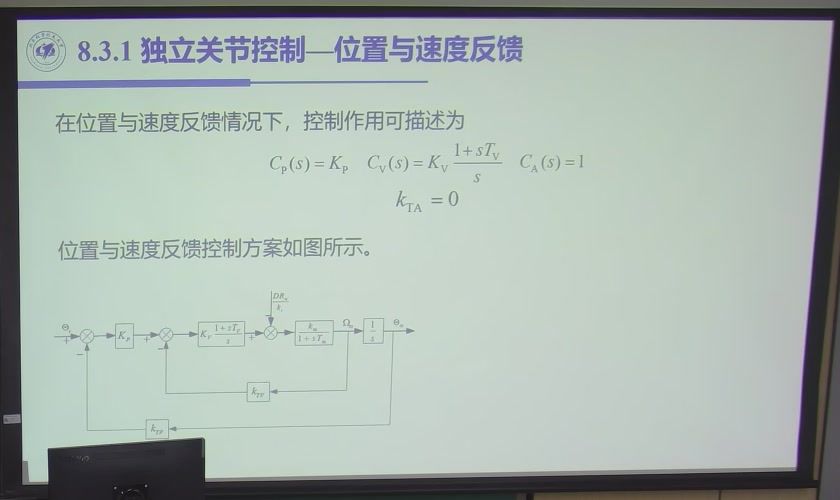
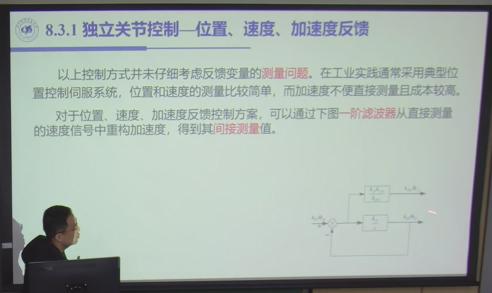
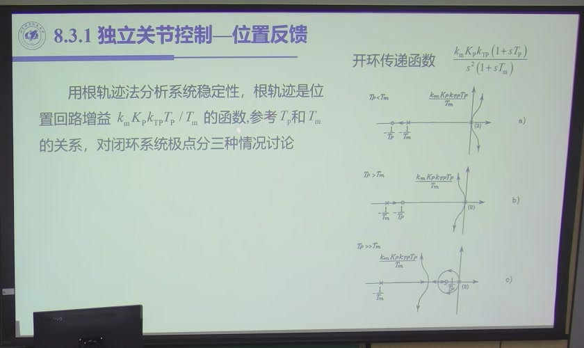
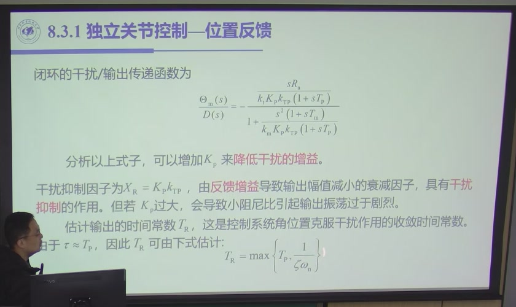
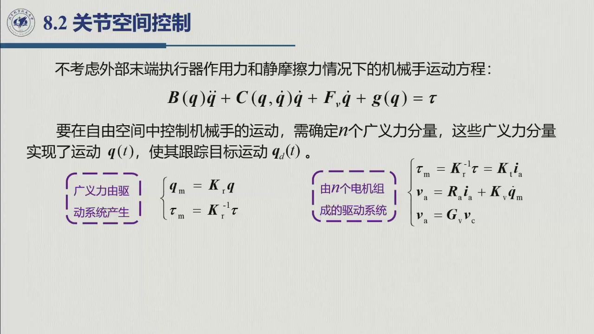
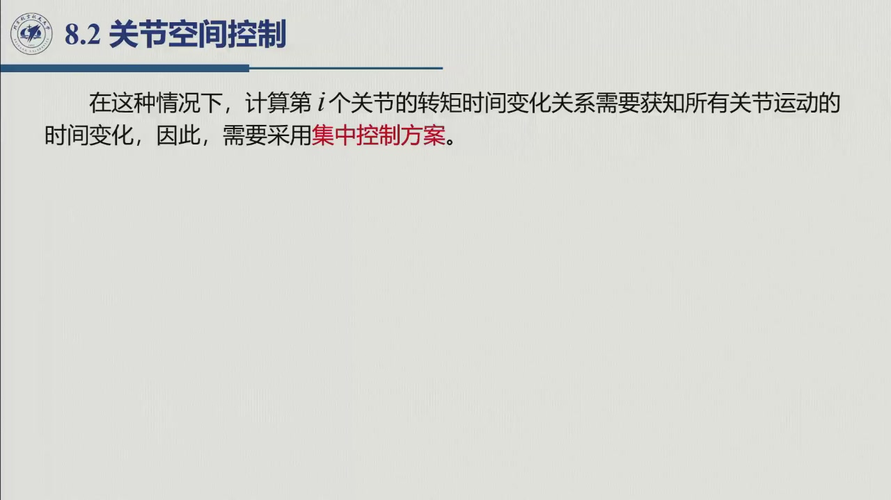
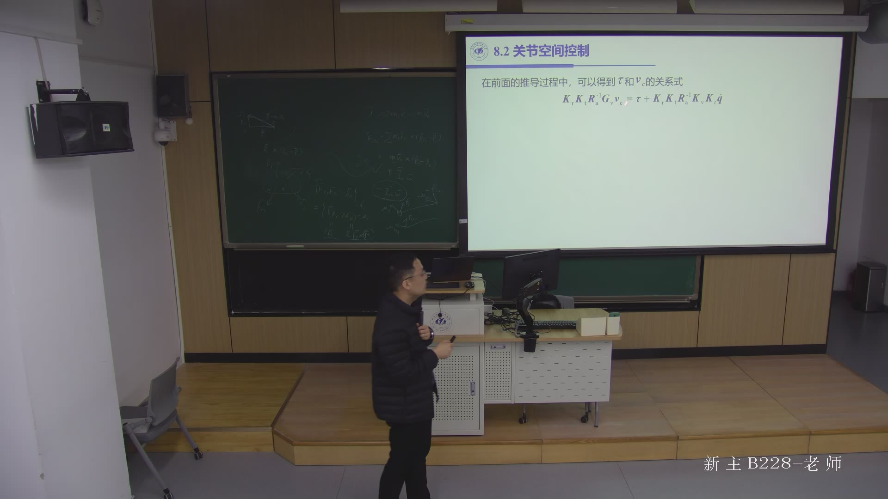
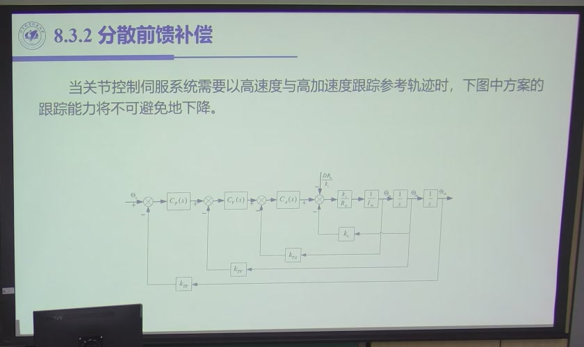
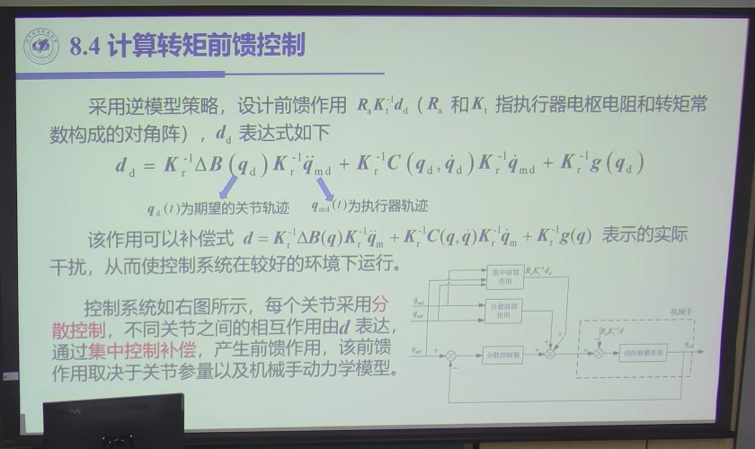

# 7.2 分散（独立关节）控制

> 录播 00:09:46–00:55:30（课件 §8.3–§8.4，**全部是课堂内容**）。这一节回答三个问题：
> **凭什么可以把 $n$ 个关节拆开、各管各的？拆开以后每个关节用什么控制器？这些控制器为什么能压住
> 耦合与重力？** 最后落到两张工程上真正会用的图：位置环的根轨迹，与加速度环的重构滤波器。

## 7.2.1 独立关节近似：把耦合塞进 $d$

分散控制的第一句话是**换坐标**：控制器看到的不是关节角 $\boldsymbol q$，而是电机轴上的转角
$\boldsymbol q_m=K_r\boldsymbol q$。把第六章的关节空间方程左乘 $K_r^{-1}$、并把 $\boldsymbol q$
换成 $K_r^{-1}\boldsymbol q_m$，得到课件 §8.3 的开式（图 7.2-1）：

$$K_r^{-1}B(\boldsymbol q)K_r^{-1}\ddot{\boldsymbol q}_m
+K_r^{-1}C(\boldsymbol q,\dot{\boldsymbol q})K_r^{-1}\dot{\boldsymbol q}_m
+K_r^{-1}F_{\mathrm v}K_r^{-1}\dot{\boldsymbol q}_m
+K_r^{-1}\boldsymbol g(\boldsymbol q)=\boldsymbol\tau_m .\tag{7.2-1}$$

**关键的一步是拆 $B$**。把惯量矩阵写成「标称对角阵 + 位形依赖项」：

$$B(\boldsymbol q)=\bar B+\Delta B(\boldsymbol q),\qquad
\bar B=\operatorname{diag}\{\bar b_1,\dots,\bar b_n\},\tag{7.2-2}$$

$\bar B$ 的每个对角元取关节惯量的一个常数标称值，例如工作范围内的平均值。令 $F_m=K_r^{-1}F_{\mathrm v}K_r^{-1}$，假设该折算摩擦矩阵为常数对角阵；把惯量偏差、速度耦合与重力合并为 $d$。本段暂不写库仑摩擦，若保留它则须将折算后的摩擦项也放入 $d$：

$$\boxed{\ K_r^{-1}\bar B K_r^{-1}\ddot{\boldsymbol q}_m
+F_m\dot{\boldsymbol q}_m+d=\boldsymbol\tau_m\ }\tag{7.2-3}$$

$$d=K_r^{-1}\Delta B(\boldsymbol q)K_r^{-1}\ddot{\boldsymbol q}_m
+K_r^{-1}C(\boldsymbol q,\dot{\boldsymbol q})K_r^{-1}\dot{\boldsymbol q}_m
+K_r^{-1}\boldsymbol g(\boldsymbol q).\tag{7.2-4}$$

**这一步在数学上是恒等变形，在工程上则是一次权衡**：耦合项 $d$ 是否可以忽略，取决于 $d$ 的大小、所要求的控制精度以及机器人本身的设计。如果负载较小、对稳态与瞬态指标的要求不高，忽略耦合可以显著简化控制器设计。但在高动态、高负载或高精度的任务中，这种忽略是否合理，必须依据机器人的物理参数与具体任务要求进行严谨分析。老师在 00:12:53–00:14:00 把这一点说得很直白：

> 「如果并没有要求负载那么大、指标没那么高，那就简单点……但这一项并不是不存在，
> 你的忽略是否合理，跟你的实际机器人情况、操作任务是否精细有关。」

::: note 摩擦去哪了（课件与本书口径的差异）
这里的模型保留黏性摩擦 $F_m\dot{\boldsymbol q}_m$。库仑摩擦没有单独出现在式 (7.2-1)–(7.2-4) 中；若要计入，可把折算后的库仑摩擦并入 $d$。它在低速换向附近需要特别处理，但低速抖动也可能来自齿隙、采样和控制器等其他因素。
:::

拆完以后，第 $i$ 个关节被近似为一个**单输入单输出线性定常系统，叠加一个未知干扰**：

$$J_i\ddot q_{m_i}+F_{m_i}\dot q_{m_i}+d_i=\tau_{m_i},\qquad
J_i=\bar b_i/k_{r_i}^2 .\tag{7.2-5}$$

**「分散」的逻辑在于**：将原本复杂的耦合关系视为局部关节的干扰，通过单轴反馈控制器的调节能力来抑制这种干扰，从而避免了对整机动力学模型进行复杂的集中式计算。压得住压不住，取决于 $d_i$ 的幅值范围与反馈控制器的带宽。

## 7.2.2 三种单轴控制器：位置、速度、加速度

课件 §8.3.1 给了三套并列的方案，它们的区别只在**反馈哪一个状态**：

| 方案 | 反馈量 | 控制器 | 适用 |
|:--|:--|:--|:--|
| **位置反馈** | $\theta_m$ | $C_p(s)=K_P$ | 点位控制、工业臂最常用 |
| **位置 + 速度反馈** | $\theta_m,\dot\theta_m$ | $C_p=K_P$，$C_v(s)=K_v(1+sT_v)/s$ | 需要阻尼、要压超调 |
| **位置 + 速度 + 加速度反馈** | $\theta_m,\dot\theta_m,\ddot\theta_m$ | $C_p=K_P$，$C_v$ 同上，$C_A(s)=1$ | 高速、高加速度跟踪 |

**老师反复强调的一点：三套不是叠加关系，选一套即可**（00:19:42–00:21:45）：

> 「这三个呢，是单独对于这个机器人的关节的控制来说，**只需要一个就行**……设计位置的时候，
> 就把速度、加速度置 1；设计速度的时候，其他置 1 或者给个比例就行。并不是说每一个位置、速度、
> 加速度都给它设一个 PID。」

课件讨论的 PI 形式为

$$C(s)=K_c\frac{1+sT_c}{s}=K_c\left(\frac{1}{s}+T_c\right).\tag{7.2-6}$$

PI 可用于选定的反馈环节，并非上表所有方块都必须是 PI：例如上表的位置比例环就是 $C_p=K_P$。在闭环稳定、执行器不饱和等条件下，适当配置的积分项可消除常值扰动引起的稳态误差。老师在 00:15:57–00:18:40 说明了增加积分的目的，并提到也可以设计成 PID。

::: note PD 与 PID：恒定扰动下的区别
沿用式 (7.2-5) 的扰动正号，写 $J\ddot q+F\dot q+d=u$，$d$ 为常值负载力矩，目标 $q_d$ 固定，误差 $e=q_d-q$。使用 $u=K_Pe-K_D\dot q$ 且闭环稳定时，稳态满足 $K_Pe_\infty=d$；有限的 $K_P>0$ 一般不能消除这个误差。

在控制律中再加 $K_I\int e\,\mathrm dt$，若闭环稳定、执行器不饱和且积分状态达到稳态，则其导数 $e$ 必须趋于零。积分可以积累出抵消常值扰动所需的力矩；稳定性和饱和限制仍须另行检查。
:::

**加速度反馈为什么要单独说**：加速度计贵、噪声大，工业上通常不直接测，而是用**一阶滤波器从速度
信号重构**（图 7.2-2，课件 39:10）：

$$\hat{\ddot\theta}_m(s)=\frac{s}{1+sT_a}\dot\theta_m(s).\tag{7.2-7}$$

这是一条**近似微分**：当 $|sT_a|\ll1$ 时近似为 $s\dot\theta_m$；高频增益则趋于有限值 $1/T_a$，而不是像理想微分那样无限增大。它限制了噪声放大，却不能消除噪声。$T_a$ 越小，重构带宽越大，高频噪声增益也越大。

若连速度也不能直接测量，课件还给出**二阶状态变量滤波器**：只用位置输入，同时重构速度与加速度。它补上了测量渠道，却会引入额外滞后；不能把重构量当成无延迟的真实导数。是否采用加速度反馈，应把测量或重构成本、滤波带宽和噪声一起比较。

::: note 内外环不是「三个 PID 串起来」
老师提到无人机等多环系统时，说明了内外环分别设计、整定的思路（00:20:30–00:21:40）。机器人驱动器也可以有电流内环、速度环和位置外环；环的数量和各环控制器形式取决于驱动器与控制结构，而不是要求每个环都采用 PID。
:::

## 7.2.3 单轴闭环：传递函数与根轨迹

把 (7.2-5) 与 PI 控制器接成闭环，位置环的开环传递函数是（课件 23:40，图 7.2-3）：

$$L(s)=\frac{k_mK_Pk_{tp}(1+sT_p)}{s^2(1+sT_m)},\tag{7.2-8}$$

其中 $k_m$ 是电机速度环节的静态增益，$k_{tp}$ 是位置传感器常数，$T_p$ 是 PI 的零点时间参数，$T_m$ 是电机时间常数。这里采用课件的位置 PI 结构，与前表的「位置比例 + 速度 PI」结构不同。其位置对象包含运动学积分 $1/s$，PI 又包含一个积分，所以开环共含两个原点极点；分子零点来自 PI 的比例项。

**根轨迹怎么读**（老师 23:50–31:10 带着走了一遍）：

令 $a=k_mK_Pk_{tp}>0$，闭环特征方程为

$$T_ms^3+s^2+aT_ps+a=0.$$

三阶 Routh 判据要求系数为正且 $aT_p>T_ma$，即 $T_p>T_m$。因此 $T_p<T_m$ 时闭环不稳定；$T_p=T_m$ 是临界情形，不能当作渐近稳定。老师在 23:50–31:10 用课件根轨迹比较了三种情况：$T_p<T_m$、$T_p>T_m$ 与 $T_p\gg T_m$。

两条无穷远渐近线的实轴交点为

$$\sigma_a=\frac{1/T_p-1/T_m}{2}>-\frac{1}{2T_m}\qquad(T_p>0).\tag{7.2-9}$$

这是渐近线的交点，不是每个闭环极点在任意增益下的位置。$T_p\gg T_m$ 也不单独保证整个响应更快；还须结合闭环极点、零点和执行器限制检查。

**位置 + 速度反馈：课件实际怎样选增益。** 在速度 PI 零点补偿电机名义极点（$T_v=T_m$）的理想模型下，课件原帧 `s0202.jpg` 给出的参考输入/输出关系为

$$\frac{\Theta_m(s)}{\Theta_r(s)}=
\frac{1/k_{tp}}{1+\dfrac{s k_{tv}}{K_Pk_{tp}}+\dfrac{s^2}{k_mK_Pk_{tp}K_v}}.$$

这里 $k_{tv}$ 是速度传感器增益，$\Theta_r$ 是框图参考输入。与标准二阶分母 $1+2\zeta s/\omega_n+s^2/\omega_n^2$ 逐项比较，得到

$$K_vk_{tv}=\frac{2\zeta\omega_n}{k_m},\qquad
K_Pk_{tp}K_v=\frac{\omega_n^2}{k_m}.$$

因此，指定 $\omega_n,\zeta$ 后可以依次求 $K_v,K_P$，但扰动抑制因子 $X_R=K_Pk_{tp}K_v$ 也随之确定，不再是独立可选的指标。该结构的扰动通道还保留电机极点 $-1/T_m$，课件估计其响应时间为 $\max\{T_m,1/(\zeta\omega_n)\}$；不要与下节位置 PI 的 $T_p$ 公式混淆。极零抵消依赖名义模型，参数失配和采样存在时仍须检查实际闭环。

**再加加速度反馈，多出哪一个可调指标。** 课件原帧 `s0213.jpg`、`s0221.jpg` 分析了加速度 PI 与传感器增益 $k_{ta}$。在其极点补偿条件下，闭环二阶分母变为

$$1+\frac{s k_{tv}}{K_Pk_{tp}}+
\frac{s^2(1+k_mK_Ak_{ta})}{k_mK_Pk_{tp}K_vK_A}.$$

此时可同时按动态指标和扰动指标整定：

$$\frac{2K_Pk_{tp}}{k_{tv}}=\frac{\omega_n}{\zeta},\qquad
k_mK_Ak_{ta}=\frac{k_mX_R}{\omega_n^2}-1,\qquad
K_Pk_{tp}K_vK_A=X_R.$$

要取正的 $K_A$，需 $k_mX_R/\omega_n^2>1$。课件的补偿条件是 $T_A=T_m$，或在 $k_mK_Ak_{ta}T_A\gg T_m$ 且 $k_mK_Ak_{ta}\gg1$ 时作相应近似；这些是简化模型的设计条件，并不表示带噪声、限幅的实际系统能够任意指定带宽。加速度方案的额外自由度，正是用更多测量和更强噪声敏感性换来的。

**另一种整定口径是二阶 PD 近似。** 对单轴对象 $J_i\ddot q+F_i\dot q=\tau$，取力矩控制 $\tau=K_P(q_d-q)-K_D\dot q$。恒定目标下特征方程为 $J_is^2+(F_i+K_D)s+K_P=0$，与 $s^2+2\zeta_i\omega_{n_i}s+\omega_{n_i}^2$ 比较，得到

$$K_{P_i}=J_i\omega_{n_i}^2,\qquad K_{D_i}=2\zeta_iJ_i\omega_{n_i}-F_i.\tag{7.2-10}$$

忽略对象自身黏性阻尼 $F_i$ 时才得到常用的 $K_D\approx2\zeta J\omega_n$。这是一种单轴力矩 PD 模型的整定，不是由上面的三阶 PI 根轨迹直接推出；实际还要检查采样、噪声和机械共振。

## 7.2.4 稳态误差与干扰抑制

**PI 为什么能消掉常值误差**：这里的位置对象本身含一个积分环节，位置 PI 控制器再加入一个积分环节。对本节的输入端恒定扰动，在闭环稳定且积分器不饱和时，终值定理给出稳态位置误差为零。斜坡扰动与其他扰动入口须分别计算，不能只凭系统型别套结论。积分还可能带来相位滞后、饱和及与摩擦有关的低速振荡。

**干扰到底被压掉多少**，课件给了一条闭式（图 7.2-4，31:10）：

$$\frac{\Theta_m(s)}{D(s)}
=-\frac{\dfrac{sR_a}{k_tK_Pk_{tp}(1+sT_p)}}
{1+\dfrac{s^2(1+sT_m)}{k_mK_Pk_{tp}(1+sT_p)}} .\tag{7.2-11}$$

低频段（$s\to0$）分子有一个 $s$，所以**常值干扰的稳态输出为零**——这是积分的作用；中频段的衰减
由**干扰抑制因子**

$$X_R=K_Pk_{tp}\tag{7.2-12}$$

参与决定；完整频率响应仍要看式 (7.2-11) 的分母，不能把所有频段的幅值都视作 $1/K_P$。增大 $K_P$ 可能使振荡模态阻尼减小，并增强噪声对控制量的影响。老师用一句话总结（00:29:30）：「可以增加这个 $K_P$ 比例系数
来降低干扰的增益，但你也不能无限大，大了之后会导致阻尼变小、振荡。」

**收敛时间**可以用一个经验式估：

$$T_R=\max\left\{T_p,\ \frac{1}{\zeta\omega_n}\right\}.\tag{7.2-13}$$

课件用它描述响应时间的估计。这里 $T_p$ 是位置 PI 控制器中的时间参数，而 $1/(\zeta\omega_n)$ 是二阶近似的衰减时间尺度；这种估计依赖相应近似，不是任意三阶闭环的精确调节时间。

::: think 常见错误（本节）
1. **把每个方块都各塞一套 PID**：老师要求按所选结构安排比例或 PI 环节，不是每个位置、速度、加速度方块都独立设计成 PID。这不否定经过带宽分配和整定的串级伺服；上面的「位置比例 + 速度 PI」本身就含内外环。
2. **以为 $K_P$ 越大越好**：扰动响应随频率而变，提高增益还会改变极点和噪声响应。式 (7.2-8) 在 $T_p>T_m$ 的理想模型下对所有正增益均稳定，但实际未建模动态、采样和饱和会限制可用增益。
3. **忽略积分饱和**：PI 的积分项在启动/大误差时会积到很大，退饱和慢，表现为「冲过头再慢慢回来」。
   工程上必须加 clamping 或 back-calculation。
4. **忽略 $T_p$ 与 $T_m$ 的关系**：对式 (7.2-8) 的正参数模型，Routh 判据要求 $T_p>T_m$；实际系统还需考虑未建模动态。
:::

## 7.2.5 从 $\boldsymbol\tau$ 到控制电压：分散控制成立的条件

到这里，控制器算出的还是**电机转矩** $\boldsymbol\tau_m$。真实驱动器接受的是**电压**（或电流）。
第 8 周已经把这层接口推完，这里只复述结论并把它接回 7.2.1 的 $d$。

驱动系统五式（减速器 + 电机 + 功率放大器）：

$$\left.\begin{aligned}
\boldsymbol q_m&=K_r\boldsymbol q\\
\boldsymbol\tau_m&=K_r^{-1}\boldsymbol\tau=K_t\boldsymbol i_a
\end{aligned}\right\}\qquad
\left.\begin{aligned}
\boldsymbol v_a&=R_a\boldsymbol i_a+K_v\dot{\boldsymbol q}_m\\
\boldsymbol v_a&=G_v\boldsymbol v_c
\end{aligned}\right\}\tag{7.2-14}$$

消元得

$$\boxed{\ \boldsymbol\tau=K_rK_tR_a^{-1}\bigl(G_v\boldsymbol v_c-K_vK_r\dot{\boldsymbol q}\bigr)\ }\tag{7.2-15}$$

**近似条件**：由 (7.2-14) 可见，$G_v\boldsymbol v_c=R_a\boldsymbol i_a+K_vK_r\dot{\boldsymbol q}$。对需要使用该近似的每个关节，都要检查电阻压降相对该关节的反电动势是否足够小，即 $|R_{a_i}i_{a_i}|\ll|k_{v_i}k_{r_i}\dot q_i|$；满足时才可近似写成

$$G_v\boldsymbol v_c\approx K_vK_r\dot{\boldsymbol q}
\quad\Longrightarrow\quad
\boldsymbol v_c\approx G_v^{-1}K_vK_r\dot{\boldsymbol q}.\tag{7.2-16}$$

课件以大减速比、小电枢电阻和小转矩解释这一近似。低速或静止时反电动势本身很小，不能仅凭「低速」断定上述比例关系成立。

**结论**：在上述逐轴近似成立、且各驱动参数矩阵为对角阵时，$\dot{\boldsymbol q}$ 与 $\boldsymbol v_c$ 近似逐轴成比例。这解释了课件中的分散驱动近似；它本身不保证含负载耦合、限幅与动态误差的整个闭环满足性能要求。

::: thm 定理 7.2.A · 分散控制成立的两条结论（第 8 周课件 §8.2） {#thm-7.2.A}
**结论一（模型参数的影响）**：在压降可忽略的近似式中，关节速度与电压的比例不显含连杆惯量、质量等机械手参数；但这些参数仍会影响实现该近似所需的电流和误差。

**结论二（逐轴关系）**：$G_v^{-1}K_vK_r$ 为对角阵时，近似关系逐轴分离。实际负载耦合及闭环稳定性仍须检查。
:::

若压降不能忽略，就须保留式 (7.2-15) 中的电流和速度项。电机参数矩阵在这里是对角的，反电动势项本身并不混合其他关节速度；整机动力学的耦合会使实现各关节所需的力矩依赖其他关节的状态。是否采用集中控制，要比较这种耦合与任务要求。

**两条工程出路**（第 8 周 02:16:29–02:17:48）：

| 出路 | 做法 | 结果 |
|:--|:--|:--|
| ① 使用速度近似 | 压降相对反电动势足够小时，用 $\boldsymbol v_c\leftrightarrow\dot{\boldsymbol q}$ 的近似 | 可按单轴设计，再检查近似误差与耦合 |
| ② 加电流环 | 在转矩命令与电压之间插电流内环，近似实现 $\boldsymbol i_a=G_i\boldsymbol v_c$ | 得到近似力矩接口 $\boldsymbol\tau=K_rK_tG_i\boldsymbol v_c$；仍须考虑电流环带宽和限幅 |

## 7.2.6 分散前馈补偿：给「跟不上」加一条旁路

分散反馈有一个绕不过去的短板：**它只看误差，不看接下来要多大的加速度**。当轨迹的速度、加速度
很高时，误差还没形成，输出已经落后了——课件 §8.3.2 的原话是「跟踪能力将不可避免地下降」
（图 7.2-5）。

**先补单轴名义对象的运动需求。** 令 $J_m=K_r^{-1}\bar B K_r^{-1}$、$q_{md}=K_rq_d$。只考虑式 (7.2-3) 左边的名义惯量与黏性摩擦，所需电机力矩为 $J_m\ddot q_{md}+F_m\dot q_{md}$；再按式 (7.2-14) 补电阻压降与反电动势，可写成一条等效电压前馈：

$$\boxed{\ \boldsymbol v_{c,\rm nom}=G_v^{-1}\Bigl[R_aK_t^{-1}(J_m\ddot{\boldsymbol q}_{md}+F_m\dot{\boldsymbol q}_{md})+K_v\dot{\boldsymbol q}_{md}\Bigr]\ }.\tag{7.2-17}$$

这给出分散参考前馈的物理分工；具体速度/加速度环框图中，各前馈可能插在不同比较点，不能不经量纲换算就把它们当成同一电压。它不包含剩余的 $d$；下一小节再用整机模型估计 $d_d$。两条旁路均只用期望轨迹和名义参数，因此可以离线计算，但仍需反馈处理初值偏差、扰动与模型误差。

**效果**（课件 §8.7 的仿真，02:13–02:16）：

| 方案 | 控制器 | 最大跟踪误差 |
|:--|:--|:--|
| A | 位置 + 速度反馈（分散） | $\sim0.2$ rad |
| C | A + 分散前馈 | $<0.01$ rad |
| E | C + 计算转矩前馈 | $\sim0.005$ rad |

这些是该组课堂仿真的量级，说明前馈在该任务中减小了误差；它不证明前馈本身保证稳定，也不保证换轨迹、参数或限幅后仍有同样的改善。

## 7.2.7 计算转矩前馈：用逆模型算「应该出多大力」

在上述名义前馈之外，再补式 (7.2-4) 的剩余扰动，得到课件 §8.4 的**计算转矩前馈**（computed torque feedforward）：

$$\boxed{\ \boldsymbol v_{c,\rm ff}=G_v^{-1}R_aK_t^{-1}\Bigl[
K_r^{-1}\Delta B(\boldsymbol q_d)K_r^{-1}\ddot{\boldsymbol q}_{md}
+K_r^{-1}C(\boldsymbol q_d,\dot{\boldsymbol q}_d)K_r^{-1}\dot{\boldsymbol q}_{md}
+K_r^{-1}\boldsymbol g(\boldsymbol q_d)\Bigr]\ }\tag{7.2-18}$$

它补偿的是 7.2.1 里那个 $d$（实际干扰）。之所以叫「计算转矩」，是因为它**把动力学模型反过来用**：
这是把逆动力学用于前馈：给定期望运动，计算名义模型需要的力矩；第六章所称的正动力学则是由力矩求运动。

::: note 核心辨析：计算力矩前馈 vs 逆动力学控制
计算力矩前馈的模型输入为期望状态；逆动力学控制的模型输入为实测状态。前者在跟踪误差小时才接近对消，后者的精确对消仍以模型准确、执行器能实现所求力矩为前提。
:::

::: note 为什么这里用 $\Delta B$ 而不是完整的 $B$
式 (7.2-3) 已把常数标称惯量 $\bar B$ 留在单轴对象中；式 (7.2-4) 的剩余扰动只含惯量偏差 $\Delta B$、速度耦合与重力。因此这条前馈旁路补的是 $d$，不是把单轴对象再补一遍。若改用完整 $B$ 构造前馈，就必须同时重新说明原有标称惯量前馈和反馈的分工；它也不会仅因使用完整 $B$ 就自动成为实测状态反馈的逆动力学控制。

上述电压前馈还保留了功率放大器增益 $G_v$：由 $\Delta\boldsymbol\tau_m=K_tR_a^{-1}G_v\Delta\boldsymbol v_c$，应有 $\Delta\boldsymbol v_c=G_v^{-1}R_aK_t^{-1}\Delta\boldsymbol\tau_m$。课件若把放大器增益归一化为单位阵，才可省略 $G_v^{-1}$；这与式 (7.2-14) 的电压定义要保持一致。
:::

## 7.2.8 小结与常见错误

- **一句话**：分散控制 = 把 $n$ 维耦合方程拆成 $n$ 个「线性定常单轴 + 干扰 $d$」，每轴用一个
  PI/PID 闭环；再用前馈把 $d$ 里能算的部分提前补掉。
- **三笔账**：耦合折算账（$1/k_r^2$、$1/k_r$）、干扰抑制账（$X_R=K_Pk_{tp}$、$T_R=\max\{T_p,1/(\zeta\omega_n)\}$）、
  电压—速度账（$G_v\boldsymbol v_c\approx K_vK_r\dot{\boldsymbol q}$）。
- **一个判据**：不能只看电压—力矩关系里是否含 $\dot{\boldsymbol q}$；反电动势是逐轴的。应检查剩余动力学耦合能否被单轴闭环抑制，以及驱动接口是否能实现所选控制律。

::: method 判别流程（工程上怎么用这一节） {#method-7.2.A}
给定一台机械手，要决定用分散还是集中：

1. **算折算**：给出减速比、电机参数与负载；检查电机侧剩余耦合，而不是只看减速比大小。
2. **看工况**：检查轨迹所需速度、加速度与力矩是否处于驱动能力内。若要采用电压—速度近似，还须逐轴比较电阻压降和反电动势；静止时不能用该比例近似。
3. **看耦合**：结合位形与速度评估 $\Delta B\ddot q$、$C\dot q$、重力与摩擦，并检查单轴反馈的稳定裕度与误差预算。
4. **选架构**：剩余耦合可被单轴闭环抑制时可用分散控制；否则考虑前馈或整机模型补偿。直驱、高速或重载是需要重点检查的工况，不是自动判定规则；电流环也可供分散控制使用。
5. **检查实现**：无论选哪条，都检查采样、延迟、噪声与限幅/保护。
:::

::: think 常见错误清单
1. **把 $d$ 当成「小量」而不检查**：$d$ 的大小随位形、速度、负载变；高速/直驱时它可能和
   $\tau_m$ 同量级，这时分散控制的假设已经破了。
2. **三种控制器全上**：位置、速度、加速度三套 PID 串在一起，互相抢带宽。选一套。
3. **用期望值算反馈环里的重力**：反馈环里的补偿必须用**实测** $\boldsymbol q$；只有前馈才用
   $\boldsymbol q_d$。
4. **把根轨迹的 $T_p<T_m$ 当归一化问题**：那是结构不稳定，调 $K_P$ 救不了。
5. **把期望状态前馈和实测状态补偿混为一谈**：二者都能使用模型，但补偿对象与误差方程不同；使用实测状态不等于必然引入一拍延迟。
:::

::: think 默写点 · 合上书再写
1. 写出 (7.2-3) 与 $d$ 的表达式，说明 $d$ 里至少包含哪三项。
2. 画出位置环、位置 + 速度环的框图，写出各自的 $C_p,C_v,C_A$。
3. 写出位置环开环传递函数 (7.2-8)，说明 $T_p<T_m$ 为什么不稳定。
4. 写出干扰抑制因子 $X_R$ 与收敛时间 $T_R$，说明 $K_P$ 的取舍。
5. 写出驱动五式并推出 (7.2-15)；说明三条假设各自消掉了什么。
6. 写出分散前馈与计算转矩前馈的表达式，说明两者与逆动力学控制的区别。
:::
