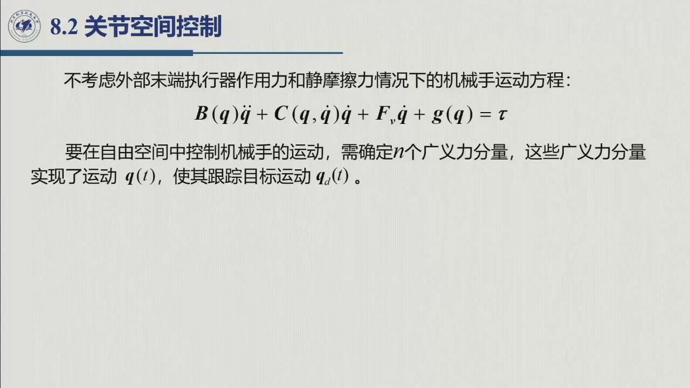
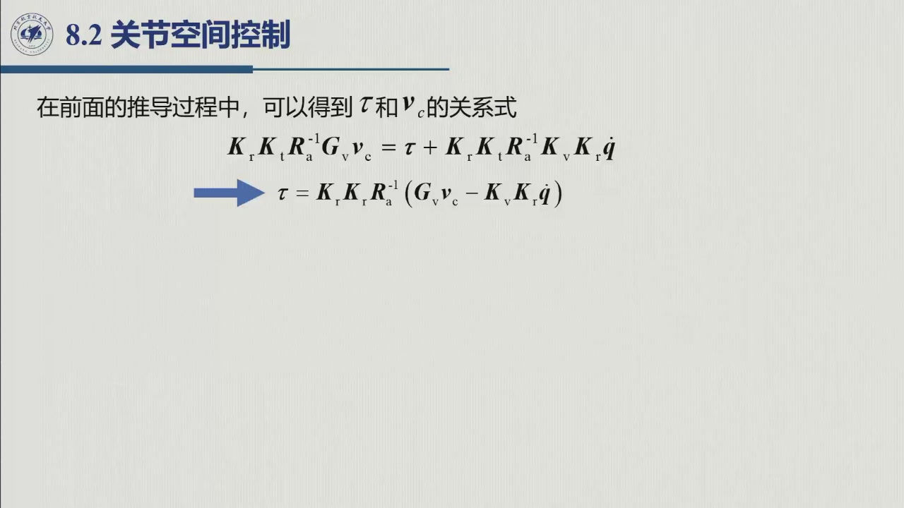
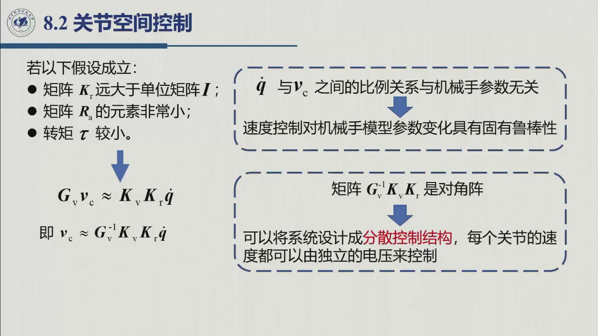
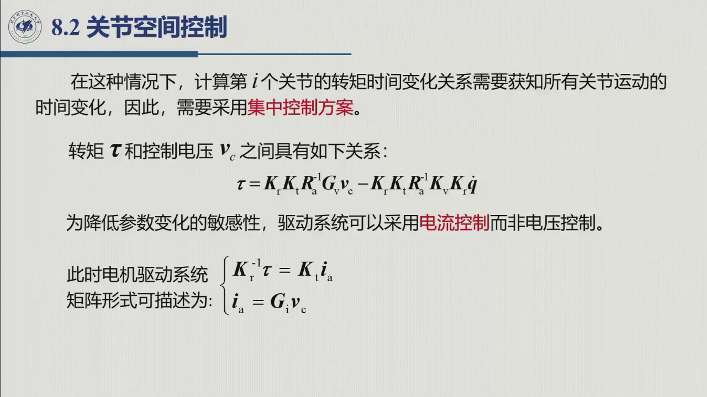

# 7.2 分散（独立关节）控制

[§7.1.5](sec7-1.md#sec-7.1.5) 算出两连杆平面臂在减速比 $k_r=100$ 时，折算到电机侧的轴间惯量耦合比值降到 $0.08\text{–}0.12$。既然其余关节和重力的相对影响已经缩小，最直接的做法就是先按单输入单输出对象分别设计每个关节的控制器，把耦合、重力及未建模项合并成一个扰动，再检查单轴反馈与前馈能否压住它。算这笔账之前，惯量、力矩和速度必须先[换到同一轴侧](../recall.md#gear)。本节依次推导单轴模型、反馈稳定条件、驱动电接口与前馈补偿；课堂回看：第 8 周 02:10:28–02:19:00、第 9 周 00:09:46–00:55:30（课件 §8.2–§8.4）。

以下以转动关节为例，电机转角 $q_m$ 与关节转角 $q$ 均用 $\mathrm{rad}$。$J_i$ 表示第 $i$ 轴电机侧等效惯量（$\mathrm{kg\cdot m^2}$），不要与第三章的雅可比矩阵混淆；$d_i$ 表示折算到电机侧的负载扰动力矩（$\mathrm{N\cdot m}$），不是第二章的 DH 偏距。

## 7.2.1 从整机方程得到单轴模型

设理想刚性传动满足 $q_m=K_rq$，其中 $K_r=\operatorname{diag}(k_{r_1},\ldots,k_{r_n})$ 为常值正对角减速比矩阵。由虚功相等 $\tau_m^{\mathrm T}\delta q_m=\tau^{\mathrm T}\delta q$ 得 $\tau_m=K_r^{-1}\tau$。把 $\ddot q=K_r^{-1}\ddot q_m$、$\dot q=K_r^{-1}\dot q_m$ 代入自由运动关节方程 $B(q)\ddot q+C(q,\dot q)\dot q+F_v\dot q+g(q)=\tau$，再左乘 $K_r^{-1}$，全部折算到电机侧：

$$K_r^{-1}B(q)K_r^{-1}\ddot q_m
+K_r^{-1}C(q,\dot q)K_r^{-1}\dot q_m
+K_r^{-1}F_vK_r^{-1}\dot q_m
+K_r^{-1}g(q)=\tau_m.\tag{7.2-1}$$

这里 $B(q)$ 按第六章选定的刚性驱动模型已包含折算后的转子惯量，不再重复添加；式 (7.1) 中的库仑摩擦等非光滑项暂并入下面的残余扰动。

为了用常系数线性工具设计单轴控制器，把惯性矩阵拆成常数标称对角阵与构形相关剩余项：

$$B(q)=\bar B+\Delta B(q),\qquad\bar B=\operatorname{diag}(\bar b_1,\ldots,\bar b_n).\tag{7.2-2}$$

$\bar b_i>0$ 通常取第 $i$ 轴对角惯量在工作空间内的标称值或平均值，$\Delta B(q)=B(q)-\bar B$ 则收集对角惯量的构形变化与全部非对角耦合元。记电机侧保留的线性黏性摩擦矩阵为 $F_m=K_r^{-1}F_vK_r^{-1}=\operatorname{diag}(b_1,\ldots,b_n)$，将常系数对角项留在左端，其余项收进扰动向量 $d$：

$$K_r^{-1}\bar BK_r^{-1}\ddot q_m+F_m\dot q_m+d=\tau_m,\tag{7.2-3}$$

$$d=K_r^{-1}\Delta B(q)K_r^{-1}\ddot q_m
+K_r^{-1}C(q,\dot q)K_r^{-1}\dot q_m+K_r^{-1}g(q)+d_{\rm other}.\tag{7.2-4}$$

$d_{\rm other}$ 收集未单列的库仑摩擦与外部载荷变化。取第 $i$ 分量，第 $i$ 轴的对象写为

$$J_i\ddot q_{m_i}+b_i\dot q_{m_i}+d_i=\tau_{m_i},\qquad J_i=\bar b_i/k_{r_i}^2.\tag{7.2-5}$$

当 $d_i=0$ 时，式 (7.2-5) 是系数恒定的单输入单输出二阶线性系统（$J_i>0,b_i\ge0$）。老师在课上说明（第 9 周 00:12:53–00:14:26），式 (7.2-3)–(7.2-4) 只是把非线性与耦合项重新归入 $d$，首先针对不含 $d$ 的定常部分设计反馈，再分析 $d$ 对闭环响应的影响；至于忽略耦合是否合算，取决于实际负载大小与任务精度要求，而且 $d$ 含有实际加速度 $\ddot q_m$，单轴名义极点稳定并不自动保证整机在大耦合或饱和下依然稳定。

## 7.2.2 先明确反馈量和内外环

有了单轴模型 (7.2-5)，下一步要看传感器送回哪些状态、驱动器接收什么指令。位置反馈消除当前位置偏差，速度反馈补充阻尼以抑制超调，积分项则用来顶住常值负载（第 9 周 00:15:57–00:18:40）。

课件 §8.3.1 按反馈信号列出位置反馈、位置—速度反馈、位置—速度—加速度反馈三套方案。老师提醒（00:19:42–00:21:45），对单关节设计时这三套方案只需选定一套，将未用到的外层环节置 $1$、不接入对应传感器即可，而不是在位置、速度、加速度上随意叠三个独立的 PID。工业伺服驱动器内部往往已经做好了高速电流环或速度环，外层控制器必须先认清驱动器已有的内环结构，从完整闭环方程统一导出各项增益。

当高速、高加速度任务需要引入加速度反馈时，直接装加速度计成本高且测量噪声大。工程上常对速度信号做一阶滤波微分来重构角加速度（00:38:08–00:39:41），用[拉普拉斯变量](../recall.md#laplace) $s$ 写为

$$\hat{\ddot q}_m(s)=\frac{s}{1+sT_a}\dot q_m(s),\qquad T_a>0.\tag{7.2-7}$$

在 $|s|\ll 1/T_a$ 的低频段，$\hat{\ddot q}_m(s)\approx s\dot q_m(s)$，近似理想微分；在 $|s|\gg 1/T_a$ 的高频段，传递函数幅值趋于有限常数 $1/T_a$，而不像纯微分 $s$ 那样把高频编码器噪声无限放大。减小滤波时间常数 $T_a$ 能减轻相位滞后，但高频噪声增益上限 $1/T_a$ 也会随之升高。

## 7.2.3 两种不同对象的稳定条件

[§7.1.6](sec7-1.md#sec-7.1.6) 提到驱动器有两种常见接法：加电流环后近似接收转矩命令，或者在大减速比、小电阻下直接接收电压命令。两种接法面对的被控对象不同，闭环稳定条件也不同，下面分别推导。

### 直接转矩输入：PD误差方程与常负载余差

先看能够直接执行转矩命令 $\tau_m$ 的单轴对象 (7.2-5)。暂省去轴下标，设目标位置 $q_{md}$ 固定，位置误差 $e=q_{md}-q_m$，则 $\dot e=-\dot q_m$、$\ddot e=-\ddot q_m$。取 PD 控制律

$$\tau_m=k_pe+k_d\dot e,$$

代入 $J\ddot q_m+b\dot q_m+d=\tau_m$，将 $-\ddot q_m=\ddot e$、$-\dot q_m=\dot e$ 移到左端，得到闭环误差方程

$$J\ddot e+(b+k_d)\dot e+k_pe=d.$$

当 $J>0,k_p>0,b+k_d>0$ 时，齐次方程 $J\ddot e+(b+k_d)\dot e+k_pe=0$ 的两个特征根均在左半平面。两边同除以 $J$，与[标准二阶形式](../recall.md#second-order) $\ddot e+2\zeta\omega_n\dot e+\omega_n^2e=0$ 逐项对照系数，有 $\omega_n^2=k_p/J$、$2\zeta\omega_n=(b+k_d)/J$，反解得

$$k_p=J\omega_n^2,\qquad k_d=2\zeta J\omega_n-b.\tag{7.2-10}$$

若模型保留了电机侧物理黏性阻尼 $b$，所需总阻尼 $2\zeta J\omega_n$ 中就要扣掉 $b$。这里的 $k_p$（$\mathrm{N\cdot m/rad}$）和 $k_d$（$\mathrm{N\cdot m\cdot s/rad}$）直接生成转矩，与下一小段电压 PI 控制器中的参数量纲不同。

算一个具体数字：取 $J=0.02\ \mathrm{kg\cdot m^2}$、$b=0.1\ \mathrm{N\cdot m\cdot s/rad}$，指定自然频率 $\omega_n=10\ \mathrm{rad/s}$、阻尼比 $\zeta=0.8$，由式 (7.2-10) 算出 $k_p=0.02\times10^2=2\ \mathrm{N\cdot m/rad}$，$k_d=2\times0.8\times0.02\times10-0.1=0.22\ \mathrm{N\cdot m\cdot s/rad}$。若存在常值重力或负载力矩 $d=0.2\ \mathrm{N\cdot m}$，平衡时 $\ddot e=\dot e=0$，误差停在 $e_{\rm ss}=d/k_p=0.1\ \mathrm{rad}$。微分项 $k_d\dot e$ 在静止时为零，只能改善过渡过程的阻尼，无法消除常值负载留下的静态偏差。

### 电压位置环：PI的根轨迹与Routh条件

再看课件 §8.3.1 的电压驱动位置环（第 9 周 00:20:29–00:26:25）。忽略快电气动态后，从控制电压到电机转角的传递函数写为 $P_v(s)=k_m/[s(1+sT_m)]$，其中 $k_m>0$ 为电机增益，$T_m>0$ 为电机机械时间常数，位置传感器增益记为 $k_{tp}>0$。为了让常值扰动下的稳态位置误差归零，课上在位置环采用比例—积分（PI）控制器：

$$C_p(s)=K_P\frac{1+sT_p}{s}=K_PT_p+\frac{K_P}{s},\qquad K_P>0,\ T_p>0.\tag{7.2-6}$$

这里 $K_PT_p$ 是比例增益，$K_P$ 是积分增益，零点位于 $s=-1/T_p$。将控制器 $C_p(s)$、对象 $P_v(s)$ 与反馈系数 $k_{tp}$ 相乘，环路开环传递函数为

$$L(s)=C_p(s)P_v(s)k_{tp}=\frac{k_mK_Pk_{tp}(1+sT_p)}{s^2(1+sT_m)}.\tag{7.2-8}$$

分母中的 $s^2$ 有两个原点极点，一个来自电机由速度到角度的积分，另一个来自 PI 控制器的积分项。记正的总环路增益为 $\kappa=k_mK_Pk_{tp}>0$，由 $1+L(s)=0$ 通分消去分母，得到三阶闭环特征方程

$$s^2(1+sT_m)+\kappa(1+sT_p)=0\quad\Longleftrightarrow\quad
T_ms^3+s^2+\kappa T_ps+\kappa=0.$$

按 $s^3,s^2,s^1,s^0$ 排列系数，构造三阶 Routh 表：

$$\begin{array}{c|cc}
s^3 & T_m & \kappa T_p \\[2pt]
s^2 & 1 & \kappa \\[2pt]
s^1 & \dfrac{1\cdot(\kappa T_p)-T_m\cdot\kappa}{1}=\kappa(T_p-T_m) & 0 \\[6pt]
s^0 & \kappa & 0
\end{array}$$

Routh 第一列依次为 $T_m,\,1,\,\kappa(T_p-T_m),\,\kappa$。由于 $T_m>0,\kappa>0$，第一列元素全为正充要条件是第三项 $\kappa(T_p-T_m)>0$，即

$$T_p>T_m.$$

当 $T_p=T_m$ 时，特征多项式可因式分解为 $T_ms^3+s^2+\kappa T_ms+\kappa=(T_ms+1)(s^2+\kappa)$，闭环出现一对纯虚根 $s=\pm\mathrm j\sqrt{\kappa}$，处于临界振荡。若 $T_p<T_m$，即控制器零点 $-1/T_p$ 落在电机极点 $-1/T_m$ 左侧，则对任意正增益 $K_P>0$ 都有 $\kappa(T_p-T_m)<0$，根轨迹进入右半平面，单靠调增益 $K_P$ 无法使系统稳定，必须重新选取零点时间常数 $T_p$ 或加入速度反馈（00:23:47–00:25:05）。

取一组满足 $T_p>T_m$ 的数值核对：令 $T_m=0.5\ \mathrm s$、$T_p=2\ \mathrm s$、$\kappa=0.5\ \mathrm{s^{-2}}$，Routh 第一列为 $0.5,\,1,\,0.75,\,0.5$，全为正；特征多项式

$$0.5s^3+s^2+s+0.5=0.5(s+1)(s^2+s+1)$$

的三个根为 $s=-1$ 与 $s=-0.5\pm\mathrm j\frac{\sqrt3}{2}$，实部均为负。

从根轨迹还能看出电机时间常数对响应速度的限制（00:23:10–00:26:20）。开环传递函数 (7.2-8) 有 $3$ 个极点 $0,0,-1/T_m$ 和 $1$ 个零点 $-1/T_p$，两条趋向无穷远的根轨迹渐近线与实轴交于

$$\sigma_a=\frac{(0+0-1/T_m)-(-1/T_p)}{3-1}=\frac{-1/T_m+1/T_p}{2}\ge-\frac1{2T_m}.\tag{7.2-9}$$

即使把 $T_p$ 选得远大于 $T_m$（$1/T_p\to0$）并不断加大增益 $K_P$，两条高频根轨迹分支的实部也只会逼近 $-\frac{1}{2T_m}$。实际增益还受编码器噪声、采样延迟、驱动限幅与机械谐振制约；比较闭环自然频率与离散采样频率时，应先统一 $\mathrm{rad/s}$ 与 $\mathrm{Hz}$ 的单位。

## 7.2.4 积分怎样消除常值负载偏差

[§7.2.3](#sec-7.2.3) 的直接转矩 PD 在常负载 $d=0.2\ \mathrm{N\cdot m}$ 下留下了 $e_{\rm ss}=d/k_p=0.1\ \mathrm{rad}$ 的稳态误差：只要关节停在目标外，比例项 $k_pe$ 才能提供平衡负载的力矩。要想在 $e=0$ 处仍然输出非零保持力矩，需要在 PD 上引入误差积分，构成 PID 控制。

令积分状态 $z(t)=\int_0^t e(\xi)\,\mathrm d\xi$，则 $\dot z=e$，控制律写为

$$\tau_m=k_pe+k_d\dot e+k_iz.$$

在固定目标 $q_{md}$、零初值下，将 $\tau_m$ 代入单轴对象 $J\ddot q_m+b\dot q_m+d=\tau_m$，得 $J\ddot e+(b+k_d)\dot e+k_pe+k_iz=d$。两边取拉普拉斯变换并代入 $Z(s)=E(s)/s$，从负载扰动 $D(s)$ 到位置误差 $E(s)$ 的闭环传递函数为

$$\frac{E(s)}{D(s)}=\frac{s}{Js^3+(b+k_d)s^2+k_ps+k_i}.\tag{7.2-11}$$

分母为三阶多项式 $Js^3+(b+k_d)s^2+k_ps+k_i$。与上一小节同样列出三阶 Routh 表，第一列依次为 $J,\,b+k_d,\,\frac{(b+k_d)k_p-Jk_i}{b+k_d},\,k_i$。对正参数 $J,k_p,k_i>0$ 且 $b+k_d>0$，闭环渐近稳定当且仅当

$$(b+k_d)k_p>Jk_i.$$

积分增益 $k_i$ 过大，会违反上式而导致三阶闭环发散。只有在满足这一稳定条件的前提下，才能应用终值定理计算稳态误差：

- 对常值负载 $d(t)=d_0$，有 $D(s)=d_0/s$，稳态误差为
  $$e_{\rm ss}=\lim_{s\to0}sE(s)=\lim_{s\to0}\frac{s\cdot d_0}{Js^3+(b+k_d)s^2+k_ps+k_i}=0,$$
  此时积分项 $k_iz(\infty)=d_0$ 恰好接替比例项顶住常负载；
- 对线性增长的斜坡负载 $d(t)=d_1t$，有 $D(s)=d_1/s^2$，稳态误差为 $e_{\rm ss}=d_1/k_i$。

可见式 (7.2-11) 分子上的因子 $s$ 是消去常值负载误差的原因。若驱动器发生转矩或电压饱和，误差无法及时减小而积分状态 $z(t)$ 持续累加（积分饱和），退出饱和后会产生明显超调和漫长恢复过程，工程实现时必须对积分状态配置抗饱和措施。

在电压驱动位置环 (7.2-8) 中，课件（第 9 周 00:28:44–00:31:27）把扰动到位置误差传递函数中的乘积 $X_R=K_Pk_{tp}$ 称为干扰抑制因子：$X_R$ 越大，斜坡扰动引起的稳态偏差越小，但过大的 $K_P$ 也会降低阻尼、引起振荡。无论采用哪种单轴模型，调节时间都应由闭环全部极点（含实极点与共轭复极点）共同决定；$1/(\zeta\omega_n)$ 仅代表二阶欠阻尼模态包络线的衰减时间常数。

## 7.2.5 转矩、电流和电压之间的换算

前几小节分别用了“转矩输入 $\tau_m$”和“电压输入 $v_c$”两种单轴模型。老师在第 8 周末尾（02:10:28–02:19:00，课件 §8.2）专门把机械手动力学与第五章的直流电机方程联立起来，回答两个问题：算出的关节力矩 $\tau$ 怎样落到电机控制电压 $v_c$ 上？什么条件下各关节可以直接用独立电压控制？

忽略电枢电感 $L_a$ 的快电气动态，采用理想刚性传动及对角形式的 $n$ 轴电机参数矩阵：减速比 $K_r$、转矩常数 $K_t$、电枢电阻 $R_a$、反电动势常数 $K_v$ 与功放电压增益 $G_v$。五组基本关系写为

$$q_m=K_rq,\quad\tau_m=K_r^{-1}\tau=K_ti_a,\quad
v_a=R_ai_a+K_v\dot q_m,\quad v_a=G_vv_c.\tag{7.2-14}$$

这里 $i_a,v_a,v_c\in\mathbb R^n$ 分别为电枢电流、电枢电压和控制电压向量。由后两式及 $\dot q_m=K_r\dot q$ 解出电枢电流 $i_a=R_a^{-1}(G_vv_c-K_vK_r\dot q)$，再代入 $\tau=K_rK_ti_a$，消去中间变量 $q_m,\tau_m,i_a,v_a$，得到关节广义力 $\tau$ 与控制电压 $v_c$ 的关系：

$$\tau=K_rK_tR_a^{-1}(G_vv_c-K_vK_r\dot q).\tag{7.2-15}$$

将式 (7.2-15) 左乘 $(K_vK_r)^{-1}R_a(K_rK_t)^{-1}$ 并移项，改写成关节角速度 $\dot q$ 的表达式：

$$\dot q=(K_vK_r)^{-1}G_vv_c
-(K_vK_r)^{-1}R_aK_t^{-1}K_r^{-1}\tau.\tag{7.2-16}$$

右端第一项只含放大器、电机和减速比的对角参数矩阵；第二项含关节力矩 $\tau=B(q)\ddot q+C(q,\dot q)\dot q+F_v\dot q+g(q)$，整机的非线性和轴间耦合全都集中在这里。

::: thm 定理 7.2.A · 电压近似速度接口的条件 {#thm-7.2.A}
在电枢电感快动态可忽略、传动近似刚性的前提下，若减速比 $K_r$ 很大、电枢电阻 $R_a$ 很小、所需关节转矩 $\tau$ 较小，使得式 (7.2-16) 右端第二项（电枢电阻压降折算的速度偏差）相对于任务允许的速度误差可以忽略，则有

$$G_vv_c\approx K_vK_r\dot q\quad\Longleftrightarrow\quad
\dot q\approx(K_vK_r)^{-1}G_vv_c.$$

此时控制电压 $v_c$ 与关节角速度 $\dot q$ 近似成正比，比例矩阵 $(K_vK_r)^{-1}G_v$ 是与机械手连杆参数无关的常对角阵，各关节可作为独立的速度源按分散结构分别控制（第 8 周 02:13:23–02:15:00）。
:::

用 [§7.5.1](sec7-5.md#sec-7.5.1) 的单轴参数算一遍式 (7.2-16) 的两项：取 $k_r=100$、$k_t=2\ \mathrm{N\cdot m/A}$、$k_v=2\ \mathrm{V\cdot s/rad}$、$R_a=10\ \Omega$、$G_v=1$。当关节以 $\dot q=0.1\ \mathrm{rad/s}$ 运动并输出负载力矩 $\tau=10\ \mathrm{N\cdot m}$ 时，电机侧力矩为 $\tau_m=\tau/k_r=0.1\ \mathrm{N\cdot m}$，电枢电流为 $i_a=\tau_m/k_t=0.05\ \mathrm A$；反电动势为 $k_vk_r\dot q=20\ \mathrm V$，电阻压降为 $R_ai_a=0.5\ \mathrm V$，总电枢电压 $v_a=20.5\ \mathrm V$。若按定理 7.2.A 忽略电阻压降，由 $v_a/(k_vk_r)$ 算出的关节速度为 $0.1025\ \mathrm{rad/s}$，相对偏差为 $0.5/20=2.5\%$。但若机械臂带同样 $10\ \mathrm{N\cdot m}$ 重力负载静止保持（$\dot q=0$），反电动势为零，电枢电压的 $100\%$（$0.5\ \mathrm V$）都用来克服电阻产生保持电流，此时不能用 $G_vv_c\approx K_vK_r\dot q$ 估算保持力矩。

反过来，当机械手高速、大加速度运动或需要输出大转矩时，式 (7.2-16) 第二项不可忽略，电压不再只与单轴速度成正比（02:15:04–02:18:00）。这时课上采用集中控制统一计算关节力矩 $\tau$，并在功放内加入高带宽电流闭环，使电枢电流跟踪指令 $i_a\approx G_iv_c$，从而由式 (7.2-14) 直接得到线性转矩接口

$$\tau=K_rK_ti_a\approx K_rK_tG_iv_c.$$

电流环把反电动势 $K_v\dot q_m$ 的影响留给内环高增益压制，使外层控制器看到的驱动器近似为受控转矩源；这依赖电流环带宽充足且未发生电压饱和。

课堂驱动框图与轴侧换算图（第 8 周 02:11–02:16）

## 7.2.6 单轴前馈：先提供参考运动需要的力矩

前面推导单轴 PD 时假定目标 $q_{md}$ 固定。跟踪随时间变化的参考轨迹 $q_{md}(t)$ 时，误差定义为 $e=q_{md}-q_m$，于是 $\dot q_m=\dot q_{md}-\dot e$、$\ddot q_m=\ddot q_{md}-\ddot e$。如果仍只用误差反馈 $\tau_m=k_pe+k_d\dot e$，代回单轴模型 $J\ddot q_m+b\dot q_m+d=\tau_m$ 移项后得到

$$J\ddot e+(b+k_d)\dot e+k_pe
=J\ddot q_{md}+b\dot q_{md}+d.$$

即使没有外部耦合扰动（$d=0$），右端仍然留着参考运动本身所需的惯性力矩 $J\ddot q_{md}$ 与黏性摩擦力矩 $b\dot q_{md}$。纯反馈控制器必须等已经出现跟踪滞后 $e\ne0$，才能产生推动关节跟上参考轨迹的力矩（第 9 周 00:40:45–00:43:00）。

既然参考轨迹 $q_{md},\dot q_{md},\ddot q_{md}$ 由第四章轨迹规划已知，可以直接按标称单轴参数把这两项提前加到输入端，构成**分散（单轴）前馈**：

$$\tau_{m,\rm ff}=J\ddot q_{md}+b\dot q_{md},\qquad
\tau_m=\tau_{m,\rm ff}+k_pe+k_d\dot e.\tag{7.2-17}$$

将式 (7.2-17) 代入单轴方程，右端的 $J\ddot q_{md}+b\dot q_{md}$ 被前馈项直接抵消，误差方程回到

$$J\ddot e+(b+k_d)\dot e+k_pe=d.$$

前馈负责提供沿期望轨迹运动所需的标称力矩，反馈则专注抑制初始偏差与残余扰动 $d$。因为前馈只依赖参考信号 $q_{md}(t)$，它不改变闭环特征多项式，既可以离线预算，也可以随参考生成器在线计算。

## 7.2.7 整机计算转矩前馈

单轴前馈 (7.2-17) 消去了标称对角惯量 $\bar B$ 和黏性摩擦，但误差方程右端的 $d$ 里还留着式 (7.2-4) 的构形相关惯量 $\Delta B(q)$、科氏离心项 $C(q,\dot q)\dot q$ 和重力 $g(q)$。如果在保持各轴独立反馈回路的同时，把期望轨迹 $q_d,\dot q_d,\ddot q_d$ 代入第六章的整机动力学模型算出这批耦合力矩并提前补偿，就得到课件 §8.4 的**计算转矩前馈**（第 9 周 00:45:43–00:55:30）。

按期望轨迹计算的完整整机前馈关节力矩为

$$\tau_{\rm ff}=\hat B(q_d)\ddot q_d
+\hat C(q_d,\dot q_d)\dot q_d+\hat g(q_d)+\hat F\dot q_d.\tag{7.2-18}$$

与单轴通道组合时要注意分工、避免重复补偿：若单轴前馈通道已经补了标称对角惯量 $\bar B\ddot q_d$ 和标称摩擦 $\hat F\dot q_d$，则集中前馈通道只需补期望轨迹上的剩余项 $d_d=K_r^{-1}\bigl[\Delta\hat B(q_d)\ddot q_d+\hat C(q_d,\dot q_d)\dot q_d+\hat g(q_d)\bigr]$；若尚未单独加单轴前馈，则直接按式 (7.2-18) 注入全部 $\hat B(q_d)\ddot q_d+\cdots$。式子里写 $\hat B$ 还是 $\Delta\hat B$ 仅取决于前馈通道怎样拆分，不是区分前馈与反馈的标志。

若底层驱动采用 [§7.2.5](#sec-7.2.5) 的电压接口 (7.2-15)，将关节前馈力矩 $\tau_{\rm ff}$ 换算为控制电压时，需同时包含克服电阻产生前馈电流的电压和克服期望速度反电动势的电压：

$$v_{c,\rm ff}=G_v^{-1}\left(R_aK_t^{-1}K_r^{-1}\tau_{\rm ff}
+K_vK_r\dot q_d\right).$$

若单轴速度前馈已补了反电动势项 $G_v^{-1}K_vK_r\dot q_d$，则转矩前馈分支只叠加 $G_v^{-1}R_aK_t^{-1}K_r^{-1}\tau_{\rm ff}$。

需要注意计算转矩前馈与下一节[§7.3.4 逆动力学控制](sec7-3.md#sec-7.3.4)（计算力矩控制）的区别：前馈把期望状态 $q_d,\dot q_d,\ddot q_d$ 代入动力学模型，反馈回路仍在各关节独立闭合，实际状态偏离期望轨迹时模型补偿会留下残差；逆动力学控制则把实测状态 $q,\dot q$ 代入 $\hat B(q)$ 与非线性项，并让误差反馈先形成虚拟加速度、再乘以 $\hat B(q)$ 变成力矩，反馈注入位置与增益量纲都随之改变。

## 7.2.8 完成一次单轴设计

::: method 分散控制的检查步骤 {#method-7.2.A}
1. **统一轴侧与驱动接口**：按式 (7.2-1)、(7.2-5) 将惯量、摩擦、负载折算到同一轴侧；由式 (7.2-15)–(7.2-16) 确认驱动器接收的是转矩／电流命令，还是满足 [@thm-7.2.A] 的电压命令。
2. **推导名义闭环并整定增益**：对转矩 PD 按式 (7.2-10) 由 $(\omega_n,\zeta)$ 计算 $k_p,k_d$；对电压 PI 按式 (7.2-8) 核查 $T_p>T_m$ 与渐近线界 (7.2-9)；加入积分消除常负载偏差时按式 (7.2-11) 核查 $(b+k_d)k_p>Jk_i$ 及抗饱和限幅。
3. **加入前馈并核对分工**：跟踪时变参考时，按式 (7.2-17) 补单轴惯性与摩擦前馈，或按式 (7.2-18) 补整机计算转矩前馈，确认 $\bar B\ddot q_d$、摩擦与反电动势没有遗漏或重复叠加。
4. **沿任务验算残余扰动**：将任务轨迹的峰值速度、加速度代入式 (7.2-4) 估计残余耦合 $d$，结合采样周期与测量噪声复核跟踪误差和峰值输入是否越界；若残余耦合超出单轴反馈承受范围，转入 [§7.3 集中控制](sec7-3.md)。
:::
