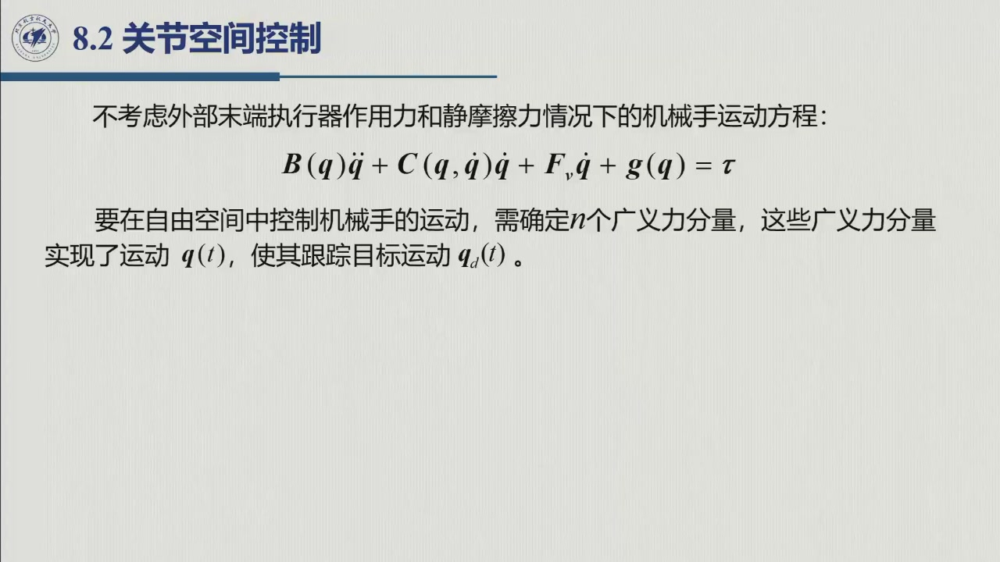
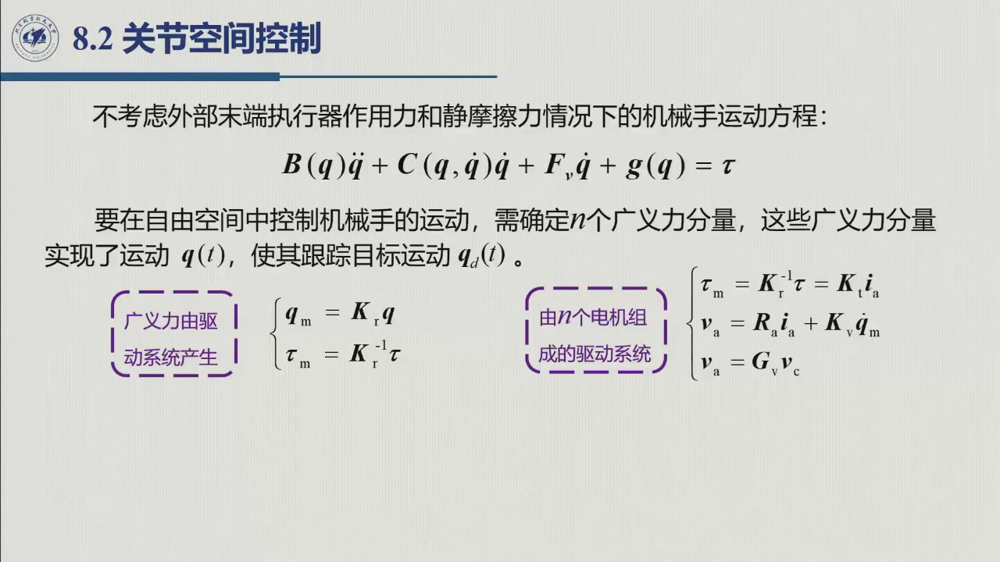
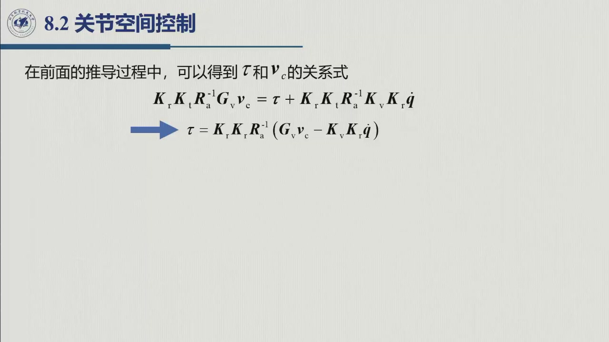
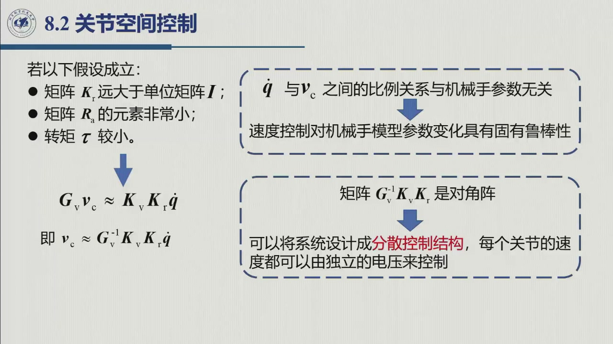
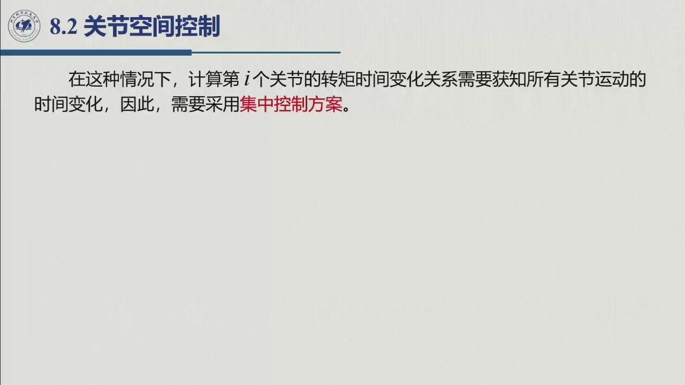
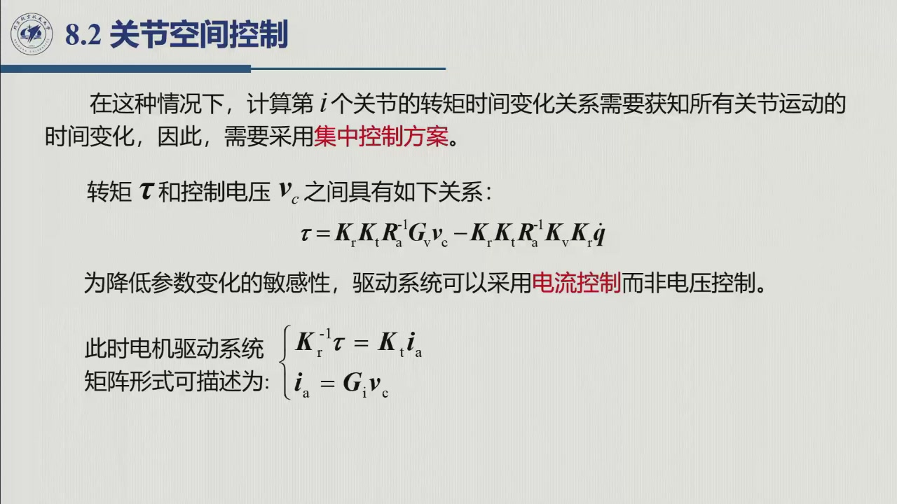
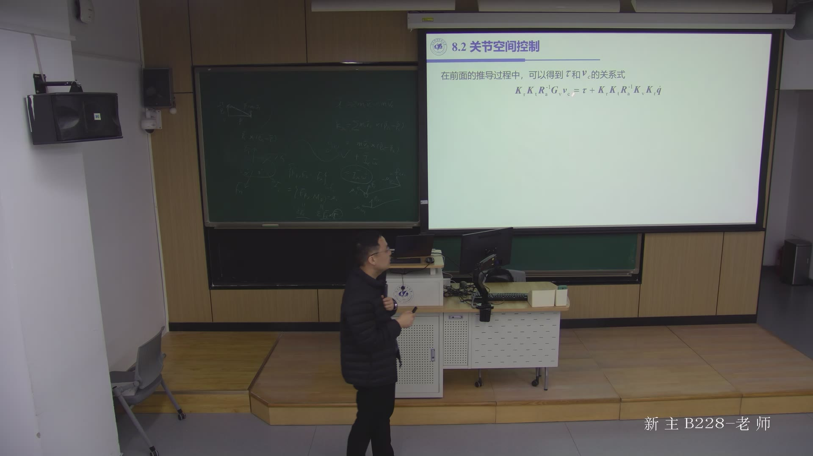

# 7.2 分散（独立关节）控制

> 录播 02:09:04–02:19:40（课件 §8.2 后半）。**7.2.5 是课堂正题**——把广义力 $\boldsymbol\tau$
> 接到电机的控制电压上，用三条假设得出「低速大减速比时可以各轴单干」；**7.2.1–7.2.4、7.2.6–7.2.7
> 是教材补**（课件 §8.3–§8.4 的控制律，公式（7.2）–（7.8）、（7.13）–（7.14）），待第 9 周校订
> ——老师说「后面分散的具体控制率设计，我们下一节课再讲」（02:19:49）。

## 7.2.1 独立关节近似：把耦合当扰动（教材补）

分散控制的出发点，是把第六章的 $n$ 维耦合方程**截成 $n$ 个标量方程**。第 $i$ 轴的方程是

$$b_{ii}(\boldsymbol q)\ddot q_i+\bigl(C\dot{\boldsymbol q}\bigr)_i+F_{{\rm v}_i}\dot q_i
+g_i(\boldsymbol q)=\tau_i-\underbrace{\sum_{j\neq i}b_{ij}(\boldsymbol q)\ddot q_j}_{\text{耦合惯量}} ,$$

把不知道的、不想管的都塞进一个扰动项 $d_i$：

$$\boxed{\ b_{ii}(\boldsymbol q)\ddot q_i+F_{{\rm v}_i}\dot q_i+g_i(\boldsymbol q)+d_i=\tau_i\ }\tag{7.2}$$

$$d_i=\sum_{j\neq i}b_{ij}(\boldsymbol q)\ddot q_j
+\bigl(C\dot{\boldsymbol q}\bigr)_i-F_{{\rm s}_i}\operatorname{sgn}\dot q_i+\text{（未建模项）}.$$

**这一步在数学上是恒等变形，在工程上是一次赌博**：赌 $d_i$ 足够小、且闭环能压住它。赔率由第五章
给出（[定理 5.2.C](../ch05/sec5-2-3.md#thm-5.2.C) 的两条折算、[定义 5.2.5](../ch05/sec5-2-4.md) 的
「独立关节近似」）：折算到电机侧，**惯量类耦合按 $1/k_r^2$ 缩小、力矩类耦合按 $1/k_r$ 缩小**；
大减速比还让重力矩的自变量变成 $\vartheta_m/k_r$，$\sin$ 只走过很短的近似直线区间
（[5.2.3 传动装置影响](../ch05/sec5-2-3.md#ex-5.2.D) 的齿轮驱动摆例题）——非线性也被压平一部分。

**但 $b_{ii}$ 仍随位形变**：独立关节近似不等于「把每个关节当成线性定常系统」——$b_{ii}=b_{ii}
(\boldsymbol q)$（[6.1.1.5](../ch06/sec6-1-1.md) 的三性质之一）。敢用线性方法，是因为 ① $b_{ii}$
变化范围通常不大（大减速比时转子惯量占主导）、② 反馈对参数慢变不敏感；**$b_{ii}$ 变化很大
（长臂、大行程）时，必须做增益调度或上 7.3 的计算力矩。**

## 7.2.2 单轴 PD 控制律（教材补）

对第 $i$ 轴，取误差 $e_i=q_{d_i}-q_i$，最简单的控制律是 **PD**：

$$\boxed{\ \tau_i=K_{P_i}e_i+K_{D_i}\dot e_i\ }\tag{7.3}$$

代入 (7.2)，把重力与扰动合记为 $d_i'=d_i+g_i$，并假定 $b_{ii}\approx J_i$（常数等效惯量）：

$$J_i\ddot e_i+K_{D_i}\dot e_i+K_{P_i}e_i=d_i'.\tag{7.4}$$

**这就是一个标准二阶系统**，其特征方程 $J_is^2+K_{D_i}s+K_{P_i}=0$，于是

$$\omega_{n_i}=\sqrt{\frac{K_{P_i}}{J_i}},\qquad
\zeta_i=\frac{K_{D_i}}{2\sqrt{K_{P_i}J_i}}.\tag{7.5}$$

**为什么 PD 能让它稳**：$K_{P_i},K_{D_i},J_i>0$ 时两个根都在左半平面（二阶系统的 Routh 判据）。
物理上 $K_P$ 是「弹簧」把误差拉回零、$K_D$ 是「阻尼」防止冲过头——**没有 $K_D$ 就是一个无阻尼
弹簧振子，必然振荡。**

## 7.2.3 稳态误差：PD 为什么「差一点」（教材补）

令 $\ddot e=\dot e=0$（稳态），由 (7.4) 立刻得到

$$\boxed{\ e_{i,\rm ss}=\frac{d_i'}{K_{P_i}}\ }\tag{7.6}$$

**这就是 PD 的稳态误差公式**，它解释了工程上三件常见的事：

| 扰动 $d_i'$ 的来源 | 是否常值 | PD 的稳态误差 | 对策 |
|:--|:--|:--|:--|
| 重力 $g_i(\boldsymbol q)$ | 在位形不变时是常值 | $g_i/K_P$（**恒定偏差**，垂直轴最明显） | 重力补偿（7.2.4）或积分 |
| 库仑摩擦 $F_{{\rm s}_i}\operatorname{sgn}\dot q_i$ | 在停止时是常值 | $F_{{\rm s}_i}/K_P$ | 摩擦前馈/积分 |
| 关节间耦合 $d_i$ | 随运动变化 | 稳态为 0，**动态滞后**不为 0 | 前馈（7.2.6）或集中控制（7.3） |
| 常值负载力矩 | 常值 | $d/K_P$ | 积分 |

**要消掉常值误差，就得提高低频增益**——最直接的办法是加积分，得到 **PID**：

$$\boxed{\ \tau_i=K_{P_i}e_i+K_{I_i}\int_0^t e_i\,\mathrm d\tau+K_{D_i}\dot e_i\ }\tag{7.7}$$

积分项使系统从「0 型」变成「1 型」：常值扰动下稳态误差为零。**代价**是相位滞后（稳定性变差）、
积分饱和与低速爬行（积分与摩擦的极限环），工程上要配抗饱和（clamping / back-calculation）与积分限幅。
这与第五章 [定理 5.2.D](../ch05/sec5-2-4.md) 从传递函数给出的结论殊途同归：驱动传递函数
$M(s)=k_m/[s(1+sT_m)]$ 有两个原点极点，纯比例闭环相位裕度极差，必须 PI 配合——**积分不是「经验」，
而是「要在常值扰动下零误差」的必然要求**。

## 7.2.4 重力补偿 PD：把最大的常值扰动先扣掉（教材补）

既然 PD 的稳态误差正比于扰动，而重力是**最容易算、量最大、变化最慢**的那一项，最划算的做法就是
**先把它减掉**：

$$\boxed{\ \boldsymbol\tau=\boldsymbol g(\boldsymbol q)
+K_P\boldsymbol e+K_D\dot{\boldsymbol e}\ }\tag{7.8}$$

其中 $\boldsymbol g(\boldsymbol q)$ 用**当前实测的** $\boldsymbol q$ 在线计算（不是期望值）。
代入被控对象，重力项对消，闭环变成

$$B(\boldsymbol q)\ddot{\boldsymbol e}+C(\boldsymbol q,\dot{\boldsymbol q})\dot{\boldsymbol e}
+K_D\dot{\boldsymbol e}+K_P\boldsymbol e=\text{（残余耦合与摩擦）},$$

**平衡点移到了 $\boldsymbol e=0$**：静止时不再需要靠 $K_P$ 的「弹簧压缩量」去顶重力。三个工程要点：
① $\boldsymbol g$ 必须用实测 $\boldsymbol q$（用 $\boldsymbol q_d$ 算等于开环补偿，位形偏差时补错）；
② $\boldsymbol g$ 的精度决定残余误差——连杆质量/质心标定不准，残余就是个常值偏差，回到 (7.6) 由
$K_P$ 兜住；③ 它只是**部分补偿**：只补了 $\boldsymbol g$，$B\ddot{\boldsymbol q}$ 与
$C\dot{\boldsymbol q}$ 没补，都补掉就是 7.3 的计算力矩。

## 7.2.5 从 $\boldsymbol\tau$ 到控制电压：分散控制成立的条件

**这是课堂正题**（02:09:04–02:19:40，课件 §8.2 后半）。老师点题（02:10:48）：「我们后面的设计控制
都是设计 $\boldsymbol\tau$ 的，但是你设计出来的 $\boldsymbol\tau$，最终还要（落）到电机的控制量。」

### 7.2.5.1 被控对象与要设计的东西

> 「不考虑外部末端执行器作用力和静摩擦力情况下的机械手运动方程：
> $B(\boldsymbol q)\ddot{\boldsymbol q}+C(\boldsymbol q,\dot{\boldsymbol q})\dot{\boldsymbol q}
> +F_{\mathrm v}\dot{\boldsymbol q}+\boldsymbol g(\boldsymbol q)=\boldsymbol\tau$。
> 要在自由空间中控制机械手的运动，需确定 $n$ 个广义力分量，这些广义力分量实现了运动
> $\boldsymbol q(t)$，使其跟踪目标运动 $\boldsymbol q_d(t)$。」

### 7.2.5.2 驱动系统的四个关系（五式）

课件把「广义力由驱动系统产生」拆成两个虚线框：左边是**减速器**，右边是 $n$ 个电机组成的
**驱动系统**：

$$\left.\begin{aligned}
\boldsymbol q_m&=K_r\boldsymbol q\\
\boldsymbol\tau_m&=K_r^{-1}\boldsymbol\tau=K_t\boldsymbol i_a
\end{aligned}\right\}\qquad
\left.\begin{aligned}
\boldsymbol v_a&=R_a\boldsymbol i_a+K_v\dot{\boldsymbol q}_m\\
\boldsymbol v_a&=G_v\boldsymbol v_c
\end{aligned}\right\}\tag{7.9}$$

逐条读（$K_r$ **减速比矩阵**，对角；$K_t$ 转矩常数；$R_a$ 电枢电阻；$K_v$ 反电动势常数；
$G_v$ 功率放大器增益）：

1. $\boldsymbol q_m=K_r\boldsymbol q$：电机转角 = 减速比 × 关节角（电机转得快）；
2. $\boldsymbol\tau_m=K_r^{-1}\boldsymbol\tau=K_t\boldsymbol i_a$：**电机侧转矩 = 关节转矩 / 减速比**，
   且与电枢电流成正比（这就是「转矩常数」的定义）；
3. $\boldsymbol v_a=R_a\boldsymbol i_a+K_v\dot{\boldsymbol q}_m$：电枢电压 = 电阻压降 + **反电动势**
   （正比于电机角速度——这一项是全部麻烦的来源）；
4. $\boldsymbol v_a=G_v\boldsymbol v_c$：功率放大器把控制电压放大成电枢电压。

这五个方程就是第五章的模型换了个写法：[定义 5.2.1 电气驱动的四个基本方程](../ch05/sec5-2-1.md)
把「电压—电流—转矩—转速」写成四式加一张框图，这里压成矩阵并把**减速比**显式提出来。符号对应：
$K_t\leftrightarrow k_t$、$K_v\leftrightarrow k_v$、$G_v\leftrightarrow G_v$，$K_r$ 是第六章
$k_{r_i}$ 组成的对角阵。

### 7.2.5.3 消元：$\boldsymbol\tau$ 与 $\boldsymbol v_c$ 的关系

把 (7.9) 逐层代入：由第 3、4 式解出电流，

$$\boldsymbol i_a=R_a^{-1}\bigl(\boldsymbol v_a-K_v\dot{\boldsymbol q}_m\bigr)
=R_a^{-1}\bigl(G_v\boldsymbol v_c-K_vK_r\dot{\boldsymbol q}\bigr),$$

再由第 2 式得 $\boldsymbol\tau_m=K_t\boldsymbol i_a$，最后乘减速比：

$$\boxed{\ \boldsymbol\tau=K_rK_tR_a^{-1}\bigl(G_v\boldsymbol v_c-K_vK_r\dot{\boldsymbol q}\bigr)\ }\tag{7.10}$$

课件把这条式子分两步写出来，正是为了让人看清括号里那两项：

$$\underbrace{K_rK_tR_a^{-1}G_v\boldsymbol v_c}_{\text{电压产生的转矩}}
=\boldsymbol\tau+\underbrace{K_rK_tR_a^{-1}K_vK_r\dot{\boldsymbol q}}_{\text{反电动势「吃掉」的转矩}}.$$

**读法**：控制电压想产生的转矩，一部分用来驱动关节（$\boldsymbol\tau$），一部分被反电动势抵消
（与速度成正比）。**这个「被吃掉的部分」就是耦合的来源**——它让「电压 ↔ 转矩」不再是比例关系。

### 7.2.5.4 条件 → 结论：三条假设推出「可以分散」

课件给三条假设（幻灯片 02:13:29）：

> 若以下假设成立：① 矩阵 $K_r$ **远大于**单位矩阵 $I$（减速比大，例如 100 以上）；
> ② 矩阵 $R_a$ 的元素**非常小**（电枢电阻小）；③ 转矩 $\boldsymbol\tau$ **较小**。

**条件**：前两条让前置因子 $K_rK_tR_a^{-1}$ **很大**；第 ③ 条说左边的 $\boldsymbol\tau$ 却很小。
由 (7.10)，大因子乘括号必须等于小量，**唯一可能是括号本身接近零**（老师口述 02:14:21–02:15:16，
这里补成完整推理）：

$$\boxed{\ G_v\boldsymbol v_c\approx K_vK_r\dot{\boldsymbol q}
\quad\Longrightarrow\quad
\boldsymbol v_c\approx G_v^{-1}K_vK_r\dot{\boldsymbol q}\ }\tag{7.11}$$

**结论**——课件在这条式子后挂的两个结论框，就是本节的要害：

::: thm 定理 7.2.A · 分散控制成立的两条结论（课件 §8.2 的落点） {#thm-7.2.A}
**结论一（鲁棒性）**：「$\dot{\boldsymbol q}$ 与 $\boldsymbol v_c$ 之间的**比例关系与机械手参数无关**」
⇒「**速度控制对机械手模型参数变化具有固有鲁棒性**」。因为 (7.11) 里根本没有 $B,C,\boldsymbol g$
的影子——只要驱动器工作在这个区，**机械手多重、连杆多长、耦合多强，都不影响「给多少电压就转多快」**。

**结论二（可分散）**：「矩阵 $G_v^{-1}K_vK_r$ **是对角阵**」⇒「可以将系统设计成**分散控制结构**，
**每个关节的速度都可以由独立的电压来控制**」。
:::

老师的原话（02:15:20–02:15:42）：「而且这个矩阵它还是个对角阵。所以在我们做了这些假设的情况下，
你这个每一个关节，我就只需要关注它的 $\dot{\boldsymbol q}$ 跟 $\boldsymbol v_c$ 就行……
每个关节都是独立的。所以对于这种方式下，我们用分散控制来设计……那是可以的。」

### 7.2.5.5 反例与两条出路：什么时候必须集中控制

**反例**：不做那三条假设，(7.10) 里 $\boldsymbol\tau$ 与 $\boldsymbol v_c$ 之间就**隔着
$K_vK_r\dot{\boldsymbol q}$ 这一项**——它把**所有关节的速度**混在一起：

> 「在这种情况下，计算第 $i$ 个关节的转矩时间变化关系**需要获知所有关节运动的时间变化**，
> 因此，**需要采用集中控制方案**。」

**「集中」不是算法口味，而是信息依赖**：想精确算出 $\tau_i$，就必须知道整机状态、用整机模型，
这个计算天然是「集中」的。

**工程上的两条出路**（老师 02:16:29–02:17:48）：

| 出路 | 做法 | 结果 |
|:--|:--|:--|
| ① 接受近似 | 保持电压控制，用三条假设把 $\boldsymbol v_c\leftrightarrow\dot{\boldsymbol q}$ 当比例 | 只能用**分散控制**，高速/大转矩时误差大 |
| ② 加电流环 | 在「转矩命令」与「电压」之间插一个**电流控制回路**，把电流稳住 | 转矩与电压成比例，**可以集中控制** |

②的推导只有两行：电流环把电枢电流强制到指令值，于是

$$\left.\begin{aligned}
K_r^{-1}\boldsymbol\tau&=K_t\boldsymbol i_a\\
\boldsymbol i_a&=G_i\boldsymbol v_c
\end{aligned}\right\}
\quad\Longrightarrow\quad
\boxed{\ \boldsymbol\tau=K_rK_tG_i\boldsymbol v_c\ }\tag{7.12}$$

**式 (7.12) 里没有 $\dot{\boldsymbol q}$**——这就是电流环的全部价值：把反电动势那一项「包」进内环，
外层看到的只剩「转矩 ∝ 电压」的纯比例关系。

这与第五章 [定理 5.2.A/5.2.B](../ch05/sec5-2-1.md) 的结论一字不差：**不加电流反馈 ⇒ 速度控制
发电机**（干扰抑制好，但转矩不独立于转速）；**加电流反馈 ⇒ 力矩控制发电机**（「驱动力矩实际上
独立于角速度」）。本节从「$\tau$ 与 $v_c$ 的关系式」这条路又走了一遍，并把用途说破：独立关节控制
（§8.3）要**速度源**，靠大减速比把 $\dot q$ 与 $v_c$ 绑在一起；集中控制（§8.5）要**力矩源**，
必须加电流环——第五章那句「8.3 节要速度控制发电机、8.5 节要力矩控制发电机」的伏笔，到这里收束。

### 7.2.5.6 本讲的收束：工况决定架构

老师用一段话把两大类控制与工况绑在一起（02:18:00–02:19:40）：

> 「当**低速**、还有**大减速比**、**小转矩**的时候，适合分散控制——而且耦合也比较弱，可以控制
> 单个关节，直接用电压控制电机就可以了。那如果对于**高速**、**大加速度**、**大转矩**的时候，
> 我们比较适合用集中控制……为了把输出的 $\boldsymbol\tau$ 化成比例关系，中间又增加了一个电流控制。」

::: method 判别流程（工程上怎么用这一节） {#method-7.2.A}
给定一台机械手，要决定用分散还是集中：

1. **算折算**：减速比 $k_r$、电枢电阻 $R_a$、额定转矩/惯量比——判断是否落在「大 $k_r$、小 $R_a$、
   小 $\tau$」的区；
2. **看工况**：轨迹规划给出的 $\dot q_{\max},\ddot q_{\max}$ 是否让转矩逼近额定值（第四章的规划结果在这里用上）；
3. **看耦合**：$b_{ij}/b_{ii}$ 的量级、$C\dot q$ 与 $g$ 的占比（第六章算过）；
4. **选架构**：低速轻载 ⇒ 分散（电压控制 + 单轴 PID/PI）；高速重载 ⇒ 集中（电流环 + 整机模型，
   见 [7.3](sec7-3.md)）；
5. **兜底**：无论选哪条，都要留反馈（7.2.2–7.2.4 的律）与限幅/保护——**模型永远有偏差**。
:::

## 7.2.6 计算力矩前馈（教材补；课件 §8.4 题作「计算转矩前馈」）

分散控制只知道「当前误差」，不知道「接下来要多大加速度」。把规划给出的 $\boldsymbol q_d,
\dot{\boldsymbol q}_d,\ddot{\boldsymbol q}_d$ 代进动力学模型，**提前**算出需要的力矩作为前馈——
这就是**计算力矩前馈**（computed torque feedforward；课件题名「计算转矩前馈」）：

$$\boxed{\ \boldsymbol\tau
=\underbrace{B(\boldsymbol q_d)\ddot{\boldsymbol q}_d
+C(\boldsymbol q_d,\dot{\boldsymbol q}_d)\dot{\boldsymbol q}_d+\boldsymbol g(\boldsymbol q_d)}_{\text{前馈：用期望值算}}
+\underbrace{K_P\boldsymbol e+K_D\dot{\boldsymbol e}}_{\text{反馈：用实际值算}}\ }\tag{7.13}$$

**与 7.3 的计算力矩（逆动力学）控制同源，差别只在自变量**：这里前馈用**期望值** $\boldsymbol q_d$
（可离线预算），7.3 用**实测值** $\boldsymbol q$（在线算、能精确对消）。代价与收益：

| | 计算力矩前馈（本节；课件题名「计算转矩前馈」） | 计算力矩控制（7.3） |
|:--|:--|:--|
| 模型自变量 | $\boldsymbol q_d,\dot{\boldsymbol q}_d,\ddot{\boldsymbol q}_d$ | $\boldsymbol q,\dot{\boldsymbol q}$（实测） |
| 能否离线预算 | 能（前馈表可预先算好） | 不能（每周期都要算） |
| 对消精度 | 取决于跟踪误差（$\boldsymbol q\approx\boldsymbol q_d$ 时才准） | 精确对消（误差大也对消） |
| 计算量 | 前馈可预算，在线只算反馈 | 每周期算 $B,C,\boldsymbol g$ |
| 适用 | 跟踪精度中等、算力有限（工业主流） | 高速高精度、算力充足 |

## 7.2.7 增益整定：把指标翻译成 $K_P,K_D$（教材补）

由 (7.5) 反解，给定期望的自然频率 $\omega_n$ 与阻尼比 $\zeta$，

$$\boxed{\ K_{P_i}=J_i\omega_{n_i}^2,\qquad K_{D_i}=2\zeta_iJ_i\omega_{n_i}\ }\tag{7.14}$$

**整定的四条经验**（教材与工程通用，不是本讲口述）：

1. **$\zeta$ 取 0.7–1.0**：小于 0.7 超调明显，大于 1 响应变钝；点位控制常取 1（无超调）。
2. **$\omega_n$ 受采样率限制**：闭环带宽一般取采样频率的 $1/10$–$1/5$ 以下，否则离散化后相位裕度不够。
3. **$\omega_n$ 受机械共振限制**：不能逼近结构固有频率，否则激发振动（大减速比传动尤其小心）。
4. **按轴分别整定，从「最重」的轴开始**：$J_i$ 大的轴（通常靠近基座）带宽最低，先定它，再让远端
   小惯量轴跟上；否则远端快、近端慢，耦合会在中间「顶牛」。

**别把「$K_P$ 越大越好」当经验**：$K_P$ 提高会同时抬高带宽（好）与噪声放大、饱和、共振风险（坏），
且**稳态误差只按 $1/K_P$ 缩小**，永远不为零。真正的做法是：**先补偿能补的（重力、摩擦、前馈），
再让 $K_P$ 只负责剩余的扰动与模型偏差**——这正是 7.2.4 与 7.2.6 存在的理由。

## 7.2.8 小结与常见错误

- **一句话**：分散控制 = 把 $n$ 维耦合方程截成 $n$ 个「单轴 + 扰动」，每轴用 PD/PID 闭环；
  它能成立的两个条件是**耦合折算后足够小**（第五章）与**驱动器工作在速度源区**（7.2.5）。
- **三笔账**：耦合折算账（$1/k_r^2$、$1/k_r$）、稳态误差账（$e_{\rm ss}=d/K_P$）、
  电压—速度账（$G_v\boldsymbol v_c\approx K_vK_r\dot{\boldsymbol q}$）。
- **一个判据**：$\tau$ 与 $v_c$ 的关系式里有没有 $\dot{\boldsymbol q}$——有它，就得整机一起算；
  靠电流环把它消掉才能做集中控制。

::: think 常见错误清单
1. **把 (7.10) 的量纲搞错**：$K_r$ 是「电机转角/关节角」，所以 $\boldsymbol\tau_m=K_r^{-1}\boldsymbol\tau$
   （电机侧转矩小于关节侧），别写反；漏掉反电动势项 $K_v\dot{\boldsymbol q}_m$，就无法解释三条假设。
2. **把「小转矩」当成「小电流」**：假设 ③ 说的是**关节侧转矩**小（相对额定），它才允许
   「大因子 × 小括号 = 小量」这个推理成立。
3. **用期望值算重力补偿**：(7.8) 必须用实测 $\boldsymbol q$，否则位形偏差时补错方向。
4. **PD 加了大 $K_P$ 就以为没有稳态误差**：常值扰动下 $e_{\rm ss}=d/K_P\neq0$；
   要零误差必须加积分或把扰动补掉。
5. **前馈与反馈用同一个 $\boldsymbol q$**：前馈用 $\boldsymbol q_d$（7.2.6）还是 $\boldsymbol q$（7.3）
   决定了它是「预算」还是「对消」，别混用。
:::

::: think 默写点 · 合上书再写
1. 写出单轴解耦方程 (7.2)，说明 $d_i$ 里至少包含哪三项。
2. 写出 PD 的闭环方程与 $\omega_n,\zeta$ 表达式；说明 $K_D$ 为什么不能省。
3. 写出 PD 的稳态误差并解释「垂直轴为什么总差一点」。
4. 默写驱动系统五式（四组关系），推出 (7.10)；说明三条假设各自消掉了什么。
5. 由 (7.10) 解释「为什么精确算 $\tau_i$ 需要知道所有关节的运动」，并说明电流环如何绕开它。
6. 写出计算力矩前馈律，标出哪部分可离线预算、哪部分必须在线算。
:::
