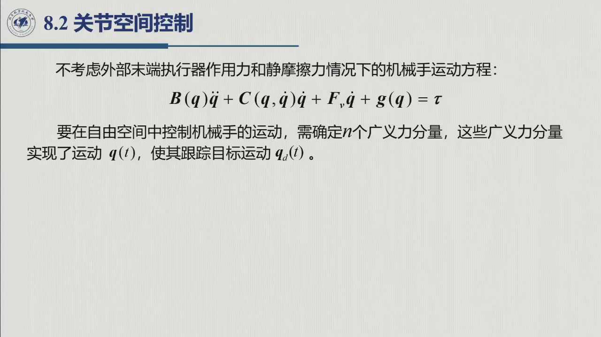
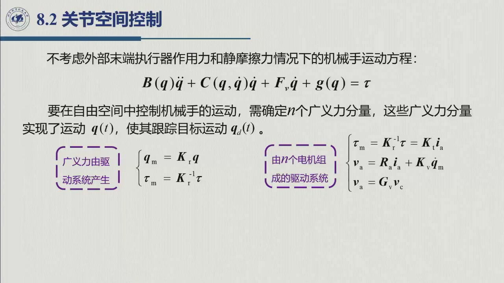
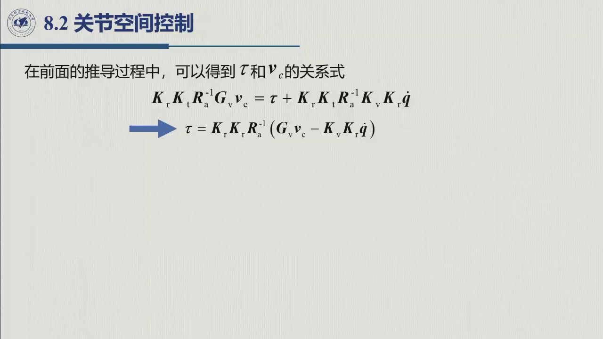
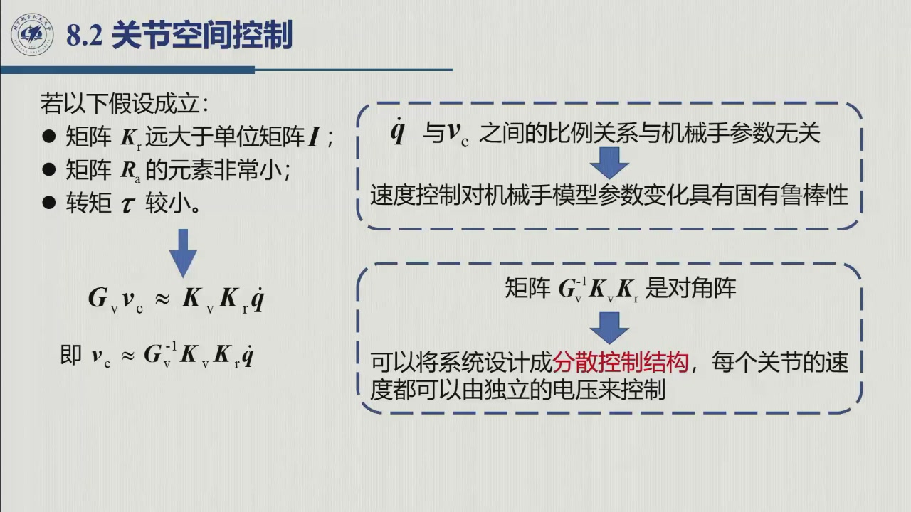
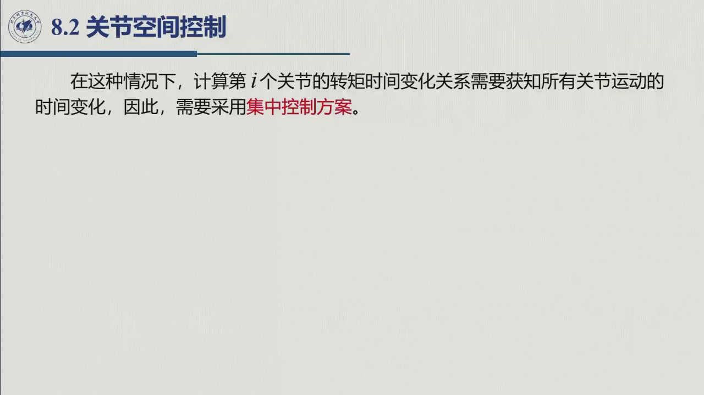
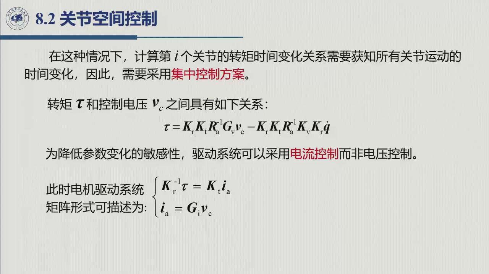

# 7.2 分散（独立关节）控制

先分别控制每个关节，把其他关节、重力及未补偿负载的影响放进扰动，再检查单轴反馈能否承受它。这需要把惯量、力矩和速度先[换到同一轴侧](../recall.md#gear)。本节完成单轴误差方程、稳定条件和前馈推导；课堂回看：00:09:46–00:55:30。

以下以转动关节为例，电机角 $q_m$ 与关节角 $q$ 用rad。$J_i$ 表电机侧等效惯量，不是第三章的雅可比；$d_i$ 表电机侧负载扰动力矩，不是DH距离。

## 7.2.1 从整机方程得到单轴模型

设理想刚性传动的 $q_m=K_rq$，$K_r$ 为固定正对角减速比矩阵。功率相等给 $\tau_m=K_r^{-1}\tau$。将关节方程左乘 $K_r^{-1}$，得到

$$K_r^{-1}BK_r^{-1}\ddot q_m
+K_r^{-1}CK_r^{-1}\dot q_m
+K_r^{-1}F_vK_r^{-1}\dot q_m
+K_r^{-1}g=\tau_m.\tag{7.2-1}$$

这里 $B$ 应按第六章选定的刚性驱动模型包含相应惯性；若它已包含折算的转子惯量，不再重复添加。暂未单列的库仑摩擦等可并入下面的残余扰动。

把惯性矩阵分成常数标称对角阵和剩余部分：

$$B(q)=\bar B+\Delta B(q),\qquad\bar B=\operatorname{diag}(\bar b_1,\ldots,\bar b_n).\tag{7.2-2}$$

用电机侧黏性系数矩阵 $F_m$ 表示保留的线性摩擦，则

$$K_r^{-1}\bar BK_r^{-1}\ddot q_m+F_m\dot q_m+d=\tau_m,\tag{7.2-3}$$

$$d=K_r^{-1}\Delta BK_r^{-1}\ddot q_m
+K_r^{-1}CK_r^{-1}\dot q_m+K_r^{-1}g+d_{\rm other}.\tag{7.2-4}$$

$d_{\rm other}$ 收集所选模型外的摩擦、载荷等项。这只是重新分组，并未证明 $d$ 很小；而且它含实际加速度，不能在所有稳定性分析里当作独立外部信号。

对第 $i$ 轴保留的模型为

$$J_i\ddot q_{m_i}+b_i\dot q_{m_i}+d_i=\tau_{m_i},\qquad J_i=\bar b_i/k_{r_i}^2.\tag{7.2-5}$$

先按 $J_i>0,b_i\ge0$ 的单轴对象设计，再沿任务检查残余耦合。单轴名义极点稳定，不自动等于包含全部耦合和限幅的整机稳定。

## 7.2.2 先明确反馈量和内外环

位置反馈反映当前位置偏差，速度反馈可增加模型阻尼，积分则可补偿常负载。实际伺服常将位置、速度与电流环按带宽串级安排，具体结构需匹配驱动器已有接口；这些反馈环并非只能选一个。

下面先按电机转矩能够执行命令的模型设计。实际驱动若接收电压，或已经包含速度伺服，就需换用相应对象。位置、速度、加速度信息可以同时参与反馈，但各项应从完整闭环方程导出，不能任意串接多个PID。

加速度也可由速度作滤波微分，下面用[拉普拉斯变量](../recall.md#laplace) $s$ 表达：

$$\hat{\ddot q}_m(s)=\frac{s}{1+sT_a}\dot q_m(s),\qquad T_a>0.\tag{7.2-7}$$

低频近似微分，高频增益趋于有限的 $1/T_a$；它限制微分的噪声增益，却不把所有高频噪声降到零。减小 $T_a$ 会提高这个上限。

## 7.2.3 两种不同对象的稳定条件

### 直接转矩输入：PD误差方程

暂去轴下标，取固定目标 $q_{md}$，误差 $e=q_{md}-q_m$。用

$$\tau_m=k_pe+k_d\dot e$$

代入 $J\ddot q_m+b\dot q_m+d=\tau_m$，再用 $\dot q_m=-\dot e$，得到

$$J\ddot e+(b+k_d)\dot e+k_pe=d.$$

当 $J>0,k_p>0,b+k_d>0$，名义齐次系统稳定。与标准二阶式 $s^2+2\zeta\omega_ns+\omega_n^2$ 比较：

$$k_p=J\omega_n^2,\qquad k_d=2\zeta J\omega_n-b.\tag{7.2-10}$$

若保留了物理黏性阻尼，就必须在所需总阻尼中扣掉它。这里的 $k_p,k_d$ 是转矩控制增益，与下一段电压PI中的参数不是同一个量。

例如 $J=0.02$ kg·m²、$b=0.1$ N·m·s/rad，选 $\omega_n=10$ rad/s、$\zeta=0.8$，得到 $k_p=2$ N·m/rad、$k_d=0.22$ N·m·s/rad。常负载 $d=0.2$ N·m时，稳态误差为 $d/k_p=0.1$ rad；阻尼改善了动态过程，却没有消掉这个偏差。

### 电压位置环：PI的根轨迹与Routh条件

课堂另一模型忽略快电气动态，把电压到电机角度的对象写成 $P_v(s)=k_m/[s(1+sT_m)]$，$k_m,T_m>0$。传感器增益为 $k_{tp}>0$，PI写成

$$C_p(s)=K_P\frac{1+sT_p}{s}.\tag{7.2-6}$$

其中比例项是 $K_PT_p$，积分项是 $K_P/s$。开环为

$$L(s)=\frac{k_mK_Pk_{tp}(1+sT_p)}{s^2(1+sT_m)}.\tag{7.2-8}$$

一个原点极点来自位置积分，另一个来自PI。记 $\kappa=k_mK_Pk_{tp}>0$，闭环特征式为

$$T_ms^3+s^2+\kappa T_ps+\kappa=0.$$

Routh第一列为 $T_m,1,\kappa(T_p-T_m),\kappa$，所以这条连续名义模型稳定当且仅当 $T_p>T_m$。等号时可分解成 $(1+T_ms)(s^2+\kappa)$，有一对纯虚根。若 $T_p<T_m$，单调改变正增益 $K_P$ 不能满足这个条件，需要改变控制器零点或对象。

例如 $T_m=0.5$ s、$T_p=2$ s、$\kappa=0.5$，特征式为 $0.5(s+1)(s^2+s+1)$，三根均在左半平面。这是可以直接展开核对的稳定算例。

两条无穷远根轨迹渐近线的交点为

$$\sigma_a=\frac{-1/T_m+1/T_p}{2}\ge-\frac1{2T_m}.\tag{7.2-9}$$

它描述高增益分支的渐近位置，不是全部闭环极点的统一边界，也不能直接当作所有实现的带宽上限。增益还受噪声、采样延迟、驱动与结构模态限制；比较自然频率与采样率时，应先统一rad/s和Hz的单位。

## 7.2.4 积分怎样消除常值负载偏差

回到直接转矩对象，在PD上加积分。令 $z(t)=\int_0^t e(\xi)d\xi$，则 $\dot z=e$，控制为 $\tau_m=k_pe+k_d\dot e+k_iz$。零初值下，负载到位置误差的传递函数为

$$\frac{E(s)}{D(s)}=\frac{s}{Js^3+(b+k_d)s^2+k_ps+k_i}.\tag{7.2-11}$$

对正增益，三阶Routh条件给

$$(b+k_d)k_p>Jk_i.$$

闭环稳定后，常负载 $D(s)=d_0/s$ 才能用终值定理得到 $e_{\rm ss}=0$；斜坡负载 $D(s)=d_1/s^2$ 则给 $e_{\rm ss}=d_1/k_i$。这是对指定扰动入口推出来的结论，不能只数系统型别就判断所有扰动。

积分状态在稳态保留抵消负载所需的力矩。驱动一旦饱和，继续累计积分可能使退出饱和后的修正持续过久，因此输入限幅还需配套处理积分状态。

课堂用 $X_R=K_Pk_{tp}$ 表示该电压模型中的干扰抑制参数。它能帮助比较同一模型内的增益变化，不能跨不同接口直接充当通用抑制倍数。调节时间也应根据闭环极点、误差带和参考类型计算；$1/(\zeta\omega_n)$ 只是二阶欠阻尼包络的衰减时间尺度。

## 7.2.5 转矩、电流和电压之间的换算

忽略电感的快动态，采用理想传动及对角电机参数：

$$q_m=K_rq,\quad\tau_m=K_r^{-1}\tau=K_ti_a,\quad
v_a=R_ai_a+K_v\dot q_m,\quad v_a=G_vv_c.\tag{7.2-14}$$

消去电流，得到

$$\tau=K_rK_tR_a^{-1}(G_vv_c-K_vK_r\dot q).\tag{7.2-15}$$

也可解成速度形式：

$$\dot q=(K_vK_r)^{-1}G_vv_c
-(K_vK_r)^{-1}R_aK_t^{-1}K_r^{-1}\tau.\tag{7.2-16}$$

第二项就是负载造成的速度偏差。只有它相对任务允许误差足够小，电压与速度的比例近似才有用，不能单凭“大减速比”或“低速”宣告成立。

::: thm 定理 7.2.A · 电压近似速度接口的条件 {#thm-7.2.A}
在电气快动态可忽略、传动近似刚性且电阻压降相对允许速度误差足够小时，可取 $G_vv_c\approx K_vK_r\dot q$。比例矩阵为对角阵，主要取决于驱动参数；机械负载通过上式被忽略的第二项影响精度。

这支持特定工况下的单轴近似，并不限制集中控制只能使用电流接口。电压输入也可连同电气和机械动态建模，设计多轴控制。
:::

例如单轴 $k_r=100$、$k_t=k_v=2$、$R_a=10\ \Omega$、$G_v=1$。关节以0.1 rad/s运动、输出10 N·m，电流为0.05 A，反电动势为20 V，电阻压降为0.5 V，总电压20.5 V。忽略压降会把速度估成0.1025 rad/s，偏差2.5%。同样负载静止保持时仍需0.5 V，不能用零速下的反电动势近似算保持力矩。

若已有足够快的电流环，外层可在其适用范围内近似命令转矩：$\tau\approx K_rK_ti_d$。这一近似依赖电流环带宽和限幅，也不自动消除机械耦合。

课堂驱动框图与轴侧换算图

## 7.2.6 单轴前馈：先提供参考运动需要的力矩

仍用同一单轴模型。若只反馈误差，跟踪运动参考时可推得

$$J\ddot e+(b+k_d)\dot e+k_pe
=J\ddot q_{md}+b\dot q_{md}+d.$$

右边除了未知负载，还有参考本身要求的惯性和摩擦。加入名义前馈

$$\tau_{m,\rm ff}=J\ddot q_{md}+b\dot q_{md},\qquad
\tau_m=\tau_{m,\rm ff}+k_pe+k_d\dot e,\tag{7.2-17}$$

模型准确时，上述前馈抵消参考运动的惯性与摩擦需求，误差方程右端只剩 $d$。反馈仍用于修正初始偏差和未补偿负载。前馈也可随新参考在线计算，并不限于离线预算。

## 7.2.7 整机计算转矩前馈

利用整机模型，可按期望状态计算

$$\tau_{\rm ff}=\hat B(q_d)\ddot q_d
+\hat C(q_d,\dot q_d)\dot q_d+\hat g(q_d)+\hat F\dot q_d.\tag{7.2-18}$$

若名义单轴前馈已补了 $\bar B\ddot q_d$ 和标称摩擦，新增通道只补剩余项，其中惯性部分为 $\Delta B\ddot q_d$；若尚未补这些项，完整前馈就应使用 $B$。是否出现 $B$ 或 $\Delta B$ 取决于分工，不能据此区分前馈与反馈线性化。

对于上面的准静态电压接口，把关节前馈力矩换成控制电压应保留全部比例：

$$v_{c,\rm ff}=G_v^{-1}\left(R_aK_t^{-1}K_r^{-1}\tau_{\rm ff}
+K_vK_r\dot q_d\right).$$

若反馈通道已经包含反电动势或其他名义补偿，应按完整框图去掉重复项。

前馈按期望运动计算；[§7.3.4](sec7-3.md#sec-7.3.4)的反馈线性化则由实际状态计算 $B(q)$ 和非线性项，再指定虚拟加速度。反馈注入位置和增益单位也随之改变，不能只将 $q_d$ 替换成 $q$。即使模型准确，偏差较大时，期望轨迹上的补偿也可能不同于当前状态所需的补偿。

## 7.2.8 完成一次单轴设计

::: method 分散控制的检查步骤 {#method-7.2.A}
先统一轴侧和实际驱动输入，再推导所选控制器的闭环方程。确定名义稳定条件后，沿任务估计耦合、重力和摩擦等残余项，检查误差与限幅是否允许。若加入前馈，明确每个模型项由哪个通道补偿，避免遗漏或重复。

最后用实际更新周期、测量噪声和驱动动态复核；单轴结论只覆盖所列模型，整机耦合需要另行验证。
:::
