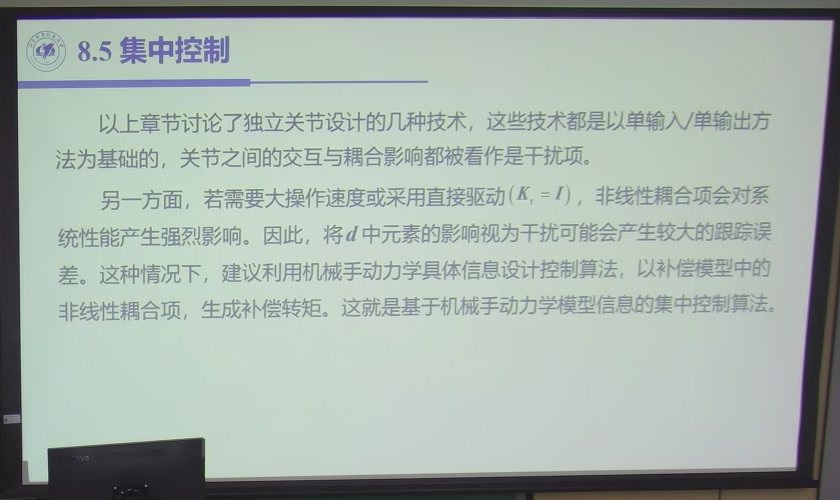
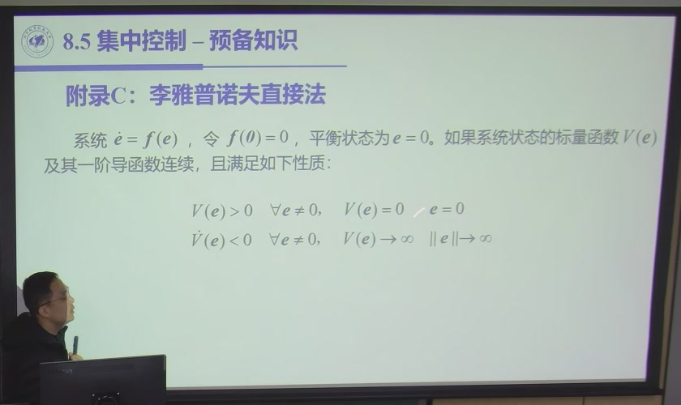
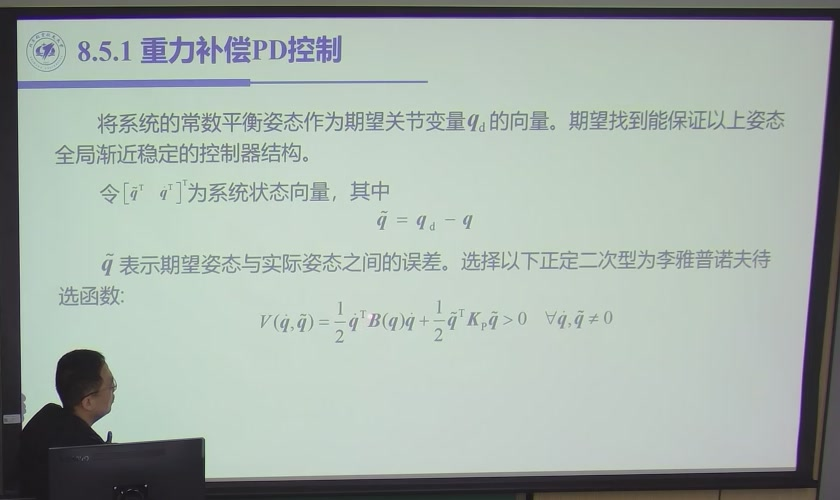
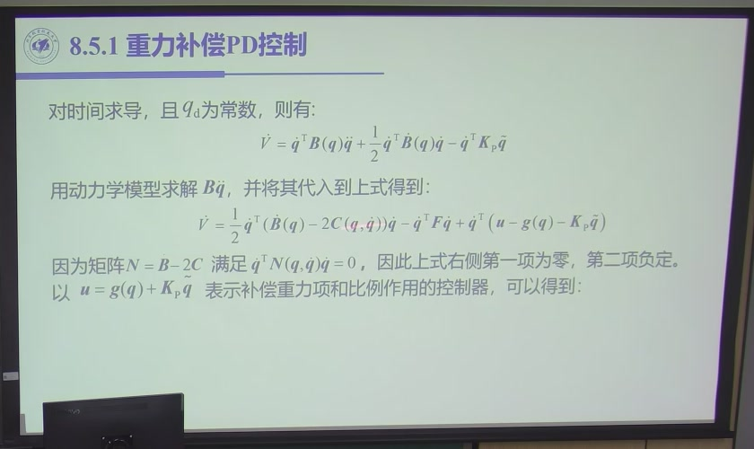
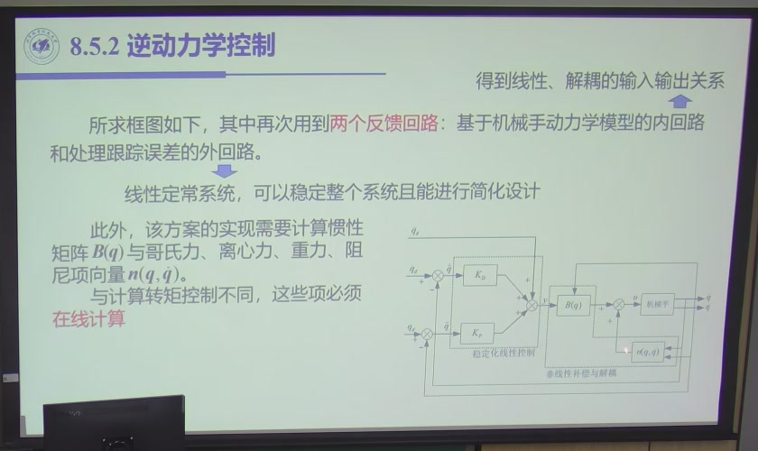
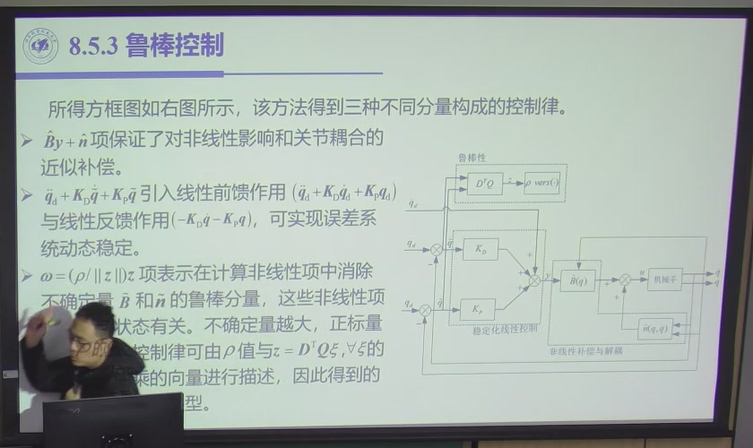
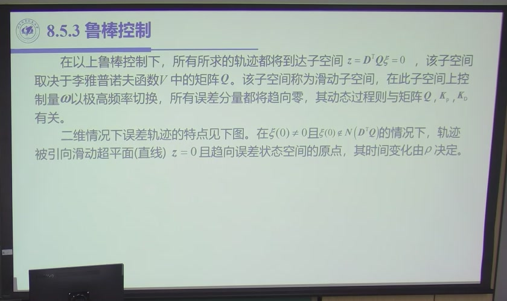
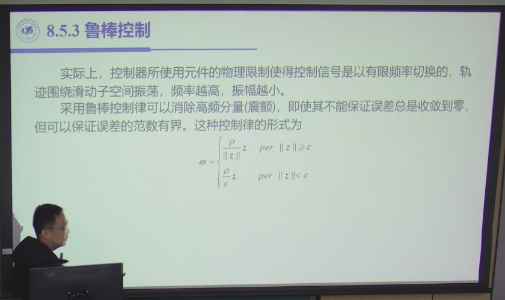
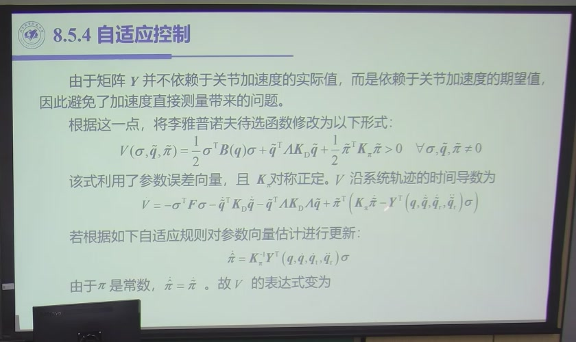
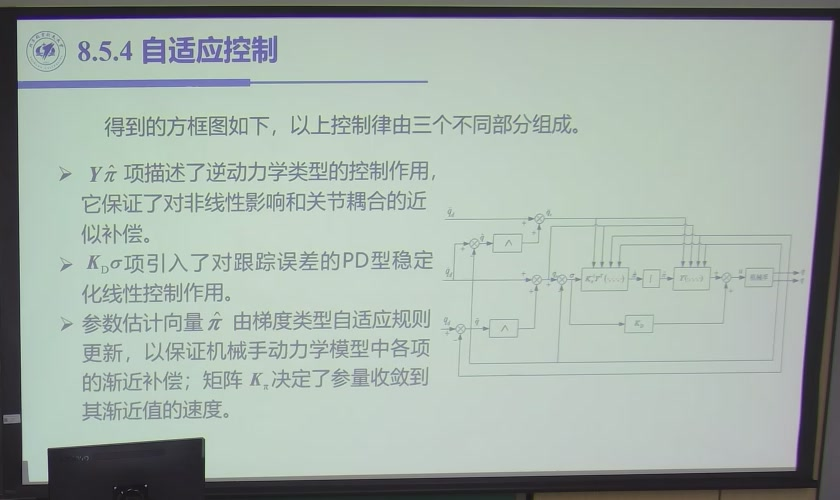

# 7.3 集中控制

> 录播 00:56:32–01:58:20（课件 §8.5，**全部是课堂内容**）。这一节是本章最长、理论密度最高的
> 一段：先说明为什么分散控制不够用，再补一段**李雅普诺夫稳定性**的最小预备知识，然后依次给出
> 四种集中控制律——**重力补偿 PD、逆动力学、鲁棒、自适应**。它们的关系是一条线：
> 从「只补重力」到「全补模型」，再到「模型不准时怎么办」。

## 7.3.1 为什么需要集中控制

7.2 的所有方案都建立在同一个前提上：**耦合与重力可以塞进 $d$，靠反馈压住**。这个前提在两种
工况下失效（课件 §8.5 开头，图 7.3-1）：

1. **大操作速度 / 大加速度**：$C(\boldsymbol q,\dot{\boldsymbol q})\dot{\boldsymbol q}$ 与
   $\Delta B\ddot{\boldsymbol q}$ 随速度平方增长，$d$ 不再是「小扰动」；
2. **直接驱动**（$K_r=I$）：没有大减速比把耦合按 $1/k_r^2$、$1/k_r$ 缩小，耦合原封不动地
   落在控制器面前。

**集中控制的定义**：不再把关节间耦合当干扰，而是**用整机动力学模型算出耦合项，主动补偿掉**。
控制器因此是「多输入多输出」的一个整体，而不是 $n$ 个独立回路。

::: note 「集中」是信息依赖，不是算法口味
想补偿 $C(\boldsymbol q,\dot{\boldsymbol q})\dot{\boldsymbol q}$，就必须知道**全部关节**的
$\boldsymbol q,\dot{\boldsymbol q}$；想补偿 $\Delta B\ddot{\boldsymbol q}$，就必须知道全部关节的
加速度。这个计算天然是「集中」的——**不是设计者偏好集中，是耦合项本身把信息绑在一起**。
:::

集中控制的四种方法，按「用模型用到什么程度」排列：

| 方法 | 补偿什么 | 模型要求 | 适用 |
|:--|:--|:--|:--|
| 重力补偿 PD | $\boldsymbol g(\boldsymbol q)$ | 只需重力项 | 点对点、低速 |
| 逆动力学控制 | $B\ddot{\boldsymbol q}+C\dot{\boldsymbol q}+\boldsymbol g$ 全部 | 整机模型精确 | 高速高精度跟踪 |
| 鲁棒控制 | 全部 + **不确定项上界** | 模型 + 误差界 | 有界扰动、参数慢变 |
| 自适应控制 | 全部 + **参数在线估计** | 模型结构已知、参数未知 | 负载/参数变化 |

## 7.3.2 李雅普诺夫稳定性：够用的版本

把机械臂停在目标位置附近，轻轻偏离一点，再放开。我们希望它能回到目标，也希望这种判断有证明。本节用一个类似能量的函数 $V$，检查闭环运动是否会持续消耗偏差对应的能量。这里的函数不一定就是实际物理能量。录播 00:58:00 至 01:10:40 介绍了这个工具。

考虑自治系统 $\dot{\boldsymbol e}=f(\boldsymbol e)$，平衡点为零。这里 $\boldsymbol e$ 代表完整误差状态；二阶机器人系统通常要同时包含位置误差和速度。假设 $f$ 局部 Lipschitz，存在连续可微函数 $V$，在原点邻域内满足

$$V(0)=0,\qquad V(\boldsymbol e)>0\ (\boldsymbol e\neq0),\qquad
\dot V(\boldsymbol e)<0\ (\boldsymbol e\neq0),\tag{7.3-1}$$

则原点局部渐近稳定。要推出全局渐近稳定，一组常用的充分条件是：系统与上述不等式在整个 $\mathbb R^n$ 上成立，并且 $V$ 径向无界，即 $\|\boldsymbol e\|\to\infty$ 时 $V\to\infty$。这个条件把轨迹限制在有界子水平集中。只写“能量一直下降”，还不足以保证状态不会逃向无穷远。

最常用的构造是**二次型**（图 7.3-2）：

$$V(\boldsymbol e)=\boldsymbol e^{\mathrm T}Q\boldsymbol e,\qquad Q=Q^{\mathrm T}\succ0
\quad\Longrightarrow\quad
\dot V=2\boldsymbol e^{\mathrm T}Qf(\boldsymbol e).\tag{7.3-2}$$

很多机器人系统只能得到 $\dot V\le0$，例如 $\dot V=-\dot{\boldsymbol q}^{\mathrm T}K_D\dot{\boldsymbol q}$。机械臂停在错误位置的一瞬间，速度也是零，因而 $\dot V=0$；但位置反馈随后会让它动起来。证明时必须区分“此刻不动”和“以后一直不动”。

拉萨尔不变性原理处理这个区别。在自治系统的紧致正向不变集上，若 $\dot V\le0$，轨迹趋向 $\dot V=0$ 集合内的最大不变集。对下面的重力补偿 PD，可按以下步骤检查：

1. 用 $V$ 的子水平集证明轨迹有界，并且不会离开这个集合。
2. 在 $\dot V=0$ 的候选状态中，要求 $\dot q\equiv0$，再代回闭环方程，求出能够一直保持静止的状态。
3. 若只剩目标平衡点，才得到位置和速度误差都趋于零。不能直接由 $\dot V\le0$ 跳到速度收敛。

::: intuition 回用第六章的结构性质
下面用位置误差 $\tilde q=q_d-q$ 构造 $V=\frac12\dot{\boldsymbol q}^{\mathrm T}B\dot{\boldsymbol q}+\frac12\tilde{\boldsymbol q}^{\mathrm T}K_P\tilde{\boldsymbol q}$。求导后会出现 $\dot B-2C$；第六章证明的反对称性让相应二次型消失。先试着找到这一项，再看下一段的完整计算。
:::

## 7.3.3 重力补偿 PD：只补最大的那一项

最简单的集中控制只补重力。它针对的是**点对点控制**：期望关节角 $\boldsymbol q_d$ 是**常数**，
让 $\boldsymbol q$ 收敛到 $\boldsymbol q_d$（图 7.3-3）。

取误差 $\tilde{\boldsymbol q}=\boldsymbol q_d-\boldsymbol q$，构造

$$V(\dot{\boldsymbol q},\tilde{\boldsymbol q})
=\frac12\dot{\boldsymbol q}^{\mathrm T}B(\boldsymbol q)\dot{\boldsymbol q}
+\frac12\tilde{\boldsymbol q}^{\mathrm T}K_P\tilde{\boldsymbol q}>0
\quad\bigl((\dot{\boldsymbol q},\tilde{\boldsymbol q})\neq(0,0)\bigr).\tag{7.3-3}$$

对时间求导，注意 $\boldsymbol q_d$ 是常数（$\dot{\boldsymbol q}_d=0$，$\dot{\tilde{\boldsymbol q}}=-\dot{\boldsymbol q}$）：

$$\dot V=\dot{\boldsymbol q}^{\mathrm T}B(\boldsymbol q)\ddot{\boldsymbol q}
+\frac12\dot{\boldsymbol q}^{\mathrm T}\dot B(\boldsymbol q)\dot{\boldsymbol q}
-\dot{\boldsymbol q}^{\mathrm T}K_P\tilde{\boldsymbol q}.\tag{7.3-4}$$

用动力学方程解出 $B\ddot{\boldsymbol q}$ 代进去：

$$\dot V=\frac12\dot{\boldsymbol q}^{\mathrm T}\bigl(\dot B(\boldsymbol q)-2C(\boldsymbol q,\dot{\boldsymbol q})\bigr)\dot{\boldsymbol q}
-\dot{\boldsymbol q}^{\mathrm T}F\dot{\boldsymbol q}
+\dot{\boldsymbol q}^{\mathrm T}\bigl(\boldsymbol u-\boldsymbol g(\boldsymbol q)-K_P\tilde{\boldsymbol q}\bigr).\tag{7.3-5}$$

**第一项为零**——这正是第六章性质一（$\dot B-2C$ 反对称）的用处。取控制律

$$\boxed{\ \boldsymbol u=\boldsymbol g(\boldsymbol q)+K_P\tilde{\boldsymbol q}-K_D\dot{\boldsymbol q}\ }\tag{7.3-6}$$

这里 $K_P,K_D$ 对称正定，$F$ 对称半正定。由于目标固定，$\dot{\tilde q}=-\dot q$，所以阻尼项也可写成 $+K_D\dot{\tilde q}$。若用实际速度 $\dot q$，必须取负号。可以用一个瞬间检查：已到目标但仍向正方向运动时，阻尼应产生反向力矩。

代回得

$$\dot V=-\dot{\boldsymbol q}^{\mathrm T}(F+K_D)\dot{\boldsymbol q}\le0.\tag{7.3-7}$$

假设采用无关节限位的展开坐标 $q\in\mathbb R^n$、模型光滑、重力补偿精确且驱动力矩不限幅，并有 $B(q)\succeq b_*I$（常数 $b_*>0$）。则 $V$ 径向无界，其子水平集紧致且正向不变。$\dot V=0$ 要求 $\dot q=0$；若要一直保持在该集合内，还必须有 $\ddot q=0$。代回闭环方程，得 $K_P\tilde q=0$，故最大不变集只有目标平衡点。于是该理想模型在这些坐标与假设下全局渐近稳定。

**三个必须记住的限制**：

1. **只对点对点有效**。推导里用了 $\dot{\boldsymbol q}_d=0$；跟踪时 $\boldsymbol q_d(t)$ 不是常数，
   $\dot{\tilde{\boldsymbol q}}\neq-\dot{\boldsymbol q}$，(7.3-4) 多出 $\tilde{\boldsymbol q}^{\mathrm T}K_P\dot{\boldsymbol q}_d$
   一项，不能沿用这个证明。下一节给出用于跟踪的逆动力学控制。
2. **$\boldsymbol g$ 必须用实测 $\boldsymbol q$**。用 $\boldsymbol q_d$ 算等于开环补偿，位形偏差时补错。
3. **它只补了重力**。$B\ddot{\boldsymbol q}$ 与 $C\dot{\boldsymbol q}$ 没补，速度一高就露馅。

## 7.3.4 逆动力学控制：把非线性整块抵消

跟踪轨迹时，$\boldsymbol q_d(t)$ 不是常数。课件把机器人方程写成

$$B(\boldsymbol q)\ddot{\boldsymbol q}+\boldsymbol n(\boldsymbol q,\dot{\boldsymbol q})=\boldsymbol u,
\qquad
\boldsymbol n(\boldsymbol q,\dot{\boldsymbol q})
=C(\boldsymbol q,\dot{\boldsymbol q})\dot{\boldsymbol q}
+F\dot{\boldsymbol q}+\boldsymbol g(\boldsymbol q).\tag{7.3-8}$$

**思路分两步**（课件 §8.5.2，图 7.3-4）：

1. **非线性补偿**：令 $\boldsymbol u=B(\boldsymbol q)\boldsymbol y+\boldsymbol n(\boldsymbol q,\dot{\boldsymbol q})$，
   代回得 $\ddot{\boldsymbol q}=\boldsymbol y$——原来的非线性对象变成了 $n$ 个双积分器；
2. **线性控制**：对双积分器取
   $\boldsymbol y=\ddot{\boldsymbol q}_d+K_D\dot{\tilde{\boldsymbol q}}+K_P\tilde{\boldsymbol q}$。

合起来就是**逆动力学控制律**（也叫计算力矩控制）：

$$\boxed{\ \boldsymbol u=B(\boldsymbol q)\bigl(\ddot{\boldsymbol q}_d
+K_D\dot{\tilde{\boldsymbol q}}+K_P\tilde{\boldsymbol q}\bigr)
+\boldsymbol n(\boldsymbol q,\dot{\boldsymbol q})\ }\tag{7.3-9}$$

代入 (7.3-8)，$B$ 可逆（第六章性质一：对称正定），得

$$\ddot{\boldsymbol q}=\ddot{\boldsymbol q}_d+K_D\dot{\tilde{\boldsymbol q}}+K_P\tilde{\boldsymbol q}
\quad\Longrightarrow\quad
\boxed{\ \ddot{\tilde{\boldsymbol q}}+K_D\dot{\tilde{\boldsymbol q}}+K_P\tilde{\boldsymbol q}=0\ }\tag{7.3-10}$$

**一个 $n$ 自由度、强耦合、非线性的机械手，误差方程变成了 $n$ 个互不耦合的线性二阶系统**。
只要 $K_P,K_D$ 正定，$\tilde{\boldsymbol q}\to0$ 且指数收敛。这是本章最漂亮的一行。

**它与 7.2.7 计算转矩前馈的差别，只在「用谁的状态」**：

| | 计算转矩前馈 | 逆动力学控制 |
|:--|:--|:--|
| 模型自变量 | $\boldsymbol q_d,\dot{\boldsymbol q}_d,\ddot{\boldsymbol q}_d$ | $\boldsymbol q,\dot{\boldsymbol q}$ |
| 非线性对消 | 近似（跟踪误差小时才准） | 精确（大范围） |
| 计算 | 可离线预算 | 每周期在线算 $B,\boldsymbol n$ |
| 本质 | 前馈 | 反馈线性化 |

**代价与失效点**（课件 86:30 专门列了一页）：

1. **模型必须准**。$\hat B\neq B$、$\hat{\boldsymbol n}\neq\boldsymbol n$ 时，非线性只抵消一部分，
   误差方程右边多出不确定性项（见 7.3.5）。
2. **必须实时算整机模型**。$B$ 与 $\boldsymbol n$ 每周期都要算，$O(n^2)$ 甚至 $O(n^3)$；
   用牛顿–欧拉递推可降到 $O(n)$（第六章 6.4），但仍是重计算。
3. **采样要快**。「连续时间精确对消」在离散实现里变成「用上一拍的状态算这一拍的力矩」，
   采样太慢等效为时滞，对消失效。
4. **忽略了执行器动态**。模型里没有电机电感、电流环、减速器柔度；高速时这些「未建模动态」
   会跳出来。

::: note 为什么说它是「反馈线性化」
$\boldsymbol u$ 的表达式里显式含有实测的 $\boldsymbol q,\dot{\boldsymbol q}$，所以消掉非线性靠的是
**反馈**，不是在工作点附近做 Taylor 展开。前者大范围有效，后者只在工作点附近有效——这是它与
「小偏差线性化」的本质区别。
:::

## 7.3.5 鲁棒控制：模型不准，但知道不准多少

逆动力学控制假设模型精确。现实是 $\hat B=\hat B(\boldsymbol q)$、$\hat{\boldsymbol n}$ 只是估计，
真实对象与标称模型之间有一个**不确定项**：

$$B(\boldsymbol q)\ddot{\boldsymbol q}+\boldsymbol n(\boldsymbol q,\dot{\boldsymbol q})
=\hat B(\boldsymbol q)\ddot{\boldsymbol q}+\hat{\boldsymbol n}(\boldsymbol q,\dot{\boldsymbol q})
+\boldsymbol\eta(\boldsymbol q,\dot{\boldsymbol q},\ddot{\boldsymbol q}),\tag{7.3-11}$$

$\boldsymbol\eta$ 包含参数误差、未建模动态、外部扰动。**鲁棒控制的思路**：不估计 $\boldsymbol\eta$
的具体值，只假设它**有界**，然后设计一个控制项，使得无论 $\boldsymbol\eta$ 在界内怎么变，
误差都收敛到一个有界集。

控制律取

$$\boxed{\ \boldsymbol u=\hat B(\boldsymbol q)\boldsymbol y+\hat{\boldsymbol n}(\boldsymbol q,\dot{\boldsymbol q})
+\boldsymbol\omega\ }\tag{7.3-12}$$

$$\boldsymbol y=\ddot{\boldsymbol q}_d+K_D\dot{\tilde{\boldsymbol q}}+K_P\tilde{\boldsymbol q},
\qquad
\boldsymbol\omega=\frac{\rho}{\|\boldsymbol z\|}\boldsymbol z,\qquad
\boldsymbol z=D^{\mathrm T}Q\boldsymbol\xi,\tag{7.3-13}$$

其中 $\boldsymbol\xi=[\tilde{\boldsymbol q}^{\mathrm T},\dot{\tilde{\boldsymbol q}}^{\mathrm T}]^{\mathrm T}$
是误差状态，$Q$ 是李雅普诺夫函数里的正定矩阵，$D$ 选出「需要鲁棒压制」的状态组合，
$\rho$ 是**不确定项的上界**（$\rho\ge\|\boldsymbol\eta\|$）。

**几何图像**：$\boldsymbol z=D^{\mathrm T}Q\boldsymbol\xi=0$ 是一个**滑动子空间**（图 7.3-5）。
控制项 $\boldsymbol\omega$ 在子空间外把状态往子空间里推，进入子空间后沿它滑向原点。$\rho$ 越大，
推得越狠；不确定越大，$\rho$ 必须越大。

**问题是抖振**。$\boldsymbol\omega=\rho\boldsymbol z/\|\boldsymbol z\|$ 是一个**符号函数**：
$\boldsymbol z$ 一过零，控制量立刻反向，实际执行器跟不上，就在滑模面附近高频抖振（图 7.3-6）。

**工程修正**：在滑模面附近设一个**边界层** $\varepsilon$：

$$\boldsymbol\omega=
\begin{cases}
\dfrac{\rho}{\|\boldsymbol z\|}\boldsymbol z, & \|\boldsymbol z\|\ge\varepsilon,\\[6pt]
\dfrac{\rho}{\varepsilon}\boldsymbol z, & \|\boldsymbol z\|<\varepsilon.
\end{cases}\tag{7.3-14}$$

代价是：**误差不再收敛到零，只收敛到边界层内**；$\varepsilon$ 越小误差越小，但抖振越明显。
这是「渐近稳定」与「无抖振」之间的硬取舍。

::: think 鲁棒控制的一句话
**「一年四季穿同一件衣服」**——老师 01:29:28 的原话。控制器只有一套，设计时把温度（参数）变化的
最坏情况都考虑进去；不管怎么变，系统都能工作，但性能不是最优。
:::

## 7.3.6 自适应控制：参数在线改，控制器跟着变

鲁棒控制用「一套固定增益」对抗所有参数变化；自适应控制则**在线估计参数，让控制器跟着变**。
它的前提是第六章性质二：**动力学参数具有线性性**——

$$\boldsymbol\tau=Y(\boldsymbol q,\dot{\boldsymbol q},\ddot{\boldsymbol q})\boldsymbol\pi,\tag{7.3-15}$$

$Y$ 是已知的回归矩阵，$\boldsymbol\pi$ 是未知但**常数**的动力学参数向量（质量、惯量、质心位置、
摩擦系数……）。

**控制律的构造**（课件 §8.5.4）：

1. 定义**修正速度**与**修正误差**：
   $$\dot{\boldsymbol q}_r=\dot{\boldsymbol q}_d+\Lambda\tilde{\boldsymbol q},\qquad
   \boldsymbol\sigma=\dot{\boldsymbol q}_r-\dot{\boldsymbol q}
   =\dot{\tilde{\boldsymbol q}}+\Lambda\tilde{\boldsymbol q},\qquad \Lambda\succ0.\tag{7.3-16}$$
2. 用 $\dot{\boldsymbol q}_r,\ddot{\boldsymbol q}_r$ 代替真实速度/加速度，构造回归矩阵：
   $$\boldsymbol u=Y(\boldsymbol q,\dot{\boldsymbol q},\dot{\boldsymbol q}_r,\ddot{\boldsymbol q}_r)
   \hat{\boldsymbol\pi}+K_D\boldsymbol\sigma.\tag{7.3-17}$$
3. 参数**在线更新**：
   $$\boxed{\ \dot{\hat{\boldsymbol\pi}}
   =K_\pi^{-1}Y^{\mathrm T}(\boldsymbol q,\dot{\boldsymbol q},\dot{\boldsymbol q}_r,\ddot{\boldsymbol q}_r)
   \boldsymbol\sigma\ }\tag{7.3-18}$$

取

$$V=\frac12\boldsymbol\sigma^{\mathrm T}B(\boldsymbol q)\boldsymbol\sigma
+\tilde{\boldsymbol q}^{\mathrm T}\Lambda K_D\tilde{\boldsymbol q}
+\frac12\tilde{\boldsymbol\pi}^{\mathrm T}K_\pi\tilde{\boldsymbol\pi},\qquad
\tilde{\boldsymbol\pi}=\hat{\boldsymbol\pi}-\boldsymbol\pi,\tag{7.3-19}$$

求导并用 $\dot B-2C$ 的反对称性，得

$$\dot V=-\boldsymbol\sigma^{\mathrm T}F\boldsymbol\sigma
-\tilde{\boldsymbol q}^{\mathrm T}K_D\tilde{\boldsymbol q}
-\tilde{\boldsymbol q}^{\mathrm T}\Lambda K_D\Lambda\tilde{\boldsymbol q}
+\tilde{\boldsymbol\pi}^{\mathrm T}\bigl(K_\pi\dot{\hat{\boldsymbol\pi}}-Y^{\mathrm T}\boldsymbol\sigma\bigr).\tag{7.3-20}$$

**最后一项被更新律 (7.3-18) 消掉**，于是 $\dot V\le0$。由拉萨尔原理可证：
$\boldsymbol\sigma\to0$、$\tilde{\boldsymbol q}\to0$、$\dot{\tilde{\boldsymbol q}}\to0$——
**跟踪误差全局收敛**。

**必须说清的三件事**：

1. **参数估计不一定收敛到真值**。更新律只保证 $\boldsymbol\sigma\to0$，不保证
   $\hat{\boldsymbol\pi}\to\boldsymbol\pi$；$\hat{\boldsymbol\pi}$ 只要求**有界**。
   老师原话（01:47:23–01:57:46）：「参数它并没有收敛到真值，但它不影响跟踪误差趋向零。」
2. **不需要测加速度**。回归矩阵 $Y$ 用的是 $\dot{\boldsymbol q}_r,\ddot{\boldsymbol q}_r$
   （由期望轨迹与误差算出），不是实测 $\ddot{\boldsymbol q}$——这是这套设计最实用的一点。
3. **计算量比逆动力学更大**：每周期要算 $Y$、更新 $\hat{\boldsymbol\pi}$、再算控制律。

::: think 鲁棒 vs 自适应
**鲁棒 = 一年四季穿同一件衣服**：一套固定控制器，考虑最坏情况，保证能活，但不舒服。
**自适应 = 换季换衣服**：控制器随参数在线调整，跟踪更准，但需要持续激励、计算更重，
且参数估计可能漂移。工程上先问：**参数变化是「有界未知」还是「慢变可估」？** 前者鲁棒，
后者自适应。
:::

## 7.3.7 实现要点与小结

**四条实现约束**（对逆动力学/鲁棒/自适应都成立）：

1. **模型要在线算**。$B,\boldsymbol n,Y$ 每周期都要算；用牛顿–欧拉递推降到 $O(n)$。
2. **必须有限幅**。控制律无上界，误差大时算出的 $\boldsymbol u$ 会超过电机能力；限幅后
   「精确对消」失效，鲁棒/自适应的假设也要相应放宽。
3. **采样要够快**。模型对消的精度随采样周期下降；一般要求控制周期比最快闭环极点快 10 倍以上。
4. **参数要先辨识**。$\hat{\boldsymbol\pi}$ 的初值越准，自适应/鲁棒的瞬态越小。

- **一句话主线**：**重力补偿 PD（只补 $\boldsymbol g$）→ 逆动力学（全补，模型精确）→
  鲁棒（全补 + 误差界）→ 自适应（全补 + 参数在线估）**，四步是「模型越用越多、假设越来越弱」。
- **一个工具**：李雅普诺夫函数 + 拉萨尔原理；核心技巧是用 $\dot B-2C$ 的反对称性消掉交叉项。
- **一个取舍**：模型用得越多，性能越好，但对模型/算力/采样的要求越高。

::: think 常见错误清单
1. **重力补偿 PD 拿来做轨迹跟踪**：它的稳定性证明用了 $\dot{\boldsymbol q}_d=0$，跟踪时证不出来。
2. **逆动力学里把 $\boldsymbol q$ 写成 $\boldsymbol q_d$**：一写就退回前馈，不再是反馈线性化。
3. **鲁棒项无限加大 $\rho$**：$\rho$ 超过实际不确定界只会加剧抖振，不会更稳。
4. **忘了边界层的代价**：加边界层后误差只到「有界」，不是零；答辩/报告里不能写成渐近收敛。
5. **以为自适应能辨识出真参数**：更新律只保证跟踪误差收敛，参数可能漂移；需要持续激励
   才可能辨识。
6. **忽略限幅**：限幅是逆动力学最常见的失效原因，也是鲁棒/自适应证明里最容易被忽略的假设。
:::

::: think 默写点 · 合上书再写
1. 写出重力补偿 PD 的 $V$ 与 $\dot V$，说明哪一步用了 $\dot B-2C$ 的反对称性。
2. 写出逆动力学控制律与误差方程，说明它与计算转矩前馈的区别。
3. 写出鲁棒控制律的三部分，解释滑动子空间与边界层的作用。
4. 写出自适应控制的 $\boldsymbol\sigma$、控制律与参数更新律，说明为什么不需要测加速度。
5. 说明自适应控制能保证什么、不能保证什么。
:::
