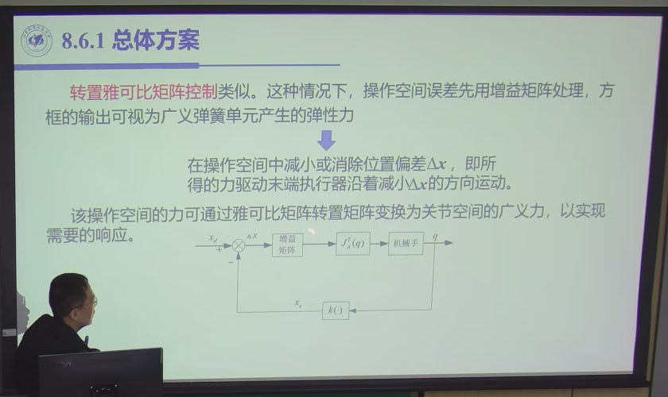
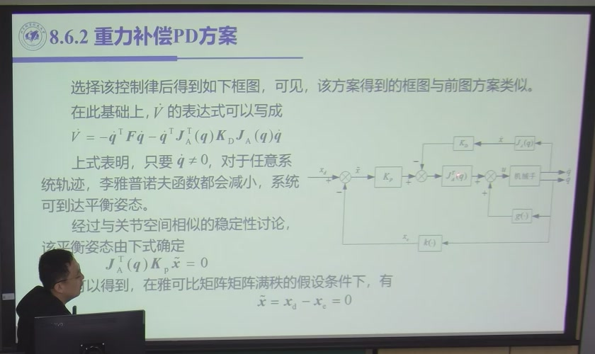
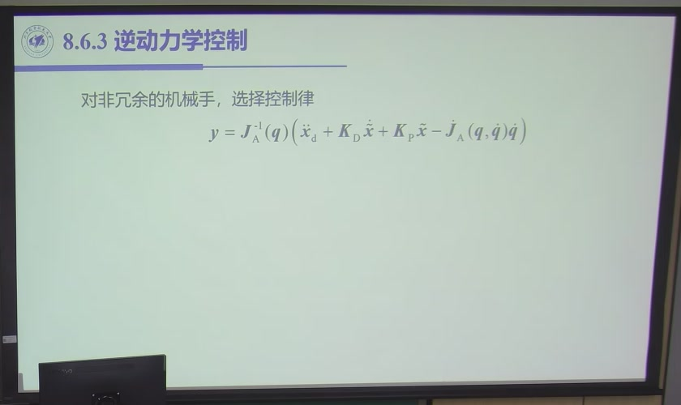

# 7.4 操作空间控制

> 录播 01:58:34–02:10:12（课件 §8.6，**全部是课堂内容**）。前三节都在**关节空间**里设计控制器：
> 先由逆运动学把任务翻译成 $\boldsymbol q_d$，再控制 $\boldsymbol q$ 跟踪它。这一节换一种做法：
> **不翻译，直接在末端位姿 $\boldsymbol x$ 的空间里闭环**。好处是任务误差直接可控，代价是要算
> 雅可比、要处理奇异与冗余。

<a id="sec-7.4.1"></a>

## 7.4.1 为什么还要操作空间

关节空间方案有一个「先天间接」：任务要求的是末端位姿，控制器跟踪的却是关节角。两者之间隔着
逆运动学，逆解误差、奇异、多解都发生在这一层，而控制器**看不见**。

直接在操作空间闭环，逻辑变成（图 7.4-1）：

```text
x_d（任务） ──→ 操作空间控制器 ──→ F（末端等效力） ──J_A^T──→ τ ──→ 机械手
     ↑                                                              │
     └──────────────── x（由 q 正运动学算出） ←──────────────────────┘
```

**优点**：任务误差（末端位置/姿态）直接进入反馈，不被逆运动学「藏起来」；冗余机械手可以在
零空间里做避障、避奇异、优化，而不影响末端任务。

**代价**：$\boldsymbol x$ 通常不能直接测，只能由 $\boldsymbol q$ 正算；要算 $J_A$ 及其导数与逆；
奇异位形附近 $J_A$ 病态。这些在 7.4.6 展开。

<a id="sec-7.4.2"></a>

## 7.4.2 操作空间动力学模型

取末端位姿

$$\boldsymbol x=\begin{bmatrix}\boldsymbol p\\ \boldsymbol\phi\end{bmatrix}
\quad(\text{位置}+\text{欧拉角}),\qquad
\dot{\boldsymbol x}=J_A(\boldsymbol q)\dot{\boldsymbol q},\tag{7.4-1}$$

$J_A$ 是**分析雅可比**，不是第三章的几何雅可比 $J$：姿态部分 $\dot{\boldsymbol\phi}$ 是欧拉角
导数，不是角速度（[3.6 分析雅可比](../ch03/sec3-6.md)）。对时间再求导：

$$\ddot{\boldsymbol x}=J_A\ddot{\boldsymbol q}+\dot J_A\dot{\boldsymbol q}.\tag{7.4-2}$$

把它与关节空间方程联立、消去 $\ddot{\boldsymbol q}$，得**操作空间动力学模型**（推导见
[6.7](../ch06/sec6-7.md)）：

$$\boxed{\ B_x(\boldsymbol q)\ddot{\boldsymbol x}
+C_x(\boldsymbol q,\dot{\boldsymbol q})\dot{\boldsymbol x}
+\boldsymbol g_x(\boldsymbol q)=\boldsymbol\tau_x-\boldsymbol h_e\ }\tag{7.4-3}$$

$B_x,C_x,\boldsymbol g_x$ 由 $B,C,\boldsymbol g$ 与 $J_A$ 组合而成，$\boldsymbol\tau_x$ 是折算到
操作空间的等效力，$\boldsymbol h_e$ 是末端与环境的作用力（自由运动时为零，力控制时是要控的量）。

**三处要留意**：

1. **(7.4-3) 与关节空间模型「形式上完全一样」**——这不是巧合。正因如此，7.3 的所有方法都能照搬：
   把 $B,C,\boldsymbol g$ 换成 $B_x,C_x,\boldsymbol g_x$，把 $\boldsymbol q$ 换成 $\boldsymbol x$。
2. **$B_x$ 依赖 $J_A$ 的可逆性**。$J_A$ 奇异时 $B_x$ 无定义/病态——这是操作空间方法在奇异位形
   附近失效的根源（[3.3 奇点](../ch03/sec3-3.md)）。
3. **冗余时 $J_A$ 不是方阵**，$J_A^{-1}$ 不存在，要用伪逆，模型写成「动力学 + 零空间投影」形式
   （[3.4 冗余分析](../ch03/sec3-4.md)）。

<a id="sec-7.4.3"></a>

## 7.4.3 两种实现：逆雅可比与转置雅可比

课件 §8.6.1 把操作空间方案分成两条路，区别在**误差怎样变成关节力矩**。

### 7.4.3.1 逆雅可比方案：先翻译，再关节控制

先用逆运动学把 $\boldsymbol x_d$ 翻成 $\boldsymbol q_d$，再用前三节的关节空间控制器。数学上等价于

$$\boldsymbol\tau=J_A^{-\mathrm T}\bigl[K_P(\boldsymbol x_d-\boldsymbol x)
+K_D(\dot{\boldsymbol x}_d-\dot{\boldsymbol x})\bigr],\tag{7.4-4}$$

但实现上要算 $J_A^{-1}$，奇异与冗余都躲不开。**它没有真正绕开逆运动学**，只是把逆解放进了
反馈回路。

### 7.4.3.2 转置雅可比方案：把误差变成「弹簧力」

不翻译，直接把操作空间误差乘增益，得到末端等效力，再用 $J_A^{\mathrm T}$ 折算成关节力矩
（图 7.4-2）：

$$\boxed{\ \boldsymbol F=K_P(\boldsymbol x_d-\boldsymbol x),\qquad
\boldsymbol\tau=J_A^{\mathrm T}(\boldsymbol q)\boldsymbol F\ }\tag{7.4-5}$$



**物理图像**：$K_P$ 是一个**广义弹簧**，把末端往 $\boldsymbol x_d$ 拉；$J_A^{\mathrm T}$ 把末端的力
「分配」到各关节（[3.8 静力学](../ch03/sec3-8.md) 的 $\boldsymbol\tau=J^{\mathrm T}\boldsymbol h$
同源）。**不需要求 $J_A^{-1}$**，奇异位形附近也能算——这是它相对逆雅可比方案的最大优势。

**代价**：弹簧力只保证「往目标拉」，不保证「沿最短路径」；刚度矩阵 $K_P$ 的设计要考虑各向异性
（位置与姿态的量纲不同），否则会出现「位置到了、姿态还差很多」的耦合。

<a id="sec-7.4.4"></a>

## 7.4.4 操作空间重力补偿 PD

与关节空间的重力补偿 PD 完全平行。取末端期望位姿 $\boldsymbol x_d$ 为常数，误差
$\tilde{\boldsymbol x}=\boldsymbol x_d-\boldsymbol x$，构造

$$V=\frac12\dot{\boldsymbol q}^{\mathrm T}B(\boldsymbol q)\dot{\boldsymbol q}
+\frac12\tilde{\boldsymbol x}^{\mathrm T}K_P\tilde{\boldsymbol x},\tag{7.4-6}$$

控制律取

$$\boxed{\ \boldsymbol u=\boldsymbol g(\boldsymbol q)
+J_A^{\mathrm T}(\boldsymbol q)K_P\tilde{\boldsymbol x}
+J_A^{\mathrm T}(\boldsymbol q)K_DJ_A(\boldsymbol q)\dot{\boldsymbol q}\ }\tag{7.4-7}$$



求导并用 $\dot B-2C$ 的反对称性，得

$$\dot V=-\dot{\boldsymbol q}^{\mathrm T}F\dot{\boldsymbol q}
-\dot{\boldsymbol q}^{\mathrm T}J_A^{\mathrm T}K_DJ_A\dot{\boldsymbol q}\le0.\tag{7.4-8}$$

由拉萨尔原理，$\dot{\boldsymbol q}\to0$，代回闭环方程得

$$J_A^{\mathrm T}(\boldsymbol q)K_P\tilde{\boldsymbol x}=0.\tag{7.4-9}$$

**$J_A$ 满秩时**，$J_A^{\mathrm T}$ 列满秩，只有 $\tilde{\boldsymbol x}=0$ 满足——末端收敛到目标。
**$J_A$ 奇异或冗余时**，(7.4-9) 有非零解，末端可能停在「弹簧力被雅可比零空间吃掉」的位置，
这是操作空间 PD 在奇异/冗余下失效的数学根源。

<a id="sec-7.4.5"></a>

## 7.4.5 操作空间逆动力学

跟踪操作空间轨迹时，把 7.3.4 的逆动力学「搬」到 $\boldsymbol x$ 空间。由 (7.4-2)，

$$\ddot{\boldsymbol q}=J_A^{-1}\bigl(\ddot{\boldsymbol x}-\dot J_A\dot{\boldsymbol q}\bigr).\tag{7.4-10}$$

取辅助控制

$$\boldsymbol y=J_A^{-1}(\boldsymbol q)\bigl(\ddot{\boldsymbol x}_d
+K_D\dot{\tilde{\boldsymbol x}}+K_P\tilde{\boldsymbol x}
-\dot J_A(\boldsymbol q,\dot{\boldsymbol q})\dot{\boldsymbol q}\bigr),\tag{7.4-11}$$

再令 $\boldsymbol u=B(\boldsymbol q)\boldsymbol y+\boldsymbol n(\boldsymbol q,\dot{\boldsymbol q})$，
代回关节空间方程得

$$\ddot{\tilde{\boldsymbol x}}+K_D\dot{\tilde{\boldsymbol x}}+K_P\tilde{\boldsymbol x}=0.\tag{7.4-12}$$



**注意它与 7.4.4 的分工**：7.4.4 只补重力，适合点对点；7.4.5 全补模型，适合高速跟踪。
两者都需要 $J_A$ 及其导数，区别只在「补多少」。

**这个方案有三个硬约束**：

1. **$J_A$ 必须可逆**：非冗余（$n=6$）且非奇异；冗余时要用伪逆 + 零空间项。
2. **要算 $\dot J_A\dot{\boldsymbol q}$**：这一项是操作空间的「离心/科氏」项，高速时不能丢。
3. **$B_x$ 不一定显式算**：可以像 (7.4-11) 这样先算 $\boldsymbol y$ 再乘 $B$，避免构造 $B_x$；
   但 $J_A^{-1}$ 的数值条件仍然决定成败。

<a id="sec-7.4.6"></a>

## 7.4.6 奇异、冗余与代价

课件 127:50 专门用一页列了操作空间控制的「麻烦」：

| # | 问题 | 后果 | 对策 |
|:--|:--|:--|:--|
| 1 | $\boldsymbol x$ 不能直接测 | 反馈量由 $\boldsymbol q$ 正算，误差被运动学放大 | 视觉/激光跟踪（第十章） |
| 2 | $J_A$ 奇异 | $J_A^{-1}$ 不存在，$B_x$ 病态，力矩爆 | 阻尼最小二乘、奇异回避（第三章） |
| 3 | 冗余（$n>6$） | $J_A$ 非方阵，逆不唯一 | 伪逆 + 零空间投影 |
| 4 | 计算量大 | 要算 $J_A,\dot J_A,J_A^{-1},B_x,C_x,\boldsymbol g_x$ | 递推算法、降采样 |
| 5 | 姿态误差定义敏感 | 欧拉角万向锁、大角度误差不「小」 | 四元数/旋转矩阵误差 |

**一条常被忽略的工程判断**：关节空间方案的误差是「**关节跟得上、末端跟不上**」，标定好之后是
**系统性、可预测**的；操作空间方案的误差是「**末端测不准**」，**随机、与位形相关**。所以精度要求高、
工作空间固定、标定充分时，关节空间反而更稳；末端需要柔顺、经常换工作空间、或要与环境接触时，
操作空间（及力控）才值得上。

::: note 操作空间不是「更高级」
课件原话（127:50）：「操作空间控制器设计总是要求计算机械手雅可比矩阵，导致机械手的操作空间控制
通常比关节空间控制更复杂。实际上，奇异或冗余的存在都会影响到雅可比矩阵，操作空间控制器很难
处理这些影响因素。」——**它是另一套取舍，不是升级版**。
:::

<a id="sec-7.4.7"></a>

## 7.4.7 小结与常见错误

- **一句话**：操作空间控制把 7.3 的整套方法「搬」到 $\boldsymbol x$ 空间——用 (7.4-3) 的模型替换
  关节空间模型，用 (7.4-7)/(7.4-11) 替换 (7.3-6)/(7.3-9)，误差方程形式不变；代价是 $\boldsymbol x$
  难测、计算量大、奇异与冗余要多处理。
- **两条实现路线**：逆雅可比（先翻译，再关节控制）与转置雅可比（误差 → 弹簧力 → $J_A^{\mathrm T}$）；
  前者要 $J_A^{-1}$，后者不要，但后者不保证最短路径。
- **一个判据**：$\boldsymbol x$ 的信息质量决定这套方案的实际上限。

::: think 常见错误清单
1. **用几何雅可比写操作空间模型**：位置部分一样，姿态部分不一样——$\dot{\boldsymbol\phi}\neq
   \boldsymbol\omega$，必须用分析雅可比 $J_A$。
2. **把 $B_x$ 当常数**：它随 $J_A$ 与 $\boldsymbol q$ 变，奇异处病态。
3. **以为操作空间一定更准**：若 $\boldsymbol x$ 由 $\boldsymbol q$ 算出，误差照样被带进来，
   并且会被 $J$ 放大。
4. **忽略 $\dot J_A\dot{\boldsymbol q}$ 项**：它对应离心/科氏型速度耦合，高速时不能丢。
5. **冗余时硬求逆**：$n>6$ 时 $J_A$ 非方阵，必须伪逆 + 零空间。
6. **把 $\boldsymbol\tau=J_A^{\mathrm T}\boldsymbol F$ 写成 $J_A\boldsymbol F$**：转置方向由虚功原理
   决定，写反了力矩方向就错。
:::

::: think 默写点 · 合上书再写
1. 写出操作空间模型 (7.4-3)，说明它与关节空间模型的形式对应。
2. 说明为什么必须用分析雅可比而不是几何雅可比。
3. 写出转置雅可比方案与逆雅可比方案，各说明一个优缺点。
4. 写出操作空间重力补偿 PD 的 $V$ 与 $\dot V$，说明平衡点为什么由 $J_A^{\mathrm T}K_P\tilde x=0$ 确定。
5. 写出操作空间逆动力学，指出它与 7.4.4 的分工。
6. 列出操作空间控制的五条代价与各自的对策。
:::
