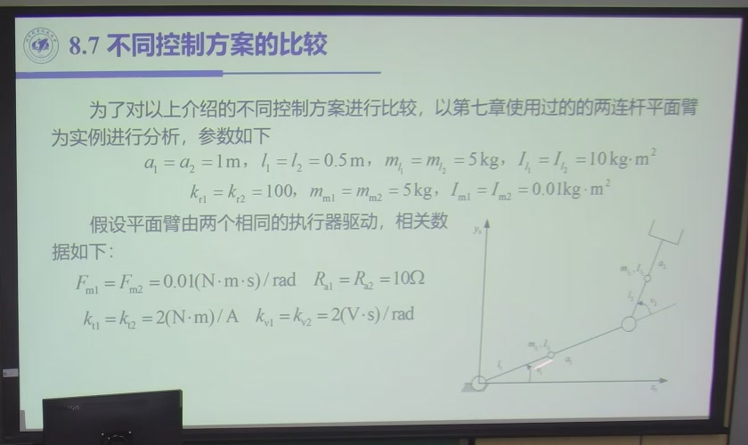
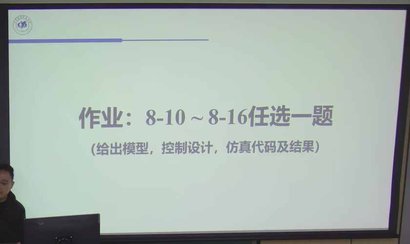

# 7.5 九种方案的仿真比较与选型

> 录播 02:10:13–02:17:50（课件 §8.7，**全部是课堂内容**）。这一节把前面所有控制律放到**同一个
> 两连杆平面臂**上跑一遍，用跟踪误差曲线回答一个工程问题：**给定任务与硬件，到底该选哪一套？**
> 课件最后给出作业：教材习题 8-10～8-16 **任选一题**，要求「给出模型、控制设计、仿真代码及结果」。

## 7.5.1 仿真对象与设置

被控对象是第六章用过的**两连杆平面臂**（图 7.5-1），参数与驱动参数如下（课件 §8.7）：

| 量 | 值 | 量 | 值 |
|:--|:--|:--|:--|
| 连杆长 $a_1=a_2$ | $1\ \mathrm m$ | 连杆质心 $l_1=l_2$ | $0.5\ \mathrm m$ |
| 连杆质量 $m_1=m_2$ | $5\ \mathrm{kg}$ | 连杆惯量 $I_{l_1}=I_{l_2}$ | $10\ \mathrm{kg\cdot m^2}$ |
| 减速比 $k_{r_1}=k_{r_2}$ | $100$ | 电机质量 $m_{m_1}=m_{m_2}$ | $5\ \mathrm{kg}$ |
| 电机惯量 $I_{m_1}=I_{m_2}$ | $0.01\ \mathrm{kg\cdot m^2}$ | 黏性摩擦 $F_{m_1}=F_{m_2}$ | $0.01\ \mathrm{N\cdot m\cdot s/rad}$ |
| 电枢电阻 $R_{a_1}=R_{a_2}$ | $10\ \Omega$ | 转矩常数 $k_{t_1}=k_{t_2}$ | $2\ \mathrm{N\cdot m/A}$ |
| 反电动势常数 $k_{v_1}=k_{v_2}$ | $2\ \mathrm{V\cdot s/rad}$ | | |

**轨迹**：两条典型的「快—慢」速度曲线（快速段加速度大、慢速段近似匀速），用来分别考察
「高速耦合」与「低速摩擦/重力」。**采样**：离散仿真，控制周期固定。**控制器参数**：按二阶系统
指标反算，取自然频率 $\omega_n=5\ \mathrm{rad/s}$、阻尼比 $\zeta=0.5$，即

$$K_P=J\omega_n^2,\qquad K_D=2\zeta J\omega_n .\tag{7.5-1}$$

**评价指标**：关节角跟踪误差 $e_i(t)=q_{d_i}(t)-q_i(t)$ 的最大值与均方根。

## 7.5.2 九种方案

课件按「分散 → 集中 → 操作空间」排了九套（A–I）：

| 方案 | 控制器 | 属于 | 关键参数 |
|:--|:--|:--|:--|
| **A** | 位置 + 速度反馈（PI） | 分散 | $K_P,K_v,T_v$ |
| **B** | 位置 + 速度 + 加速度反馈 | 分散 | 加速度由一阶滤波器重构 |
| **C** | A + 分散前馈 | 分散 | 前馈用 $\boldsymbol q_d,\dot{\boldsymbol q}_d,\ddot{\boldsymbol q}_d$ |
| **D** | B + 分散前馈 | 分散 | 同上 |
| **E** | C + 计算转矩前馈 | 分散 + 前馈 | 用 $\Delta B,C,\boldsymbol g$ |
| **F** | 重力补偿 PD | 集中 | 只补 $\boldsymbol g(\boldsymbol q)$ |
| **G** | 关节空间逆动力学 | 集中 | 全补 $B,C,\boldsymbol g$ |
| **H** | 鲁棒控制 | 集中 | 不确定界 $\rho$、边界层 $\varepsilon$ |
| **I** | 自适应控制 | 集中 | $\Lambda,K_D,K_\pi$ |

另外还有两套**操作空间**方案：操作空间重力补偿 PD、操作空间逆动力学（7.4.4/7.4.5）。
分散方案用**电压控制**（速度源），集中方案用**电流控制**（力矩源，内环加电流环）——这正是
7.2.5 的结论。

## 7.5.3 结果：误差一层一层往下掉

课件给的跟踪误差量级（快轨迹，02:13–02:16）：

| 方案 | 最大跟踪误差（量级） | 读法 |
|:--|:--|:--|
| A（位置 + 速度） | $\sim0.2\ \mathrm{rad}$ | 纯反馈，误差很大 |
| B（+ 加速度） | 与 A 接近 | 加速度反馈改善有限 |
| C（A + 分散前馈） | $<0.01\ \mathrm{rad}$ | **前馈把误差压了一个数量级** |
| D（B + 分散前馈） | 与 C 接近 | 加速度反馈的边际收益小 |
| E（C + 计算转矩前馈） | $\sim0.005\ \mathrm{rad}$ | 再压一半 |
| F（重力补偿 PD） | 跟踪效果不如 C/D | 只补重力，**点对点控制器拿来跟踪** |
| G（逆动力学） | $\sim10^{-4}\ \mathrm{rad}$ | 模型精确时最好 |
| H（鲁棒） | $\sim10^{-3}$–$10^{-4}\ \mathrm{rad}$ | 有扰动时仍保持 |
| I（自适应） | 与 G 同量级 | 参数未知时逼近 G |

**四条结论**（老师 02:13–02:16 的口述）：

1. **纯分散反馈最差**，误差到 $0.2$ rad；**加前馈立刻降一个数量级**——前馈是性价比最高的一步。
2. **重力补偿 PD 不适合跟踪**。它只能保证点对点（7.3.3 的证明用了 $\dot{\boldsymbol q}_d=0$），
   拿来做轨迹跟踪，效果反而不如带前馈的分散控制。
3. **模型精确时逆动力学最好**（$10^{-4}$ 量级）；模型有误差/扰动时退化到 $10^{-3}$ 量级，
   这时鲁棒/自适应能把它拉回来。
4. **操作空间与关节空间同量级**；快轨迹时集中控制明显优于分散，慢轨迹时差距缩小
   （慢轨迹的惯性/耦合项小，分散的 $d$ 本来就小）。

::: note 「误差量级」怎么用
不要记具体数字（它们依赖轨迹、采样、参数），要记**相对关系**：
**纯反馈 $\gg$ 加前馈 $\gg$ 逆动力学**，以及**模型误差会把逆动力学拉回前馈的水平**。
选型时先问「我的误差预算在哪一档」，再决定要不要上模型。
:::

## 7.5.4 选型表

| | 分散控制 | 集中 · 逆动力学 | 集中 · 鲁棒/自适应 | 操作空间 |
|:--|:--|:--|:--|:--|
| 设计对象 | 单轴（$n$ 个回路） | 整机 | 整机 | 末端（6 维） |
| 需要的模型 | 少（单轴惯量、重力） | 全（$B,C,\boldsymbol g$） | 全 + 误差界/参数结构 | 全 + $J_A,\dot J_A$ |
| 反馈量 | $\boldsymbol q,\dot{\boldsymbol q}$ | $\boldsymbol q,\dot{\boldsymbol q}$ | 同左 | $\boldsymbol x,\dot{\boldsymbol x}$（多为估计） |
| 驱动器 | **速度源**（电压） | **力矩源**（电流环） | 力矩源 | 力矩源 |
| 误差方程 | 带扰动 $d$ 的单轴二阶 | 解耦二阶（模型精确） | 有界误差 | $x$ 空间解耦二阶 |
| 计算量 | 最小 | 大 | 最大 | 最大 + 雅可比逆 |
| 典型场合 | 点位、低速、轻载 | 高速、高精、重载 | 参数慢变、有扰动 | 柔顺、冗余、力控前奏 |
| 主要风险 | 高速耦合压不住 | 模型误差/限幅 | 抖振/参数漂移 | 奇异、$x$ 测不准 |

**选型三步**：

1. **看驱动器**：电压控制 ⇒ 只能分散（或加电流环改造成力矩源）；已有电流环 ⇒ 可上集中。
2. **看误差预算**：$0.1$ rad 级 ⇒ 分散反馈够；$0.01$ rad ⇒ 加前馈；$10^{-3}$ 以下 ⇒ 逆动力学 +
   模型辨识；模型不准 ⇒ 鲁棒/自适应。
3. **看任务空间**：末端精度/柔顺/冗余 ⇒ 操作空间；固定工位、标定充分 ⇒ 关节空间更稳。

## 7.5.5 作业与下一章

课件最后一页（02:17:50）给的作业是：

> **作业：8-10 ～ 8-16 任选一题**
> **（给出模型，控制设计，仿真代码及结果）**

老师对作业的口径说得很清楚（02:17:33–02:18:30）：

> 「这次的作业不是理论计算，是书上的……你自己认识就像那种工作的方法，好一个控制的一个专门的
> 结果出来。你实际地动手看一看怎么设计的这个控制，你找一个参数看看控制效果是不是有变化……
> 主要是让大家学习操作，用 MATLAB 往上跑一会儿，直观感受一下。并不是说从头从零开始编。」

**建议的做题顺序**（不是老师要求，是本书的建议）：

1. 先用第六章的两连杆模型把**逆动力学**跑通，确认 $\boldsymbol q$ 能跟踪 $\boldsymbol q_d$；
2. 再把同一模型换成**分散 PD**，观察误差从 $10^{-4}$ 掉到 $0.1$ 量级；
3. 最后加**前馈**，看误差怎么随前馈项增加而下降——这三步做完，本章的「模型用得多深、
   误差就到多小」就有了体感。

**下一章（原书第 9 章）是力控制**。老师用最后两分钟点了题（02:19:45–02:20:40）：

> 「这一章的对象是自由运动机器人，不跟外界接触……下一章力控制就是机器人这个对象所特有的。
> 很多其他对象像飞机、卫星就没有这种需求；只有机器人末端要接触、要完成各种任务，才需要力的
> 功能。你简单点当抓东西，抓一把就行；但你要抓一个软的东西，或者往里面拧个螺丝，那就需要
> 精确的力的功能。」

也就是说：**本章把 $-\boldsymbol h_e$ 扔掉了，下一章把它捡回来，变成要控的量**。本章的操作空间
模型 (7.4-3) 与 $J^{\mathrm T}$ 折算关系，就是下一章力/位混合控制的直接入口。

::: think 本章自检（能答八问即可进入第八章）
1. 分散控制把什么塞进 $d$？$d$ 里至少包含哪三项？
2. 位置环开环传递函数是什么？$T_p<T_m$ 为什么不稳定？
3. 干扰抑制因子与收敛时间怎么算？$K_P$ 的取舍是什么？
4. 驱动五式与三条假设推出什么？为什么它能证明「可以分散」？
5. 重力补偿 PD 的李雅普诺夫函数是什么？为什么它只能做点对点？
6. 逆动力学控制的误差方程是什么？它与计算转矩前馈的区别在哪？
7. 鲁棒控制的滑动子空间与边界层各起什么作用？为什么加边界层后误差不为零？
8. 自适应控制的 $\boldsymbol\sigma$、控制律、更新律是什么？它保证什么、不保证什么？
9. 操作空间的转置雅可比方案与逆雅可比方案各有什么优缺点？
10. 九种方案的误差量级相对关系是什么？选型先看哪三件事？
:::
