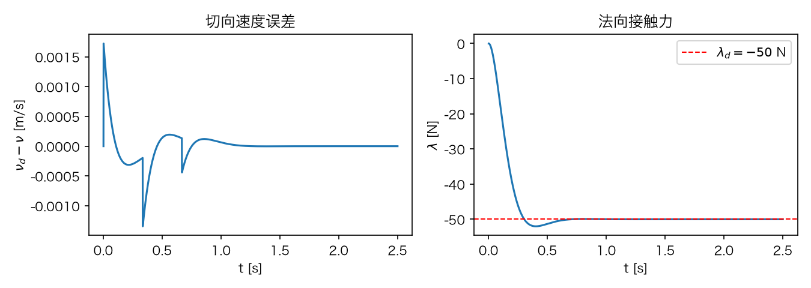
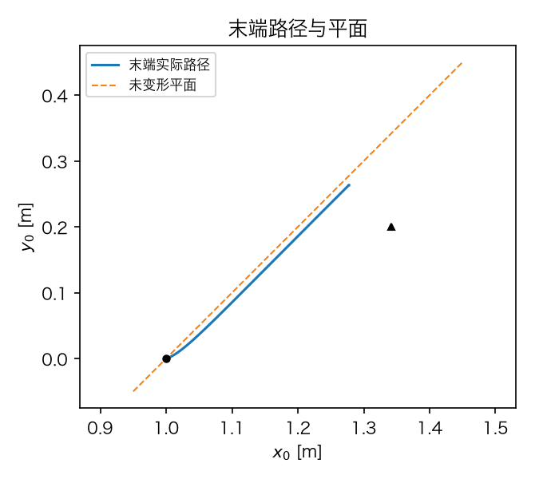

# 作业八：教材习题 9-7（必做）＋ 9-3 / 9-10 任选一题

> **布置时间**：2026-11-09 第 10 周课末（《第9章 力控制-V3.pdf》末页，约 02:11:16 翻到该页时）。
> **题目**：**9-7 必做**；**9-3 / 9-10 任选一题**。
> **提交内容**：**控制设计、仿真代码及结果**（课件原话）；9-7 是约束分析题，只交分析，仿真部分由选做题承担。

::: note 提交与评分
- **渠道与截止**：智学北航 → 机器人控制技术 → **课程作业 →「第9章 力控制」**；
  平台窗口 **2026-11-09 00:00 至 2026-11-16 00:00**（周一零点截止），**满分 1 分，文件上传，不限提交次数**。
- **课件原话**（第 91 页，本周课件《第9章 力控制-V3.pdf》）：
  「作业：1、9-7；2、9.3/9.10任选一题（给出控制设计，仿真代码及结果）」。
- **课上归因**：录播转写在 02:11:16 处只有一句含混的「这是我们……的一个作业」，
  结合课件末页翻页时间与内容，判定为布置作业的时刻。本次课上**没有**逐题讲解要求
  （不同于第 9 周布置作业七时 02:17–02:18 的口头补充），要求以课件末页为准。
- **与作业七的两点不同**：一是**没有分发基础代码**（课程文件里本周只有课件 PDF，无代码包）；
  二是必做 + 任选的**两题结构**，总工作量比上一周大，宜早动手。
- 9-3 / 9-10 的机械臂就是**作业七那台 §8.7 两连杆**（不带末端负载 $m_L$）——
  第 9 周交的建模代码改一处参数即可复用。
:::

课件与教材的题号对照：课件写「9-7」「9.3」「9.10」，是同一套编号的两种写法，
都指教材第 9 章末 Problems 列表（本章 [8.6](sec8-6.md)、[8.7](sec8-7.md) 对应教材 §9.6、§9.7）。

---

## 三道题在考什么

| 题 | 给定量 | 要求的量 | 真正考的是一句话 | 类型 |
|:--|:--|:--|:--|:--|
| **9-7** | 图 9.17：旋具在孔中拧螺钉 | 合适约束系下的自然约束与人工约束表 | **会不会做约束判读**（[8.6](sec8-6.md) 的核心技能） | 分析 |
| **9-3** | 图 9.16：π/4 斜弹性平面，$k_y=5\times10^3$ N/m；§8.7 臂 | 阻抗控制设计 + 直线路径交互仿真 | 阻抗参数怎么决定压入与过渡（[8.3](sec8-3.md)） | 仿真 |
| **9-10** | 同 9-3 的臂与环境 | 混合控制：xc 控运动、yc 控力至 50 N + 仿真 | 选择矩阵 + 两子空间各配增益（[8.7](sec8-7.md)） | 仿真 |

9-3 与 9-10 用**同一台臂、同一个环境、同一条路径**，只是控制方案不同——
若时间允许，两题都做并把结果对比，报告会好看得多（但平台只要求任选其一）。

**本教程推荐选 9-10**：它正是课堂收尾（02:08:52–02:11:11）老师放慢讲的那个斜面 + 选择矩阵场景；
力目标 50 N 是一个可直接从图上核对的稳态量；而且它与 [8.8 综合算例](sec8-8.md) 的打磨任务同构。
9-3 的阻抗方案路线在[文末](#hw8-93-route)给出，工作量略小。

---

## 习题 9-7：拧螺钉的自然约束与人工约束（必做详解）

::: ex 题目（转述）
对图 9.17 的拧螺钉任务（旋具驱动螺钉进孔），选一个合适的约束坐标系，
写出自然约束与人工约束。
:::

### 约束系怎么选

约束系 **固连在旋具上**（随工具一起动）：

- $z_c$：**螺钉轴线**（拧入方向）；
- $x_c$：旋具**刃口方向**（螺钉头部开槽的方向，水平）；
- $y_c$：与刃口垂直的水平方向。

选在工具上而不是孔上，是为了让「槽允许滑动」这件事直接体现在 $x_c$ 方向的约束里，
不必随螺钉转动而换系。

### 逐方向判读

先数环境允许什么、挡住什么（设槽与螺纹均无摩擦）：

| 观察 | 结论（自然侧） | 对偶（人工侧） |
|:--|:--|:--|
| 刃口嵌在头槽里：垂直于刃口的方向 ($y_c$) 挡死 | $\dot p_{c_y}=0$ | $f_{y_c}$ 可指定（贴槽力，常设 0） |
| 刃口嵌在头槽里：绕 $x_c$、$y_c$ 倾斜挡死 | $\omega_{x_c}=0$，$\omega_{y_c}=0$ | $\mu_{x_c}$、$\mu_{y_c}$ 可指定（常设 0） |
| 无摩擦槽：沿槽方向 ($x_c$) 挡不住力 | $f_{x_c}=0$ | $\dot p_{x_c}$ 可指定（滑动对中速度，常设 0） |
| 螺旋副：轴向运动由转动经导程决定，**不可独立指定** | $\dot p_{c_z}$（由 $\omega_{z_c}$ 与导程确定） | $f_{z_c}$ 可指定（轴向进给压力） |
| 螺旋副：绕轴力矩与轴向力经螺纹力平衡耦合，**不可独立指定** | $\mu_{c_z}$（由 $f_{z_c}$ 与导程确定） | $\omega_{z_c}$ 可指定（拧入角速度） |

合成任务表：

| 自然约束 | 人工约束 |
|:--|:--|
| $\dot p_{c_y}$ | $f_{y_c}$ |
| $\dot p_{c_z}$ | $f_{z_c}$ |
| $\omega_{x_c}$ | $\mu_{x_c}$ |
| $\omega_{y_c}$ | $\mu_{y_c}$ |
| $f_{x_c}$ | $\dot p_{x_c}$ |
| $\mu_{c_z}$ | $\omega_{z_c}$ |

这张表与官方解答手册（Solution Manual, Table S9.1）一致。

### 三句话讲清这张表

1. **拧螺钉的主动命令只有两个**：拧的角速度 $\omega_{z_c}$ 和往里压的力 $f_{z_c}$——
   其余人工量都设 0，只是把「不主动施加」也写成约束。
2. **自然侧的 $z_c$ 两行是螺旋副的耦合**：给了 $\omega_{z_c}$，轴向速度就被导程定死
   （$\dot p_{c_z}=\frac{l}{2\pi}\omega_{z_c}$，$l$ 为导程）；给了 $f_{z_c}$，绕轴力矩就被
   螺纹力平衡定死。这两行不是「等于零」，而是「不可独立指定」——这是本表与
   [8.6](sec8-6.md) 平面滑动表（教材表 9.1）最不一样的地方：平面任务里每个自然量都是 0，
   螺旋任务里出现了「被机构定死」的自然约束。
3. **互斥性自查**：每个轴向的两个自由度（力／力矩一个、速度／角速度一个）恰好一边一个，
   $6+6=12$，无一重叠、无一遗漏。有摩擦时槽向与螺纹向会出现额外的自然力约束，
   人工侧相应改设力目标——课件未展开，报告提一句即可。

::: think 9-7 易错点 · 四条 {#hw8-97-pitfalls}
1. **把 $\dot p_{c_z}$、$\mu_{c_z}$ 写成自然侧的「0」**：它们是「被导程／力平衡定死」，
   写成 0 会推出「拧螺钉轴向不动、无需力矩」的荒谬结论。
2. **约束系选在孔上**：螺钉会转，孔系的方向随时间变，选择矩阵成了时变阵——
   能做但平白给自己加难度；工具系是静态的。
3. **人工量全填运动**：六个全设速度／角速度会与螺旋副的自然运动约束打架
   （$z_c$ 轴向撞车）。先数自然侧占了哪六个，人工侧只能补剩下的。
4. **漏掉「常设 0」的说明**：$f_{y_c}$、$\mu_{x_c}$、$\mu_{y_c}$、$\dot p_{x_c}$ 的合理取值
   是 0（对中、不倾覆、不沿槽滑），报告里写出取值与理由，别只给符号。
:::

---

## 习题 9-10：混合力／运动控制（完整详解）

::: ex 题目（转述）
对题 9-3 的臂与环境（§8.7 两连杆 + 过 $(1,0)$、与 $x_0$ 轴成 $\pi/4$ 的弹性平面，
$y_c$ 向刚度 $5\times10^3$ N/m）：设计混合控制——$x_c$ 方向控运动、$y_c$ 方向控力，
期望接触力 50 N；沿题 9-3 的直线路径做交互仿真，离散实现采样 1 ms。
:::

### 第 0 步：这道题在考什么

| 给定量 | 要求的量 | 真正考的是 |
|:--|:--|:--|
| §8.7 两连杆动力学 | 被控对象 | [第六章 6.3 两连杆算例](../ch06/sec6-3.md)模型 + 操作空间形式 (9.73) |
| π/4 斜面几何与 $k_y$ | 约束系 $R_c$ 与环境模型 | 课堂 02:08:52–02:11:11 的「斜面先转系再分解」 |
| $x_c$ 控运动、$y_c$ 控力 50 N | 选择矩阵 + 两个环的增益 | [8.7](sec8-7.md) 的 (9.77)–(9.84) |
| $T_s=1$ ms 仿真 | 接触力到位、路径贴合 | 离散实现 + 读图（力、速度误差、压入量） |

### 第 1 步：建模与环境

臂的操作空间模型（教材 (9.73)）：

$$
B_e(\boldsymbol q)\dot{\boldsymbol v}^e+\boldsymbol n_e(\boldsymbol q,\dot{\boldsymbol q})
=\boldsymbol\gamma^e-\boldsymbol h_e,
\qquad
B_e=J^{-\mathrm T}BJ^{-1},\quad
\boldsymbol n_e=J^{-\mathrm T}\boldsymbol n-B_e\dot J\dot{\boldsymbol q},
\tag{H8.1}
$$

其中 $B,\boldsymbol n=C\dot{\boldsymbol q}+F\dot{\boldsymbol q}+\boldsymbol g$ 取 §8.7 两连杆
（**不带** $m_L$；课堂口径 $m_1=m_2=5$ kg，英文原书 50 kg，见[作业七参数表注](../ch07/homework07.md)）。

环境：约束系原点取在基座、$x_c$ 沿平面、$y_c$ 沿法向，

$$
R_c=\begin{bmatrix}1/\sqrt2&-1/\sqrt2\\ 1/\sqrt2&\ \ 1/\sqrt2\end{bmatrix},
\qquad
y_{c0}=-1/\sqrt2
$$

（$y_{c0}$ 是未变形平面过 $(1,0)$ 的 $y_c$ 坐标）。接触为单边弹性：

$$
\lambda=k_y\,(y_c-y_{c0})\ \ (\text{压入时}<0\text{，未接触}=0),
\qquad
\boldsymbol h_e=R_c\,[\,0\;\lambda\,]^{\mathrm T},
\tag{H8.2}
$$

臂端反力为 $-\boldsymbol h_e$。**符号自查**：末端压入材料时 $y_c<y_{c0}$，
故期望力 $\lambda_d=-50$ N——教材与官方解答正是这么取的。

### 第 2 步：选择矩阵与力／运动分解

平面 2 自由度任务在约束系里记 $\boldsymbol v^e_c=[\nu\;\; \dot y_c]^{\mathrm T}$：

$$
\nu=\dot x_c\ (\text{切向速度，控运动})，\qquad
\lambda=h_{y_c}\ (\text{法向力，控力})。
$$

柔顺环境的运动学分解（教材 (9.74)、(9.75)）：

$$
\boldsymbol v^e=S_v\nu+C'S_f\dot\lambda,
\qquad
\dot{\boldsymbol v}^e=S_v\dot\nu+C'S_f\ddot\lambda,
\qquad
C'S_f=\frac{1}{k_y}\,\boldsymbol y_c .
\tag{H8.3}
$$

$C'S_f$ 里这个 $1/k_y$ 是**法向柔顺系数**：给法向一个虚拟加速度，实际产生的是
力导数 $\ddot\lambda=k_y\,\ddot y_c$。忘乘它，力环增益就差一个数量级——这是本题第一个大坑。

### 第 3 步：控制律与增益

操作空间逆动力学内环（教材 (9.76)）：

$$
\boldsymbol\gamma^e=B_e\boldsymbol\alpha+\boldsymbol n_e+\boldsymbol h_e
\quad\Longrightarrow\quad
\dot{\boldsymbol v}^e=\boldsymbol\alpha ;
\tag{H8.4}
$$

混合分配（教材 (9.77)，法向乘**估计**柔顺系数 $\hat c_y=1/\hat k_y$）：

$$
\boldsymbol\alpha=S_v\alpha_\nu+C'\!S_f\,f_\lambda
=\boldsymbol x_c\,\alpha_\nu+\boldsymbol y_c\,\frac{f_\lambda}{\hat k_y};
\tag{H8.5}
$$

运动子空间（教材 (9.80)，带 $\dot\nu_d$ 前馈的 PI）：

$$
\alpha_\nu=\dot\nu_d+k_{P\nu}(\nu_d-\nu)+k_{I\nu}\!\int_0^t(\nu_d-\nu)\,\mathrm d\varsigma,
\qquad
k_{P\nu}=16,\ \ k_{I\nu}=100 ;
\tag{H8.6}
$$

力子空间（教材 (9.84)，力导数用估计刚度从**速度**算，不微分测力信号）：

$$
f_\lambda=-k_{D\lambda}\hat{\dot\lambda}+k_{P\lambda}(\lambda_d-\lambda),
\qquad
\hat{\dot\lambda}=\hat k_y\,\dot y_c,
\qquad
k_{D\lambda}=16,\ \ k_{P\lambda}=100,\ \ \lambda_d=-50\ \text{N}.
\tag{H8.7}
$$

**闭环核账**：真实刚度 $k_y=5\times10^3$，估计 $\hat k_y=4\times10^3$，代入
(H8.3)–(H8.5) 得 $\ddot\lambda=L_f f_\lambda$，其中

$$
L_f=\frac{k_y}{\hat k_y}=1.25
\quad\Longrightarrow\quad
\omega_{n\lambda}=\sqrt{L_fk_{P\lambda}}=11.18\ \text{rad/s},\quad
\zeta_\lambda=\frac{k_{D\lambda}}{2\omega_{n\lambda}}=0.71 .
$$

这正是官方解答给出的数值——它按「刚度只有估计值」的场景设计；若按刚度精确已知设计，
$\omega_{n\lambda}=10$、$\zeta_\lambda=0.8$，两者性能接近。运动环由 $k_{P\nu}=16$、
$k_{I\nu}=100$ 得 $\omega_{n\nu}=10$ rad/s、$\zeta_\nu=0.8$。

期望运动：沿题 9-3 直线路径（$t_f=1$ s 梯形速度）取切向分量
$\nu_d=\boldsymbol x_c^{\mathrm T}\dot{\boldsymbol p}_d$、$\dot\nu_d=\boldsymbol x_c^{\mathrm T}\ddot{\boldsymbol p}_d$；
$t>1$ s 后 $\nu_d=0$、$\lambda_d$ 保持 $-50$ N（原地压住），总时长 2.5 s——与官方解答的时窗一致。

### 第 4 步：离散仿真怎么做

1. 初值 $\boldsymbol o^e(0)=[1,0]^{\mathrm T}$（恰在未变形平面上），
   $\boldsymbol q(0)$ 由逆解给出（$\boldsymbol q_2(0)=2\pi/3$ 一支），$\dot{\boldsymbol q}(0)=\boldsymbol 0$；
2. 每个 1 ms 采样：读 $\boldsymbol q,\dot{\boldsymbol q}$、测力 $\lambda$（或由 (H8.2) 计算），
   按 (H8.5)–(H8.7) 算 $\boldsymbol\alpha$，**零阶保持**一个周期；
3. 周期内用 **RK4** 积分整机（注意关节方程是 $B\ddot{\boldsymbol q}=\boldsymbol\tau-\boldsymbol n-J^{\mathrm T}\boldsymbol h_e$，
   反力带**负号**——见[常见坑 #22](../preface-pitfalls.md)）。

配套代码：

| 文件 | 作用 |
|:--|:--|
| `tools/hw08_9_10_matlab/run_hw910.m` | 主仿真 + 出图（交作业可直接改） |
| `tools/hw08_9_10_matlab/plant_dyn.m` | 两连杆动力学（$m_L=0$） |
| `tools/hw08_9_10_matlab/traj_tip.m` | 任务空间梯形路径 |
| `tools/verify_homework08.py` | Python 复算（`make verify`，本页数值来源） |

```matlab
% 核心四行（完整脚本见 tools/hw08_9_10_matlab/run_hw910.m）
a_nu  = nu_dd + Kp_nu*(nu_d - nu) + Ki_nu*int_v;      % (9.80)
f_l   = -Kd_l*(k_hat*dot(yc,v)) + Kp_l*(lambda_d-lam); % (9.84)
alpha = xc*a_nu + yc*f_l/k_hat;                        % (9.77)
tau   = J'*(Be*alpha + ne + he);                       % (9.76) 内环
```

### 第 5 步：结果与读图

`tools/verify_homework08.py` 复算（MATLAB 脚本已提供，本机许可过期未对拍，
交作业前建议在 MATLAB 里复跑一遍对数）：

| 指标 | 数值 | 参照 |
|:--|--:|:--|
| 稳态接触力 $\lambda$ | $-50.000$ N（波动 $<10^{-4}$ N） | 期望 $-50$ N |
| 力首次进入 $\pm5\%$ 带 | $t\approx0.27$ s | $\omega_{n\lambda}=11.18$ rad/s 量级 |
| 力超调 | $-52.0$ N @ $t\approx0.40$ s（约 4%） | $\zeta_\lambda=0.71$ 对应小超调 |
| 运动段 $\max\lvert\nu_d-\nu\rvert$ | $1.3\times10^{-3}$ m/s（rms $3.0\times10^{-4}$） | 官方图同量级 |
| 稳态压入量 $y_c-y_{c0}$ | $-0.01000$ m | 理论 $\lambda_d/k_y=-0.01$ m |





**读图三句话**

1. **力环**：$\lambda$ 约 0.4 s 到位并稳在 $-50$ N；0.27 s 后就进入 $\pm5\%$ 带，
   超调 4% 与 $\zeta_\lambda=0.71$ 一致。稳态压入 $|{-50}|/5000=1$ cm——
   **刚度已知时力与压入量一一对应**，这是核对仿真最快捷的一步。
2. **运动环**：切向速度误差在 $10^{-3}$ m/s 量级，折角出现在梯形剖面的加速度
   跳变点（$t\approx0.33,0.67,1$ s）——与[作业七](../ch07/homework07.md)读图第 2 条同源，
   是参考加速度不连续 + ZOH 的残差，不是发散。
3. **两个子空间互不打扰**：期望终点在材料内 0.1 m（位置上不可达），末端只在
   切向走到期望投影、法向停在 1 cm 压入处——位置目标在力控子空间里**让位**给力目标，
   这就是[8.7](sec8-7.md)开头那句话的仿真版。

### 第 6 步：交卷前再压一遍的四个坑

::: think 9-10 易错点 · 四条 {#hw8-910-pitfalls}
1. **法向分配忘乘 $\hat c_y$**：(H8.5) 里 $f_\lambda$ 直接加在 $\boldsymbol y_c$ 上，
   等于把柔顺系数当成 1，力环慢 4000 倍或直接发散。先写 (H8.3) 再写 (H8.5)。
2. **微分测力信号算 $\dot\lambda$**：实测 $\boldsymbol h_e$ 微分是噪声放大器——
   老师 02:08:02–02:08:18 原话「力的导数一般就是噪声」；用 (9.84) 的速度重构
   $\hat{\dot\lambda}=\hat k_y\dot y_c$。
3. **把 $\boldsymbol h_e$ 当反力**：关节方程右端是 $-J^{\mathrm T}\boldsymbol h_e$
   （$\boldsymbol h_e$ 是臂给环境的力）；方向写反成正反馈，几步就飞。
4. **两环增益互相串**：$k_{P\nu},k_{I\nu}$ 单位是 1/s、1/s²，$k_{P\lambda},k_{D\lambda}$
   单位是 1/s²、1/s（经 $\hat c_y$ 折算后）——别把速度环增益抄进力环。
:::

<a id="hw8-93-route"></a>

## 若你选 9-3：阻抗控制路线概要

同一台臂、同一环境、同一路径（$[1,0]^{\mathrm T}\to[1.2+0.1\sqrt2,\ 0.2]^{\mathrm T}$，
$t_f=1$ s，$T_s=1$ ms）。要点：

1. **方案**：阻抗控制（教材 §9.3，本教程 [8.3](sec8-3.md)）——把末端设计成
   $M_d\ddot{\tilde{\boldsymbol x}}+B_d\dot{\tilde{\boldsymbol x}}+K_d\tilde{\boldsymbol x}=\boldsymbol h_e$
   的二阶环节，参考轨迹在**材料内**（题给的直线穿过平面 0.1 m），
   靠阻抗刚度与环境刚度分压得到平衡压入。
2. **参数选法**：期望质量 $M_d$ 取单位阵；$K_d$ 决定稳态压入
   （切向自由、法向分压 $\approx K_d/(K_d+k_y)$ 份额的路径法向偏差），$B_d$ 按
   $\zeta=0.7\sim1$ 配临界阻尼；增益与 9-10 的力环参数不同源，不要照抄。
3. **核对点**：稳态时切向贴合路径、法向压入量 $=$ 阻抗力 $=$ $k_y\times$压入
   （力平衡方程手算一遍再跑仿真）；对照课堂 01:13:55 讲过的
   「环境越硬、同样参数走得越少」——把 $k_y$ 改大一档复跑，读数应变小。
4. **回看**：[8.2 的单轴接触平衡](sec8-2.md#sec-8.2.balance)与
   [8.8 综合算例](sec8-8.md)（打磨算例就是平面阻抗的完整版）。

::: note 与作业七共用什么
9-3 / 9-10 的机械臂 = §8.7 两连杆、无末端负载：把
`tools/hw07_8_12_matlab/plant_dyn.m` 的 `p.mL` 置 0 即得本题对象；
两连杆雅可比、逆解约 10 行，自己补上。参数口径（课堂 $m=5$ vs 原书 $m=50$）
沿用[作业七的约定](../ch07/homework07.md)：跟课堂口径，报告里注明即可。
:::

---

## 交卷前自查 {#homework08-final-check}

::: think 按「模型 / 设计 / 代码 / 结果」四段勾
**模型段**（两题共用）：§8.7 参数表是否注明来源与 $m_L=0$？环境模型 (H8.2) 的
单边条件（未接触时 $\lambda=0$）写了吗？斜面几何（$R_c$、$y_{c0}$）交代了吗？

**设计段**：9-7 —— 表格 12 项填满且互斥，$z_c$ 两行写「由导程／力平衡确定」而非「0」；
9-10 —— 选择矩阵、(H8.5) 的 $\hat c_y$、增益与 $\omega_n,\zeta$ 的换算是否都在？

**代码段**：参数集中在开头？采样 1 ms？力信号来源（测量 or 模型）写明？
能否用你的代码复现你贴的图？

**结果段**：9-10 必有接触力到位曲线与压入量核对（$-50/5000=1$ cm）；
运动误差量级说明；若做 9-3，稳态力平衡手算对上仿真。
:::

复算命令：

```bash
cd robot && python3 tools/verify_homework08.py
# 或：make verify   （已并入总校验）
```
