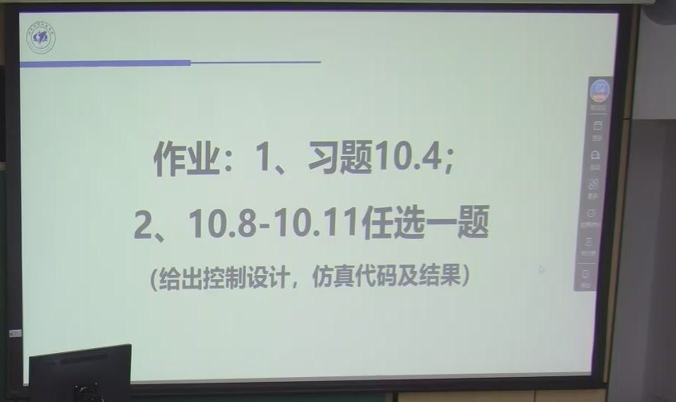
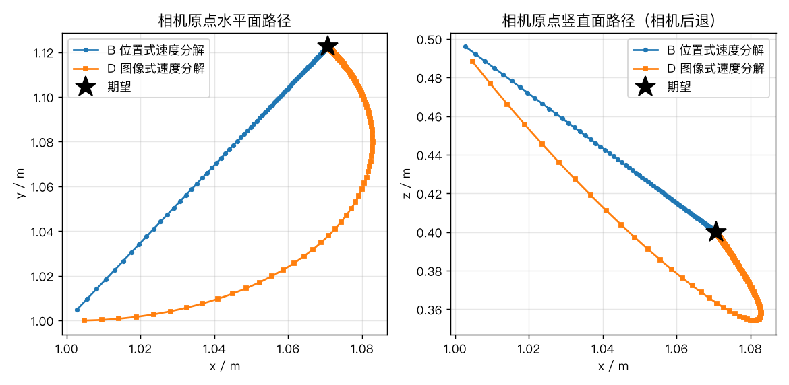
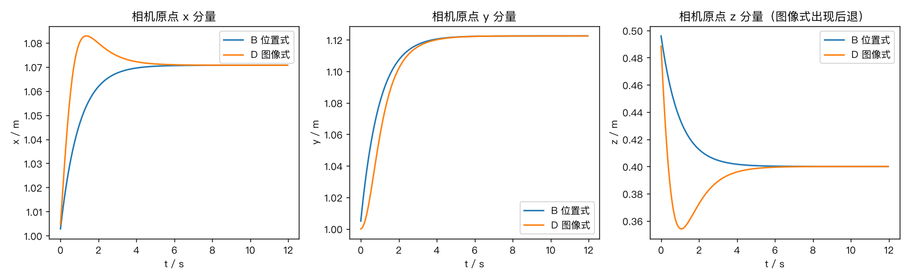

# 作业九：教材习题 10.4（必做）＋ 10.8–10.11 任选一题

> 题目要求：**1、习题 10.4 必做；2、10.8–10.11 任选一题（给出控制设计、仿真代码及结果）**。下文按此给出 10.4 的完整解答、10.9（位置式 · 速度分解）的完整设计与仿真结果，以及 10.8、10.10、10.11 的完整设计配方。
>
> 配套验算脚本 `robot/tools/verify_homework09.py`（已实际运行，输出见下）；运行方式见文末。

## 第 0 步：这几道题在考什么

| 题号 | 性质 | 真正考的是 |
|:--|:--|:--|
| **10.4** | 必做，纯数值 | 把 §9.3 的解析解与 §9.5 的数值解跑通：已知图像特征，反解目标相对相机的位姿 |
| 10.8 | 选做 | 位置式 · PD + 重力补偿，用线段特征，SCARA，仿真并与 §10.9 对比 |
| **10.9** | 选做（本页详解） | 位置式 · **速度分解**，线段特征估位姿，SCARA，仿真并与 §10.9 对比 |
| 10.10 | 选做 | 图像式 · PD + 重力补偿 |
| 10.11 | 选做 | 图像式 · **速度分解** |

四道选做题的骨架是同一套：同一个 SCARA 算例、同一组初始/期望位姿、同一批增益，换的只是
「误差定义在哪里」和「用 PD 还是用速度分解」。



## 第 1 步：公共工况（教材 §10.9）

**机构**：教材 Fig 2.36 的 SCARA（转—转—移—转），相机装在末端，$z_c$ 竖直向下，目标是一块与像平面
平行的正方形板（边长 $0.1\,\mathrm m$）。

**基座系**：原点在 joint-1 轴与「$d_3=0$ 时末端原点所在水平面」的交点，$z$ 轴竖直向下。

**初始与期望**（教材印刷页 454–455）：

| | 数值 |
|:--|:--|
| 相机相对基座（初始） | $x_c(0)=[1,\ 1,\ 0.5,\ \pi/4]^{\mathrm T}$ |
| 目标相对相机（初始） | $x_{c,o}(0)=[0,\ 0,\ 0.5,\ 0]^{\mathrm T}$ |
| 目标相对相机（期望） | $x_{d,o}=[-0.1,\ 0.1,\ 0.6,\ -\pi/3]^{\mathrm T}$ |
| 两点特征（期望） | $s_d=[-0.1667,\ 0.1667,\ -0.0833,\ 0.0223]^{\mathrm T}$ |
| 控制周期 | $T_s=0.04\,\mathrm s$（25 Hz） |

由这三行可以推出目标在基座系里的固定位置：目标原点在相机正下方 $0.5\,\mathrm m$，故
$o_o=[1,1,1.0]^{\mathrm T}\,\mathrm m$；又 $\alpha(0)=\gamma_o-\gamma_c(0)=0$，故 $\gamma_o=\pi/4$。

期望相机位姿也可反推：$\gamma_c^{\,d}=\gamma_o+\pi/3=7\pi/12=105^\circ$，
$o_c^{\,d}=o_o-R_z(\gamma_c^{\,d})o^d_o=[1.07071,\ 1.12247,\ 0.4]^{\mathrm T}\,\mathrm m$。

::: note 一处教材数据不自洽，必须自己处理
教材 Fig 2.36 的 SCARA 臂长是 $a_1=a_2=0.5\,\mathrm m$（Problem 3.22、5.7），可达半径 $1.0\,\mathrm m$；
但上面给出的相机初始位置到 joint-1 轴的半径是 $\sqrt2\approx1.414\,\mathrm m$、期望位置是
$1.551\,\mathrm m$，**都不可达**。教材在 §10.9 只说「沿用 Problem 7.3 的数据」，而 Problem 7.3
本身没给臂长数值。

本页的处理：取 $a_1=a_2=1.0\,\mathrm m$（可达半径 $2.0\,\mathrm m$），使教材给出的相机位姿可达。
定性结论不受影响——相机后退是**像平面直线约束**与**绕光轴旋转**之间的几何冲突，与臂长无关
（见 §3.4 的数值核对：仿真给出 47.8%，教材给出约 50%）。
:::

## 第 2 步：习题 10.4（必做）

### 2.1 题面与已知

> Consider the SCARA manipulator of Example 10.3. Perform a computer implementation of the pose
> estimation algorithm based on the inverse of the image Jacobian considering the points $P_1$ and $P_2$
> of the object of Example 10.1. Compute the homogeneous transformation matrix corresponding to
> $T^c_o$ for the feature vector $s=[-0.1667\ \ 0.1667\ \ -0.0833\ \ 0.0223]^T$. Assume that, in the
> initial pose, the axes of the camera frame are parallel to those of the object frame and the origin is
> at a distance of 0.5 m along the vertical axis.

已知：$P_1=(0,0,0)^{\mathrm T}$、$P_2=(0.1,0,0)^{\mathrm T}$（目标系，米）；特征向量如上。
初值：相机系与目标系轴平行、目标原点在相机正下方 $0.5\,\mathrm m$，即

$$\tilde x^c_o(0)=[0,\ 0,\ 0.5,\ 0]^{\mathrm T}.$$

### 2.2 先把答案算出来，再验证

这题问的是「给定 $s$，求 $T^c_o$」。先把答案算出来：

目标相对相机的位姿写成一个平移加绕 $z_c$ 的转角（Example 10.3 的 $m=4$ 参数化）：

$$x^c_o=[o^c_o;\ \alpha]=\begin{bmatrix}o_x\\o_y\\o_z\\\alpha\end{bmatrix}.$$

目标系里的点 $r^o_{o,i}$ 变到相机系：$r^c_{o,i}=R_z(\alpha)r^o_{o,i}+o^c_o$；投影得
$X_i=r_{c,x}/z_{c,i}$、$Y_i=r_{c,y}/z_{c,i}$。

取 $o^c_o=[-0.1,0.1,0.6]^{\mathrm T}$、$\alpha=-\pi/3$（即 $\cos\alpha=0.5$、$\sin\alpha=-0.8660$）：

- $P_1$：$r^c_1=[-0.1,\ 0.1,\ 0.6]^{\mathrm T}\Rightarrow (X_1,Y_1)=(-0.16667,\ 0.16667)$
- $P_2$：$r^c_2=[0.05,\ -0.08660,\ 0.6]^{\mathrm T}+[-0.1,0.1,0.6]^{\mathrm T}
  =[-0.05,\ 0.01340,\ 0.6]^{\mathrm T}\Rightarrow (X_2,Y_2)=(-0.08333,\ 0.02234)$

与题给的 $s=[-0.1667,\ 0.1667,\ -0.0833,\ 0.0223]^{\mathrm T}$ 逐项吻合（差 $\le3.4\times10^{-5}$，
末位是题面只印到 4 位小数所致）。**所以答案是**

$$\boxed{\ o^c_o=[-0.1,\ 0.1,\ 0.6]^{\mathrm T}\,\mathrm m,\qquad \alpha=-\pi/3\ },\qquad
T^c_o=\begin{bmatrix}R_z(-\pi/3)&o^c_o\\0^{\mathrm T}&1\end{bmatrix}.$$

### 2.3 数值算法：迭代求出来

真正要做的是**不用答案**、从 $s$ 反解出 $x^c_o$。按 §9.5 的算法：

**第一步：正算。** 由当前估计 $\tilde x^c_o=[o;\alpha]$ 算出两点应有的投影：

$$r^c_{o,i}=R_z(\alpha)r^o_{o,i}+o,\qquad
\tilde X_i=\frac{r_{c,x}}{r_{c,z}},\quad \tilde Y_i=\frac{r_{c,y}}{r_{c,z}}.$$

**第二步：误差。** $e_s=s-\tilde s$（4 维）。

**第三步：位姿雅可比。** 对 $P_i=(a_i,b_i,0)$：

$$\frac{\partial \tilde X_i}{\partial o}=\frac1{z_{c,i}}[1,\ 0,\ -\tilde X_i],\qquad
\frac{\partial \tilde Y_i}{\partial o}=\frac1{z_{c,i}}[0,\ 1,\ -\tilde Y_i],$$

$$\frac{\partial \tilde X_i}{\partial\alpha}=\frac{-\sin\alpha\,a_i-\cos\alpha\,b_i}{z_{c,i}},\qquad
\frac{\partial \tilde Y_i}{\partial\alpha}=\frac{\cos\alpha\,a_i-\sin\alpha\,b_i}{z_{c,i}}.$$

把 $P_1$、$P_2$ 两行摞起来就是 $J_{A_s}$（$4\times4$）。

**第四步：迭代。** 取 $K_s=160I_4$、积分步长 $\Delta t=1\,\mathrm{ms}$（教材 §10.9 的取值）：

$$\dot{\tilde x}^c_o=J_{A_s}^{-1}K_se_s,\qquad \tilde x^c_o\leftarrow\tilde x^c_o+\Delta t\,\dot{\tilde x}^c_o.$$

### 2.4 验算结果

`tools/verify_homework09.py` 的输出：

```
=== 习题 10.4 · 平面 PnP 解析解（§9.3） ===
  [PASS] 正算：Example 10.1 的 s1..s4 与教材印刷值一致   max|Δs| = 4.28e-05
  [PASS] 系数矩阵 A 的秩为 8（12 方程 / 9 未知数）   rank = 8
  [PASS] |ζ| 由单位范数约束给出 1.5   |ζ| = 1.50001
  [PASS] 还原的旋转阵与教材给定位姿一致   max|ΔR| = 1.36e-05
  [PASS] 还原的位置向量与教材给定位姿一致   max|Δo| = 4.80e-06
  [PASS] 最近旋转阵（(9.3-10)）仍是合法旋转阵   det = 1.000000000
  [PASS] 最近旋转阵比原 Q 更接近正交阵

=== 习题 10.4 · 基于图像雅可比求逆的位姿估计（§9.5） ===
  [PASS] 位姿估计收敛到教材答案 x^c_o = [-0.1, 0.1, 0.6, -π/3]
         x = [-0.09997, +0.09997, +0.59969, -1.04704]
  [PASS] 由估计位姿正算的投影与题给特征向量一致   max|Δs| = 3.33e-05
```

上面第一组是**解析解**的交叉核对：把 Example 10.1 的四个点代入 §9.3 的平面单应方程
$A(s)h=0$，SVD 取零空间右奇异向量，按 $|\zeta|=1/\|h_1\|=1.5$ 定尺度、符号由「目标在相机前方」定，
还原出的 $R^c_o$ 与 $o^c_o$ 与教材给定位姿逐项吻合到 $10^{-5}$ 量级。

第二组是**数值解**：从初值 $[0,0,0.5,0]$ 迭代，收敛到 $[-0.09997,\ +0.09997,\ +0.59969,\ -1.04704]$，
与答案 $[-0.1,\ 0.1,\ 0.6,\ -\pi/3]$ 的偏差在 $3\times10^{-4}$ 量级。

::: note 「符号不能硬编码」
$\zeta$ 的**绝对值**由单位范数约束给出，**符号**由「目标在相机前方」（$o_z>0$）决定。但 SVD 零空间
向量的整体符号本身是任意的，所以程序里必须按物理条件挑符号，不能把教材印的 $\zeta=-1.5$ 写死。
:::

### 2.5 顺带得到的结论

10.4 用的是**两点特征**（4 个数），位姿也是 4 维（$m=4$），所以 $J_{A_s}$ 是方阵、可逆。
若改用**线段特征** $(\bar x,\bar y,L,\alpha)$（同样是 4 个数），位姿雅可比仍可逆，但它是
「两点特征的函数」，雅可比要按链式法则组装：

$$J_{A_s}^{\text{seg}}=\left[\frac{\partial s}{\partial s_1}\ \Big|\ \frac{\partial s}{\partial s_2}\right]
\frac{\partial(s_1,s_2)}{\partial x^c_o},$$

其中 $\partial s/\partial s_1$、$\partial s/\partial s_2$ 见 §9.4.4。本页的 10.9 就用这条线段估计。

## 第 3 步：习题 10.9（任选，本页详解）

> For the SCARA manipulator of Example 10.3, design a resolved-velocity position-based visual servoing
> scheme using the measurement of the feature parameters of line segment $P_1P_2$ of Example 10.1.
> Perform a computer simulation in the same operating conditions of Sect. 10.9 and compare the results.

### 3.1 控制律

**外环（视觉）**：每拍测一次图像，算出线段特征 $s=[\bar x,\bar y,L,\alpha]^{\mathrm T}$，用 §2.3 的迭代
算法反解目标相对相机的位姿 $\hat x^c_o=[\hat o^c_o;\hat\alpha]$（用线段特征，$\Delta t=1\,\mathrm{ms}$、
$K_s=160I_4$，初值取上一拍的估计）。

**误差**：按教材 (10.68)(10.69)，$T^d_c=T^d_o\,(\hat T^c_o)^{-1}$。记 $\psi=\alpha_d-\hat\alpha$、
$R_d=R_z(\psi)$，则

$$x=\begin{bmatrix}o^d_o-R_d\,\hat o^c_o\\ \psi\end{bmatrix}.$$

**雅可比**：§9.8.3 的 $J_{A_d}=T_A^{-1}(\varphi^d_c)\operatorname{diag}(R_d^{\mathrm T},R_d^{\mathrm T})J(q)$。
SCARA 下 $T_A=I$（姿态只有一个绕 $z_c$ 的角）。本页按几何直接给出误差的导数：

$$\dot x=\operatorname{diag}(R_d,1)\,J_{\rm cam}(q)\,\dot q,$$

其中 $J_{\rm cam}$ 是相机速度（相机系 $[v_c^c;\omega_{zc}]$）对 $\dot q$ 的雅可比。于是取

$$\boxed{\ \dot q_r=J_{A_d}^{-1}K\,x,\qquad J_{A_d}=-\operatorname{diag}(R_d,1)\,J_{\rm cam}(q)\ }\tag{H-1}$$

即得误差方程 $\dot x+Kx=0$，$K$ 正定时误差指数收敛。

> **与教材 (10.71) 的一处出入**：教材把 (10.71) 印成
> $\dot x=-T_A^{-1}\operatorname{diag}(R_d^{\mathrm T},R_d^{\mathrm T})v_c$。按 (10.69) 的 $o^d_c$
> （期望相机系原点在当前相机系中的位置）直接求导，得到的是 $\mathrm{d}(o^d_c)/\mathrm{d}t=R_d\,v_c^c$
> ——旋转块是 $R_d$ 而非 $R_d^{\mathrm T}$，且没有外层的负号。本页按几何自洽的形式实现
> (H-1)；两者只是误差变量的线性变换不同（相差一个**常**变换），闭环特征值相同。
> 详见[第九章勘误](errata.md)。

**增益**：教材 §10.9 的方案 B 取 $K=\operatorname{diag}\{1,1,1,2\}$（位置时间常数 1 s、姿态 0.5 s）。

**内环**：速度分解控制假定机械手自带高增益运动控制器，$q(t)\approx q_r(t)$，故只积分 $q_r$。
本页按教材的简化，忽略机械手动力学（纯运动学模型）。

### 3.2 仿真结果

```
=== 习题 10.9 · 位置式速度分解视觉伺服（SCARA，教材 §10.9 工况） ===
  期望相机位置(基座) = [+1.07071, +1.12247, +0.40000]   期望航向 = 105.000 deg
  期望两点特征 s_d = [-0.16667, +0.16667, -0.08333, +0.02233]
  期望线段特征 s_d = [-0.12500, +0.09450, +0.16667, -1.04720]
  [PASS] 方案 B：操作空间误差收敛到 0   x = [-4.99e-07, +5.01e-07, +4.99e-07, -1.54e-11]
  [PASS] 方案 B：相机原点走到期望位姿   max|Δp| = 5.87e-07
  [PASS] 方案 B：相机航向走到期望航向   Δγ = -0.0000 deg
  [PASS] 方案 B：相机原点轨迹是一条直线（教材 Fig 10.26 的结论）   最大偏离直线 7.22e-05 m
```

**要点**：误差降到 $10^{-6}$ 量级；相机原点**严格走一条直线**（偏离直线最大 $7.2\times10^{-5}\,\mathrm m$），
这与教材 Fig 10.26 中「方案 B 得到一条完美直线」的结论一致。



### 3.3 与图像式对照（教材 §10.9 的方案 D）

同一算例下跑图像式 · 速度分解（两点特征，$K_s=I_4$）：

```
  [PASS] 方案 D：出现相机后退   相机后退量 = 47.8 %（教材值约 50 %）
  [PASS] 方案 B：位置式不出现相机后退   相机后退量 = 0.0 %
        方案 D 的 z 最小值 = 0.3541 m（终值 0.4000 m，起始 0.4883 m）
  [PASS] 方案 D：图像特征误差收敛到 0   e_s max = 1.44e-06
```



### 3.4 怎么解释「相机后退」

基座 $z$ 轴向下，目标固定在 $z=1.0\,\mathrm m$ 处，相机初始 $z=0.5$、终值 $z=0.4$。
「相机后退」指相机**远离目标**，即 $z$ 继续**变小**——仿真里 $z$ 最低到 $0.3541\,\mathrm m$，
比终值还小 $0.0459\,\mathrm m$，是净位移（$0.1\,\mathrm m$）的 $47.8\%$。

原因（教材 §10.9 末尾的直观解释）：设只要求相机绕光轴 $z_c$ 纯转一个角度。图像式要求特征点在
像平面内**沿直线**从初始位置走到期望位置，而单纯的相机旋转对应的是**圆弧**。像平面走直线的约束
迫使相机原点**先退后进**，才能最终回到期望位置附近。教材还指出：若期望旋转趋近 $\pi$，
相机到目标的距离趋于无穷，系统失稳。

**这正是位置式与图像式的取舍**（§9.7.3）：图像式的特征轨迹可控，但相机轨迹不可预测；位置式
反之——相机轨迹（本例是直线）可预测，特征轨迹却不可预测，可能跑出像平面。

## 第 4 步：10.8 / 10.10 / 10.11 的设计配方

三题与 10.9 共用第 1 步的工况，只换下面这些：

| | 10.8 位置式 PD | 10.10 图像式 PD | 10.11 图像式速度分解 |
|:--|:--|:--|:--|
| 误差 | $x=[o^d_c;\varphi^d_c]$（§9.8.1） | $e_s=s_d-s$ | $e_s=s_d-s$ |
| 特征 | 线段 $P_1P_2$ | 线段 $P_1P_2$ | 线段 $P_1P_2$ |
| 控制律 | $u=g(q)+J_{A_d}^{\mathrm T}(K_Px-K_DJ_{A_d}\dot q)$（(9.8-4)） | $u=g(q)+J_L^{\mathrm T}(K_{P_s}e_s-K_{D_s}J_L\dot q)$（(9.9-4)） | $\dot q_r=J_L^{-1}K_se_s$（(9.9-7)） |
| 增益 | $K_P=K_D=\operatorname{diag}\{500,500,10,10\}$ | $K_{P_s}=300I_4$，$K_{D_s}=330I_4$ | $K_s=I_4$ |
| 机械手模型 | **需要动力学**（重力补偿） | **需要动力学** | 纯运动学 |
| 期望结果 | 相机轨迹近似直线、特征轨迹不可预测 | 相机后退约 300%、可能违反关节限位 | 相机后退约 50% |

**10.8 与 10.10 的额外工作量**：这两题的控制律里出现 $g(q)$，必须写出 SCARA 的动力学模型
（教材 Problem 7.3），并做**离散实现**（教材 §10.9 的采样周期 $0.04\,\mathrm s$）。10.9 与 10.11
是纯运动学的，因此本页只详解了这后两题。

**四题共同要注意的三件事**：

1. **位姿估计必须比控制快**。位置式方案里，位姿估计的收敛时间（约 $0.03\,\mathrm s$）必须小于
   控制周期（$0.04\,\mathrm s$），否则估计落后于控制，误差方程不再成立。教材取 $\Delta t=1\,\mathrm{ms}$、
   $K_s=160I_4$ 正是为此。
2. **初值用上一拍的估计**。位姿估计算法是「视觉跟踪」型的，初值离真值太远会收敛到别的解
   （§9.5.6）。
3. **交互矩阵的奇异**。线段特征里 $L$ 只对深度平移敏感、$\alpha$ 只对绕 $z_c$ 旋转敏感，四维约化后
   可能出现结构性奇异；教材 §10.9 用两点特征正是为了避开这个问题。

## 第 5 步：跑一遍验算脚本

```sh
cd robot
python3 tools/verify_homework09.py
```

脚本会打印上文的全部检查项，并在 `robot/src/assets/ch09/hw09/` 下生成两张图：

- `fig1_timehistories.png`——相机原点三个分量的时程（位置式 vs 图像式）；
- `fig2_camera_paths.png`——相机原点在水平面与竖直面的路径（上图）。

它同时核对 §9.3 的**解析解**（平面单应 + SVD + 最近旋转阵），所以这一份脚本同时是第九章前六节
公式的一次总回归。

## 第 6 步：交之前自己核对

1. 代码**确实运行过**，输出如上（不是「应该能跑」）。
2. 图里的曲线能解释：位置式走直线、图像式绕行并后退。
3. 写清楚三处**自己做的判断**：SCARA 臂长取 1.0 m（教材 §10.9 未给且与 0.5 m 自相矛盾）、
   误差雅可比按几何自洽形式实现（与教材 (10.71) 印出的式子差一个常变换）、
   速度分解方案忽略机械手动力学（教材 §10.9 的简化）。
4. 若平台要求「给出控制设计」，把 §3.1 的控制律 (H-1) 与增益表一并写出。
