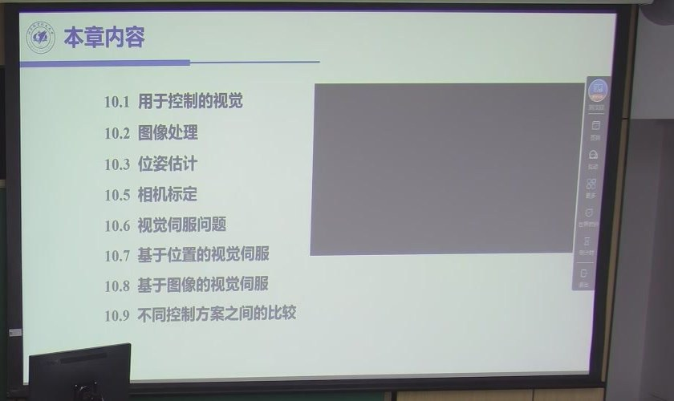

# 第九章 · 视觉伺服

## 从开环看图到闭环视觉伺服

前面几章假定机械手要到达的目标位姿事先由程序写死，关节或操作空间控制器仅根据编码器或力传感器调节运动。一旦工件位置未预先标定或在作业途中移动，纯靠盲走或一次性拍照无法纠正执行期间积累的运动学、标定与环境扰动误差。本章研究如何把视觉信息直接接入实时控制回路，构建闭环**视觉伺服（visual servoing）**系统。

与关节位置控制（编码器直读 $q$）不同，相机输出的原始信号是二维像素灰度阵列，无论三维位姿还是图像几何特征都必须经过图像处理与计算机视觉解算的**二次加工**才能送入控制器。全章沿着「**图像提取 → 特征映射与位姿估计 → 标定支撑 → 闭环控制**」四环节推进（对应 Siciliano 等《机器人学：建模、规划与控制》第 10 章；立体视觉与混合视觉伺服不作展开）：

1. **视觉系统构型与分类（[§9.1](sec9-1.md)）**：区分开环 look-and-move 与闭环视觉伺服，界定基于位置（PBVS）与基于图像（IBVS）两大分支，并建立单目**眼在手**（Eye-in-Hand）与**眼到手**（Eye-to-Hand）的齐次变换链与速度映射；
2. **图像预处理与特征提取（[§9.2](sec9-2.md)）**：完成针孔透视归一化投影、直方图阈值分割、梯度/Laplacian 边缘算子与图像矩特征描述（了解精简）；
3. **单目位姿估计 PnP 与微分映射（[§9.3](sec9-3.md)–[§9.5](sec9-5.md)）**：推导共面四点平面单应线性解析解与 SVD 最近旋转矩阵投影；推导目标相对速度与相机绝对速度转换阵 $\Gamma(\boldsymbol o^c_{c,o})$ 及单点/线段**相互作用矩阵** $L_s$ 及其 $4$ 维零空间；建立连续时间/Gauss–Newton/LM 数值位姿跟踪算法及其超定伪逆降级分析；
4. **相机内参与外参标定（[§9.6](sec9-6.md)）**：阐明三阶段线性标定原理（$k\ge 3$ 姿态求解 $B=\Omega^{-\mathrm T}\Omega^{-1}$）与张氏平面标定工程实践（了解精简）；
5. **两类视觉伺服架构对比、控制律设计与仿真（[§9.7](sec9-7.md)–[§9.10](sec9-10.md)）**：从误差定义空间、标定误差所在控制环路径（反馈 vs 前向）与物体几何需求三方面对比 PBVS 与 IBVS；分别设计重力补偿 PD 控制律与内外环级联分离（内环带宽 $\ge 5$ 倍外环）的速度分解控制律；在 SCARA 算例上定量检验 PBVS 直线轨迹与 IBVS 相机后退（Chaumette 退缩）机理。

**作业与验算**：课后作业要求见[作业九](homework09.md)（习题 10.4 必做，10.8–10.11 任选一题），可运行 `robot/tools/verify_homework09.py` 独立复核全部正算投影、PnP 线性解、迭代收敛及 SCARA 仿真数据；其余自检练习见[习题集](exercises.md)。

## 全章核心符号约定

| 符号 | 含义 | 维数 / 单位 / 说明 |
|:--|:--|:--|
| $b,e,c,o,d$ | 坐标系记号 | 基座系 $b$、末端系 $e$、相机系 $c$、目标系 $o$、期望相机系 $d$；上标为表达系，下标为相对系（如 $T^c_o\in SE(3)$） |
| $\boldsymbol r^c,\ \boldsymbol r^o_{o,i}$ | 特征点三维坐标 | 在相机系或目标系中的坐标（$\mathrm m$），前向可见深度 $z_c>0$ |
| $\boldsymbol s_i,\ \tilde{\boldsymbol s}_i,\ \boldsymbol c_i$ | 归一化与像素图像坐标 | $X_i=x_{c,i}/z_{c,i},\ Y_i=y_{c,i}/z_{c,i}$，$\tilde{\boldsymbol s}_i=[X_i,Y_i,1]^{\mathrm T}$；$\tilde{\boldsymbol c}_i=\Omega\tilde{\boldsymbol s}_i$（$\mathrm{pixel}$） |
| $\Omega,\ \Pi,\ H,\ \zeta$ | 内参、投影、单应与尺度 | $\Omega\in\mathbb R^{3\times 3}$，$\Pi=[I_3\mid \mathbf 0]\in\mathbb R^{3\times 4}$，共面 $H=[\boldsymbol r_1\ \boldsymbol r_2\ \boldsymbol o^c_o]$，$|\zeta|=1/\|\boldsymbol h_1\|$ |
| $\boldsymbol v^c_{c,o},\ \boldsymbol v^c_c,\ \Gamma$ | 相对/绝对旋量速度与转换阵 | 均在当前相机系表达；$\boldsymbol v^c_{c,o}=\boldsymbol v^c_o+\Gamma(\boldsymbol o^c_{c,o})\boldsymbol v^c_c$ |
| $J_s,\ L_s,\ J_{A_s},\ J_{A_d},\ J_L$ | 各层视觉雅可比矩阵 | $J_s$ 映射相对速度至 $\dot{\boldsymbol s}$，$L_s$ 映射相机速度至 $\dot{\boldsymbol s}$；$J_{A_s},J_{A_d},J_L$ 分别服务于位姿估计、PBVS、IBVS |
| $\boldsymbol x,\ \boldsymbol e_s$ | 两类伺服反馈误差 | PBVS：$\boldsymbol x=[\boldsymbol o^{d\mathrm T}_c,\ \boldsymbol\varphi^{d\mathrm T}_c]^{\mathrm T}$（由 $T^d_c=T^d_o(T^c_o)^{-1}$ 提取）；IBVS：$\boldsymbol e_s=\boldsymbol s_d-\boldsymbol s$ |

先修接口：逆运动学求解见 [§2.12](../ch02/sec2-12.md)，分析雅可比转换 $T_A$ 见 [§3.6](../ch03/sec3-6.md)，相机成像内参模型见 [§5.4](../ch05/sec5-4.md)，操作空间重力补偿控制骨架见 [§7.4](../ch07/sec7-4.md)。考前边界、教材排印核查及仿真补充约定汇总于[勘误与补注](errata.md)。
