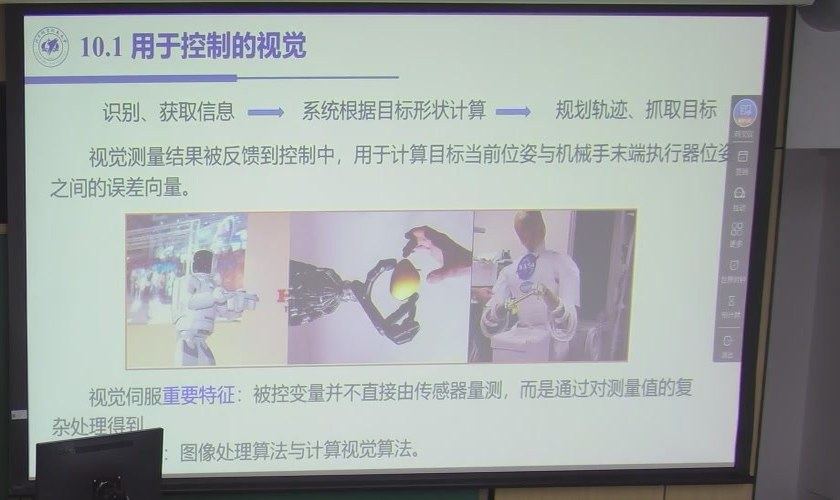
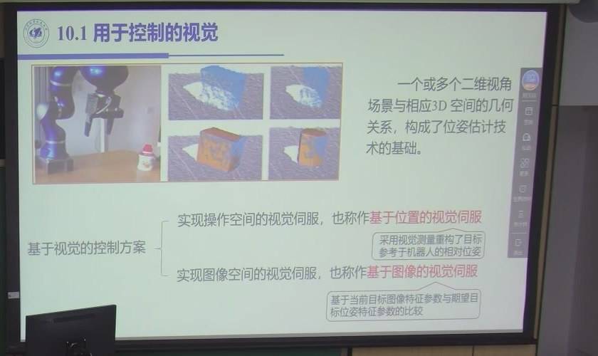

# 9.1 用于控制的视觉

> 录播 00:08–00:15（课件 §10.1、§10.1.1，**全部是课堂内容**）。这一节回答两个问题：视觉伺服与
> 「先看一眼再动」的做法差在哪里；相机装在手上还是装在架子上，为什么会带来不同的困难。

## 9.1.1 先看一眼再动，和边看边动

设想机械手要抓起一个工件。最直接的做法是：拍一张照片，识别出工件相对夹爪的位置和姿态，据此规划一条
到达抓取构型的轨迹，然后交给普通运动控制器执行下去。这个做法在教材里叫 **look-and-move**
（看一眼再动）。它能用，但有两个毛病：

1. 机械手自身的定位误差、标定误差全都直接落在抓取精度上；
2. 夹爪还在去的过程中，工件可能已经被人挪动了——照片是**旧的**，控制器却按旧信息继续执行。

视觉伺服（visual servoing）的做法不同：把视觉测量**接进反馈回路**。相机在运动中持续测量，
控制器每一拍都用「当前看到的」和「应该看到的」之差算出误差，再据此修正。

因此视觉伺服的闭环是：识别并获取信息 → 按目标状态计算 → 规划轨迹、抓取目标，而视觉测量的结果被
反馈到控制中，用来计算目标当前位姿与机械手末端位姿之间的误差向量。

::: note 视觉伺服最容易被忽略的差别
第七章的位置控制里，被控变量是关节角 $q$，传感器直接测它。视觉伺服里，**被控变量并不是传感器
直接测出来的**。相机直接给出的是图像平面上的特征参数（像素坐标、灰度、特征点位置），位姿、位置
误差都是经过图像处理和计算视觉算法**二次加工**才得到的量。

这一点决定了整章的技术路线：要得到一个能用的误差，得先解决三件事——图像怎么变成可用的数值
（§10.2）、这些数值怎么变成位姿（§10.3）、相机的内外参怎么标定（§10.5）。
:::

老师 00:03–00:08 先交代了本章的位置：现在 VLA、视觉动作模型这类方法发展很快，但它们大量地建立
在这些基础之上。若研究方向确实是这一块，这些基础要往深里走；若只是应用层面，知道「图像—位姿—误差」
这条链条上每一步在做什么、代价在哪就够用。老师 00:05 特别点出：图像处理、定位、标定，每一项单独
都是一棵很大的分支，本课只取其中最基础的部分。

## 9.1.2 两类伺服：误差定义在哪里

视觉伺服按**误差定义在哪个空间**分成两类。这是全章最重要的分类，后面每一节都会用到：

| | 位置式视觉伺服 | 图像式视觉伺服 |
|:--|:--|:--|
| 英文 | position-based visual servoing | image-based visual servoing |
| 别称 | 操作空间视觉伺服 | 图像空间视觉伺服 |
| 误差是什么 | 目标相对相机的**位姿误差** | 图像**特征参数**的误差 |
| 要不要算位姿 | 要 | 不要 |
| 理论地位 | 与第七章操作空间控制同构 | 与图像空间的误差直接耦合 |

按老师的说法（00:12–00:13）：位置式把「位置估计量」当作中间量，先算出机械臂与目标之间的位姿误差，
再伺服这个误差；图像式不经过位姿估计这一步，直接把目标在图像中的当前位置和期望位置作比较。

用一个类比可以记住差别（老师 01:51–01:52 用来讲图像式）：倒车入库时通过后视镜看着车位倒，
你关心的是「车现在在画面的哪个位置」，希望车最终停在车位框正中间，但并不关心车离框线还差多少米。
位置式则相当于测出车与框的实际距离再靠这个距离误差修正。

## 9.1.3 相机装在哪：眼在手与眼到手

单相机系统有两种装法：

- **眼到手（eye-to-hand）**：相机固定在某个位置（比如墙上、地面上），看着机器人运动。
- **眼在手（eye-in-hand）**：相机装在机械臂末端，随机械臂一起动。

老师 00:14–00:15 讲了两者的差别：眼到手的视野在任务过程中不变，测量精度原则上恒定，但在装配一类
场景里机械手会挡住工件；眼在手的视野随运动大幅变化，测量精度也随之变化，但当末端靠近目标时精度
反而通常比眼到手更高，而且几乎没有遮挡问题。

::: note 本课的适用范围
本课与教材第 10 章都只讲**单目、眼在手**的方案。老师 00:15 说，眼到手的情形经过适当修改同样可以
用，区别并不大；多相机（立体视觉）本章不讲，教材 §10.4 也是另一条线索。
:::

## 9.1.4 本节要记住的三件事

1. **视觉伺服与 look-and-move 的区别在于反馈**：测量结果回灌到控制器，而不是只用一次。
2. **被控变量是加工出来的**：位姿误差来自图像处理与计算视觉，不是传感器直读量。
3. **两类伺服由误差所在空间划分**：位置式误差在操作空间，图像式误差在图像空间。

检查理解：装一个力传感器就能做力控制吗？装了相机就能做视觉伺服吗？

都不必然。力传感器只提供测量，是否构成力控制取决于控制律闭环的是哪个量——若闭环的是位置误差，它
仍是位置控制，只是反馈里多了力信号。相机同理：拍到图像不构成视觉伺服，必须把视觉测量接到反馈回路
里、以视觉量定义的误差去调节。

