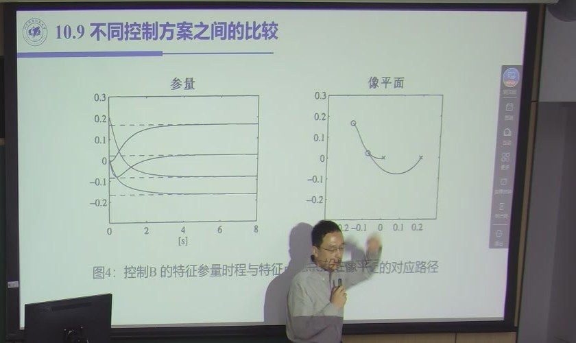
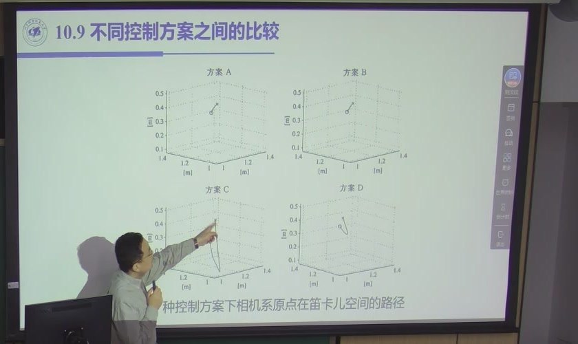

# 9.10 四种方案的仿真比较

> 录播 02:05–02:10（课件 §10.9，**全部是课堂内容**）。前面九节讲的是「每种方法各自成立」。这一节
> 把四种方案放在同一个算例里跑一遍，看它们**分别好在哪儿、分别坏在哪儿**。

## 9.10.1 算例设置

被控对象是教材例 10.3 的 **SCARA 机械手**（转—转—移），相机装在末端，$z_c$ 竖直向下；目标是例 10.1
的**平面正方形板**（边长 $0.1\,\mathrm m$），与像平面平行。SCARA 的操作空间维数 $m=4$，
$x_{c,o}=[o^c_{c,o}\ \alpha]^{\mathrm T}$。

初始与期望位姿（教材 §10.9）：

| | 相机相对机座 $x_c(0)$ | 目标相对相机 $x_{c,o}(0)$ | 期望目标相对相机 $x_{d,o}$ |
|:--|:--|:--|:--|
| 数值 | $[1,\ 1,\ 0.5,\ \pi/4]^{\mathrm T}$ | $[0,\ 0,\ 0.5,\ 0]^{\mathrm T}$ | $[-0.1,\ 0.1,\ 0.6,\ -\pi/3]^{\mathrm T}$ |

图像式用的期望特征向量（取 $P_1,P_2$ 两点）：

$$s_d=\begin{bmatrix}-0.1667&0.1667&-0.0833&0.0223\end{bmatrix}^{\mathrm T}.$$

**控制周期 0.04 s（25 Hz）**。教材说这个值「与模拟相机的最低帧率一致，保证最坏情况下也能用上视觉
测量」。

四个方案与增益：

| 方案 | 内容 | 增益 |
|:--|:--|:--|
| **A** | 位置式，PD + 重力补偿 | $K_P=K_D=\operatorname{diag}\{500,500,10,10\}$ |
| **B** | 位置式，**速度分解** | $K=\operatorname{diag}\{1,1,1,2\}$（位置时间常数 1 s、姿态 0.5 s） |
| **C** | 图像式，PD + 重力补偿 | $K_{P_s}=300I_4$，$K_{D_s}=330I_4$ |
| **D** | 图像式，**速度分解** | $K_s=I_4$ |

两处仿真上的简化（教材原话）：速度分解方案**忽略机械手动力学**，用纯运动学模型；位置式方案用
§9.5 的位姿估计算法（图像雅可比求逆），积分步长 $\Delta t=1\,\mathrm{ms}$、增益 $K_s=160I_4$，
收敛时间约 0.03 s——**小于控制采样周期 0.04 s**，这是位置式能正确工作的前提。图像式方案则用
$\tilde L_s=L_s(s,z_d)$ 近似交互矩阵，即把深度取成期望位姿下的值。

## 9.10.2 位置式：瞬态可以指定，但路径不可预测

教材对 A、B 的评价：

- **方案 A**（PD + 重力补偿）：位置式原则上**可以给操作空间变量指定期望的瞬态行为**。但这只
  「部分成立」——重力补偿 PD 的闭环动力学是**非线性且耦合**的，所以换一个初始位形或换一个期望位形，
  瞬态就会不一样。
- **方案 B**（速度分解）：操作空间变量的时程是**指数型**的，其特点**只取决于矩阵 $K$**。
  这正是速度分解的价值：误差方程 (9.8-7) 是线性的，整定 $K$ 就等于指定瞬态。

**但两者有一个共同的问题**（教材 §10.9）：特征点投影在像平面上的轨迹**事先无法预测**。即使初始
位形和期望位形下特征点都在像平面内，**瞬态过程中它们可能跑出像平面**，于是收敛出问题。

> 这一条把 §9.7.2 的警告落到了具体算例上：位置式的「目标出视野」不是假想风险，是这套仿真里
> 真实存在的失效路径。

**相机原点的轨迹**（教材 Fig. 10.26）：

- **方案 B 得到一条完美的直线**。原因很直接：$K$ 是对角阵且位置部分各分量权重相同，于是
  相机原点沿连接初始位置与期望位置的线段运动（§9.8.3 的结论）。
- **方案 A 近似直线**，但不完全是——因为这种控制不保证各操作空间变量解耦。

## 9.10.3 图像式：特征轨迹可指定，相机轨迹不可预测

教材对 C、D 的评价，是上面那段的**对偶**：

- 图像式原则上**可以给特征参数的时程指定期望的瞬态行为**——这与位置式「给操作空间变量指定瞬态」
  正好对称。
- **方案 C**（PD + 重力补偿）尤其明显：尽管初始与最终位形相同、瞬态时长相近，**操作空间变量的时程
  与 A、B 相差很大**（教材 Fig. 10.22 对 Fig. 10.18、10.20）。
- 后果是：相机路径不可预测，**可能导致违反关节限位，或让机械手撞上障碍物**。

**相机后退（camera retreat）现象**：

| 方案 | 相机轨迹 $z$ 分量的超调 | 含义 |
|:--|:--|:--|
| C | **300%** | 相机大幅后退，退后幅度远大于瞬态结束时的实际接近距离 |
| D | **50%** | 同样有后退，但小得多 |

教材给了一个直观的解释（§10.9 末尾）：设想只要求相机绕光轴 $z_c$ 纯转一个角度，采用方案 D。
视觉伺服要求特征点在像平面上**沿直线**从初始位置走到期望位置，而单纯的相机旋转对应的是**圆弧**。
像平面上走直线的约束，迫使相机原点**先向后退、再向前**，才能最终回到目标位置附近。
教材还指出：**若期望旋转趋近 $\pi$，相机到目标的距离会趋于无穷，系统失稳**。

老师 02:09–02:10 用自己的话总结了这个现象：「因为它没有考虑动力学，反而更复杂一点……相机的坐标系的
原点路径，它是一个严重的非线性」，并指出图像式「不需要目视位置……反而相机坐标系，相机它会动，非预期
的动」。

**C 与 D 的相机原点路径远非线性**，与 B 的完美直线形成鲜明对照。

## 9.10.4 速度分解在图像式里也有效

对比 C 与 D：两者都是图像式、同样以特征参数为目标，唯一区别是 D 用了速度分解。结果是

- D 的 $z$ 分量超调只有 50%，比 C 的 300% 小得多；
- 老师 02:09 说：「D 通过分解、通过速度分解，性能要好一些」。

这与位置式里的对照一致：**速度分解把误差方程变成线性的**（位置式 (9.8-7)、图像式 (9.9-8)），
瞬态由增益矩阵直接决定，与被控对象的动力学耦合脱开。

## 9.10.5 一张表看完四种方案

| | A 位置式 PD | B 位置式速度分解 | C 图像式 PD | D 图像式速度分解 |
|:--|:--|:--|:--|:--|
| 瞬态由什么决定 | 闭环非线性动力学（随初始/期望位形变） | 只由 $K$ 决定 | 只由 $K_{P_s},K_{D_s}$ 决定 | 只由 $K_s$ 决定 |
| 能指定什么 | 操作空间变量（部分成立） | 操作空间变量 | 特征参数 | 特征参数 |
| 相机原点轨迹 | 近似直线 | **完美直线** | 远非线性 | 远非线性 |
| 相机后退 | 无 | 无 | **300%** | **50%** |
| 特征投影轨迹 | 不可预测，可能出视野 | 不可预测，可能出视野 | 按设计走直线 | 按设计走直线 |
| 主要风险 | 目标出视野→失反馈 | 目标出视野→失反馈 | 关节限位、碰撞、后退过大 | 后退（较小） |

**位置式和图像式的取舍，与 §9.7 的分析完全对得上**：

- 位置式：**能规划操作空间的轨迹**（B 甚至是直线），但特征投影不可预测，目标是出视野的风险实在；
- 图像式：**特征轨迹可控**，但相机轨迹不可预测，可能违反关节限位或撞障碍物。

老师 02:05–02:06 交代了比较的用意：「讲了这么多方法，来看看它的功能效果是怎样」；02:10 之后放了
一段双臂视觉对接的演示视频。

## 9.10.6 本节小结

1. 四方案在同一个 SCARA + 平面目标的算例里比较，控制周期 25 Hz。
2. **速度分解让瞬态只由增益决定**：B 的相机原点走完美直线；D 的后退超调从 C 的 300% 降到 50%。
3. **位置式的特征投影轨迹不可预测**，瞬态中可能跑出像平面，丢反馈。
4. **图像式的相机轨迹不可预测**，可能违反关节限位或碰撞；绕光轴大角度旋转时相机后退，
   期望旋转趋近 $\pi$ 时距离发散、系统失稳。
5. 位置式与图像式的取舍，与 §9.7 的定性分析一致。

检查理解：图像式的「特征轨迹可控」听起来是好事，为什么反而更危险？

因为**特征轨迹可控 ≠ 相机轨迹可控**。特征点沿像平面走直线，对应的三维相机运动必须靠**平移**来
补偿旋转带来的弧线，于是相机先退后进。特征看着「顺」，实际末端却可能走到意料之外的地方，
撞上障碍物或顶到关节限位。

位置式恰好相反：操作空间轨迹可规划（B 甚至是直线），但特征点可能在像平面里跑出去——那是**测量
丢失**的风险，不是碰撞风险。两种风险性质不同，不能只比「哪个更好」。

