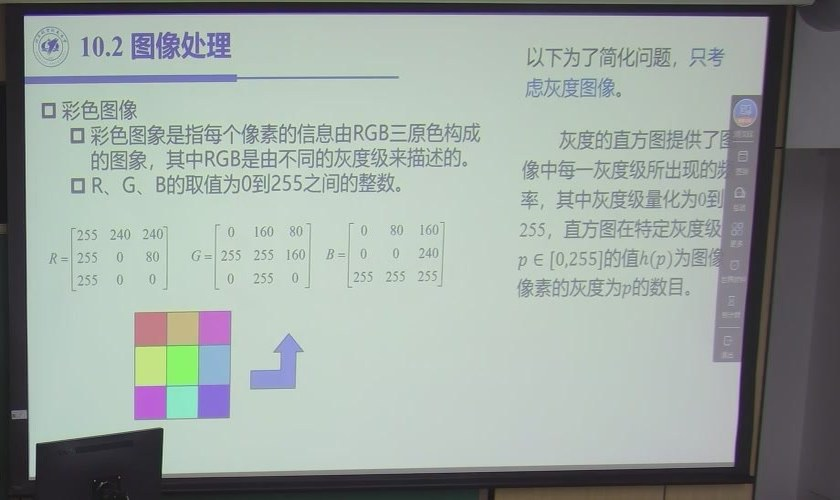
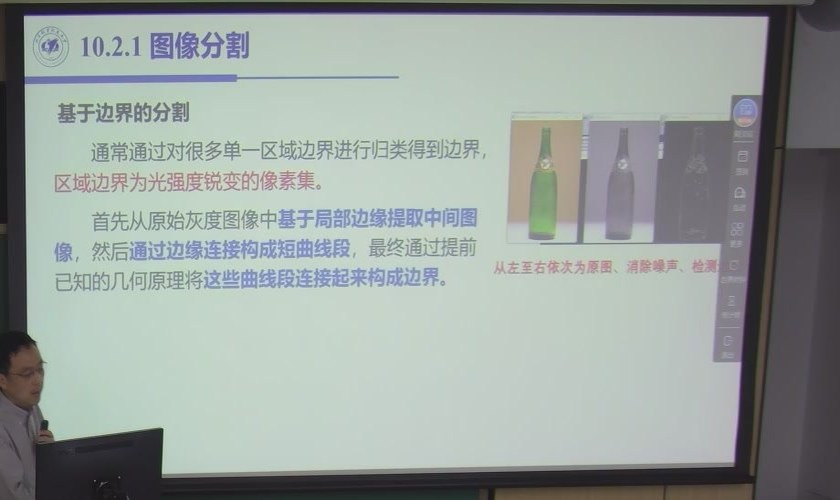
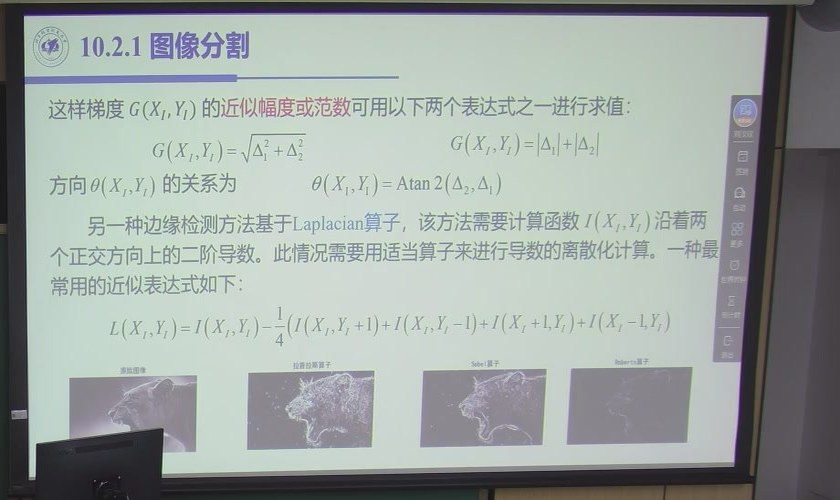
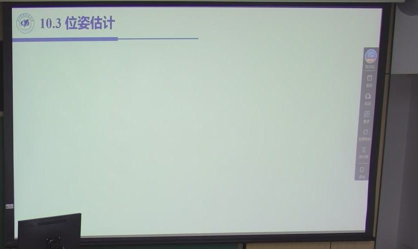

# 9.2 图像处理

> 录播 00:15–00:39（课件 §10.2、§10.2.1、§10.2.2，**全部是课堂内容**）。这一节把「相机拍到的
> 一张图」变成「可以拿去做位姿估计的数值」。分两步：**分割**把画面分成若干块，**解释**从分出来的块里
> 算出可用的特征量。

## 9.2.1 图像在计算机里是什么

一张照片拍下来，在计算机里是一个二维数组，数组的每个元素叫一个**像素**。黑白灰图像里，每个像素存
一个灰度值；现在常用 256 级灰度（一个字节），$0$ 为黑、$255$ 为白。老师 00:16–00:20 用彩色图说明
得更直接：彩色图像的每个像素有 R、G、B 三个分量，各用一个字节，于是整幅图是**三个矩阵叠在一起**；
纯红就是 (255, 0, 0)，纯蓝是 (0, 0, 255)，浅蓝是 (0, 128, 255) 之类。

本节及以后只考虑**灰度图**。老师 00:21 说得很直接：为了简化问题只考虑灰度，彩色相当于三倍，可以
用类似的做法处理。

把整幅图每个灰度值出现的次数统计出来、画成柱状图，就是**灰度直方图** $h(p)$，其中 $p\in[0,255]$
是灰度级，$h(p)$ 是取该灰度的像素个数；除以总像素数得到归一化直方图。老师 00:21–00:22 说，
直方图是分割的输入：看完直方图往往能看出画面里有几个「层」（比如最暗的物体、最亮的物体、背景），
这就是接下来阈值分割的由来。

## 9.2.2 分割（一）：按区域

分割的目标是把图像划分成若干**区域**，使同一区域内的像素在某个或某些特征上相似。不同的区域通常
对应场景中不同的物体或物体的不同部分。

两条互补的路线（老师 00:22–00:23）：

- **区域分割**：把特征相近、彼此连通的像素归到一起；
- **边界分割**：找出物体的轮廓线，再由边界围出区域。

最直观的区域分割是**阈值分割**：取一个阈值 $T$，灰度大于 $T$ 的像素划为白，小于 $T$ 的划为黑。
老师 00:23–00:25 讲了阈值怎么定：先画直方图，找到两个峰之间的**谷值**，取这个谷作为阈值。
他的例子是直方图上最大峰附近取「离最大值最近的这一片的最小值」，算出是 152，于是小于 152 的归黑、
大于 152 的归白。

> 直觉地说：一个物体在直方图上占一个峰，物体和背景之间是谷；把谷切开，两个物体就分开了。
> 老师 00:24 说阈值取多少「一定有对应的方法」，这里给的是直方图谷值法。

阈值分割的适用前提是**前景与背景的灰度分得开**。若直方图没有明显的谷，这一步就不可靠。

## 9.2.3 分割（二）：按边界

边界处的灰度变化剧烈——不管从黑到白还是从白到黑。找出变化大的地方，就得到边缘。

边缘检测算子的任务是**估计灰度的导数**。图像是离散的，导数没有解析表达式，只能用差分近似：

**一阶差分（Roberts 算子）**。用中心差分：

$$\Delta f(i,j)=f(i,j+1)-f(i,j),\qquad
\Delta' f(i,j)=f(i+1,j)-f(i,j).$$

老师 00:28–00:30 指出这个办法的毛病：**对噪声敏感**。Roberts 算子改用对角方向的两个差分
$\Delta_1=f(i,j+1)-f(i+1,j)$、$\Delta_2=f(i,j+1)-f(i+1,j+1)$ 之类，形式上是 2×2 模板，
计算量仍小，但对噪声仍然敏感。

**Sobel 算子**。在 3×3 邻域上加权求和：横向用 $[+1\ 2\ +1]$ 对称加权、纵向用 $[+1\ 0\ -1]^T$
反对称加权，两个方向各得一个差分量 $\Delta_1,\Delta_2$。老师 00:30–00:31 说它「写得很清楚」：
把 3×3 窗口里每个像素按权重加起来就行。

**Laplacian 算子**。用二阶差分，沿两个方向各取二阶导数：

$$L(i,j)=f(i+1,j)+f(i-1,j)+f(i,j+1)+f(i,j-1)-4f(i,j).$$

老师 00:32 说它「沿着两个方向上的二阶导数来算」，对噪声的影响更敏感，但作为二阶导数算子，
它定位边界比一阶差分更准。

**梯度与方向**。算出两个差分分量后，要合成一个标量表示「变化有多大」，再定方向。老师 00:31–00:32：

$$\text{幅值}=\sqrt{\Delta_1^2+\Delta_2^2}
\quad\text{或}\quad
|\Delta_1|+|\Delta_2|,\qquad
\theta=\operatorname{Atan2}(\Delta_2,\Delta_1).$$

用哪个都可以：平方和开方是欧氏长度，两个绝对值相加是曼哈顿长度，幅值尺度不同而已。

## 9.2.4 解释：图像矩

分割出来的是一堆像素。要描述「这个目标长什么样、在哪、朝哪」，教材用**图像矩**，方法和刚体动力学
里的质量矩完全类似（老师 00:34–00:39 反复拿钢琴、惯性张量做类比）。

定义图像矩

$$m_{pq}=\sum_{x=0}^{L_x-1}\sum_{y=0}^{L_y-1}x^p\,y^q\,f(x,y),$$

其中 $f(x,y)$ 是像素 $(x,y)$ 的灰度值。二值图像里 $f$ 取 0 或 1。

| 阶 | 记号 | 含义 |
|:--|:--|:--|
| 零阶 | $m_{00}$ | 像素总数，即目标**面积** |
| 一阶 | $m_{10},m_{01}$ | 灰度加权的位置，给出**质心** |
| 二阶 | $m_{20},m_{11},m_{02}$ | 分布的散布程度，对应**惯性** |

老师 00:35–00:37 一步步讲：二值图里零阶矩就是「把每个像素加起来」得到面积；一阶矩里
$m_{10}=\sum x f(x,y)$、$m_{01}=\sum y f(x,y)$，除以零阶矩就得到质心坐标；若灰度不是二值，
灰度相当于「密度」，求出来的是**灰度重心**而不是几何质心。

更高阶矩给出形状信息。$m_{20},m_{11},m_{02}$ 组合起来可以定义主轴方向和主轴长度；老师 00:37–00:39
说这类似于刚体的**主惯性轴**——刚体上某个轴方向的惯性矩最小，主轴就是使惯性矩取极值的方向。

> **这一小节与后文的关系**：矩给出的是目标的**图像内**特征（面积、质心、方向）。要得到目标相对
> 相机的**位姿**，还差「图像特征 ↔ 三维位姿」这一步，那是 §9.3。位姿估计之所以困难，正因为
> 二维到三维是欠定的（见 §9.4 关于零空间的讨论）。

## 9.2.5 本节小结

1. 灰度图是二维数组；直方图统计各灰度级的像素数，是分割的输入。
2. 分割两条路：**区域法**（阈值分割取直方图谷值）与**边界法**（差分算子找梯度）。
3. 边缘算子从一阶差分（Roberts）到 Sobel、Laplacian，一阶易受噪声影响，二阶定位更准但更敏感。
4. 解释阶段用**图像矩**描述目标：零阶给面积，一阶给质心，二阶给形状与主轴。

检查理解：直方图谷值法取阈值，前提是什么？失败了怎么办？

前提是前景与背景在灰度上分得开，直方图上出现两个可分辨的峰和中间的谷。若目标与背景灰度接近、或
目标内部本身就有多个灰度层，谷值法就失效。这时要么换分割路线（用边界法，靠轮廓而非灰度门限把
目标圈出来），要么用多特征分割而不是单一灰度阈值。

