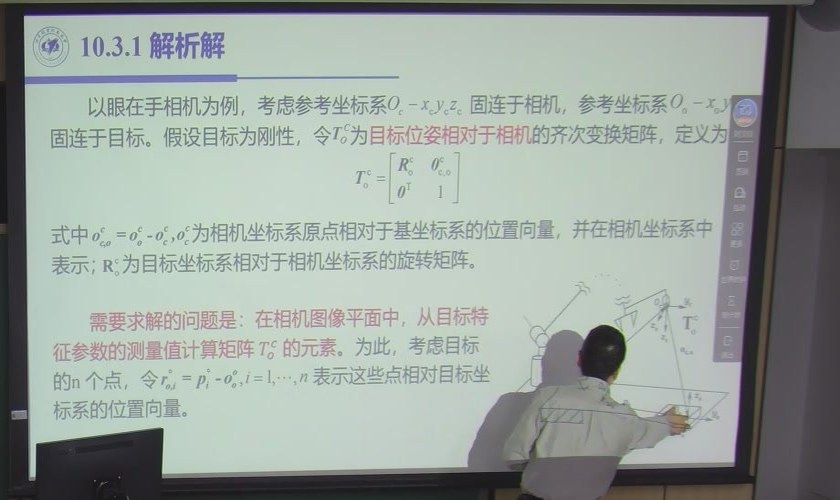
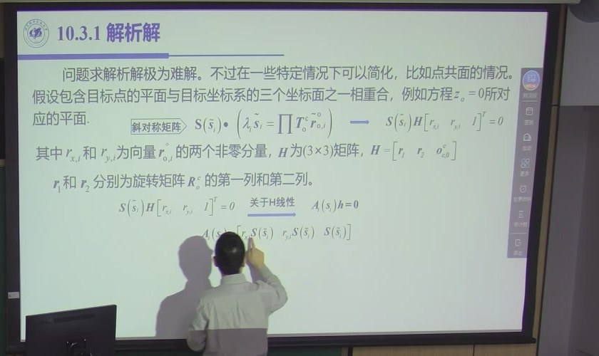
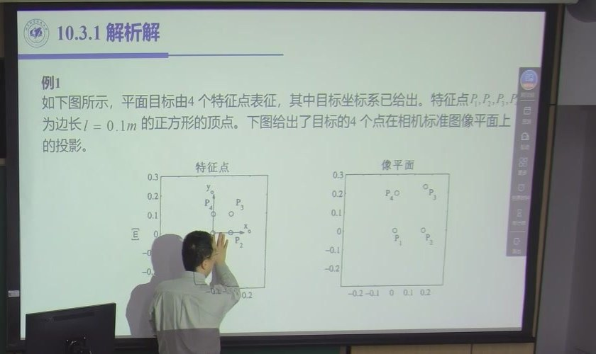

# 9.3 位姿估计（一）：PnP 问题与解析解

> 录播 00:39–01:15（课件 §10.3、§10.3.1，**全部是课堂内容**）。这一节是本章最硬的一段：
> 从图像上看到的几个点，反推出目标相对相机的位姿。老师 00:40–00:42 先把问题定性——这和逆运动学
> 是同一类问题，解析法像逆运动学的解析解，数值法像数值解。

## 9.3.1 问题是什么

约定两个坐标系：

- **相机系** $c$，原点 $O_c$，轴 $x_c,y_c,z_c$，其中 $z_c$ 是光轴；
- **目标系** $o$，原点 $O_o$，固连在目标上（目标本身是刚体）。

要解的是目标相对相机的位姿，记作

$$T^c_o=\begin{bmatrix}R^c_o & o^c_o\\[2pt]0^{\mathrm T} & 1\end{bmatrix},$$

其中 $R^c_o$ 是 $3\times3$ 旋转矩阵（$o$ 系坐标到 $c$ 系坐标），$o^c_o\in\mathbb R^3$ 是目标原点在
相机系下的位置；角标上标表示「表达在哪个系里」，下标表示「相对谁」。

**特征向量**：目标上若干已知点在图像上的投影位置。取归一化图像坐标

$$s_i=\begin{bmatrix}X_i\\Y_i\end{bmatrix},\qquad
X_i=\frac{x_{c,i}}{z_{c,i}},\quad Y_i=\frac{y_{c,i}}{z_{c,i}}，$$

其中 $(x_{c,i},y_{c,i},z_{c,i})$ 是第 $i$ 个点在**相机系**里的坐标。(x,y) 为像素坐标，归一化坐标要靠
相机内参换算（第五章 (5.44)–(5.45)）。

**目标点的已知量**：点在**目标系**里的位置 $r^o_{o,i}$，来自 CAD 模型或已知几何。

投影关系（教材 (10.6)）写成齐次形式

$$\boxed{\ \lambda_i\,\tilde s_i=\Pi\,T^c_o\,\tilde r^o_{o,i}\ },\qquad
\tilde s_i=\begin{bmatrix}X_i\\Y_i\\1\end{bmatrix},\quad
\Pi=\begin{bmatrix}1&0&0&0\\0&1&0&0\\0&0&1&0\end{bmatrix},\quad \lambda_i=z_{c,i}>0.\tag{9.3-1}$$

读法：左边是投影点的齐次坐标乘一个正尺度因子 $\lambda_i$（就是深度），右边是「目标点先变到相机系，
再取前三维」。

> **归一化坐标的好处**（老师 00:43–00:44）：这样写出来的方程里**不含相机内参**。内参只出现在
> 「像素坐标 → 归一化坐标」这一步。所以只要内参已知，后面的位姿估计与相机本身的焦距、主点无关。

**PnP 问题**（Perspective-n-Point）：已知 $n$ 对对应点（目标系坐标 + 图像坐标），求 $T^c_o$。
这个方程组有 12 个未知数（$R$ 的 9 个 + $o$ 的 3 个），但**解不唯一**。教材给出解的个数：

| 点数与配置 | 解的个数 |
|:--|:--|
| 3 点不共线（P3P） | **4** 个 |
| 4 点、5 点不共面 | **至少 2** 个 |
| 4 点共面且无三点共线 | **唯一** |
| $\ge6$ 点不共面 | **唯一** |

老师 00:57–00:59 用一句话概括：「取三个点有四个解；取六个点以上才有一个唯一的解」。多解来自「同一条
投影射线上的深度模糊」——单目相机天然丢了一维深度。

**共面情形**是实际中最常见的：抓取、插入、装配，目标往往是一块平板或一个平面件。教材下面就专门处理
这一情形，解析式也简洁得多。

## 9.3.2 共面情形：把三维问题降成二维

**第一步：目标平面与目标系的一个坐标面重合。** 不失一般性设目标平面就是 $z_o=0$，于是所有目标点的
目标系坐标的第三个分量为零。

把 (9.3-1) 的右边展开。记 $R^c_o$ 的三列为 $r_1,r_2,r_3$，则

$$\Pi T^c_o\tilde r^o_{o,i}
=\begin{bmatrix}
r_{1x}r_{x,i}+r_{2x}r_{y,i}+o_x\\
r_{1y}r_{x,i}+r_{2y}r_{y,i}+o_y\\
r_{3x}r_{x,i}+r_{3y}r_{y,i}+o_z
\end{bmatrix}.$$

**关键一步**：左端是 $\lambda_i\tilde s_i$，第三分量是 $\lambda_i$；右端第三分量不含 $\lambda_i$。
于是可以提出一个**公共的齐次尺度**，把 $\lambda_i$ 吸收进去：

$$\boxed{\ \lambda_i\,\tilde s_i=H\begin{bmatrix}r_{x,i}\\r_{y,i}\\1\end{bmatrix},
\qquad H=\begin{bmatrix}r_1&r_2&o^c_o\end{bmatrix}\ }\tag{9.3-2}$$

这就是**平面单应（planar homography）**：一个 $3\times3$ 矩阵，把目标平面上的点映射到图像平面。
（教材把 $H$ 称作 homography，$r_1,r_2$ 是 $R^c_o$ 的第一、二列。）

老师 01:01:06–01:02:40 把 $H$ 的构成讲了一遍：$R$ 本来是 $3\times3$，三列分别是目标系三个坐标轴
单位向量在相机系上的投影；因为目标点都在 $z_o=0$ 平面上，**第三列用不上**，于是「把它给去掉」，
只剩三列摞成 $3\times3$ 的 $H$，九个未知量。他还补了一个容易被误解的点：$r_3$ 并不是不用求了，
而是「把这两个求出来之后，$r_1$ 叉乘 $r_2$ 就给 $r_3$ 了」——暂时不求而已。

**第二步：用反对称矩阵消掉尺度。** 引入斜对称矩阵

$$S(\tilde v)=\begin{bmatrix}0&-v_3&v_2\\v_3&0&-v_1\\-v_2&v_1&0\end{bmatrix},
\qquad S(\tilde v)\tilde v=0 .$$

对任何向量 $\tilde v$ 都成立。于是把 (9.3-2) 两边左乘 $S(\tilde s_i)$：左端变成
$S(\tilde s_i)\lambda_i\tilde s_i=0$，右端得

$$S(\tilde s_i)\,H\begin{bmatrix}r_{x,i}\\r_{y,i}\\1\end{bmatrix}=0.\tag{9.3-3}$$

老师 01:00 讲这一步时说得很直白：「为什么要乘这个反对称矩阵？它的好处就是把 $\lambda$ 给消了」——
本来每个点带一个未知尺度 $\lambda_i$，一乘就全没了，剩下的方程对 $H$ 是**线性的**。

**第三步：写成矩阵形式。** 把 $H$ 的三列竖着摞成 $9\times1$ 向量 $h$，展开 (9.3-3)：

$$\boxed{\ A_i(s_i)h=0,\qquad
A_i(s_i)=\begin{bmatrix}
r_{x,i}S(\tilde s_i)\ \big|\ r_{y,i}S(\tilde s_i)\ \big|\ S(\tilde s_i)
\end{bmatrix}\ }\tag{9.3-4}$$

（$r_{x,i},r_{y,i}$ 是 $r^o_{o,i}$ 的两个非零分量。）四个点摞起来就是 12 个方程、9 个未知数：

$$A(s)h=0,\qquad A(s)=\begin{bmatrix}A_1(s_1)\\A_2(s_2)\\A_3(s_3)\\A_4(s_4)\end{bmatrix}.\tag{9.3-5}$$

由于 $\operatorname{rank}S(\cdot)\le2$，每点只贡献两条独立方程，四点足够。老师 01:04 说：「12 个方程，
9 个位置量；可以证明矩阵 $A$ 的秩是 8」——所以解空间是一维的，$h$ **只确定到一个尺度因子**。

**第四步：从 $h$ 还原 $H$。** 记 $h_i$ 为 $h$ 的第 $i$ 段（3 维），则存在实数 $\zeta\ne0$ 使

$$r_1=\zeta h_1,\qquad r_2=\zeta h_2,\qquad o^c_o=\zeta h_3 .\tag{9.3-6}$$

$|\zeta|$ 由 $r_1,r_2$ 是单位向量确定：$1=\|\zeta h_1\|=|\zeta|\,\|h_1\|$，故

$$|\zeta|=\frac{1}{\|h_1\|}=\frac{1}{\|h_2\|}.\tag{9.3-7}$$

$\zeta$ 的**符号**由「目标在相机前方」确定：取使 $\lambda_i=z_{c,i}>0$ 的那个符号（老师 01:06 说
「方向可以通过这个来确定它的正负号」）。

$r_3$ 不在 $H$ 里，但由旋转矩阵的正交性直接给出：

$$r_3=r_1\times r_2.\tag{9.3-8}$$

## 9.3.3 噪声下 $Q$ 不一定是旋转矩阵

有测量噪声时，(9.3-5) 求出的 $r_1,r_2$ 带着误差，$Q=[r_1\ r_2\ r_3]$ 未必严格正交、行列式也未必为 1。
教材的处理是：找**离 $Q$ 最近的旋转矩阵**，即在 $R$ 为旋转阵的约束下最小化 Frobenius 范数

$$\|R^c_o-Q\|_F=\sqrt{\operatorname{Tr}\bigl((R^c_o-Q)(R^c_o-Q)\bigr)}.\tag{9.3-9}$$

关键等价关系（教材 Problem 10.3 的提示）：

$$\min_R\|R-Q\|_F^2\ \Longleftrightarrow\ \max_R\operatorname{Tr}(R^{\mathrm T}Q),$$

因为 $\operatorname{Tr}(R^{\mathrm T}R)=3$ 是常数。设 $Q=U\Sigma V^{\mathrm T}$ 为奇异值分解，则解为

$$\boxed{\ R^c_o=U\begin{bmatrix}1&0&0\\0&1&0\\0&0&\sigma\end{bmatrix}V^{\mathrm T},
\qquad \sigma=\det(UV^{\mathrm T})\ }\tag{9.3-10}$$

取 $\sigma=\det(UV^{\mathrm T})$ 保证 $\det R^c_o=1$（老师 01:08 说「这个是用一个 $U$ 分解来解」，
并指出「矩阵分析里的这个可以直接算」）。

## 9.3.4 算一遍：教材例 10.1

目标是边长 $l=0.1\,\mathrm m$ 的正方形，四个特征点在目标系里的坐标

$$r^o_{o,1}=[0\ 0\ 0]^{\mathrm T},\quad
r^o_{o,2}=[0.1\ 0\ 0]^{\mathrm T},\quad
r^o_{o,3}=[0.1\ 0.1\ 0]^{\mathrm T},\quad
r^o_{o,4}=[0\ 0.1\ 0]^{\mathrm T}\ (\mathrm m).$$

给定位姿（教材原页数值）：

$$R^c_o=R_y(\pi/4)=\begin{bmatrix}0.7071&0&0.7071\\0&1&0\\-0.7071&0&0.7071\end{bmatrix},
\qquad o^c_o=\begin{bmatrix}0\\0\\0.5\end{bmatrix}\mathrm m .$$

用 (9.3-1) 正算（老师 01:11–01:12 讲的就是这一步），得四个点的归一化坐标

$$s_1=\begin{bmatrix}0\\0\end{bmatrix},\quad
s_2=\begin{bmatrix}0.1647\\0\end{bmatrix},\quad
s_3=\begin{bmatrix}0.1647\\0.2329\end{bmatrix},\quad
s_4=\begin{bmatrix}0\\0.2\end{bmatrix}.$$

**抽出来看一条**：$P_2$ 在目标系是 $[0.1,0,0]^{\mathrm T}$，变到相机系

$$R^c_o[0.1\ 0\ 0]^{\mathrm T}+o^c_o=[0.07071,\ 0,\ -0.07071]^{\mathrm T}+[0,0,0.5]^{\mathrm T}
=[0.07071,\ 0,\ 0.42929]^{\mathrm T},$$

于是 $X_2=0.07071/0.42929=0.1647$，$Y_2=0$。✓

**反过来解**：把这四个点的坐标（目标系 + 图像系）代入 (9.3-4)–(9.3-5)，用 SVD 求 $A$ 的零空间右奇异向量，
得到（教材原页数值，按列读的 $h$ 摞成的 $3\times3$ 矩阵）

$$h=\begin{bmatrix}
-0.4714&0&0\\
0&-0.6667&0\\
0.4714&0&-0.3333
\end{bmatrix}.$$

由 (9.3-7) 得 $|\zeta|=1/\|h_1\|=1/0.6667=1.5$，符号由「目标在前方」取 $\zeta=-1.5$。代回 (9.3-6)：

$$r_1=\zeta h_1=[0.7071,\ 0,\ -0.7071]^{\mathrm T},\quad
r_2=\zeta h_2=[0,\ 1,\ 0]^{\mathrm T},\quad
o^c_o=\zeta h_3=[0,\ 0,\ 0.5]^{\mathrm T},$$

与给定位姿逐项吻合；$r_3=r_1\times r_2=[0.7071,0,0.7071]^{\mathrm T}$，$Q$ 本身就正交，所以
(9.3-10) 这一步在这里是恒等变换（教材原页也说明「因为图像坐标测量没有噪声，$Q$ 与所求旋转阵
数值上一致，不需要任何近似解」）。

::: note 教材这一处的一处印刷出入
教材把上面那个 $3\times3$ 矩阵标为「$\zeta H$」，但按它自己随后「取 $\zeta=-1.5$ 即得精确解」的
说法，把该矩阵乘以 $-1.5$ 才得到真正的 $H=[r_1\ r_2\ o^c_o]$。也就是说，印刷出的矩阵其实是
**解出的零空间向量** $h$（按列摞成 $3\times3$），而不是 $\zeta H$。按 (9.3-6) 的定义读，
$\zeta h_1,\zeta h_2,\zeta h_3$ 才是 $r_1,r_2,o^c_o$，数值自洽。详见[第九章勘误](errata.md)。
:::

## 9.3.5 非共面情形：直接线性变换

若目标点不共面，(9.3-2) 的降维不成立，但 (9.3-3) 仍然可用——只是不再有「第三个分量为零」可利用。
直接写 (9.3-3) 的一般形式（教材 (10.13)）：

$$S(\tilde s_i)\begin{bmatrix}R^c_o&o^c_o\end{bmatrix}\tilde r^o_{o,i}=0 .\tag{9.3-11}$$

由于 $\operatorname{rank}S\le2$，每个点仍只给两条独立方程。$n$ 个点给 $2n$ 个方程。六个不共面点给
12 个方程、12 个未知数；教材指出此时系数矩阵的**秩是 11**，所以解仍差一个尺度因子（老师 00:58
说「取六个点以上才有一个唯一的解」，但严格说唯一性还要靠 $R$ 的正交约束把尺度定下来）。

有噪声时方程组满秩、只有零解，须改用 $n>6$ 的最小二乘。

## 9.3.6 从相机系换到别的系

$T^c_o$ 只给出目标相对**相机**的位姿。实际任务往往要的是目标相对**机座**或相对**末端**的位姿：

- **眼到手**（相机固定）：$T^b_o=T^b_c\,T^c_o$，其中 $T^b_c$ 是相机外参；
- **眼在手**（相机装在末端）：$T^e_o=T^e_c\,T^c_o$，其中 $T^e_c$ 是相机相对末端的安装位姿。

老师 01:14–01:15 讲的就是这段：「我们很多是相对于机座坐标系的……再乘以对应的坐标变换阵就行了」。

## 9.3.7 本节小结

1. **建模**：$n$ 对对应点给出 (9.3-1)；这是 PnP 问题，多解由单目的深度模糊造成。
2. **共面情形**最常用：$z_o=0$ 时降成平面单应 (9.3-2)。
3. **反对称矩阵 $S$ 消尺度**，把方程变成对 $H$ 的线性方程 (9.3-4)；四点、12 方程、9 未知数、
   秩 8，解到一个尺度 $\zeta$。
4. **旋转阵的正交性定尺度与符号**，$r_3=r_1\times r_2$；噪声下用 SVD 求最近旋转阵 (9.3-10)。
5. **输出换系**：$T^b_o=T^b_cT^c_o$ 或 $T^e_o=T^e_cT^c_o$。

检查理解：为什么反对称矩阵能把未知尺度消掉？

因为对任意向量 $\tilde v$ 都有 $S(\tilde v)\tilde v=0$。左乘 $S(\tilde s_i)$ 之后，左端
$\lambda_i S(\tilde s_i)\tilde s_i$ 自动为零，$\lambda_i$ 这个每点各不相同的未知尺度就此消失，
剩下的是对 $H$ 的线性齐次方程。注意消掉的是**尺度**，不是**信息**：方程变少了，但每点的深度信息
本就在齐次表达里，换成用 $H$ 的尺度来承担。

