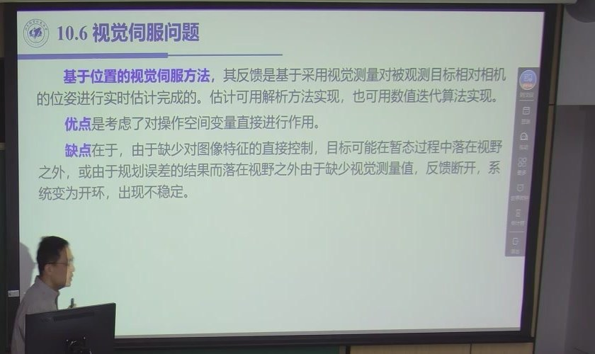

# 9.7 视觉伺服问题：两类方案的取舍

> 录播 01:49–01:56（课件 §10.6，**全部是课堂内容**）。前面六节把「怎么测」讲完了，这一节回到
> 「怎么控」。核心是一个矛盾：**测量在图像空间，任务在操作空间**。

## 9.7.1 任务是什么

视觉伺服的目标（教材 §10.6 开头）：基于实时处理的视觉测量，让末端执行器相对被观察物体到达并保持
一个期望位姿（可以是常数，也可以是时变的）。

矛盾在于：

- 视觉系统直接给出的是**图像平面上的特征参数**；
- 机器人任务定义在**操作空间**——末端相对物体的位姿。

这个矛盾自然分成两条路：**位置式**（在操作空间做伺服）与**图像式**（在图像空间做伺服）。教材也提到
还有把两者特点混合的**复合视觉伺服**（hybrid），本课与教材 §10.10 都不展开。

## 9.7.2 位置式：先估位姿，再伺服

位置式的结构与第七章的操作空间控制几乎一样，唯一的差别是**反馈量的来源**：反馈不是关节位置，
而是**实时估计出来的**物体相对相机的位姿。

位置式可以用解析方法（§9.3），也可以用迭代数值方法（§9.5）。

**优点**（教材 §10.6 第一段）：概念上与操作空间控制同构，因此**可以直接作用于操作空间变量**。
控制参数可以按末端运动变量的时间响应指标来选——稳态和瞬态都可以有明确要求。这对工程很重要：
任务书里写的往往就是「末端在 2 秒内到位、超调小于 5%」这类指标。

**缺点**：因为**没有对图像特征的直接控制**，目标可能在瞬态过程中、或因规划误差而**移出相机视野**。
一旦目标出了视野，视觉测量就没有了，反馈回路**实际变成开环**，系统可能失稳。

> 这一条是位置式最要命的短板，而且它不是「增益调不好」能解决的：目标出视野不是控制品质问题，
> 是**测量缺失**问题。

## 9.7.3 图像式：直接对图像特征伺服

图像式的控制量直接由「期望位姿下的特征参数」与「当前实测的特征参数」之差决定。期望值 $s_d$ 的取得
有两条路：用透视变换算出来，或者**把相机摆到期望位姿直接拍一张**。

**优点**：**不需要实时估计位姿**；而且因为控制直接作用在图像特征上，可以在运动过程中**把目标保持在
视野内**。

**缺点**（教材 §10.6 第二段）：图像特征到操作空间变量的映射是**非线性的**，因此可能出现
**奇异构型**，导致控制量失稳或饱和；而且**末端轨迹事先难以预测**，可能撞上障碍物或违反关节限位。

老师 01:55:42 用开车入库打比方说明这个非线性带来的困难：倒车入库本来就是「要考」的，
**不是一打方向就能到**，而是「要经过长期的训练」；接着 01:56:01 讲具体后果——因为没有考虑
机械手本身的特性，机械手走到某一个位形时**可能引起奇异或者饱和**，也可能**冲出它的运动范围**。

## 9.7.4 标定误差落在哪条路上：这一条最容易被忽略

两类方案对**相机标定误差**的敏感度不同，教材给的理由很值得琢磨。

- **位置式对标定误差更敏感**。因为内参、外参的不确定性会造成**操作空间变量的估计误差**，
  这个误差出现在控制环的**反馈路径**上，而反馈路径的**抗扰能力低**——误差直接改变控制器算出来的
  力矩。
- **图像式的敏感度低**。因为它用的量**本来就定义在图像平面上、用像素单位测量**，期望值也是用相机
  直接测的。标定参数的不确定性落在控制环的**前向路径**上，而前向路径的**抗扰能力高**。

这里的关键是「误差出现在环的哪一侧」。可以这样记：

| | 标定误差落在 | 该路径的特点 |
|:--|:--|:--|
| 位置式 | 反馈路径 | 抗扰能力低 → 敏感 |
| 图像式 | 前向路径 | 抗扰能力高 → 不敏感 |

老师 01:53:32 先给了一句总评：「当然各有优缺点…根据你的实际情况来选」。然后 01:53:45 起把两类
各说了一遍——位置式（01:54:03–01:54:40）「好处是很直观，考虑了对操作空间变量直接进行（作用）」，
「缺点，因为它并没有对图像直接控制…缺少对图像特征的直接控制」，目标会「暂时落到视野外面去」，
「缺少了视觉反馈之后…反馈断了，不稳定了」；图像式（01:55:08–01:55:26）「优点就不需要估计它们
之间的位置、姿态、误差」，「缺点就是一个是图像特征参数与操控空间之间的（映射）…并不是线性」。

## 9.7.5 要不要知道物体的几何

| | 单目相机 | 立体相机 |
|:--|:--|:--|
| 位置式 | **必须**知道物体几何（位姿估计要用） | 可以不知道 |
| 图像式 | 原则上**不需要**知道物体几何 | 不需要 |

位置式要求物体几何，是因为 PnP 要用到特征点在**目标系**里的坐标（§9.3 的 $r^o_{o,i}$）；没有它就没法
做位姿估计。图像式直接用图像里的量，不经过这一步。

老师 01:49:32 在进入伺服控制前先把两条主线的共同骨架说了一遍：「剩下的就是要视觉伺服控制…因为跟
前面的（运动控制）一样，只不过它的**误差方式**不一样，所以没那么难」；01:56:42 才正式进入位置式的
具体实现。两条线的骨架都是「视觉测量 → 实时估计 → 算误差 → 做控制」，只是估计这一步的位置不同。

## 9.7.6 本节小结

1. **矛盾**：测量在图像空间，任务在操作空间；由此分出位置式与图像式。
2. **位置式**：先估位姿再伺服，好处是能直接按操作空间的时间响应指标整定，坏处是目标出视野即
   失反馈、回路变开环。
3. **图像式**：直接对图像特征伺服，好处是不必估位姿且能保证目标在视野内，坏处是映射非线性、
   可能有奇异与饱和，末端轨迹事先不可预测。
4. **标定敏感性**：位置式的标定误差落在反馈路径（抗扰低），图像式落在前向路径（抗扰高）。
5. **物体几何**：位置式单目必须知道，图像式原则上不需要。

检查理解：位置式和图像式，是「位姿估计做得好不好」的区别吗？

不是。两者的区别在于**位姿估计在回路里的位置**。位置式把位姿估计放在反馈通道里，算出的位姿误差
直接进入控制律；图像式则完全不做这一步，误差定义在图像平面上。

因此两者面对同一个标定误差时表现不同：位置式里标定误差污染了反馈量本身，图像式里标定误差只是
影响「图像特征」到「实际位姿」的对应关系，不进入控制律。

