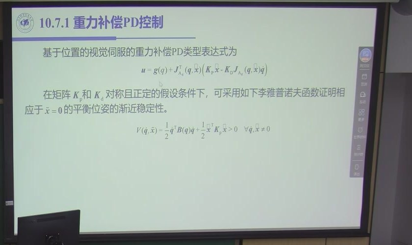
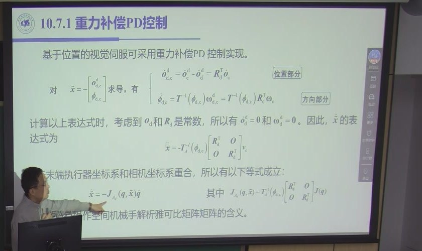
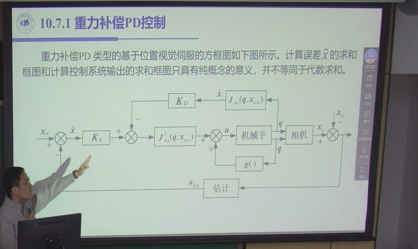

# 9.8 基于位置的视觉伺服

> 录播 01:56–02:03（课件 §10.7、§10.7.1、§10.7.2，**全部是课堂内容**）。这一节把位置式的两
> 种实现走完：**PD + 重力补偿**，以及**速度分解（resolved-velocity）**。两者的差别不只是控制律形式，
> 还差在「视觉测量慢、电机控制快」这个现实约束怎么处理。

## 9.8.1 误差怎么定义

视觉测量实时给出 $T^c_o$，从中取出独立坐标 $x^c_o$。期望位姿用 $T^d_o$ 给出（上标 $d$ 表示期望），
从中取出 $x^d_o$。

注意：**操作空间误差 $x$ 不是 $x^d_o-x^c_o$**。教材 (10.68) 先算出相机当前位姿相对期望位姿的变换

$$T^d_c=T^d_o\,(T^c_o)^{-1}=\begin{bmatrix}R^d_c&o^d_c\\0^{\mathrm T}&1\end{bmatrix},$$

再从 $R^d_c$ 中取出欧拉角 $\varphi^d_c$，定义

$$\boxed{\ x=\begin{bmatrix}o^d_c\\\varphi^d_c\end{bmatrix}\ }\tag{9.8-1}$$

（教材 (10.69)）。这个向量**不依赖物体的位姿**，只表示相机当前位姿与期望位姿之间的差。

控制目标是让 $x\to0$。

::: note 一个可行性前提
期望的相机位姿（相对机座）$T^d=T^c(T^d_c)^{-1}$ 必须落在机械手的**灵巧工作空间**内，否则目标不可达
（教材 (10.70)）。物体固定在机座系时 $T^d$ 是常数。
:::

## 9.8.2 PD + 重力补偿

**第一步：写出误差的导数。** 对 (9.8-1) 的位置部分求导（教材 (10.71)）：

$$\dot o^d_c=R_d^{\mathrm T}\dot o_c,$$

对姿态部分，因 $\varphi^d_c$ 由 $R^d_c$ 的欧拉角取出，

$$\dot\varphi^d_c=T_A^{-1}(\varphi^d_c)\,\omega^d_d
=T_A^{-1}(\varphi^d_c)\,R_d^{\mathrm T}\omega_c .$$

两式合起来（教材 (10.71)）：

$$\boxed{\ \dot x=-T_A^{-1}(\varphi^d_c)\begin{bmatrix}R_d^{\mathrm T}&0\\0&R_d^{\mathrm T}\end{bmatrix}v_c\ }\tag{9.8-2}$$

其中 $v_c$ 是相机的速度（平移 + 角速度）。

**第二步：接到机械手上。** 眼在手时末端系与相机系重合，故 $v_c=J(q)\dot q$。代入得

$$\dot x=-J_{A_d}(q,x)\,\dot q,
\qquad
\boxed{\ J_{A_d}(q,x)=T_A^{-1}(\varphi^d_c)\begin{bmatrix}R_d^{\mathrm T}&0\\0&R_d^{\mathrm T}\end{bmatrix}J(q)\ }\tag{9.8-3}$$

$J_{A_d}$ 就是机械臂在操作空间的**分析雅可比**（教材 (10.73)）。

**第三步：设计控制律。** 教材 (10.74)：

$$\boxed{\ u=\boldsymbol g(q)+J_{A_d}^{\mathrm T}(q,x)\bigl(K_P\,x-K_D\,J_{A_d}(q,x)\dot q\bigr)\ }\tag{9.8-4}$$

与第七章 (8.110) 的操作空间重力补偿 PD **结构完全相同**，只有两点不同：

1. 误差换成了 $x$（相机相对期望位姿的偏差），不是 $x_d-x$；
2. 雅可比换成了 $J_{A_d}$，其中含 $T_A^{-1}$ 与 $R_d^{\mathrm T}$——它们把**角速度**与**欧拉角导数**
   的差别、以及**期望系**与**当前系**的差别都算了进去。

**第四步：稳定性。** 取李雅普诺夫函数

$$V(\dot q,x)=\frac12\dot q^{\mathrm T}B(q)\dot q+\frac12 x^{\mathrm T}K_P x>0 ,$$

在 $K_P,K_D$ 对称正定、模型光滑、力矩不限幅等常设下，利用第六章的 $\dot B-2C$ 反对称性可以证得
$\dot V\le0$，进而用拉萨尔原理得平衡点的渐近稳定。**具体推导步骤与第七章 7.3.3 相同**——
这里不重复展开，只需把 $x$ 换回去逐项对照。

教材还有一处实用提示：控制律 (9.8-4) 需要 $x^c_o$ 的估计以及 $q,\dot q$ 的测量；其中的**微分项也
可以直接取 $-K_D\dot q$**，即不必算 $J_{A_d}\dot q$。

## 9.8.3 速度分解控制：对付「视觉慢、电机快」

**问题**（老师 02:00–02:01 讲得很清楚）：视觉测量的频率**低于或等于相机帧率**，CCD 相机尤其明显，
比机械臂运动控制的典型频率**至少低一个数量级**。如果直接按 (9.8-4) 做数字实现，为保持闭环稳定，
控制增益必须取得**比运动控制小得多**，结果是收敛速度和抗扰能力都很差。

**办法**：假设机械手本身带一个**高增益的**关节空间（或操作空间）运动控制器，把它当成理想的定位
装置。于是

$$q(t)\approx q_r(t),\tag{9.8-5}$$

$q_r(t)$ 是我们给出的关节参考。于是视觉伺服不必直接输出力矩，只要**算出 $q_r(t)$** 使操作空间误差
按 (9.8-3) 收敛即可。取

$$\boxed{\ \dot q_r=J_{A_d}^{-1}(q_r,x)\,K\,x\ }\tag{9.8-6}$$

代入 (9.8-3)（用 $q(t)\approx q_r(t)$），得到线性方程

$$\boxed{\ \dot x+K\,x=0\ }\tag{9.8-7}$$

$K$ 正定时，$x$ 指数收敛，收敛速度由 $K$ 的特征值决定。这叫**操作空间的速度分解控制**（resolved-velocity
control）：由操作空间误差算出关节参考速度，再积分出 $q_r(t)$。

**轨迹形状**（教材 §10.7.2 末尾）：若 $K$ 取对角阵且位置部分各分量增益相同，则相机原点走的是连接初始
位置与期望位置的**直线段**。姿态轨迹则取决于欧拉角的具体选法。

::: note 为什么「事先知道相机轨迹」在这里特别重要
位置式本来就可能因目标出视野而丢失反馈。若控制律能保证相机的运动轨迹是一条可预测的直线，就可以
**事先判断**目标会不会出视野，必要时改成先退后进的路径。教材明确点了这一条。
:::

## 9.8.4 内外环分离：老师补充的工程说法

老师 02:00–02:02 用了一个更贴近工程的口径来讲上面这套做法。视觉测量是秒级的，运动控制是
50 Hz 甚至上百赫兹。如果内外环用同一个频率，就等于把快速的部分也拖慢了。

解决办法是把回路**拆开**：

1. **外环（视觉）**：由图像生成期望的关节角 $q_r$（或期望关节速度）；
2. **内环（运动控制）**：高带宽地跟踪 $q_r$，这一部分的参数**完全不变**，还是原来那套运动控制器。

老师 02:02 说这跟无人机控制、自动驾驶里的级联结构是同一回事：位置环生成期望速度，速度环生成期望
姿态，姿态环生成期望角速度，角速度再转成电机量；**每一环的快慢不一样，内环至少要比外环快 5 倍
以上**，整个系统才能定得住。

老师 02:02 还点了一句：「只不过视觉更难，他就在最外层生成一个 $q_r$，然后再跟踪 $q_r$」。
换句话说，**视觉伺服只是把级联结构的最外环换成了视觉**，里面的运动控制部分一点没改。

## 9.8.5 本节小结

1. 误差 $x$ 由 $T^d_c=T^d_o(T^c_o)^{-1}$ 定义，**不是**两个位姿向量之差。
2. PD + 重力补偿 (9.8-4) 与第七章操作空间控制同构，换的是误差与雅可比；稳定性证明步骤相同。
3. **速度分解控制**把「视觉慢」与「电机快」解耦：外环由视觉算 $q_r$，内环原样不动；
   误差方程变成线性的 (9.8-7)，指数收敛。
4. 误差落在**反馈路径**，因此对标定误差敏感（§9.7.4）。
5. 工程口径：**级联内外环**，内环至少比外环快 5 倍。

检查理解：速度分解控制解决了什么，没解决什么？

**解决**了增益被迫调小的问题。视觉帧率低，若把视觉直接闭环到力矩，稳定所允许的增益就受视觉更新
周期限制，性能差。速度分解把快的那部分交给原有运动控制器（当作理想定位器），视觉环只负责给
参考，于是 (9.8-7) 的收敛速度只由 $K$ 决定，不再被视觉帧率绑住。

**没解决**目标出视野的问题——误差仍在反馈路径上，视野一丢照样断反馈。这是位置式的固有问题，
教材在 §10.6 就已指出。

