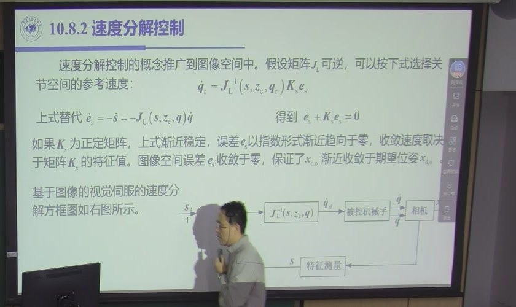

# 9.9 基于图像的视觉伺服

> 录播 02:03–02:05（课件 §10.8、§10.8.1、§10.8.2，**全部是课堂内容**）。位置式要先算位姿；
> 图像式跳过这一步，误差直接定义在图像平面。控制律的结构与 §9.8 **完全平行**，只是把 $x$ 换成
> $e_s$、把 $J_{A_d}$ 换成 $J_L$。

## 9.9.1 任务直接定义在图像空间

图像式的任务不再用期望位姿表达，而是直接规定特征向量的期望值：

$$\boxed{\ e_s=s_d-s\ }\tag{9.9-1}$$

其中 $s_d$ 是期望特征向量。它有两种取法（教材 §10.8）：

- 用透视变换从期望位姿**算**出来；
- 把相机**摆到期望位姿直接拍**一张。

后一种更可靠，因为它避开了模型误差。老师 01:50 说「期望值和测量值就是图像的坐标」。

**特征怎么选**：可以取目标上 $n$ 个点的坐标（$s\in\mathbb R^{2n}$），$n\ge4$ 且无三点共线（共面情形）
或 $n\ge6$（非共面情形）；若操作空间维数 $m<6$（如 SCARA 的 $m=4$），点数可以减少。

::: note 一个重要区别
位置式需要**物体几何**（特征点在目标系里的坐标）才能估位姿；图像式不需要，因为误差里根本没有位姿。
这正是 §9.7.5 那张表的来源。
:::

## 9.9.2 PD + 重力补偿

**第一步：写李雅普诺夫函数。** 与第七章的套路一样，取

$$V(\dot q,e_s)=\frac12\dot q^{\mathrm T}B(q)\dot q+\frac12 e_s^{\mathrm T}K_{P_s}e_s>0 ,\tag{9.9-2}$$

其中 $K_{P_s}$ 是 $k\times k$ 对称正定阵（$k$ 是特征参数的个数）。

**第二步：求误差导数。** 目标固定在机座系时 $s_d$ 是常数，故 $\dot e_s=-\dot s$。由 (9.4-1) 与
(9.4-3)，把 $\dot s$ 用**相机速度**展开并把相机系与末端系重合代进去，得（教材 (10.82)、(10.83)）

$$\dot e_s=-J_L(s,z_c,q)\,\dot q,
\qquad
\boxed{\ J_L(s,z_c,q)=L_s(s,z_c)\begin{bmatrix}R_c^{\mathrm T}&0\\0&R_c^{\mathrm T}\end{bmatrix}J(q)\ }\tag{9.9-3}$$

$J_L$ 就是**图像雅可比**（在 §9.4 里记作 $J_s$，教材在图像式这一节称它 $J_L$）。

**第三步：求 $\dot V$ 并设计控制律。** 用第六章的动力学方程与 $\dot B-2C$ 反对称性，得（教材 (10.81)）

$$\dot V=-\dot q^{\mathrm T}F\dot q+\dot q^{\mathrm T}\bigl(u-\boldsymbol g(q)\bigr)+\dot e_s^{\mathrm T}K_{P_s}e_s .$$

取控制律（教材 (10.84)）

$$\boxed{\ u=\boldsymbol g(q)+J_L^{\mathrm T}(s,z_c,q)\bigl(K_{P_s}e_s-K_{D_s}J_L(s,z_c,q)\dot q\bigr)\ }\tag{9.9-4}$$

（$K_{D_s}$ 对称正定），代入后各项整理得（教材 (10.85)）

$$\dot V=-\dot q^{\mathrm T}F\dot q-\dot q^{\mathrm T}J_L^{\mathrm T}K_{D_s}J_L\dot q\le0 .\tag{9.9-5}$$

**第四步：平衡点。** $\dot V=0$ 要求 $\dot q=0$；再要求一直保持在该集合内，代回闭环方程得

$$J_L^{\mathrm T}K_{P_s}e_s=0.\tag{9.9-6}$$

由 (9.9-3) 与雅可比的性质，若**交互矩阵与几何雅可比都满秩**，则 $e_s=0$——这正是要的结果。

::: note 这套推导有一个隐藏的额外要求
控制律 (9.9-4) 不只需要实测的 $s$，还需要 $z_c$（各特征点的深度）。而「精确的 $z_c$」恰恰是
单目视觉拿不到的东西。教材坦白说：有些场合 $z_c$ 可以近似已知（例如相机相对目标的运动在某个平面内），
否则就用估计值（初值或期望位姿下的值）——但那等于用了一个**估计的**交互矩阵 $\tilde L_s$，
此时稳定性证明会复杂得多。

老师 02:04 提到这一节时说「这里面就有交互矩阵阵、还有雅可比矩阵带进去……这些具体就不看了，并不难」，
意思是在第七章的重力补偿 PD 已经很熟的情况下，这套推导是照搬。
:::

## 9.9.3 速度分解控制

同样因为「视觉慢、电机快」，图像式也用内外环分离（教材 (10.87)）：

$$\boxed{\ \dot q_r=J_L^{-1}(s,z_c,q_r)\,K_s\,e_s\ }\tag{9.9-7}$$

代入 (9.9-3) 得

$$\boxed{\ \dot e_s+K_s e_s=0\ }\tag{9.9-8}$$

$K_s$ 正定时误差指数收敛，收敛速度由 $K_s$ 的特征值决定。$e_s\to0$ 即特征参数达到期望值，
也就保证了相对位姿达到期望。

**分两步算更好**（教材 (10.89)、(10.90)）：

$$v_c^{\,r}=L_s^{-1}(s,z_c)\,K_s e_s,\qquad
\dot q_r=J^{-1}(q)\begin{bmatrix}R_c&0\\0&R_c\end{bmatrix}v_c^{\,r}.$$

这样把**交互矩阵的奇异**与**机械臂运动学的奇异**分开处理：远离运动学奇异时，$L_s$ 的奇异可以用
「取更多特征（$k>m$）＋最小二乘」来对付。

**用伪逆时结论同样要降级**（教材 (10.91)）：

$$v_c^{\,r}=(L_s^{\mathrm T}L_s)^{-1}L_s^{\mathrm T}K_s e_s,$$

此时取 $V(e_s)=\frac12e_s^{\mathrm T}K_se_s$，沿 (9.9-3) 求导得

$$\dot V=-e_s^{\mathrm T}K_sL_s(L_s^{\mathrm T}L_s)^{-1}L_s^{\mathrm T}K_se_s,$$

同样只是**半负定**（$L_s^{\mathrm T}$ 的零空间非空），所以系统**稳定但非渐近稳定**，可能出现
$e_s\ne0$ 而 $K_se_s\in N(L_s^{\mathrm T})$ 的「卡住」情形。

## 9.9.4 特征轨迹与相机轨迹

教材 §10.8.2 末尾对比了两种轨迹：若 $K_s$ 取对角阵且各元素相同，则**特征点在像平面上走直线段**；
但由于图像特征到操作空间的映射是非线性的，**相应的相机运动事先难以预测**。

这正是 §9.7.3 说的图像式的缺点：图像平面上看着「规规矩矩走直线」，实际的三维运动却可能绕远、
可能撞障碍物、可能顶到关节限位。老师 02:04–02:05 提到这一点时说「这些具体就不看了」。

## 9.9.5 本节小结

1. 图像式**不做位姿估计**，误差直接是图像特征误差 $e_s=s_d-s$；不需要物体几何。
2. PD + 重力补偿 (9.9-4) 与位置式平行，把 $x\to e_s$、$J_{A_d}\to J_L$ 即可；稳定条件是交互矩阵与
   几何雅可比都满秩。
3. 速度分解 (9.9-7) 给出线性的误差方程 (9.9-8)；用伪逆时降级为「稳定但非渐近稳定」。
4. 隐含要求 $z_c$；用估计值会让稳定性论证复杂化。
5. 特征轨迹可以是直线，但**相机轨迹不可预测**。

检查理解：图像式不需要物体几何，那么它凭什么知道「到位了」？

它不需要知道物体在哪儿，只需要**图像看起来对**。$e_s\to0$ 表示当前图像与期望图像一致，这本身就是
任务规定的判据。

代价是判据的物理含义变了：特征一致不等于位姿一致（单目多解，见 §9.3）。另外，若目标在视野里
「看着对」但其实是另一个物体或另一个姿态，图像式无从分辨——它没有用几何信息去分辨。

